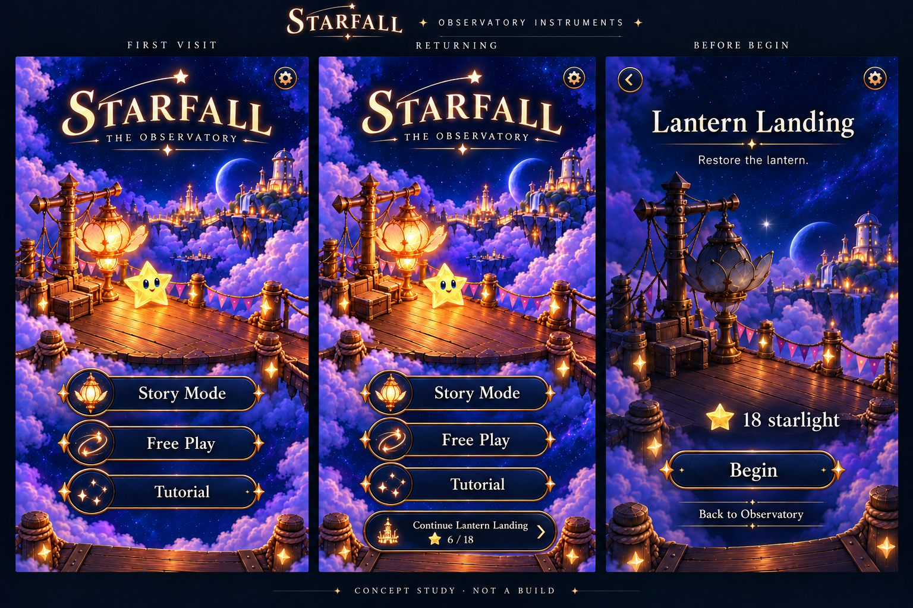
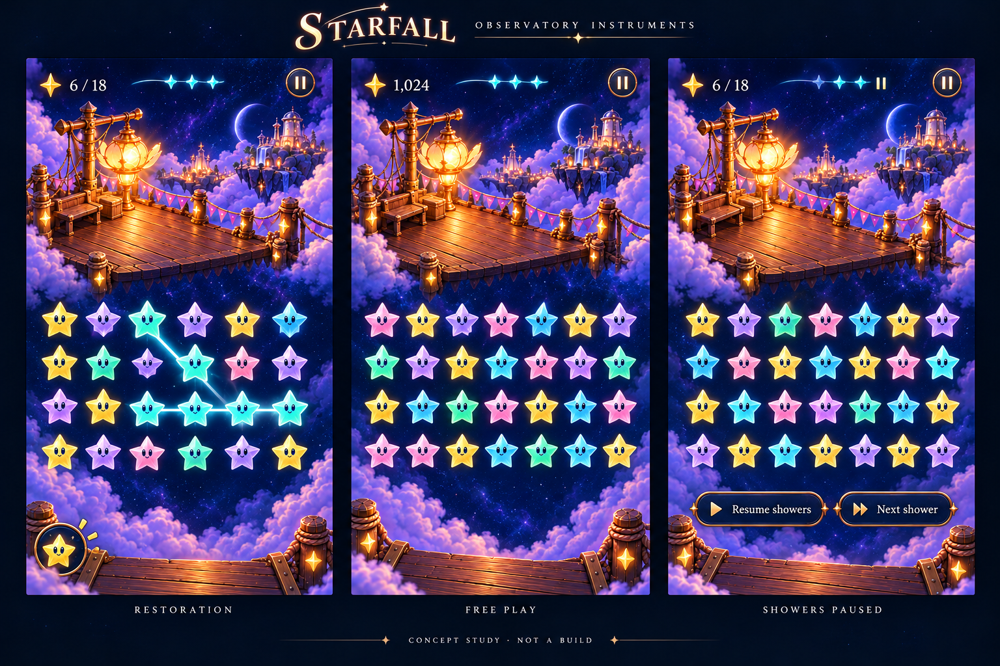
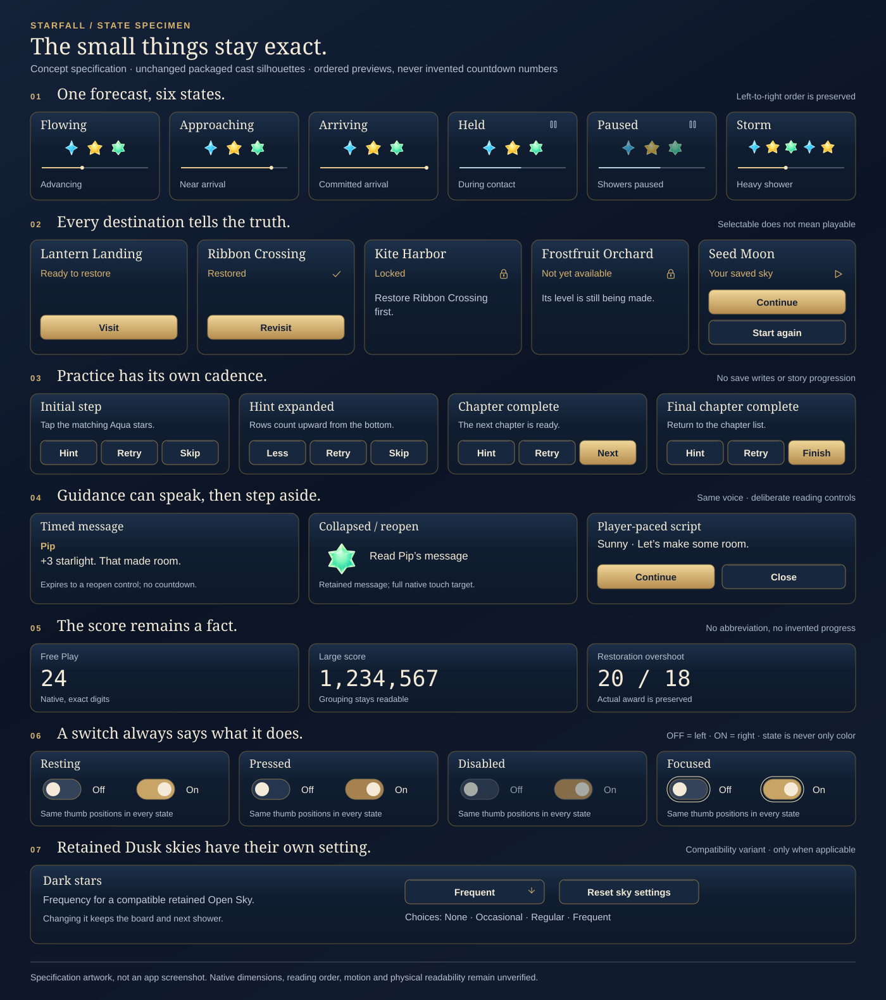

# Observatory Instruments — proposed UI atlas

**Status:** Proposed mocks for review · **Source:** `cfd6ab7` · **Date:** October 19, 2026

The pitch: Starfall's world fills the screen; its interface is a small family of crafted observatory instruments. Midnight enamel gives text a quiet surface, fine brass marks useful edges, and pearl lettering carries choices. Home welcomes the player into the world. Gameplay gives that space back to the stars.

This package expands the accepted art direction into nine painted boards, an exact vector state specimen and twenty original SVG glyphs. It maps all fifteen audited player-facing surface families. Individual mock screens are representative; the linked inventory covers additional states without claiming every combination has been painted or implemented.

**Next decision:** Review the screen composition, material weight and shared states in this atlas. Then build a small native specimen at actual phone size before migrating screens, following the [system plan](../../GAME_UI_SYSTEM.md). No app code or assets have been replaced.

## Browse the proposal

[Open the full-resolution atlas](index.html). Select a screen family, expand the screen map, or enlarge an individual phone screen. The inventory below each board identifies mapped states separately from illustrated views.

*Proposed concept art. Home retains Story Mode, Free Play and Tutorial, with a contextual return to the single retained round. Entry previews the chosen sky before Begin commits it.*

*Proposed concept art. Score, forecast and pause use the top safe edge. Manual shower controls use the bottom edge. Board geometry, camera clearance and star arrangements are illustrative.*

## Screen and component coverage

| Board | Illustrated views | Additional states mapped in the viewer |
| --- | --- | --- |
| [Arrival](arrival.png) | Fresh home, returning home, Lantern Landing entry | Active/finished retained sky, explicit Begin/Back, pre-play settings, other restoration identities |
| [Story](story.png) | World map, Places list, restored result | Destination detail; ready, selected, active, restored, locked and unavailable places; recovery notice; five restoration identities and their artwork stages |
| [Play](play.png) | Restoration trace, free play, showers paused | Exact/large scores, fixed 18-light objective, shower lifecycle, trace/movement feedback, star forms, awards and historical Dusk compatibility |
| [Pause & settings](settings.png) | Game menu, preferences, Sky settings | Resume, contextual actions, Sound/Haptics/Calm effects, Help/Done, pace selection, default/reset state, legacy-only dark-star frequency |
| [Learn](learn.png) | Chapter index, practice, How to Play | All 21 chapter identities; initial, in-progress, incorrect and complete practice; Hint/Less, Retry, Skip/Next, Finish/Exit; contextual help |
| [Outcomes & recovery](outcomes.png) | Full-sky result, launch/preparation studies, save alerts | Restored result, score overshoot, delayed Preparing with Home escape, saved-sky-unavailable and save-failed recovery |
| [Controls](controls.png) | Action, utility, toggle, choice and panel material studies | Idle, pressed, disabled and focus; selected choices; touch bounds, long labels and reusable surface roles |
| [Type & feedback](type.png) | Display/functional/crystal hierarchy, cast, dialogue and awards | Glow-off, native fallback, brief/reopened/scripted messages, six award forms, Relay and tracing |
| [Adaptive](adaptive.png) | Large text, opaque/contrast treatment, tablet and assistive actions | Compact/landscape layouts, reduced motion/transparency, exact-number preservation, VoiceOver focus and board actions |
| [Exact states](state-specimen.svg) | Forecast lifecycle, destination states, tutorial footers, dialogue states, number widths, toggle matrix and historical Dusk context | Precise state semantics accompanying the painted material studies |
| [SVG glyphs](glyphs.svg) | Twenty original glyphs at enlarged and nominal scale | Modes, navigation, preferences, play actions and state marks |

The fifteen surface families are Launch, Home, World Map/Places, Destination Detail, Entry, Gameplay, Game Menu, Pre-play Settings, Sky Settings, How to Play, Tutorial Index, Practice, Restored Result, Full-sky Result and Exceptional Overlays. Debug studios and the historical puzzle are developer tooling, outside the player-facing redesign.

*Authored vector state study. Samples are independent states, not one simultaneous save/progression snapshot. Existing Spark, Sunny and Pip body artwork is embedded unchanged.*

## Shared design decisions

- Home and story carry the richest material. During play, small instruments sit at the viewport's safe edges; the board keeps the center.
- Actions share geometry, light direction and state response. A compact visible glyph keeps a full touch target. Dedicated SVG masters replace unrelated utility symbols.
- Typography has three jobs: pearl display lettering for major choices, crisp functional text for reading and exact numbers, and existing Crystal Comet artwork for celebrations. Luminous text needs a font/material specimen; it does not automatically need another multiview sprite alphabet.
- Settings use one family of readable controls. Modal menu suspension remains distinct from manually paused showers, where the board is still playable.
- Large text, opaque surfaces and quiet motion simplify decoration while preserving meaning. These are review variants, not authorization to add redundant preference keys.

## Concept limits and production boundary

The PNGs are generated art studies, not screenshots, production skins or installable fonts. They establish composition and material direction. The vector state sheet and source audit govern control semantics where a painted specimen is approximate—for example, the generated toggle row is not an exact on/off state matrix. Some result studies omit the Home action visually; the inventory retains it. The chapter image shows an excerpt, not all 21 rows at once.

Existing world paintings, cast, wordmark and Crystal Comet remain production owners. Painted reinterpretations in these mocks do not replace them. Calm celebration uses a settled crystal presentation where supported; accessibility/unsupported-content fallback uses native text. Do not infer that every quiet variant requires a different font. Launch remains static with no artificial delay; after Begin, Preparing reflects a committed round waiting for scene readiness, with Back to Observatory available. Save alerts retain native alert semantics.

No pixel count, contrast ratio, touch target, camera fit, motion timing, accessibility behavior or performance claim is established by these stills. Native text/material comparisons, all device layouts, actual VoiceOver and physical play remain future acceptance under the [system plan](../../GAME_UI_SYSTEM.md#delivery-sequence-and-acceptance).

## Provenance and review checks

[PROMPTS.json](PROMPTS.json) retains the full generation briefs, corrective prompts, source paths and SHA-256 for all nine final PNGs. Built-in ImageGen used the [accepted concept](../observatory-game-ui-concept-2026-10-19.png), existing Lantern Landing/world art and the existing Crystal Comet specimen as references. Retained PNG copies are unchanged from their final generated source. The inline conversation viewer uses smaller presentation copies; this folder keeps the original resolution.

The SVG glyph family and state specimen were authored for this proposal. They are editable design masters, not runtime assets; no external icon package or runtime parser was added. The HTML is a local review viewer. It uses the sibling image files and makes no service requests.

The source inventory was checked against app routing, HUD, tutorial, preferences, dialogue and save recovery owners at `cfd6ab7`. Documentation and concept files are the only dirty inputs; no build-affecting paths changed. Browser inspection verified all eleven board images load, screen enlargement, tab selection and inventory navigation. Repository hygiene, whitespace, local links, image hashes, SVG references and viewer script syntax are checked for this batch. Native builds, interaction tests, motion, actual VoiceOver and device installation were not run because the app is unchanged.
