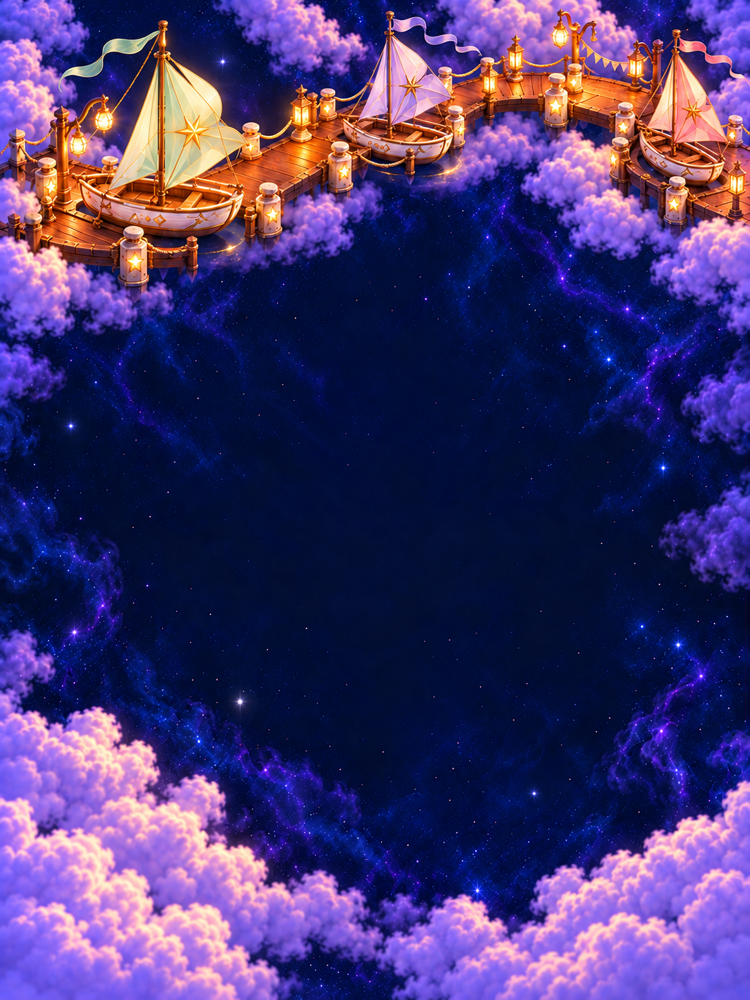

# Kite Harbor

**Status:** Implemented and development-verified; merge/canonical delivery pending · **Updated:** October 19, 2026

Kite Harbor restores the wind to a small fleet of paper-kite boats. The [production plan](PRODUCTION_PLAN.md) defines the third directly selectable challenge: seed 42, the same fixed opening and 18-light rules as First Light and Ribbon Crossing, with no campaign or unlocks. Open sky remains the default.

The in-game finish lights the lead mast star and shows the boats buoyant above their berths through the existing light transfer and whole-image crossfade. World travel, passengers and Murk's reaction belong to future user-generated clips/cutscenes; none are implemented. Playable stars and the normal result ceremony keep their existing roles.

## Start here

Read the [observable acceptance](PRODUCTION_PLAN.md), the [atlas entry](../WORLD_ATLAS.md#03--kite-harbor--a-departure-made-possible) and the [five authored beats](../world-01/world-data.js). The [composition reviewer](board.html) compares three viewport families, five restoration states and the actual Crystal Glow body assets with a fixed sample. This is a static review tool, not a playable round or native evidence.

**Approved generated concept — not runtime evidence.** Map inspected October 19, 2026; [original package](../world-01/README.md). Its sail silhouettes, ceramic fittings and docks guide the new paintings; tiny map figures are not runtime travelers.

| Phone completion | iPad portrait completion | iPad landscape completion |
| --- | --- | --- |
|  |  |  |

**Generated production artwork, inspected October 19 — not native screenshots.** The completed paintings show a fleet ready for departure, with no travelers. Wider views reveal connected quays, lighter hull trim and pale sail variations. They do not establish native HUD clearance, normal-motion behavior or input acceptance.

## Review and ownership

The reviewer uses the existing [offline cast renderer](../environments/concept-cast.js) and packaged star bodies. Choose Phone, iPad portrait or iPad landscape; use the score slider or five milestone buttons; compare 24, 40, 49 or no stars and optional geometry guides. Scores 0/5/9/14/18 select the five paintings, while text shows actual clamped progress. Reference canvases are 393 × 852, 768 × 1024 and 1024 × 768 points. Their packaged source paintings are 887 × 1774, 1086 × 1448 and 1448 × 1086 pixels respectively; the reviewer preserves their proportions with whole-image cover fitting. Backgrounds load from app asset sets named `KiteHarbor###`, `KiteHarborTabletPortrait###` and `KiteHarborTabletLandscape###`; unavailable art is reported explicitly.

[Original generation records](art-prompts.json) preserve all 21 attempts verbatim, including superseded variants, inspection notes and landmarks. The [production asset manifest](production-assets.json) identifies all 15 selected PNGs with source paths, dimensions, byte counts and SHA-256 hashes. Every packaged image was verified byte-identical to its selected generated source; no pixels were edited.

This folder owns the plan, offline reviewer and artwork provenance. Core owns rules/saves; the app owns native geometry, actual pieces, resources and bounded feedback. Restore the harbor cumulatively in complete continuous paintings, without center masks or baked-in characters. The final-state painting establishes readiness for departure; it does not add a travel mechanic or unlock Seed Moon.

All fifteen source paintings were inspected on October 19. Each family preserves its camera, dock connections and three boats; recovery accumulates from one lit mooring/sail to the open fleet, with the lead star dark at 75% and lit at 100%. Restored lights stay lit, central sky stays clear and no characters are baked into the paintings. No material artwork blocker was identified. [Development evidence](../../evidence/kite-harbor-2026-10-19/README.md) verifies all fifteen native states, phone/tablet/compact interaction, a 49-star clear, normal motion and Debug/Release. Runtime is `dev.b05d0b243e`; the record preserves the initial hosted probe failure and corrected targeted pass. Merge and canonical installation remain pending. Portrait HUD overlap makes the final-star anticipation subtler, and bottom controls have weaker contrast over bright clouds; physical-device contrast review remains due before RC. Browser rendering is unverified: a prior local-file URL was denied with an explicit prohibition on alternate-route workarounds. Static JavaScript checks may establish reviewer logic, not rendering or native behavior. Actual VoiceOver follows the RC cadence; physical play and human satisfaction require their own observations.

## Reviewer checks

`node --check board.js` passed. A minimal-DOM JavaScript check exercised all 57 score/view combinations, fixed sample identities, 24/40/49/0 densities, milestone buttons, guides, missing-art/load messages, query precedence and existing cast asset paths. Queries such as `?view=tablet-portrait&score=9&density=crowded` select a reproducible comparison; score takes precedence over `state`. These are logic checks only. Browser rendering and pointer/keyboard interaction remain unverified; native acceptance is recorded separately in the linked evidence.
