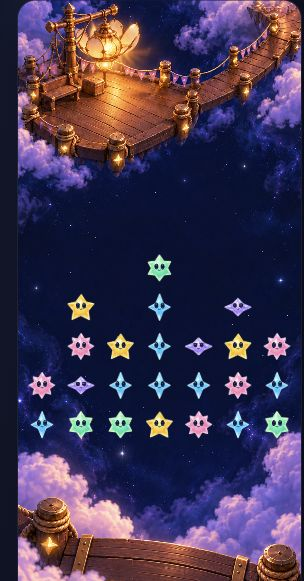
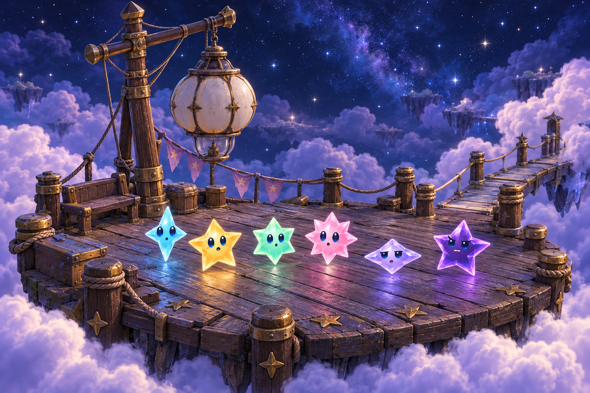
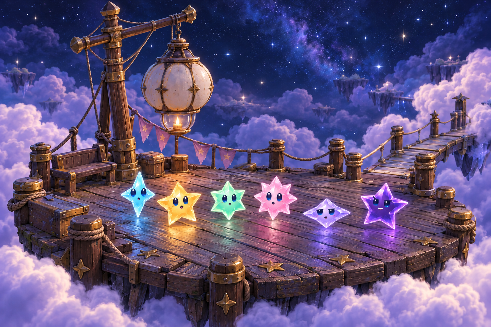
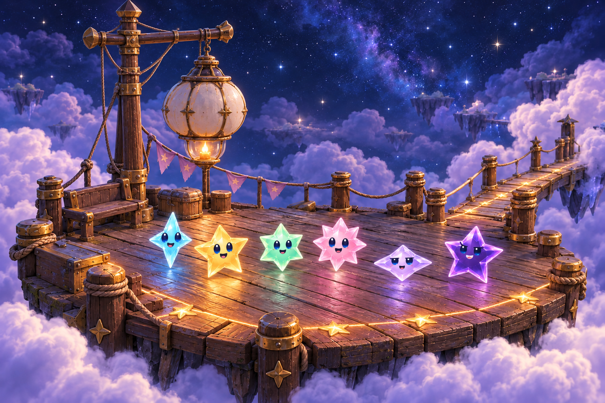
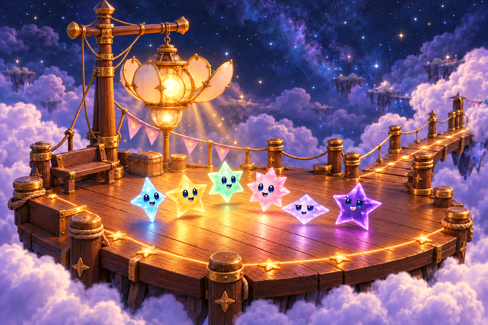
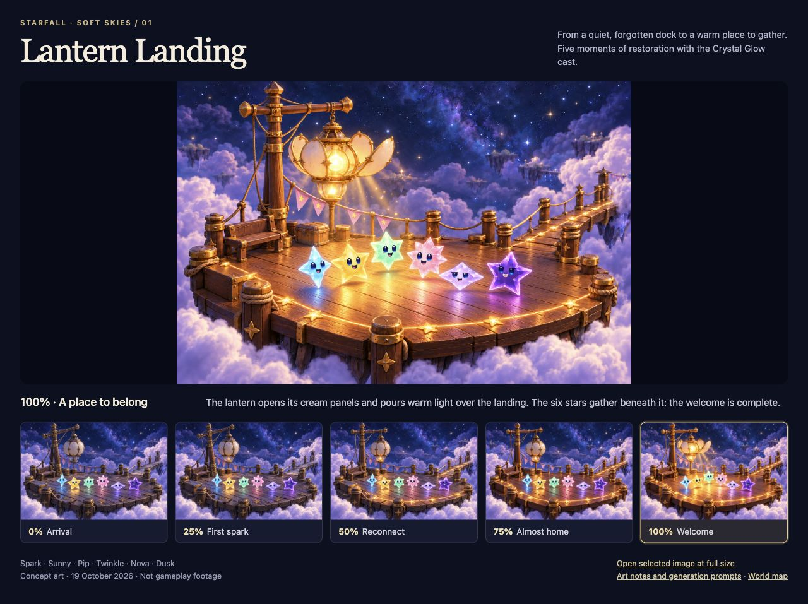

# Lantern Landing playfield and restoration study

**Status:** Three-view artwork packaged; native First Light acceptance pending · **Owner:** Current implementer · **Updated:** October 19, 2026

**[Open the three-view playfield study](board.html)** to compare five restoration states with actual packaged star bodies in seven columns. Choose **Phone**, **iPad portrait** or **iPad landscape**; restoration and star density stay selected when the view changes. The user authorized First Light implementation and phone delivery, then chose bespoke but consistent scenes whose wider views reveal different connected docks in the same Lantern Landing. The [production plan](PRODUCTION_PLAN.md) owns that scope and the acceptance criteria; revised native acceptance remains pending.

## Current rendering decision

The user rejected the visible middle fade/cut line in the first native pass. Each viewport must show **one continuous whole-artwork scene**: no replacement center, clearing patch, feather masks or split upper/lower regions. Whole-image scaling and viewport-edge cropping preserve proportions; repair may crossfade complete images. A quiet central sky belongs in the artwork itself. The native cast, hit cells, HUD and dialogue remain separate from the artwork.

The approved phone composition supplies shared identity: brass mast and petal lantern, rosewood planks, amber star fittings, rope gangways, violet clouds and navy sky. Tablet portrait reveals more of the neighboring mooring and connected route; tablet landscape reveals docks on both sides of the open field. The tablet masters were selected for implementation within this direction. All three views retain the same five restoration beats; native acceptance must establish that viewport changes preserve the current progress.

All fifteen packaged PNGs retain their generated artwork unchanged. The five phone images use `LanternLanding000` through `LanternLanding100`; tablet portrait and landscape have separate five-image families. [Production hashes](production-assets.json) record those assets and the continuous-image rendering contract. Existing concept previews and checks of the superseded split-region pass do not establish acceptance of the replacement native renderer.

The existing header reports exact collected light and rounded continuous percentage; artwork milestones occur at scores 0, 5, 9, 14 and 18. Entry previews preserve retained saves. The revised renderer must preserve those boundaries, show the final opened lantern from the committed win, and let the existing ceremony complete without another gate. Compact/accessibility layout, normal/quiet transitions, interruption, and tablet rotation still require source-bound native checks of the replacement.

## Revised composition: the sky is playable

The 393 × 852 review canvas uses the current centered `LandingGeometry` square: x=6, y=235.5, side=381, seven equal columns and rows. The environment has an overhead angle; the foreground stars retain their square-pixel proportions and screen-space mapping. The dock sits above the field, a near landing edge sits below it, and the lantern’s light stays outside occupied cells. This applies the [Hearthstone study’s](../environments/hearthstone-study/README.md) quiet-center and purposeful-edge principle.

The default fixed 24-star sample uses existing app body images and the shared [offline face renderer](../environments/concept-cast.js). Empty and full 49-position samples, plus optional geometry guides, expose composition conflicts. The same sample stays in place at every percentage, so restoration never disguises a change to board geometry. This is a static review, not a playable round or Core-generated fixture. The browser omits native HUD, dialogue, actions and safe areas; native acceptance is recorded separately.

The viewport selector applies the same geometry formula to reference canvases of 393 × 852, 768 × 1024 and 1024 × 768 points. Tablet views use the packaged `LanternLandingTabletPortrait###` and `LanternLandingTabletLandscape###` artwork families at 3:4 and 4:3; each background remains one continuous image. A missing state shows an explicit availability message. Direct review links accept `?view=tablet-portrait&state=50&density=dense` or `view=tablet-landscape`. These are composition previews, not native captures or evidence for every device size.

**Three-view viewer check — October 19, development working tree based on `caa0c5f`:** desktop Chrome loaded all fifteen images at their expected dimensions. Each view preserved the same 24-star identities and selected restoration state; dense and empty samples contained 49 and 0 stars. Geometry guides and Enter activation worked. Phone, tablet portrait and tablet landscape were visually inspected, with no captured browser warnings/errors. JavaScript syntax, hygiene and whitespace checks pass. Mobile browser layout, native HUD/motion, actual VoiceOver and physical play are separate, unverified by this viewer check.



**Composition concept — browser capture, not native gameplay.** October 19, 2026, working tree based on `548660b1`; default 304-pixel browser viewport, crop includes the entire scene width. The [full 49-position inspection](dev-548660b1-wip__board-v2-dense__browser.png) shows the geometry guide. The body assets load from the app; face overlays are the existing offline approximation.

The five `background-*-v2.png` files contain **no cast, controls or grid**. They were generated with built-in imagegen, then copied unchanged into this folder. [board-prompts.json](board-prompts.json) records exact prompts, references, selected sources, dimensions and hashes. The restored master established the composition; four edits supplied earlier states. A targeted continuity correction kept the illuminated post fittings on at 75% and 100%. Minor generated geometry differences remain; these are not registered animation frames.

Serve the repository root so the viewer can load packaged star bodies:

```sh
python3 -m http.server 8770 --bind 127.0.0.1 --directory .
```

Open `/docs/design/lantern-landing-01/board.html`, or open that file locally. The earlier close-up [scene comparison](index.html) is retained only as a superseded exploration. Its source-bound record follows.

**V2 verification:** all five backgrounds and packaged body files loaded; each state preserved the 24-star sample; empty and full samples yielded 0 and 49 pieces; guides toggled; all five backgrounds were inspected. The full-field browser view leaves the dock and lantern outside the star silhouettes. No captured browser console warnings/errors. JavaScript syntax, local package/reference paths, image hashes, repository hygiene and whitespace checks pass. Viewer/source hashes are recorded in [board-prompts.json](board-prompts.json). Desktop-wide arrangement, native control placement, motion, hit testing, human play and actual VoiceOver remain unverified. This pass changes only design documents and offline review assets.

## Superseded close-up scene study

The first five views depict Spark, Sunny, Pip, Twinkle, Nova and Dusk gathering on the dock. The user rejected their camera/composition for the playable board on October 19, 2026. They remain references for material and lantern construction, not an accepted gameplay direction.

**Concept — not implementation evidence.** These are generated depictions using the actual Crystal Glow character reference, not exact runtime sprite composites. All five full-size PNGs are 1536 × 1024 and remain outside the app target.

## The five moments

| State | Image | What changes |
| --- | --- | --- |
| **0% · Arrival** |  | Cold lantern, leaning mast, worn wood and dark fittings. |
| **25% · First spark** |  | A wick catches and its reflection reaches the boards. |
| **50% · Reconnect** |  | The mast straightens; linked fittings light the landing and route. |
| **75% · Almost home** |  | Wood and fittings are repaired. The closed upper chamber is the remaining promise. |
| **100% · Welcome** |  | The lantern opens and the cast gathers in its warm light. |

**Generated concept stills — October 19, 2026.** The night sky remains blue and the clouds lavender throughout. Living stars retain their color at 0%; the dormant architectural star fittings have no faces.

## Sources and regeneration

The [approved map](../world-01/map-v1.png) supplies the location and material language. The inspected [native Crystal Glow sheet](../../evidence/crystal-glow-integration-2026-10-17/materials.png), source `6cc9efd`, supplies character identities. The [atlas](../WORLD_ATLAS.md#01--lantern-landing--a-light-that-means-welcome) and [world data](../world-01/world-data.js) remain the owners of the location and five-state brief.

[prompts.json](prompts.json) retains every exact prompt, reference path and generated source filename. Mode: **built-in imagegen**. The 0% image was generated from map and cast; 25% and 50% edited that anchor; 75% edited 50%; 100% edited 75%. Original outputs remain in Codex generated-image storage; these PNGs are unmodified copies. Keep later variants versioned rather than overwriting this review set. The HTML comparison uses local files only, with no dependencies, autoplay or persistence.

## Review and limits

All five images were visually inspected against the brief and native cast reference, with a second independent visual review. The six silhouette/color identities survive each stage; the wick, connected fittings, repaired wood and final opening make distinct events. The 0→25% change is deliberately small and reads best at full size. The 0% view depicts a neglected landmark in a beautiful night, rather than extensive destruction.

Minor generated geometry drift remains, especially at the mast repair and final cast gathering. These are matched concept views, not registered animation frames. The hinged lantern needs an authored construction before animation. Pennant movement and phone-scale gameplay readability are not established by stills. The final ribbon beyond the gangway is only a route hint.

Historical concept delivery baseline: `548660b1f78e9d34775eb0ee601e91f146a898ac`; this package and its documentation links are the working-tree changes. App/Core files, resources, rules and saves are unchanged. Native builds, actual VoiceOver, animation, gameplay and physical-device checks are not applicable to this concept delivery.

**Passed:** five image dimensions and SHA-256 records; local image/reference and viewer/README file links; `python3 scripts/ci-hygiene.py`; `git diff --check`. Desktop in-app browser inspection checked all five image/title/selected-state changes and Enter activation back to 0%. No captured console warnings/errors. After a fixed-height layout correction, the viewer was reloaded and its 100% view visually rechecked. Mobile layout and rendered Markdown were not checked.



**Offline viewer capture — not native gameplay.** October 19, 2026; 1280-pixel desktop viewport, full-page capture. Source: the dirty documentation snapshot above; `index.html` SHA-256 `6d40dcd796823845f89bf45a8a7ae2eac171fc5752fe74e87be5d4ed3d116f52`. Image hashes are recorded in the prompt manifest. This capture establishes the comparison’s inspected appearance, not motion or phone acceptance.
