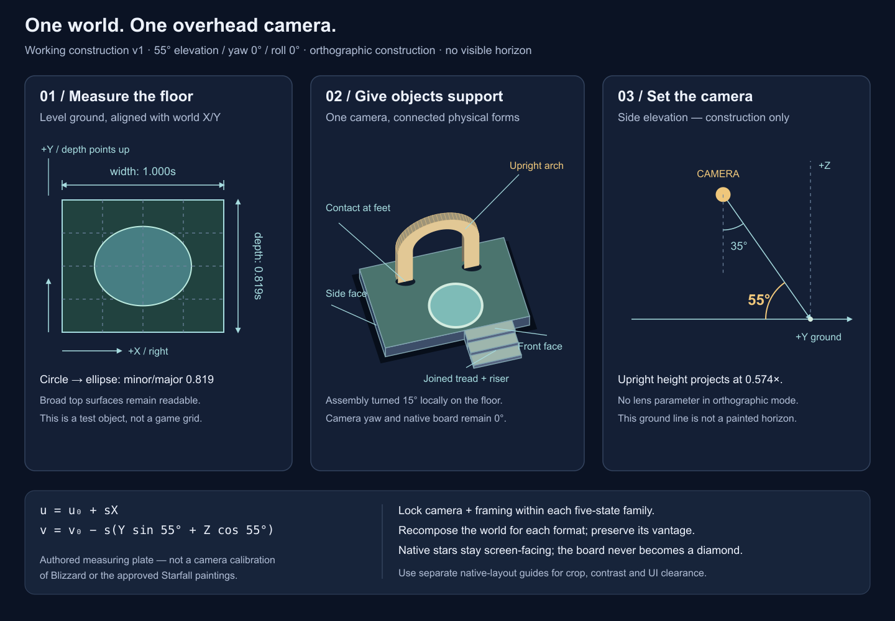

# One camera for a connected world

**Status:** Adopted working construction default for new compositions — v1 · **Owner:** current implementer · **Updated:** October 20, 2026

Use a high three-quarter overhead view with an orthographic-like projection, no visible horizon and no camera roll. Keep world X horizontal and world depth pointing up the image. This gives each place a readable floor, substantial edges and objects that stand on their supports. The native stars, seven columns and hit cells keep their existing screen-space geometry.

**Working construction default:** 55° elevation above the horizontal ground plane, equivalent to 35° from vertical; yaw 0° and roll 0°. Use exact orthographic projection for the reference geometry and nearly parallel edges in the painting. These are authored starting values, not measurements of Blizzard's camera or a reconstruction of the approved Starfall paintings.

**First application:** [Frostfruit Orchard](../frostfruit-orchard-06/README.md) used this guide for its three bespoke compositions, then revised them against native stars and controls before state derivation. Accepted fit is qualitative; it does not establish a measured 55° projection in generated paintings. Continue applying the [layout guides](README.md) and native review to each new composition. Preserve the registered camera of existing families, including rich Silver Pools; this guidance does not call for repainting them.

**Body-specimen status: refreshed for Sunwheel production.** This camera construction remains independent from body sizing. The kit embeds the authored faceless `SkyPieceSunny` shell using source-derived nominal radii of **0.35 ordinary / 0.46 grown**, with grown visible extent about **0.903 cell spacing** after body registration. The plate omits native `LivingLight` interior fill/shader, aura and motion; it establishes size and contour rather than current rendered appearance. Follow the [production contract](../star-cast/README.md#motion-material-and-growth), [native shard specimens and motion evidence](../../evidence/gameplay-shards-2026-10-20/README.md) and [regeneration instructions](README.md#regenerate-the-guides); native fit remains a separate check.



**Construction reference — not game artwork or runtime evidence.** [Download the scalable SVG](camera-reference.svg). Its square floor is a measuring object, not a visible board proposal.

## What stays fixed

| Property | Working construction default |
| --- | --- |
| View direction | High overhead, looking toward world +Y from the near −Y side; world +Z is up. |
| Elevation / yaw / roll | 55° / 0° / 0°. Yaw 0 means world X projects horizontally; it does not forbid turning individual props on the ground. |
| Projection | Orthographic construction. Paint with weak or negligible convergence; avoid obvious wide-angle distortion or a vanishing-point vista. |
| Horizon | None in the artwork. Distant sky, clouds and peripheral terrain continue beyond the crop. The ground baseline in the plate's side diagram is a measurement guide. |
| New device compositions | Phone, iPad portrait and iPad landscape share this vantage. Recompose paths, supports, near/far layers and crop for each format; do not tilt the camera to create space. |
| Restoration states | Lock camera, scale, framing and terrain positions within each five-painting family. Change the authored restoration features. |
| Gameplay | Native pieces retain screen-space board geometry. No diamond rotation, projected cell grid, perspective scaling of the board or moved hit cells. Finite yaw/pitch/roll of child artwork is presentation motion, not a change to the scene camera or native targets. |

“Isometric” is too ambiguous for a production prompt here. This is an overhead illustration with a defined construction camera, not a requirement for the equal-axis, diamond-grid appearance often associated with isometric art.

## What 55° means in the drawing

For a world point `(X,Y,Z)`, uniform image scale `s` and screen origin `(u₀,v₀)`, the reference uses:

```text
u = u₀ + sX
v = v₀ − s(Y sin 55° + Z cos 55°)    // image Y increases downward
sin 55° = 0.819152; cos 55° = 0.573576
```

A square lying on level ground has projected depth/width 0.819. A horizontal circular pool has ellipse minor/major ratio 0.819. An upright world-unit height projects to 0.574 image units. These checks apply to level, geometric reference surfaces; a sloped terrace, noncircular basin or sculpted rim has a different outline.

55° deliberately favors seeing the floor while retaining enough vertical height for arches, posts, steps and thick platform edges. It is a useful high-overhead starting point. Its level circles are rounder than some stylized pools in the current Silver Pools painting; that painting does **not** prove a 55° camera. Use the default for new compositions and verify their native fit before deriving variants. Existing families retain their painted camera.

At yaw 0, a rectangular platform aligned exactly with world X/Y shows its top and front face; its side face collapses edge-on. The plate turns one platform, its arch and its stairs together by 15° on the ground to expose a side face. That is local object placement, not camera roll, a second camera or a rotated gameplay board.

## Preserve the painted benchmarks

| Lantern Landing | Ribbon Crossing | Silver Pools rich master |
| --- | --- | --- |
|  |  |  |

**Painted source assets, not camera calibrations.** Lantern and Ribbon are the approved benchmarks for connected terrain, substantial forms, craft and near/middle/far depth. Silver Pools has source-bound development acceptance. None is asserted to obey this mathematical projection exactly; their [native evidence/status](../VISUAL_REFERENCE.md) is separate from this construction reference.

The [historical Hearthstone study's camera observation](../environments/hearthstone-study/README.md#5-the-camera-serves-readability) supports an overhead view that exposes useful prop faces without requiring an architectural isometric drawing. It does not supply camera angles or lens parameters. Keep its practical lesson: coherent supports, visible thickness and contact shadows make objects belong to the place.

Illustration may exaggerate a rim, widen a step or turn a small prop to expose its useful face. Preserve the shared ground, gravity, overlapping supports and direction of depth. Do not flatten one pool into a distant-horizon view while neighboring level pools use a steep overhead view. Richness comes from connected architecture and layers, not changing camera angles within a painting or shrinking the whole location to one isolated prop.

## Reusable camera prompt

> For a new composition: high three-quarter overhead view; use the attached construction reference as the camera guide. Working default 55° elevation above the ground, yaw 0°, roll 0°, orthographic-like scale with nearly parallel edges and no visible horizon. World X runs horizontally and depth recedes upward. Show broad top surfaces, thick front edges, locally turned side faces, supported upright props, connected steps and grounded contact shadows. Preserve a rich connected place across the frame. Use the separate native-layout guide for readability; it is not a request for a blank center or a painted mask. Keep the same camera and framing across restoration states. Do not paint the playable stars, grid, controls or text into the scene.

## Apply and verify

- Apply the working projection to one rich completed composition. Check its native overlays before deriving the other four states; keep the camera registered for those edits.
- Inspect top/front/side faces, step rises and arch feet together. A local prop adjustment must retain a plausible shared ground plane and contact.
- Review the real sparse/dense gameplay pieces and native UI overlays in each device format, including grown bodies and their auras. Camera consistency alone does not establish gameplay contrast or safe framing; those remain owned by the layout guides and native acceptance.

This document and SVG change no app camera, rules, assets or runtime transforms. No new native or motion validation is claimed.
