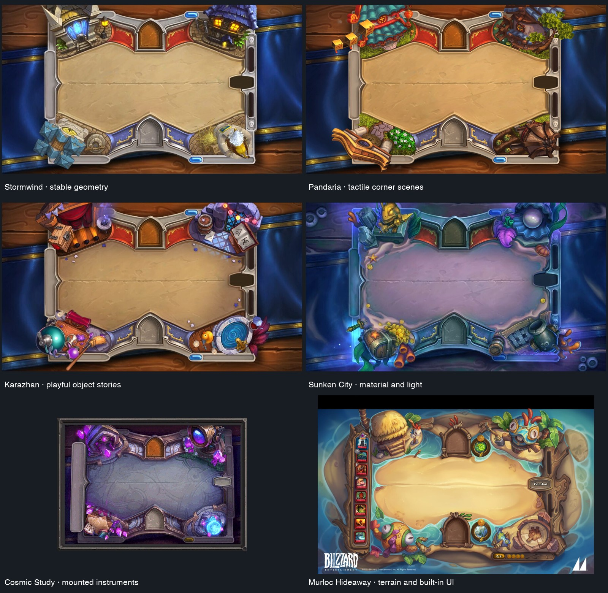

# Build a place around the stars

**Status:** Accepted art direction · **Updated:** October 20, 2026

Each level should feel like a substantial, connected place: crafted terrain, useful paths, supporting structures and a clear restoration story. Lantern Landing and Ribbon Crossing set the visual standard. During Silver Pools production, the user rejected the increasingly sparse “small landmark on empty sky” approach and enthusiastically accepted the richer common garden. Preserve that richness while fitting the actual native board.

Start with the [reusable brief](BRIEF.md), the [layout overview](overview.png), [camera construction](CAMERA.md) and the references below. The templates describe particular native layouts; they do not certify every viewport, text size or painting. **Next action:** compose a rich restored master, inspect it against the appropriate geometry, then check it in the native app before deriving the remaining states.

**Material and body-scale specimens: refreshed for faceless gameplay pieces.** The guides embed the exact packaged `SkyPieceSunny` shell at production sizing. Current `SkyPiece` composes its interior through `LivingLight.material` and a native shader; those effects are deliberately omitted from these neutral construction specimens. The generator reads ordinary/grown radii from `FallingSkyMotion` and raster registration from `StarCast`, and records those owners plus `SkyPiece` and the material hash. This refresh establishes source-bound construction sizes, not native living-light appearance, aura, motion or visual acceptance. The [piece contract](../star-cast/README.md#motion-material-and-growth) and [native material/motion evidence](../../evidence/gameplay-shards-2026-10-20/README.md) retain their separate roles.

## The visual standard

**Packaged source paintings, inspected October 19, 2026 — not native screenshots.** Lantern Landing has a deck, bench, chest, rope fittings and a route continuing beyond the frame. Ribbon Crossing connects two places and repeats its construction in the foreground. Both establish near, middle and far depth around a readable center. See the [visual reference](../VISUAL_REFERENCE.md) for source-bound native evidence and its limits.

- **Give the place a purpose.** A common garden shares water; a landing receives arrivals. Paths, ledges, mechanisms and planted beds should explain how the place works. Build supporting clusters around a few decisive subjects, with recognizable silhouettes and physical connections.
- **Make material visible in the shape.** Thick stone rims, broad timber planks, stitched cloth and glass edges should differ in construction as well as color. Supports, contact shadows, joins and useful top/side faces give objects weight. Small detail supports the large forms.
- **Frame through terrain and depth.** Continue paths beyond the crop and use nearer foreground structures to place the viewer within the world. Keep one coherent camera and continuous painting. The readable center may contain restrained texture; do not manufacture a blank rectangle, middle mask, fog divider or rigid decorative frame.
- **Protect play through composition.** Put the sharpest scenic highlights and important silhouettes where they support the setting without obscuring gameplay silhouettes or matching groups. Shape and shade the architecture around native UI. Preserve its detail rather than globally shrinking the garden or the stars.

## Read the geometry, then judge the art

| Guide | Use |
| --- | --- |
| [Phone](phone.svg) | Reference phone composition, board, UI and crop regions |
| [iPad portrait](ipad-portrait.svg) / [iPad landscape](ipad-landscape.svg) | Separately authored arrangements of the same place |
| [Source phone](source-phone.svg) / [source iPad portrait](source-ipad-portrait.svg) / [source iPad landscape](source-ipad-landscape.svg) | Pixel-sized guides to attach to image-generation briefs; center-cover baseline with explicit crop limits. Matching `source-*.png` files provide raster references. |
| [Overview](overview.png) | Compare the three reference compositions together |
| [Native layout values](native-layouts.json) | Exact dimensions and configuration behind the guides |
| [Camera reference](CAMERA.md) | Consistent overhead vantage, projection, orientation and no visible horizon |
| [Piece scale reference](scale-reference.svg) | Authored faceless `SkyPieceSunny` shell at ordinary/grown production sizing, plus suggested prop-size bands |
| [Browser reference data](reference-layouts.js) | Generated compiled geometry and piece sizing for opted-in composition reviewers; earlier reviewers retain their historical appearance |

The guides are authoring overlays, never artwork to package. Their exact reference geometry comes from the native layout contract; the color regions express different design priorities:

| Mark | Meaning |
| --- | --- |
| **Teal** | Opportunity for rich scenery. It is not a mandatory box or an instruction to fill every pixel. |
| **Amber** | Soft edge bleed: up to **0.15 cell** is a preliminary design budget to test, not an automatic allowance to hide stars or their cues. |
| **Red** | Native board contrast takes priority. This area need not be blank; restrained continuous sky, water or material can remain readable behind pieces. |
| **Violet edge markers** | HUD at the viewport top; dialogue and actions at the bottom. These schematic markers are **not measured coverage bounds**. Actual content, safe insets and text size determine their extent. Architecture may continue behind these surfaces, but do not place the only story-critical change there. |
| **Hatching** | Viewport crop/inset exposure. Do not rely on detail in this region surviving every fit. |

Use the actual piece width, not the full cell square, as the visual ruler. Current [FallingSkyMotion](../../../App/FallingSkyMotion.swift) uses nominal radii of **0.35 cell ordinary / 0.46 cell grown**, replacing the kit's old grown radius of **0.43**. Nominal diameters are therefore **0.70 / 0.92 cell**. [SkyPiece](../../../App/SkyPiece.swift) shares the 212-pixel registration contract with bodies spanning at most 208 pixels, giving visible maximum extents of approximately **0.687 / 0.903 cell**; the separate aura extends farther. The refreshed cell overlays and scale plate use that registration without stretching the alpha bounds to fill the nominal diameter. Overlays dim ordinary bodies for annotation visibility; the scale plate shows the original authored shell. The plate omits native living-light fill/shader, aura and deformation. Compare rails, flowers, streams and finish cues with the [actual native shard specimen](../../evidence/gameplay-shards-2026-10-20/dev-9e0732a__piece-materials__iphone-17e__native-host.png), then inspect ordinary and grown pieces in motion. These source facts do not authorize changing piece size.

[LandingGeometry](../../../App/LandingGeometry.swift) owns the board and cell mapping. [FallingSkyView](../../../App/FallingSkyView.swift) can use expanded scrolling canvases for compact viewports and accessibility text. [RestorationEnvironment](../../../App/RestorationEnvironment.swift) fits each complete painting using its actual dimensions. Device orientation, canvas shape, safe insets and Dynamic Type can therefore change the visible crop and text arrangement. Exact values for one guide do not establish universal safe space. Bleed and prop-scale recommendations still need native visual and input checks.

The current Observatory interface measures its HUD at the safe top and its guide/action group at the safe bottom; reading-heavy layouts place them outside the scrolling board. The exporter cannot measure those SwiftUI surfaces. Its `legacyGeometryReservations` preserve the older crown/dialogue/action values for reference only; they no longer appear as fixed UI rectangles in the guides. Inspect the actual HUD, reading panel and controls before assigning a protected restoration cue.

The Sunwheel production refresh retains compiled `LandingGeometry` board/cell data and exact source-owner hashes, and registers the faceless `SkyPieceSunny` shell specimens at production sizing. It exports source-sized phone and both tablet guides while marking current viewport-edge UI schematically. These generated guides establish geometry, not measured SwiftUI coverage or a mathematically exact projection in generated art. [Frostfruit evidence](../../evidence/frostfruit-orchard-2026-10-20/README.md) records the separate native checks; regenerate after owner changes.

## Produce one coherent restoration

1. Write the place's function, main silhouette, material language and final change in the brief. Name the few purposeful supporting clusters and how they connect.
2. Build the restored master with the visual richness of the first two locations. Compare its focal detail and supporting architecture with actual star scale. Establish a phone, tablet portrait and tablet landscape composition; preserve the place's identity across them.
3. Inspect the master under native HUD, sparse and dense stars, dialogue and result controls. Adjust terrain arrangement, perspective or local material lighting where needed. Keep the whole scene continuous and the stars' geometry unchanged.
4. Derive **0 / 25 / 50 / 75 / 100** paintings from each accepted composition. Keep camera, architecture and backdrop registered; make progress cumulative and specific. A new connection, raised step or filled basin says more than a global brightness increase. At 75%, show a clear unfinished state; at 100%, resolve it visibly. In the existing 18-light challenge, these painting thresholds occur at scores **0 / 5 / 9 / 14 / 18**.
5. Record prompts, references, attempts, selected files, dimensions and hashes. Verify every family and state in the app. Source art, native stills, motion, input, actual VoiceOver and physical play remain separate evidence.

A 0% place may be quiet, drained or dormant while retaining its crafted structure. Restoration should reveal why that place matters. Keep its changes legible under the HUD and after the result appears. Do not add a gardening rule, campaign, walking actors or a cutscene to solve a composition problem. Existing whole-image transitions and committed gameplay remain separate from any future authored travel clips.

## Review before accepting a level

- [ ] At phone size, the image reads as a connected place with substantial architecture, purposeful supporting details and near/far depth.
- [ ] Each format retains the same identity, material language and restoration story; the wide view is deliberately composed.
- [ ] Sparse and full native boards keep all piece silhouettes, growth cues and matching groups readable; representative real taps use the unchanged cell mapping.
- [ ] Default and largest supported text, compact scrolling, HUD, dialogue and result actions remain readable. No sole progress or finish cue is hidden by UI or crop.
- [ ] All five states stay registered and build cumulatively. The 75% setup and 100% resolution are distinguishable without relying only on color.
- [ ] The complete painting remains continuous. No mask, hard middle cut, flattened panel or reduced star size was introduced to make it fit.
- [ ] Native normal motion and interruptions are inspected separately from stills and Reduce Motion. Evidence names the tested source, device/configuration and remaining limits.

## Research and scope

The [Hearthstone study](../environments/hearthstone-study/README.md) supplies useful principles: stable gameplay geometry, purposeful edge clusters, convincing supports, clear materials and a camera chosen for readability. Its [catalog](../environments/hearthstone-study/CATALOG.md) distinguishes full-board references from prop icons, and its [motion notes](../environments/hearthstone-study/MOTION.md) distinguish sampled media from live behavior.

**Historical external research — Blizzard and credited artists; inspected in the October 18 study.** The copied full-board references retain their [original sources and attribution](../environments/hearthstone-study/sources.json). They are documentation references, not licensed Starfall runtime assets or a brief to copy their characters and distinctive artwork. This kit applies the composition lessons to original Starfall places; it does not rewrite that historical study or claim its proposals shipped.

**Seed Moon is a future candidate for a richer composition review.** The user's comparison during Silver Pools production motivated that follow-up. Seed Moon's richer treatment remains deferred outside the Frostfruit batch; this kit does not itself replace its shipped art. This kit also does not change rules, saves, native control roles or the [world atlas](../WORLD_ATLAS.md). The repository’s [level-design skill](../../../.agents/skills/starfall-level-design/SKILL.md) routes future location work through this kit.

## Regenerate the guides

Regenerate whenever a recorded geometry, interface, material, motion or registration owner changes. The generator reads production constants and fails if it cannot find exactly one scalar declaration or the Sunny raster no longer matches the shared registration. It does not infer actual UI coverage, reconstruct `LivingLight` material/shader output or animate bodies. The fourteen hashed owners bind geometry, UI context, registration and the authored shell; they do not certify the unrendered living-light appearance. Inspect sparse/dense native boards with ordinary and grown pieces before accepting a new painting. Camera construction and historical Frostfruit evidence retain their separate validity.

Run `swift test` to build Core, then `python3 scripts/level-design-kit.py` from the repository root using an environment with Pillow. The generator compiles `App/LandingGeometry.swift` with the export adapter and records source hashes. `--layouts-json` accepts an explicit prior export for offline reproduction. It preserves any original `sourceSHA256` values and marks geometry ownership unverified; `generationSourceSHA256` describes only the files present while making the guides. Compile a fresh export before relying on its geometry for new art. SVG point-sized panels and `source-*.svg` artwork-pixel panels have separate coordinate systems. The latter show center-cover baseline crop exposure; final focal fitting must still be inspected in the app. Generated guide files are owned by this folder’s generator and need no individual folder front doors.

The camera plate is authored SVG construction, independent of the layout generator. Render its PNG with an SVG renderer (the retained PNG uses Sharp 0.35.5) after editing the SVG, then inspect text, supports and measurement labels. Do not change painted source assets to produce these technical guides.
