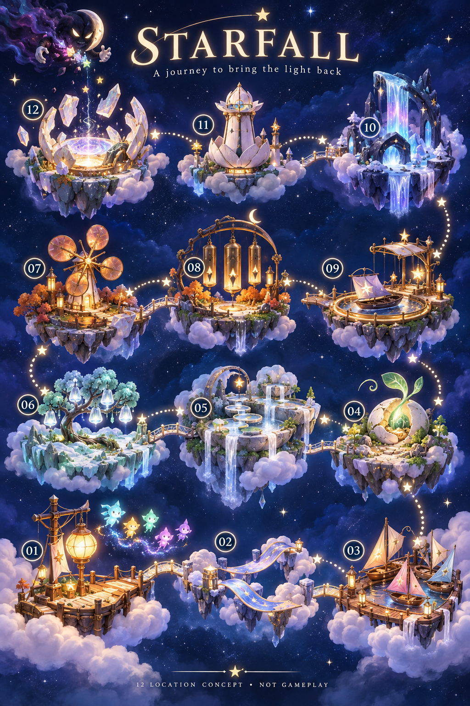

# Ribbon Crossing

**Status:** Implemented and verified within the bounded development scope; canonical installation pending · **Updated:** October 19, 2026

Ribbon Crossing reconnects two cloud banks through a broad lavender ribbon, returning a shared route to the stars. The [production plan](PRODUCTION_PLAN.md) defines a second directly selectable 18-light challenge beside First Light, with three bespoke viewport compositions and five restoration beats. Completion uses the existing light transfer, a full-image crossfade to the joined seam and the normal result. No campaign or unlock is added.

The two challenges deliberately share seed 42, the authored opening and existing rules. Open sky remains the default. All fifteen native scene states and a 49-star phone sample have been inspected; phone win/restore/replay, cross-location cancellation, largest-text/system Reduce Motion and tablet rotation with real clears pass. Dense-fixture interaction was not confirmed. [The evidence record](../../evidence/ribbon-crossing-2026-10-19/README.md) keeps each result tied to its tested source.

The final simplified completion at `4dff983` / `dev.453e081fb5` passes 49 focused hosted checks, compact Ribbon win/replay and a zero-warning Release build. The same runtime at `15fbdf6` passes final tablet rotation, native clears and all ten tablet-state captures. A 5.195-second normal-motion recording confirms the finish without characters crossing the bridge. Lantern compact and survival sibling checks also passed at their recorded source. Canonical installation, actual VoiceOver at RC and physical play remain separate. Character travel is reserved for future generated clips, none implemented; board stars and the usual result-ceremony cast remain unchanged.

## Start here

Read the [scope and acceptance criteria](PRODUCTION_PLAN.md) for verified development coverage and delivery follow-up. The [atlas](../WORLD_ATLAS.md#02--ribbon-crossing--neighbors-can-reach-each-other) owns the location's daily life and material identity; [world-data.js](../world-01/world-data.js) owns its exact five beats and the crowded-column puzzle question. Open the [composition reviewer](board.html) to compare phone portrait, iPad portrait and iPad landscape with actual body assets and fixed star samples. The score slider follows the 18-light target; scene buttons select its five thresholds. Choose 24, 40, 49 or no stars, with optional geometry guides. Missing artwork displays an explicit availability message. Generated art and browser review are not native acceptance.

**Approved generated concept — not runtime evidence.** [Original map package](../world-01/README.md), October 18, 2026. Preserve the recognizable cloth crossing and its connections; playable stars remain separate native elements. The image does not specify a runtime world-travel animation.

| Phone portrait | iPad portrait | iPad landscape |
| --- | --- | --- |
|  |  |  |

**Generated production artwork, inspected October 19 — not native screenshots.** These 100% plates establish three views of the same crossing. All fifteen states have separate native inspection in the linked evidence record. Recorded native completion is separate evidence; these paintings cannot establish motion or HUD clearance by themselves.

## Boundaries

This folder owns the production plan, offline composition reviewer and generated-art provenance. The app owns packaged images, rules, saves, geometry and native effects. At 0% the spans hang apart; at 25% the first anchor lights; at 50% stitching reconnects; at 75% the middle seam is still loose; at 100% the seam joins and reconnects the banks. Use complete continuous paintings with cumulative restoration, without center masks or baked-in characters.

The [Ribbon verification record](../../evidence/ribbon-crossing-2026-10-19/README.md) tracks confirmed Core/tooling/hosted, phone/tablet, recorded motion and Release results alongside the pending installation and physical/RC limits. Existing [Lantern Landing acceptance](../../evidence/lantern-landing-2026-10-19/README.md) retains its own source; its older result captures do not establish parity with the shared heading-placement changes. Actual VoiceOver remains an RC check, and physical play is separate.

## Review locally

Serve the repository root with `python3 -m http.server 8770 --bind 127.0.0.1 --directory .`, then open `/docs/design/ribbon-crossing-02/board.html`. Direct links accept `?view=tablet-portrait&score=9&density=crowded` or `view=tablet-landscape&state=75`. Score takes precedence over a scene query. Changing score/view preserves the same sample identities; this is not a playable round.

The reviewer uses the existing [offline cast renderer](../environments/concept-cast.js), actual packaged body PNGs and the reference geometry from [LandingGeometry](../../../App/LandingGeometry.swift). Faces are the shared offline approximation. Backgrounds load directly from app asset sets named `RibbonCrossing###`, `RibbonCrossingTabletPortrait###` and `RibbonCrossingTabletLandscape###`, each with `scene.png`. The canvases are 393 × 852, 768 × 1024 and 1024 × 768 points; they do not model every native safe area, HUD or device size.

## Reviewer verification

Development documentation working tree based on `016822a`, October 19, 2026. `node --check board.js` passed. A local JavaScript execution check with a minimal DOM stub exercised all 57 score/view combinations, stable sample identities, 24/40/49/0 densities, scene buttons, guides and missing-art/load messages; existing body paths resolved. This checks logic only, not browser rendering, pointer/keyboard interaction or image composition. Browser visual review was not completed because browser policy rejected the attempted local-file URL; no alternate route was attempted. Native inspection is recorded separately and does not establish browser rendering.
