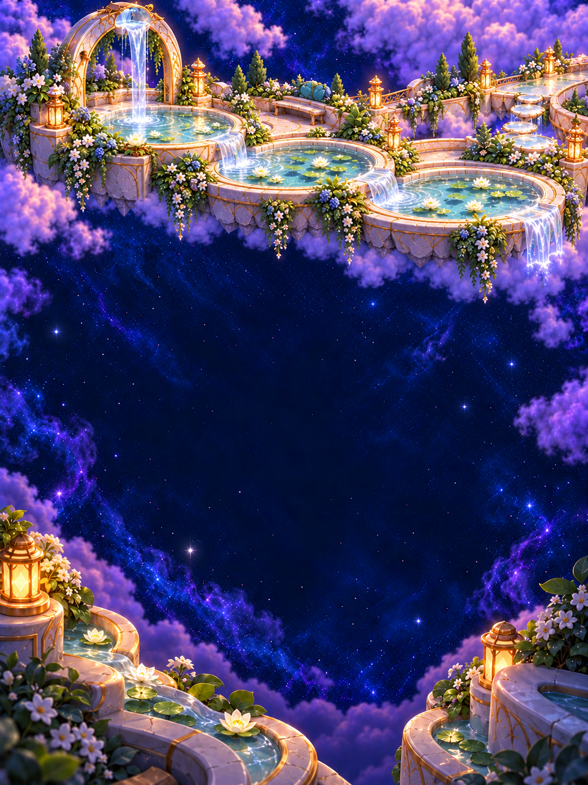

# Silver Pools

**Status:** Development verified; canonical delivery pending · **Updated:** October 19, 2026

Restore the shared flow through a suspended moonstone garden. Three descending basins, useful paths, planted terraces and nearby resting places make this a complete neighborhood. The fifth optional challenge keeps the existing seed-42 opening and 18-starlight objective.

All fifteen native scene states, 49-star density/input, tablet rotation, compact layout, largest text with system Reduce Motion, recorded normal completion and Release compilation are verified within the [development evidence](../../evidence/silver-pools-2026-10-19/README.md). Publication and canonical delivery are next; no installation, physical play or full release-candidate acceptance is claimed.

Start with the [board reviewer](board.html), [production plan](PRODUCTION_PLAN.md) or [native verification record](../../evidence/silver-pools-2026-10-19/README.md). The [atlas](../WORLD_ATLAS.md#05--silver-pools--one-flow-through-the-whole-place) owns the setting; the [level-design kit](../level-design-kit/README.md) owns reusable composition, dimensional and camera guidance.

| iPhone | iPad portrait | iPad landscape |
| --- | --- | --- |
|  |  |  |

**Packaged source paintings — not native screenshots.** All fifteen generated PNGs are preserved byte-for-byte. These bespoke compositions keep the same garden identity while revealing different paths and resting places. Playable stars, UI and feedback remain native; no miniature inhabitants are painted into the scenery. The approved twelve-location [map concept](../world-01/map-v1.png) remains the broader reference.

| Painting | Visible restoration |
| --- | --- |
| 0% | Dry basins, tide marks, quiet lanterns and a silent arch. |
| 25% | The first pool fills; nearby lights begin returning. |
| 50% | A thin stream joins the first two pools; the third remains dry. |
| 75% | All three pools connect; the arch holds one pearl droplet above a clear gap. |
| 100% | The arch releases its silver thread into the complete cascade. |

Scores 0/5/9/14/18 select these authored milestones; the HUD reports actual progress, so five light reads 28% and fourteen reads 78%. Committed Core progress owns the transition and win. There is no water simulation, new gardening mechanic, campaign, unlock, scenery traveler or separate cutscene.

The reviewer uses the [shared restoration review engine](../environments/restoration-review.js), shared styles and actual cast assets. It offers phone/portrait/landscape, five states, score, density and geometry controls. Its static logic checks pass; browser rendering is unverified and it is not native evidence.

[Prompt provenance](art-prompts.json) preserves all 30 attempts, including the rejected sparse direction and the richer retry the user approved. [Selected assets](production-assets.json) records exact generated sources, dimensions, SHA-256, Git blob hashes and byte matches. The verification record separates completed native visuals, motion and development accessibility samples from pending canonical delivery, physical play and actual VoiceOver at release candidate.
