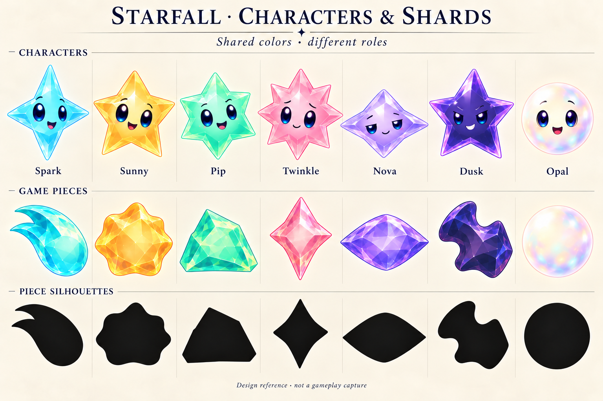

# Characters and faceless game pieces

**Selected design direction, October 20, 2026 — production sprite and motion adaptation development-verified.** The user wants the varied shard silhouettes as faceless playable pieces and the original traditional star designs as characters, connected by color. Opal is explicitly included as the seventh family, retaining the smooth pearly white round form.

**Generated design reference — not a gameplay capture.** All seven characters have faces; all seven pieces are faceless. The black row compares piece outlines. Opal retains a smooth pearly surface in both roles.

The user rejected the [larger whole-star interpretations](../whole-star-study-2026-10-20/README.md). Those remain historical exploration. The selected relationship is coordinated character and piece families; it does not require the pieces to be broken portions of the characters.

## Seven pairings

| Family | Character | Faceless game piece |
| --- | --- | --- |
| Spark / aqua | Original tall four-point star | Compact swept comet |
| Sunny / amber | Original friendly five-point star | Blunt irregular solar chunk |
| Pip / mint | Original compact six-point star | Asymmetric flat-sided meteor wedge |
| Twinkle / rose | Original eight-ray star | Tall pinched glint |
| Nova / lavender | Original wide four-point star | Low broad lens |
| Dusk / dark indigo | Original concave five-point star | Admired folded piece with opposing notches |
| Opal / pearly white | Existing smooth round Opal with a face | Smooth round opalescent piece without a face |

Characters retain expressions and personality. The repeated pieces use distinct silhouettes, color and material. Removing a face must reconstruct uninterrupted material rather than leave eye-shaped holes or paired highlights. Distinct silhouettes must support recognition without color.

Match hue, value range, highlight color and edge treatment within each pair. Keep Sunny saturated amber rather than white; keep Nova lavender and Dusk smoky indigo. Opal has a smooth pearly surface and circular silhouette, distinct from the faceted and lobed colored pieces. Preserve Opal's current soft motion and game semantics during production adaptation.

The earlier [larger single body with a separate renderer aura](../refinement-2026-10-20/README.md#aura-belongs-in-the-renderer) is the grown-piece treatment in the production pass. It does not become a face or new character design. Existing growth exclusions and committed game rules remain authoritative.

## Production boundary

The reference sheet records the approved art decision. The production pass now routes forecast, flight and settled board objects through faceless `SkyPiece` materials, while dialogue, map traveler and cast ceremonies retain character artwork. Native acceptance is recorded separately from this concept.

`StarCast` retains character rendering for `WorldMapPainting` and `SkyFlowCeremony`; `SkyDialogue`/`SkyDialogueBubble` keep packaged dialogue portraits. `SkyPiece` shares the existing family identity and updates accessibility shape descriptions to the new outlines.

Normalize transparent production cutouts, pivots and visual weight before integration. Inspect real 24/36/44-point materials against bright and dark restoration artwork, dense mixed pieces, forecast-to-flight-to-board continuity and adjacent grown pieces. The generated reference cannot establish those results.

Selectable companions, unlocks, powers and altered progression remain unselected optional ideas. The original concept board changes no runtime behavior. Its approved [production adaptation](MOTION.md) adds gameplay materials and finite motion while preserving rules, saves and Murk.

## Sources

The original [Crystal Glow lineup](../crystal-glow/refinement.png) supplies the traditional character designs. The [varied silhouette board](../directions-2026-10-20/celestial-silhouettes-v2.png) supplies the game-piece contours. The [Opal study](../refinement-2026-10-20/opal-sheet.png) supplies its existing round face-bearing and pearly material identity. The built-in OpenAI image tool produced the first six-family board, then [added Opal](add-opal-prompt.txt) when the user explicitly requested the seventh family. The [initial prompt](pairing-prompt.txt) records the earlier six-family scope; the [provenance](provenance.json) identifies both generated sources and the selected output.

All seven pairs and their black silhouettes were inspected. The selected image has no faces on game pieces, retains the varied contours, includes Opal's circular outline and distinguishes Dusk's dark material from Nova's lighter violet. Color/value, body coverage and pivots remain illustrative; the artwork is not a normalized transparent atlas.

Source checkout: `d0dfcc1`, with the earlier October 20 artwork and documentation staged. Changes are confined to unbundled design assets and documentation; no build-affecting inputs changed. Verification uses repository hygiene, whitespace, local link checks and image/prompt/reference hashes. This paragraph records the concept-only source boundary. Production work and its separate native acceptance are tracked in [MOTION](MOTION.md).
