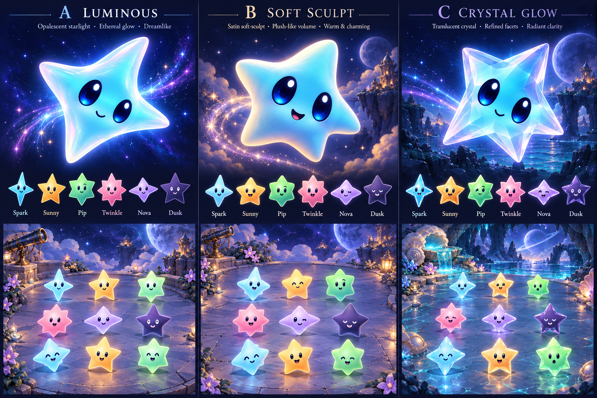
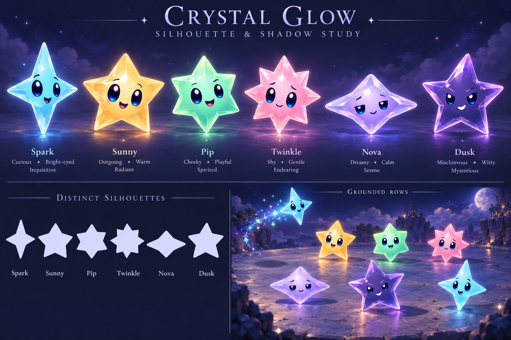

# Crystal Glow character exploration

**Status:** Approved direction; runtime adaptation integrated · **Updated:** October 17, 2026

The user selected **C — Crystal Glow** from the comparison below. Continue with translucent bodies, broad facets, larger blue-black eyes and distinct silhouettes. Match the elevated environment camera through visible thickness and ground shadows while keeping faces toward the player. This comparison records the art-direction selection. The subsequent [runtime integration](../../../evidence/crystal-glow-integration-2026-10-17/README.md) uses packaged body cutouts with authored faces; see the [current production contract](../README.md).

**Character development:** [Six individual model/expression sheets](characters/README.md) now expand the direction into gameplay expressions, construction views and motion key poses. Review limits and remaining production work are recorded there.

**Concept — not implementation evidence.** Built-in OpenAI image generation, using the [packaged icon](../../../../App/Assets.xcassets/AppIcon.appiconset/Starfall-1024.png), [native cast export](../../../evidence/star-cast-motion-2026-10-17/material-review.png), and locally generated observatory/ocean-cave environment studies as references. The comparison changes environments as well as materials, so it is not a controlled perspective comparison. Source baseline: `9bb008d`, initially clean checkout.

## Refine the selected direction

**Concept — not implementation evidence.** Built-in generation from the comparison and runtime cast references. Inspected result: stronger family shapes and varied expressions, with visible floor shadows. Remaining deviations: the inset has two settled rows rather than the requested three, the airborne shadow is not clearly demonstrated, and luminous pools still overpower some contact cores. The pale silhouette samples are illustrative, not exact extracted alpha masks. Do not treat this as a passed silhouette/shadow audit. Keep the next comparison focused on dark contact cores, smaller faces and denser rows.

Keep the six [cast silhouettes](../README.md) authoritative. Favor broad facets, a clear face area, restrained luminous edges and roughly twice the current eye area; eye size is a concept target pending small-scale inspection. Personality should vary through gaze, eyelids, brows, mouths and modest asymmetry. Avoid making every family the same five-point star.

Use a dark, compact contact shadow beneath settled stars, with a softer elliptical shadow and restrained colored bounce. Airborne shadows should soften and separate with height. Use the same scene light direction for all families. Dusk needs a readable lilac edge without losing its dark identity.

Start with shallow depth and nearly constant character size across rows. Stronger row scaling risks reducing distant faces and confusing perspective with the larger grown-star value cue. Changes to board projection would require shared rendering/hit/accessibility geometry and native tap validation; this exploration changes no geometry or rules.

## Decision point and acceptance

Next, compare the refined cast on the same observatory and ocean-cave ground at actual board sizes before authoring a production atlas or mesh.

- Distinguish all six families as solid silhouettes, including tall Spark versus wide Nova.
- Inspect eyes, Dusk contrast, facet noise and shadows at 24/36/44-point samples and on dense boards; large hero art alone cannot establish readability.
- Preserve unobscured faces and touch targets in front/back rows; keep grown size distinguishable from depth.
- Before runtime adoption, check full falling/landing/turning motion, clear and growth states, interruptions, Reduce Motion, actual VoiceOver and native hit mapping.

For this initial concept study, only generated still concepts were inspected. No app source, resources, rule/save state or runtime route changed. Native builds, interaction, animation, VoiceOver and device checks are not run for this concept-only work. No production-ready sprite/mesh or measured shadow behavior is claimed.

`prompts.md` retains the exact built-in generation prompts. Images are review artifacts outside the app target. Retain this study until the small-scale comparison decides adoption, bounded revision or rejection.
