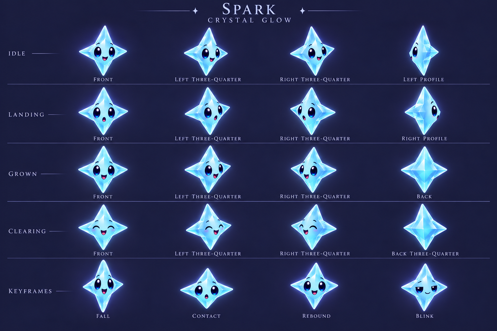
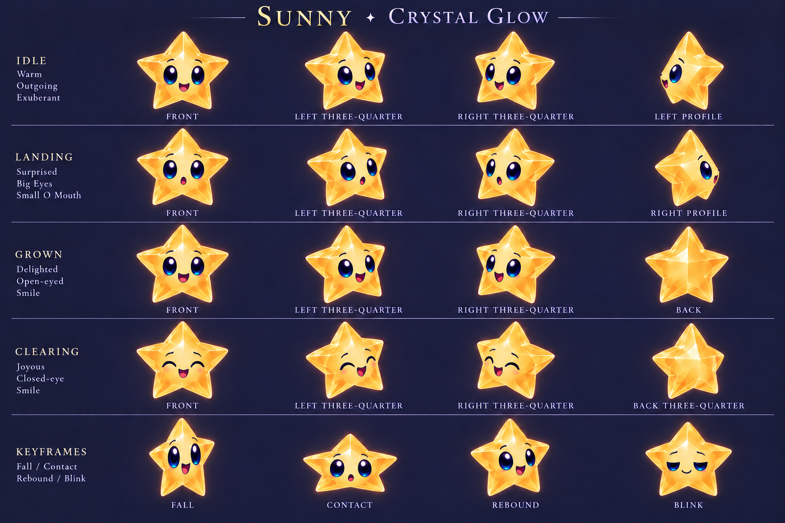
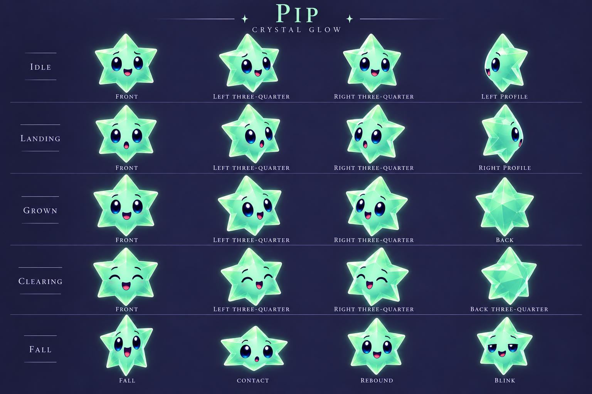
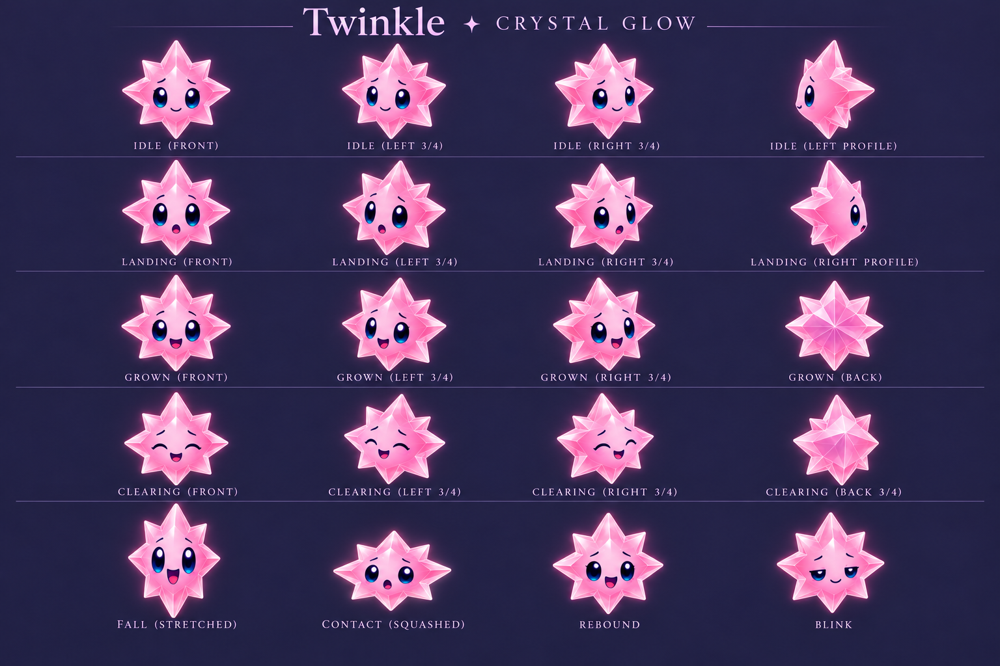
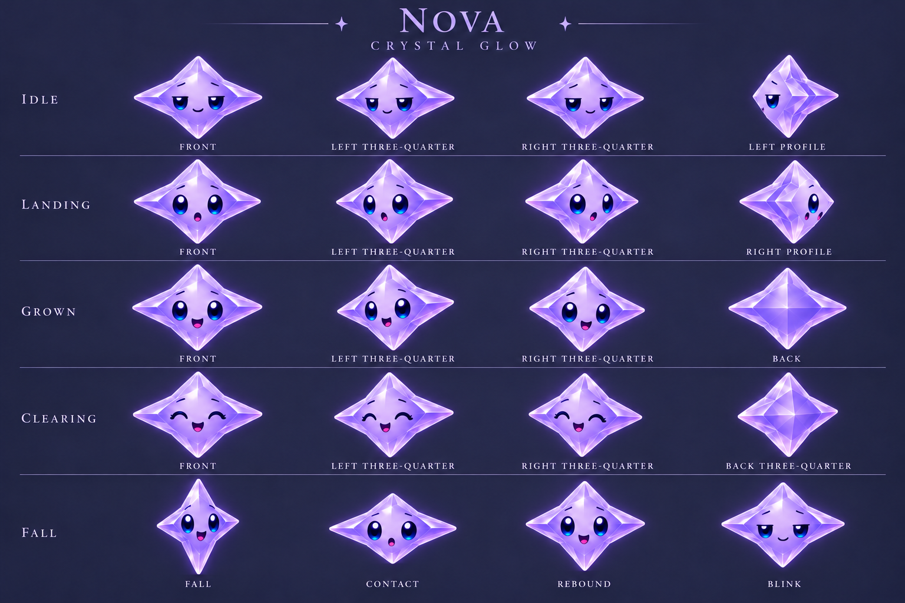
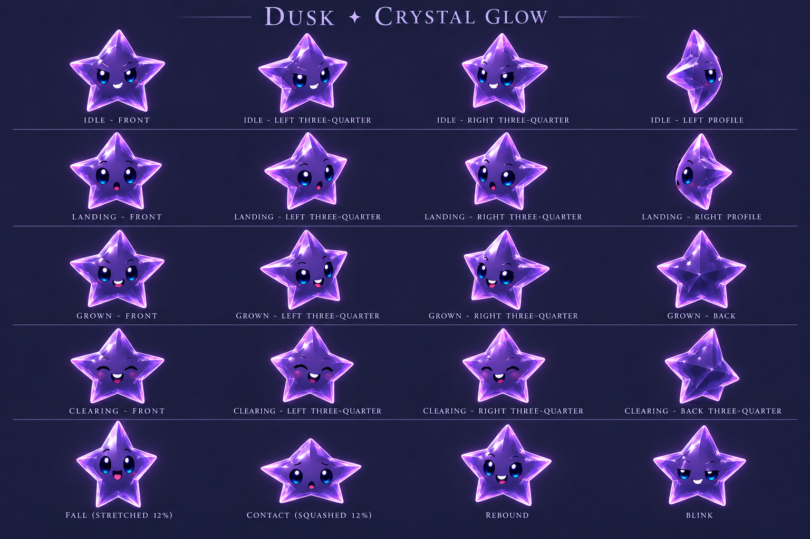

# Crystal Glow character masters

**Status:** User-approved design masters · **Updated:** October 17, 2026

The user approved these six individual model/expression sheets. They develop the selected [Crystal Glow direction](../README.md). These generated paintings define appearance and motion intent; they are not transparent, pivot-normalized runtime atlases. No app code, target membership, deterministic rules or saves changed.

The [runtime adaptation and verification](../../../../evidence/crystal-glow-integration-2026-10-17/README.md) composes body cutouts and authored faces; these paintings remain the construction references.

## Coverage contract

Each sheet requests twenty cells. Rows 1–4, columns 1–3 cover idle, landing, grown and clearing, each in front/left/right three-quarter views: the existing renderer's twelve material slots. Column 4 adds side and back construction views. Row 5 adds falling stretch, contact squash, rebound and blink key poses. Grown is drawn at the same review scale; the game must retain its separate size/value cue. Dusk's grown pose is a visual expression study only: dark stars do not gain a new gameplay state.

| Character | Identity | Sheet |
| --- | --- | --- |
| Spark | Tall aqua four-point; curious | [Spark](spark.png) |
| Sunny | Amber five-point; outgoing | [Sunny](sunny.png) |
| Pip | Mint six-point; cheeky | [Pip](pip.png) |
| Twinkle | Rose eight-ray; gentle | [Twinkle](twinkle.png) |
| Nova | Wide violet four-point; sleepy | [Nova](nova.png) |
| Dusk | Dark concave five-point; mischievous | [Dusk](dusk.png) |

| Spark | Sunny |
| --- | --- |
|  |  |
| Pip | Twinkle |
|  |  |
| Nova | Dusk |
|  |  |

**Generated character concepts — not runtime evidence.** Built-in image tool, based on the selected six-family refinement. All six sheets were visually inspected. Twenty separated pose cells appear in each, including four expression rows and a motion row. Sunny and Nova initially duplicated a side-facing direction; targeted edits restored opposing profile views. Some three-quarter turns remain very shallow; left/right labels are not a normalized screen-direction contract across sheets. The blink cells depict lowered lids, not a complete closed/open blink cycle. Rear facets and pivots still need production normalization; no exact 3D turnaround consistency is claimed.

## Acceptance and production boundary

Review all sheets for recognizable silhouettes, expressive large blue eyes, clean facial areas, faceless rear views, separated poses and consistent material. Labels do not prove correct orientation; check the actual shape and face direction. Key poses are motion references, not a verified animation sequence. Generated facet topology, scale and alignment can drift between cells.

Before runtime use, author or clean individual transparent frames with consistent canvas, body scale and centered pivot. Ground shadows must remain a separate scene-owned layer: compact contact core at rest, softer displaced shadow in flight, coherent upper-left lighting. No shadows or scenery should be baked into a rotating character. Preserve the bounded material factory and existing cancellation/generation boundaries.

Small-size/dense-board readability, exact alpha silhouettes, frame alignment, interpolation, shadows in motion, full/reduced-motion behavior, interruption handling, native taps, actual VoiceOver and device performance remain unverified. No native tests/build are needed for these unbundled art-only changes; they become required when the art is integrated. Inspect same-ground 24/36/44-point samples before adoption. Then approve/repair individual masters and choose sprite or mesh production; do not retain an alternate runtime pilot route.

Exact prompts and input provenance are in [generation prompts](prompts.md). Repository hygiene and whitespace checks cover this batch; they do not validate character quality.
