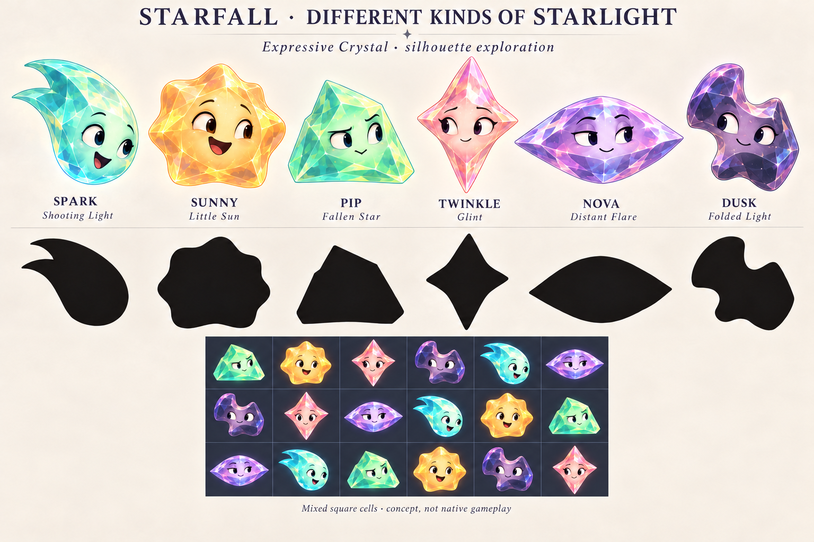
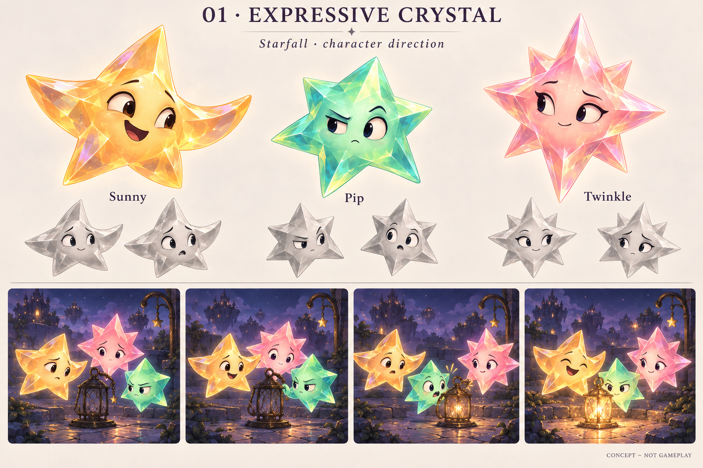
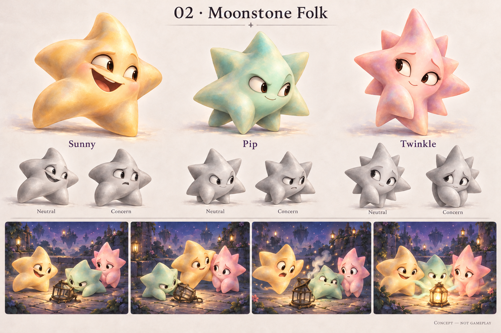
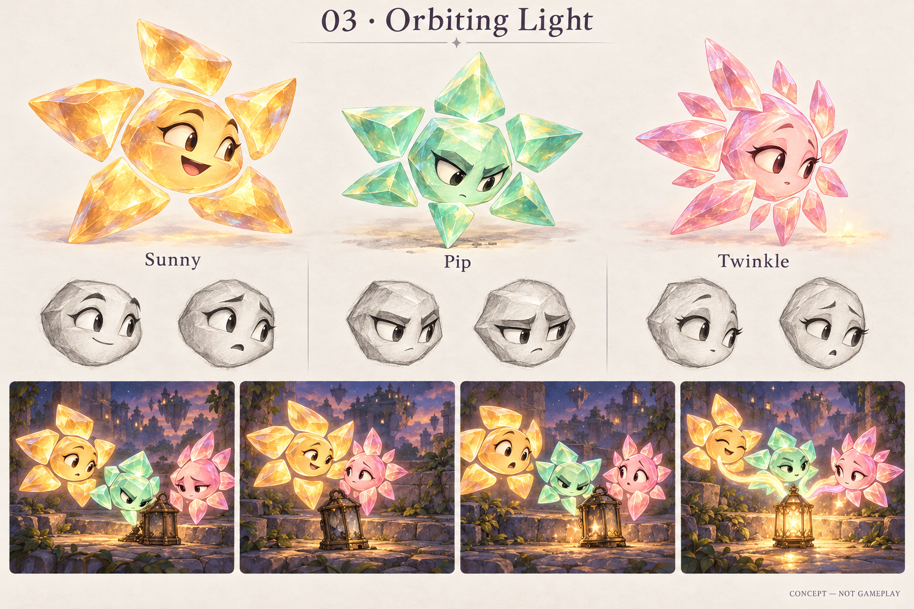

# Cast directions and celestial silhouettes

**Status: Concept exploration, October 20, 2026.** These proposals test character construction and varied celestial silhouettes after the [adversarial review](../refinement-2026-10-20/ADVERSARIAL_REVIEW.md). Murk's approved design is the quality benchmark. The current app and approved production sources remain unchanged.

**Current decision:** Keep the varied outlines as [faceless game pieces paired with the original traditional characters](../characters-and-shards-2026-10-20/README.md). Color coordinates the seven families, including round white Opal. The history below explains the exploration; neither the face-bearing shard cast nor the later whole-star expansion is the selected character direction.

**User direction: retain Expressive Crystal's appeal and reopen silhouettes.** The user prefers Expressive Crystal among the three, but correctly identifies that all three proposals still rely on similar radial star bodies. More points and different expressions do not establish distinct characters in grayscale. The initial reviewer preference for Moonstone Folk is superseded by this direction.

**User response to the new silhouettes:** The varied celestial forms are a better direction: more visually satisfying and interesting than repeating the classic star outline. Treat shared crystal material and distinct underlying forms as the preferred design direction. This does not finalize every proposed character, establish native game-piece acceptance, or select the separate-cast/shard-board alternative.

**Further direction:** The user particularly likes the folded Dusk piece and proposes imagining the larger star of which each piece could be a fragment. The [whole-star study](../whole-star-study-2026-10-20/README.md) explores Dusk, Sunny, Spark and Pip on that basis. Preserve Dusk's unusual contour as a useful clue; the earlier jigsaw comparison was a judgment under the narrower complete-token brief.
The only silhouette constraint is suitability as a game piece. Existing point counts and exact outlines are open to change. Explore different celestial forms with compact readable masses; compare solid-black silhouettes as well as grayscale faces. Unusual anatomy must work in a crowded board, rather than depend on portrait-scale detail.

## Different kinds of starlight

**Generated concept — not gameplay.** This first silhouette pass gives the six stars different masses instead of changing only ray counts. Opal's existing smooth round body is not redesigned. Names and color families help compare the proposals with the existing cast; the new shapes are not adopted runtime identities.

| Character | Interpretation | What separates its outline | Review |
| --- | --- | --- | --- |
| Spark | Shooting light | Rounded leading mass and a compact swept tail | Strong directional personality. The generated tail forks; preserve a robust outline at small size. |
| Sunny | Little sun | Full, blunt solar body with broad unequal corona bulges | Warm and less pointed, but still the most radial design. Check that the uneven outer mass stays distinct from round Opal. |
| Pip | Fallen star | Flat-sided asymmetrical meteor nugget | Clear separation from every ray-based body; risks feeling like an ordinary rock with a face. |
| Twinkle | Glint | Tall pinched diamond/cross with a broad face area | Strong link between an actual visual interpretation of starlight and a simple readable piece. Avoid letting the face area become too narrow. |
| Nova | Distant flare | Wide lens with bowed upper/lower edges and two lateral tips | Clear contrast with Twinkle. The generated lens is wider than requested and must be fitted to square cells without becoming too small. |
| Dusk | Folded light | Thick asymmetric mass with opposing open notches | The user particularly likes this form. Its unusual cuts now seed an exploration of a larger folded star; preserve them while testing that relationship. |

The initial review favored Spark and Twinkle, suggested refining Sunny and Nova, and questioned Pip and Dusk as complete characters. The user’s subsequent fragment interpretation changes that test: retain the unusual pieces and investigate what larger anatomy could explain them. Sunny still needs to remain sunlike without relying on many little rays.

The black row visibly separates the six broad masses. It is generated artwork, not a measured extraction of body alpha. One targeted correction changed the lower strip from grouped expression columns to mixed families. **Its cells remain wider than tall despite the generated square-cell caption**, so this is only an illustrative spacing comparison. Actual square-cell occupancy, exact body scale, adjacent literal doubled bodies, touch correspondence and animated overlap remain unverified.

## Earlier three-direction comparison

The initial shared brief asked for distinct body proportions, facial construction and choices in the same four-beat lantern scene. Sunny reassures a neighbor, Pip examines and adjusts, and Twinkle notices returning light. These are personality cues, not exclusive powers. Every character remains intact when sharing light.

## What the comparison tests

| Direction | Design hypothesis | Principal risk |
| --- | --- | --- |
| Expressive Crystal | Attached rays can gesture while broad facets preserve the existing celestial material. | Familiar collectible-star construction may survive beneath the improved acting. |
| Moonstone Folk | Softer, irregular bodies and distinct faces can make the cast feel like inhabitants of Murk's world. | Rounded bodies can lose family shapes or feel like ordinary stone rather than starlight. |
| Orbiting Light | Separated ray segments can make attention and emotion visible in the body's arrangement. | Gaps and moving segments may make small repeated pieces look broken or cluttered. |

Before judging polish, compare the grayscale faces, silhouettes and the choices in the four story panels. A direction succeeds only if Sunny, Pip and Twinkle remain recognizable and feel different without their names. A beautiful but interchangeable smile does not meet this brief.

The images are design references, not sprite atlases. Their point counts, pivots and anatomy need checking across poses before production. The previous [larger body and separate renderer aura proposal](../refinement-2026-10-20/README.md#aura-belongs-in-the-renderer) remains a separate state treatment; paired torso light marks remain rejected.

## 01 · Expressive Crystal

The three boards below are the initial comparison. Their original reviews identify acting and material differences; the user's subsequent silhouette criticism takes priority over those initial preferences.

**Generated concept — not gameplay.** The familiar crystal family gains directed pupils, expressive eye whites, asymmetric brows and mouths. Sunny's curved side rays suggest welcome; Pip's gaze clearly targets the lantern. This recovers acting possibilities that had narrowed in the glossy oval-eye treatment.

The surface is still too busy, and facial distinction relies heavily on brows and expression. Pip looks irritated more often than practical. Twinkle's concern and generated eyelashes do not sufficiently establish attentiveness. The story strip shows the lantern changing, but the characters' specific actions causing that change remain weak. This is the easiest continuation of Crystal Glow, with the least structural distance from a familiar collectible star.

## 02 · Moonstone Folk

**Generated concept — not gameplay.** The initial review favored this ensemble's acting: Sunny's broad grin and open weight, Pip's lower focused posture, and Twinkle's gathered vertical body. Sunny leans toward a worried friend; Pip physically inspects the lantern and recoils at the setback. Quieter surfaces leave more room for their faces. These improvements did not resolve the user's concern about similar silhouettes.

Do not freeze the generated anatomy as drawn. Pip's and Twinkle's ray counts drift, and Twinkle's folded lower rays sometimes resemble extra limbs. The stars also feel heavy and grounded; production should recover floating movement and internal light without restoring dense facets. Twinkle needs an unmistakable opening gesture and an active noticing beat, rather than remaining the worried character whom Sunny comforts. Her eyelashes are incidental generated styling, not an adopted identity requirement.

The earlier recommendation to develop this direction with fixed five/six/eight-ray construction is superseded. The user prefers Expressive Crystal and explicitly permits new silhouettes beyond point-count differences.

## 03 · Orbiting Light

**Generated concept — not gameplay.** Floating ray segments create the most conspicuous structural change. The potential is to communicate attention through an entire arrangement opening, gathering or bracing.

The actual image does not yet realize that potential: the detached pieces feel like cut gems around a face, rather than necessary anatomy. At gameplay size, narrow gaps may disappear or fragments may compete with neighbors. Sunny and Twinkle remain close in grayscale facial construction, Pip reads severe, and Twinkle has excess segments. Pip is also missing from the second story panel, so this is not a complete continuity study. Keep it as an explored alternative; do not adopt the fragments solely because Murk's detached crescent arms work.

## Adoption boundary

First resolve different celestial interpretations in Expressive Crystal, with game-piece readability as the silhouette constraint. Then make one consistent body and a small acting study per selected character, preserving the same identity at close and gameplay scales. Inspect 24/36/44-point materials on actual bright and dark restoration backgrounds and a dense board before adapting all seven characters. Keep Murk unchanged. No alternate app or runtime route is introduced.

The user subsequently selected the visual separation: [varied faceless pieces and original traditional characters](../characters-and-shards-2026-10-20/README.md), coordinated by color and including Opal. Companions, unlocks and distinct mechanics remain unselected ideas; this art decision does not implement progression, powers or changed puzzle rules.

## Sources and verification

The built-in OpenAI image tool generated all four boards. [Exact prompts and selected originals](provenance.json) are recorded alongside the images, including Moonstone Folk's single material correction and the silhouette board's single spacing correction. The approved [Murk sheet](../../world-01/murk-v1.png) supplied the acting/quality benchmark and [Crystal Glow lineup](../crystal-glow/refinement.png) supplied family recognition for the initial comparison. The new silhouette board uses only the Expressive Crystal concept as its material/face reference, explicitly reopening its outlines. No third-party franchise artwork was used as a generation reference. Selected outputs are copied byte-for-byte, with no pixel postprocessing.

Source checkout: `d0dfcc1`, with the earlier October 20 cast review and artwork staged. This follow-up adds this unbundled folder and updates the root README, roadmap, experiment register and cast/refinement indexes. No build-affecting source, resource or configuration changed. All four selected images were visually inspected, including the initial grayscale studies/story panels and new black silhouettes. The limitations above are observed in the outputs, not inferred from prompts.

Verification: `python3 scripts/ci-hygiene.py`, `git diff --check`, `git diff --cached --check`, and a Python standard-library check of four image/prompt pairs, the spacing-repair prompt, nine local links, preserved earlier image hashes and documentation-only scope. Native builds, interaction, animation, VoiceOver, physical-device contrast and delivery are not part of this concept exploration. Generated stills establish none of those results.
