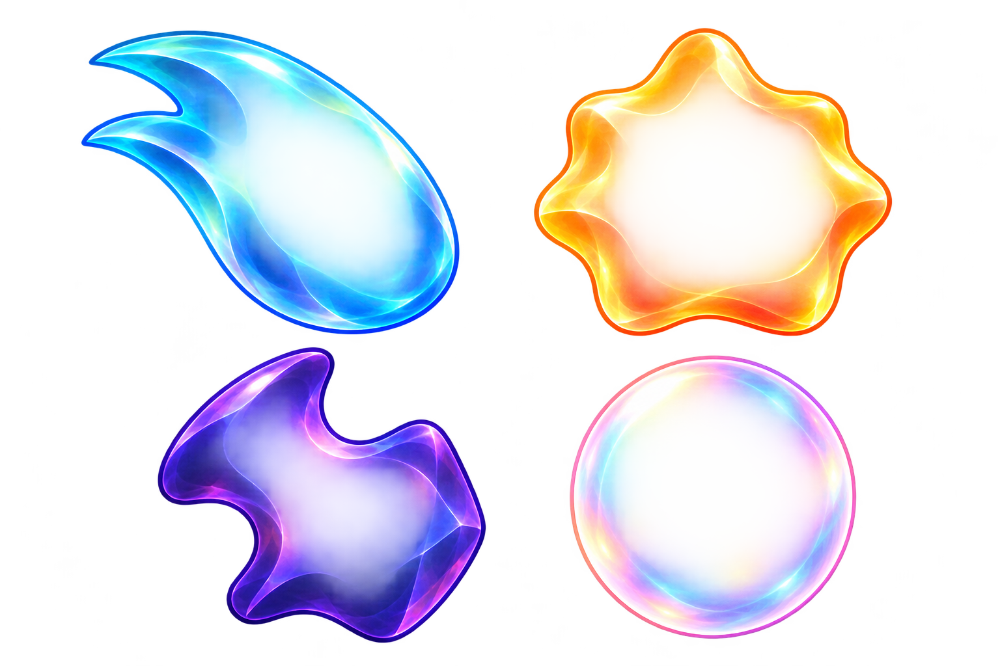
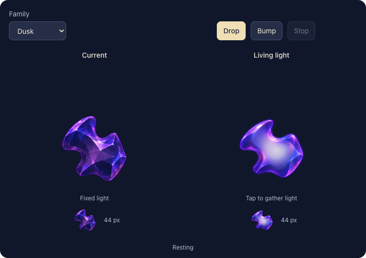

# Living starlight

**Adopted and development-verified — October 20, 2026.** A stable shard holds one responsive light. The user approved bringing this response into the normal game and delivering the verified result to the original phone. All seven gameplay families are implemented; the original face-bearing story cast remains. The [native evidence record](../../../evidence/living-starlight-2026-10-20/README.md) binds passing Core/build/hosted/UI checks, inspected materials, a 49-piece board and sampled normal motion to snapshot `756c0353`, runtime `dev.e2b265734e`. Publication and canonical delivery remain pending.

The hypothesis is that light with inertia, attention and recovery gives the varied pieces a readable presence at gameplay size. The initial four-family browser study below prompted this decision. Its checks establish only that study's behavior, not native rendering or physical feel.

## Native acceptance

| Boundary | Observable acceptance |
| --- | --- |
| Seven families | Spark, Sunny, Pip, Twinkle, Nova, Dusk and Opal keep distinct silhouettes and family colors at forecast and board sizes, over light and dark scenery. Story portraits remain unchanged. |
| One inner light | Each gameplay body uses one GPU-rendered connected light, contained by a cached interior mask. The family rim and Dusk's concave notches remain readable; no paired dots, detached insects or extra body copies appear. |
| Forecast and rest | The forecast uses a cached resting composite of the same shell and light. Prewarming creates shell, mask, composite and one shared shader per family. Per-piece attributes keep responses independent without decoding, drawing, scanning pixels or creating a shader per node. |
| Fall, contact and touch | Native full-motion samples show the light lagging in flight, gathering and recovering after contact, and briefly attending to touch. Responses finish and restore the neutral light; they never move a committed cell or decide a rule. |
| Dense play | An inspected 49-piece native board retains family recognition, input targets and separable ordinary/grown bodies. Inspect normal responses in this density rather than inferring comfort from a sparse sheet. |
| Quiet and interruption | Calm Effects, Reduce Motion and the existing VoiceOver presentation policy keep a steady light. Restart, backgrounding, scene replacement and interrupted responses cancel owned actions and restore neutral values without stale completions. |
| Compatibility and delivery | Rules, RNG, matching, growth values, hit geometry, sky archive v9 and world envelope v1 remain unchanged. Build and selected regression checks precede integration into current main; installation uses only the [canonical updater](../../../../scripts/README.md#one-app-iphone-updates). |

[`LivingLight`](../../../../App/LivingLight.swift) owns the cached shell/mask/rest composition and seven shared family shaders; [`SkyPiece`](../../../../App/SkyPiece.swift) retains shared forecast/flight/board identity and caching. Immutable family uniforms bind each shell, mask and palette. Each sprite owns `SKAttribute` values for `a_light`, `a_drain` and `a_pressure`; one piece's response or retained drainage must not affect a sibling. Cancelling decorative motion restores `a_light` while preserving committed drain/pressure. The cache bound is nine material references: three 256×256 rasters per gameplay family plus two shared historical Field/Hole rasters, or **6,029,312 nominal RGBA8 bytes**. The existing grown aura is separate. This is a raster accounting bound, not measured GPU/process memory or a performance result.

Development verification closes the bounded native adoption and browser comparison. Next publish the verified inputs and use current-main delivery. Physical recognition/performance, minimum-OS rendering and actual VoiceOver retain their separate acceptance gates; no alternate app or permanent comparison switch remains.

## Initial four-family browser study

**Initial generated shell layers, not finished sprites or native evidence.** Their translucent centers are intentionally incomplete until composited with light. The image contains no animated core. The exact [prompt](shells-prompt-v1.txt) and [crop/registration receipt](packaging.json) preserve the built-in image-generation source and deterministic exports.

## What to judge

| Event | Intended expression |
| --- | --- |
| Rest | A luminous presence fills the interior; the colored boundary still identifies the family. |
| Fall | Light lags behind the shell with a continuous soft wake. |
| Contact | The presence gathers toward impact, overshoots once and recovers. |
| Attention | Light approaches the touched side, pauses briefly, then returns. |

Keep a single broad light with a bright heart, avoiding paired dots, literal insects, loose particles and face substitutes. The silhouette stays stable. Family differences come from timing and recovery, without changing the rules or turning the whole body into rubber. Four contrasting families bounded the browser study; native integration extends the selected treatment to all seven.

The decision is whether the response feels intentional and remains legible at gameplay size. A larger hotspot alone is insufficient. This can provide life and curiosity, but may not replace the emotional specificity of eyes and expressions. The original cast remains a valid alternative if companionship is the missing quality.

## Historical study boundary

The user selected native integration after reviewing this study. Its artwork and browser behavior remain design history, with no runtime comparison route or alternate app to maintain.

The browser-only batch used app baseline `d94903b69e864218ca2643ddc191676324f69654` and changed no app, rule, save or build inputs. The [browser record](browser-checks.json) binds the inline study's hash and confirms 320/736-pixel fit, four-family finite bump/reset, Drop/attention samples, static reduced-motion behavior and zero JavaScript errors. That batch's hygiene, whitespace, local links and export hashes passed. These results do not establish the subsequent native implementation; its separate evidence record owns native checks, dense scenery and sampled motion. Physical feel remains unverified. Actual VoiceOver is deferred to RC.

**Browser concept at 736 pixels, not a game screenshot.** Both columns use the same illustrative shell movement; the left reuses the production PNG, not native SpriteKit animation. The right uses a generated membrane over procedural light. A first compact nucleus looked like a pearl in glass, so the inspected version uses a broader connected wash. The study demonstrates the response idea; it does not establish that it replaces facial expression.
