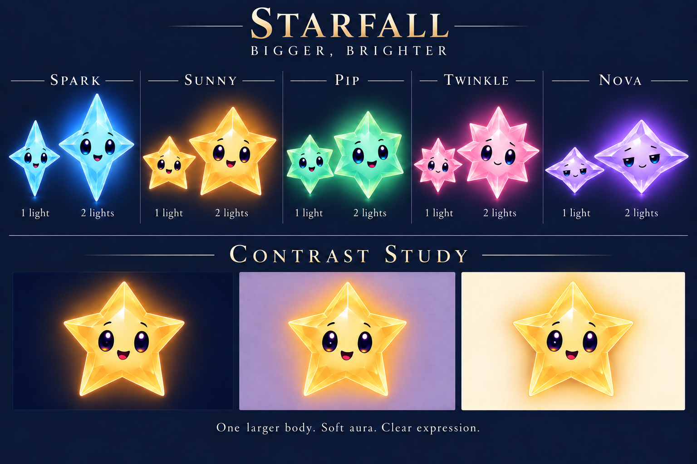
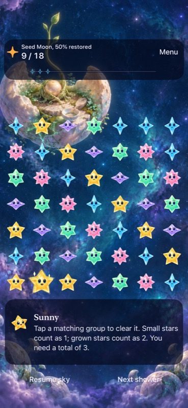

# Main cast review against Murk

**Review recommendation: reopen character construction before production adaptation.** October 20, 2026. This is an art-direction judgment based on inspected artwork, not an audience study or a replacement approval.

Murk is the stronger character design. His anatomy, material and poses communicate a specific appetite and way of behaving. The stars form an appealing, readable matching-piece family, but several remain underdeveloped as named story characters. The latest pass improves finish, growth clarity and pose coverage without resolving that gap.

Retain the larger single body and separate renderer aura as the growth direction. Preserve Murk. Use the new sheets as references and a coverage checklist; do not treat them as final character approval. Reopen proportions, facial construction and expressive use of the rays, starting with Sunny and Pip, then Twinkle. Keep Nova as a useful comparison.

## Why Murk works

**Approved concept, not a production rig.** Inspect how the same few shapes support scheming, inhaling, fullness and alarm.

- **The crescent does several jobs.** It establishes the moon, gives the face an asymmetric frame and separates pale stone from the dark body. The detached crescent hands extend the same shape language into reaching, cupping and clutching.
- **His motive changes his body.** A large opening makes hunger physical; collected color and swelling fullness show the consequence. His desire is visible before dialogue explains it.
- **He has a distinctive way to move.** Floating hands can lead a gesture while the heavy body follows; the loose smoke can lag behind an exit. These are useful animation relationships already suggested by the drawing.
- **The face can make decisions.** Large eye whites, shifting pupils, substantial lids, brows and an expandable mouth support calculation, pleasure and loss of composure. His expressions change the balance of the whole face.
- **The sheet demonstrates intention.** Arrive, feast, gloat and flee form a causal scene. It is possible to describe what he is doing and why without the labels.

The useful standard is how much character each major shape communicates. Murk has more room and narrative emphasis than a repeated board piece; copying his complexity onto every star would damage gameplay clarity.

Two production cautions remain even for Murk. His swallowed light shapes must not read as captive living stars; staging should keep the helpers visibly safe outside him. His detached crescents must read as active hands in motion, since a small still could make them look like orbiting ornaments. Neither concern calls for changing his approved design.

## Where the cast falls short

**October 20 concept, not runtime evidence.** This solves a presentation problem more convincingly than it solves individual character identity.

**The shared face dominates the ensemble.** Spark, Sunny, Pip, Twinkle and Opal largely repeat glossy oval eyes, small brows and a small central mouth. Their hues and ray counts separate families. Their facial construction gives less information about who they are. Nova's lids and Dusk's sharper face are useful exceptions, but a lid preset alone offers limited range.

**Personality is mostly attached through captions.** “Curious,” “welcoming,” “practical” and “attentive” are strong writing intentions. The drawings often resolve those intentions into the same happy, surprised and closed-eye happy expressions. Pip's practical temperament barely survives outside anticipation; Twinkle's quiet-glow face borrows Nova's sleepy shorthand.

**The sheets catalogue states more than choices.** Idle, fall, contact and grown are useful production coverage. They do not establish how someone reacts to a problem. “Share light” is frequently close to idle with extra glow. Unlike Murk's theft sequence, there is little visible decision, effort or consequence.

**Surface rendering is doing too much work.** Facets, catchlights and bloom make attractive illustrations, but they disappear or merge at small sizes. The strongest surviving features are body proportions, outer shape, value and eye placement. More white facet lines cannot supply missing personality.

**The cast and world need a more deliberate material relationship.** Murk's worn stone, soft smoke and warm interior feel tactile and specific. The stars lean toward pristine decorative jewels. Those materials can coexist, but the shared world should be evident in the treatment of edges, asymmetry and light. Adding grime, costumes or accessories indiscriminately would not solve this.

**The last pass was too conservative.** Locking every existing proportion and the common facial grammar before testing character identity narrowed the work to polishing. Protect family recognition and game semantics. Treat exact symmetry, point proportions and facial anatomy as open questions during concept exploration. This does not authorize changing the normal app's identities or non-color cues before a replacement is selected and verified.

## Character verdicts

| Character | What earns its place | Adversarial finding | Next design brief |
| --- | --- | --- | --- |
| **Spark** | Tall four-point body contrasts clearly with Nova and suggests quick movement. | Curiosity barely changes the posture; idle, anticipation and sharing are too similar. The shared face weakens a promising silhouette. | Let gaze and the leading point pull toward a discovery before the rest of the body follows. Explore an eager forward rake, modest asymmetry and an overshoot/recovery. Show Spark acting before checking that the others are ready. |
| **Sunny** | Immediate warmth and strong amber recognition. | The least specific star proposition: a smiling gold five-point star relies heavily on familiar category shorthand. “Outgoing” too often means an open mouth. | Explore a broader, softer center, shorter supporting points and lateral points that can open in welcome. Test different eye-to-mouth proportions. Draw Sunny making room for someone, then trying to reassure them while worried. |
| **Pip** | Compact six-point family is readable on the board. | Six points do not communicate practical competence. A raised eyebrow carries too much of the identity; several new poses read like mint Sunny. | Explore compact, sturdy proportions and short rays that can brace, inspect or make a precise adjustment. Give the face concentration and asymmetry. Show Pip fixing a tiny misalignment while missing a larger change behind them. |
| **Twinkle** | Rose eight-ray outline provides useful family contrast. | Pink, gentle and smiling remains a thin character idea. Exuberant grown smiles and sleepy quiet glow pull toward other cast members. | Explore a body that gathers slightly during hesitation, then opens toward something beautiful. Give attention a direction. Show Twinkle noticing the first returning reflection and quietly drawing a friend toward it. |
| **Nova** | Best existing agreement between body proportions and temperament: wide, low and unhurried. | Sleepiness risks replacing a fuller personality. Some movement poses lose the low, wide identity. | Preserve the settled shape; add evidence of awareness. Contrast patient stillness with one precise, decisive movement. Show Nova noticing a pattern before the more active stars do. |
| **Dusk** | Stronger attitude and useful dark-versus-light family distinction. | Sharp brows and the bright tooth-like smile can imply a villain's helper. That competes with Murk and conflicts with friendly, playful Dusk. | Explore an asymmetric playful gaze and a swept or hooked contour. Show hiding, a harmless surprise and self-startlement, with warmth evident before the explicitly happy pose. Avoid making darkness itself the villain cue. |
| **Opal** | Roundness and soft deformation break the angular repetition and suit the connector role. | The face currently adds generic sweetness to a pearl. Its story identity is less developed than its material and mechanics. | Decide what Opal contributes to a scene before expanding the acting sheet. Preserve the established round rest, teardrop fall and soft rebound; explore a quieter face and a distinctive way of attending to others. Equal sheet coverage does not require equal narrative prominence. |

The first construction explorations should focus on **Sunny and Pip**, where genericness and interchangeability are most acute, followed by **Twinkle**. Spark needs a performance and facial pass; Nova is an anchor to develop. Dusk needs tonal clarity. Opal needs a narrative-role decision.

## Keep character ambition compatible with the board

**Historical native reference:** `dev.b77a100`, Seed Moon at 50%, iPhone 17e, 49 stars. See its [source-bound evidence](../../../evidence/seed-moon-2026-10-19/README.md). This illustrates the actual scale constraint, not a new test of the proposed cast.

A named story character and a repeated family token have different viewing demands. Develop one coherent identity that can simplify at board scale: retain its silhouette, principal facial proportions and characteristic motion, while reducing secondary surface detail. Do not solve the gap by making every board star as elaborate as the featured villain or by creating unrelated portrait and gameplay designs.

The proposed stronger growth cue is still worthwhile. Size and aura communicate value; they do not provide a personality. Literal doubled dimensions also remain a separate dense-board validation question.

## The next review should test these questions

1. **Can the face contribute identity?** Show neutral and concerned faces without color, names, facets or glow. Ask which belong together and what differences viewers perceive. This diagnoses facial interchangeability; it is not a requirement that the game discard its color and shape cues.
2. **Does the body express an intention?** Show simple grayscale silhouettes doing a characteristic action. Explore proportions and ray behavior before rendering attractive material. Recognition alone is insufficient if every body acts the same way.
3. **Do the characters make different choices?** Give Sunny, Pip and Twinkle the same four-panel situation: a lantern fails, they notice, encounter a setback, and help. Sunny should attend to a neighbor, Pip to how the mechanism fits, and Twinkle to the first subtle sign of returning light. Remove explanatory labels and ask what happened.
4. **Can a star hold a scene beside Murk?** Stage one star witnessing his theft and choosing to help another. Judge emotional credibility and attention in the same composition. Preserve Murk and improve the star's performance.
5. **Does the selected design survive the actual game?** Review 24/36/44-point materials and dense native play, including adjacent grown bodies, color-independent identification and ordinary motion. Large portraits do not establish that.

Only then expand a selected construction into complete sheets. Avoid another seven-character finish pass while the underlying decisions remain unresolved. Do not distribute Murk's crescent hands across the cast or give everyone a hat, prop, emblem or extra sparkle to manufacture distinction.

## Scope and evidence

Inspected Murk's approved sheet; all seven October 20 character sheets and the growth study; the retained runtime material export; the 49-star Seed Moon capture; and the game bible's cast/Murk roles and Opal motion contract. Two independent reviews checked the character-identity and acting/gameplay conclusions.

This review changes documentation only. Existing staged artwork from the preceding pass is preserved. No assets were regenerated, no runtime source was changed, and Murk's approval remains intact. The critique is a reasoned visual assessment; no blind recognition study, new animation playback, native playtest or legal review was performed. The proposed tests above have not been run.

Documentation checks: repository hygiene and working/staged whitespace checks pass; all four local references in this review resolve. The preceding eight artwork and twelve prompt hashes remain unchanged.
