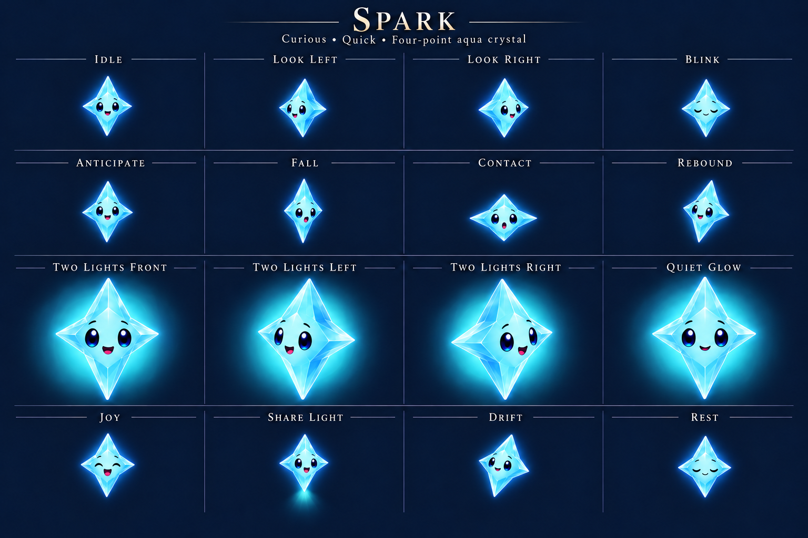
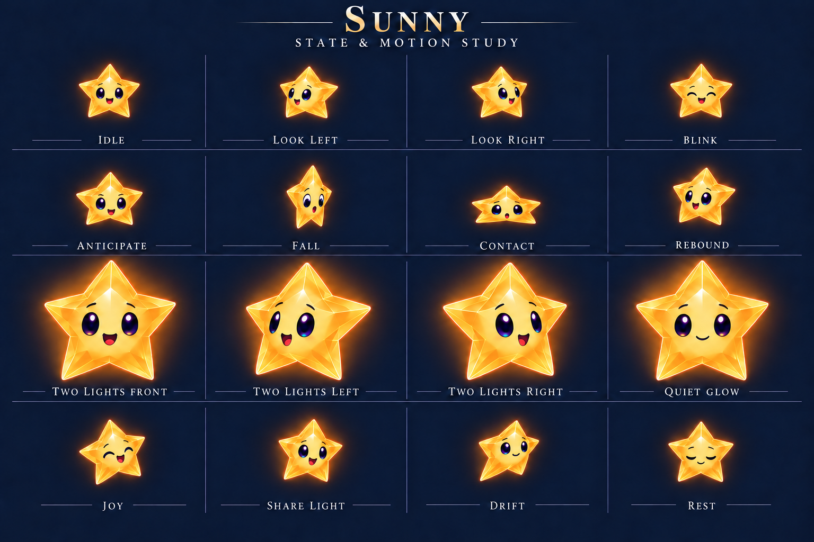
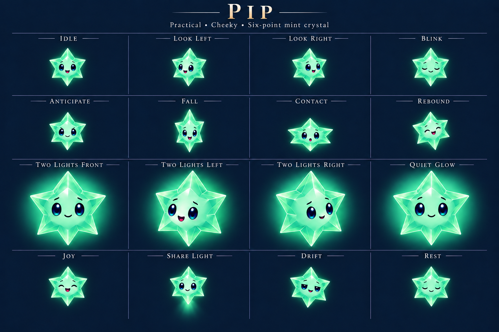
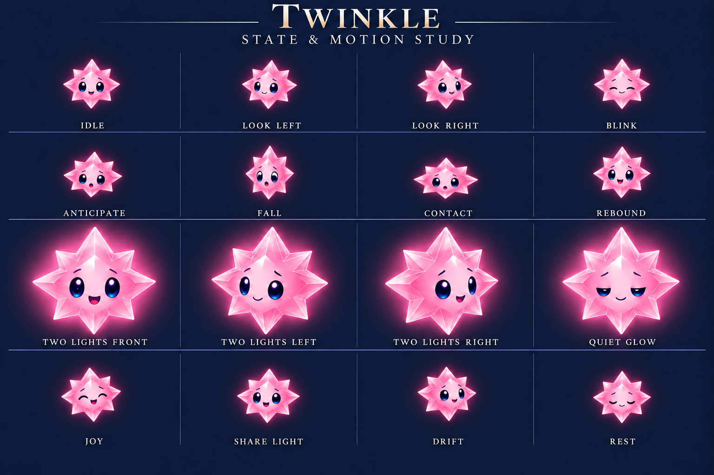
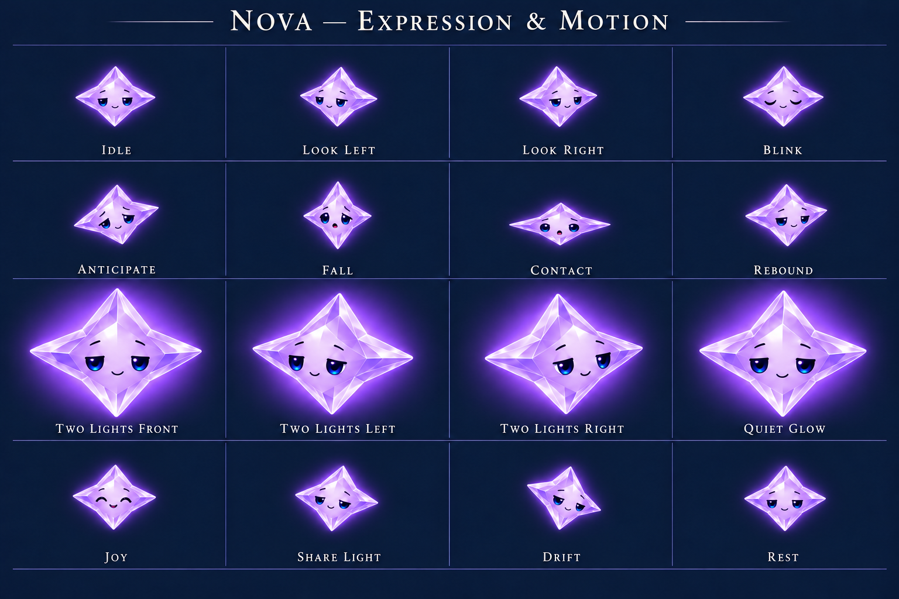
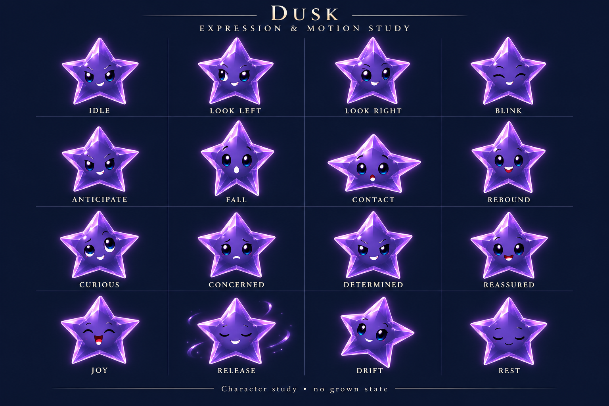
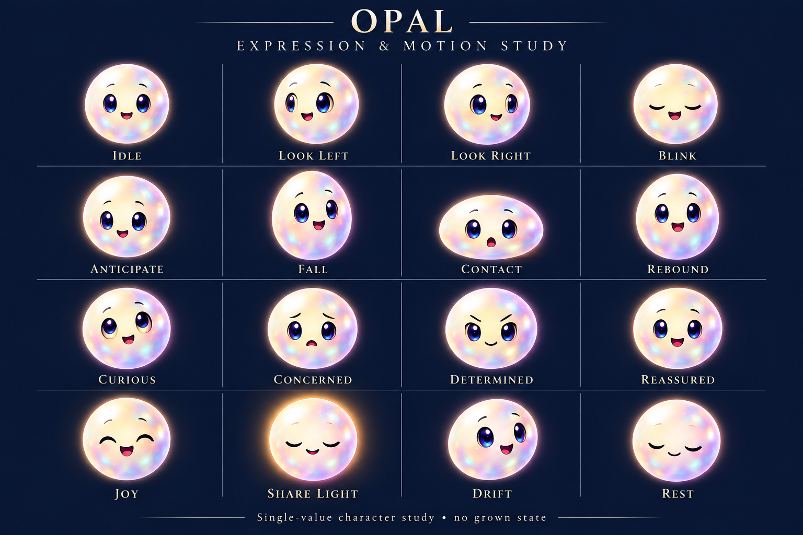

# Cast refinement — October 20

**Status: Concept artwork for review.** Refine the existing cast's consistency, expressions and motion poses, replace the cluttered grown-star treatment, and assess resemblance to Nintendo's stars. This folder contains design references outside the app target; it does not establish a changed or tested runtime.

**Lead design review:** The [adversarial review against Murk](ADVERSARIAL_REVIEW.md) recommends reopening character construction before production adaptation, particularly Sunny, Pip and Twinkle. These sheets improve presentation and coverage but are not final character approval. The larger-body/separate-aura direction remains useful; facial identity and purposeful acting need a more focused exploration.

**Follow-up exploration:** [Three character directions](../directions-2026-10-20/README.md) now compare attached expressive crystal rays, softer moonstone bodies and orbiting ray segments using the same three characters and lantern situation. Select/refine their construction before adapting these pose sheets.

**Generated concept, not a gameplay capture.** The selected direction removes both the old doubled silhouette and the rejected internal light marks. These painted comparisons show relative emphasis; they do not measure an exact 2× scale or prove contrast in the game.

## Direction and acceptance

Preserve Spark's tall aqua four-point form, Sunny's amber five points, Pip's compact mint six points, Twinkle's eight alternating rose rays, Nova's wide violet four points, Dusk's concave dark five points, and Opal's round ivory body.

The user rejected the first internal paired-light proposal because the marks resembled pimples or breasts. Remove it from the candidate direction. The revised request is an emphatically larger body with an aura. Compare a literal twofold width/height increase, keeping one clear silhouette and a soft family-colored light field. No inset light dots, floating value diamonds or offset duplicate stars.

Each character sheet must retain recognizable personality through idle, looking, blink, arrival, contact, rebound and release. Colored families also show the larger two-light state. Dusk and Opal do not acquire a grown state. Preserve one lighting direction, clear facial space, color recognition and a consistent material family.

Concept acceptance requires inspecting every sheet for identities, ray counts, coherent expression, actual closed blink, meaningful motion poses, and absence of the rejected growth marks. Illustrations are not normalized sprite atlases: exact pivots, alpha, interpolation, small-scale readability and native motion require subsequent asset production and runtime verification.

## Expression and motion sheets

The five colored families use four rows: idle/look/blink; anticipation/fall/contact/rebound; grown views/quiet glow; joy/light release/drift/rest. Dusk and Opal replace growth with curious/concerned/determined/reassured expressions. Light release keeps the characters intact, consistent with the story's willing sharing.

| Spark | Sunny |
| --- | --- |
|  |  |
| Pip | Twinkle |
|  |  |
| Nova | Dusk |
|  |  |

These are generated reference sheets showing combined appearance. Their navy backgrounds, illustrated auras and typography must not be sliced into production sprites.

## Aura belongs in the renderer

Keep the body's material shading, bevel and localized highlights in its cutout. Make enlargement and the external aura separate presentation of the committed two-light state. A cached soft radial texture, tinted to the family, is the recommended first implementation. This does not require a dynamic light or a new lighting engine.

Place the aura behind all character bodies, preserve one crisp body contour, and tune its falloff independently from body brightness. An optional low-amplitude pulse uses the existing character cancellation boundary; Calm effects, Reduce Motion and VoiceOver keep the static cue. Clear, rebuild, suspend and scene replacement must dispose of the effect. No new rule, save field or scheduler is needed.

Do not confuse that luminous layer with a separation shadow. On bright paintings, a restrained cool-dark silhouette shadow or darker lower-right bevel may help the body edge; a ground ellipse would imply a floor beneath the floating star. Compare shadow on/off in the actual game before adopting it. These sheets do not prove the shadow is necessary.

### What doubling means on the board

The current grown body is only 1.229× its ordinary width/height, approximately 1.51× its area. At a representative 54-point cell spacing, Sunny's opaque body is about 37.1×35.5 points; doubling dimensions gives 74.2×71.0 points.

| Treatment | Maximum body extent in cell units | Consequence |
| --- | ---: | --- |
| Current ordinary | 0.687 | Broad space between bodies |
| Current grown | 0.844 | Modest size difference |
| Literal 2× width and height | 1.374 | Adjacent grown tips can overlap by 0.374 cell |
| 2× area, explicitly a different option | 0.971 | Nearly fills one cell |

Honor the user's literal enlargement request in the next native comparison. Do not silently substitute double area. The existing landing squash can temporarily widen a double-dimension star to about 1.55 cells. Test two adjacent grown stars, grown/ordinary neighbors and rapid landings before settling production size. Ray overlap does not by itself establish face occlusion, but hit-cell correspondence and recognition need real play.

These are calculations from `LandingGeometry`, `FallingSkyCharacter.bodyScale`, `StarCast.silhouetteSide` and packaged body extents at source `d0dfcc1`, not measurements of the generated illustrations. Auras should fade behind neighboring bodies rather than erase their faces.

## Findings from the current game

`FallingSkyCharacter.makeGrowthCue` in `App/FallingSkyMotion.swift` adds two enlarged, offset copies of the full character texture at 1.22× and 1.10×, then two diamond glints. The inner copy is nearly opaque. This produces the doubled tips identified by the user.

`StarCast` composites fixed body cutouts with authored faces. Its landing, grown and clearing expressions share most facial geometry across the cast, losing some of the character distinction present in idle. Material and facial refinements should stay in that shared owner, which serves board, flight and interface images.

The current board intentionally omits floor/contact shadows. Explore a compact silhouette separation shadow and a dark material bevel rather than a ground ellipse. Keep face ink and saturated body planes; additional white bloom alone can reduce contrast on bright scenery.

## Nintendo resemblance

The association is plausible, especially Sunny's golden five-point silhouette and paired oval eyes. The colored celestial ensemble also evokes familiar Mario imagery. Crystal facets alone are not a distinction: Nintendo's *The Thousand-Year Door* uses colored Crystal Stars. See Nintendo's [Paper Mario manual](https://www.nintendo.com/eu/media/downloads/games_8/emanuals/nintendo_8/Manual_Nintendo64_PaperMario_EN.pdf) and [Thousand-Year Door presentation](https://www.nintendo.com/en-gb/Games/Nintendo-Switch-games/Paper-Mario-The-Thousand-Year-Door-2445545.html).

My design assessment is to evolve the cast, not replace it. Its mixed ray counts, tall versus wide proportions, authored brows and mouths, dark concave Dusk and restoration setting provide useful distinctions. Those need to remain visible at gameplay size; fine facet detail that disappears at that size contributes little.

The recommended direction combines cleaner crystal planes with restrained internal light and character-specific expressions. A more distant alternative would soften the bodies into hand-shaped starglass with subtle asymmetric cuts. That is an optional future exploration, not an adopted redesign.

This is an art-direction assessment, not legal clearance or a finding of infringement. Common symbols and basic ideas are different from a particular character's creative expression; changing a checklist of details does not establish clearance. [U.S. Copyright Office visual-artist guidance](https://www.copyright.gov/engage/visual-artists/).

## Production boundary

The original Crystal Glow sources and normal app remain authoritative until a candidate is selected and adapted. Keep the current bounded material factory, stable pivots, shared coordinate mapping, save contracts and quiet-mode cancellation. Review actual 24/36/44-point materials against dark, lavender and bright restoration scenery and densely occupied cells. Confirm growth recognition without explaining the cue first.

## Review result and provenance

Eight 1536×1024 images were created with the built-in OpenAI image tool: seven character sheets containing 112 pose cells, plus the growth/contrast study. Selected outputs were copied byte-for-byte into this folder. Exact prompts, including bounded correction passes, are alongside the images; [provenance](provenance.json) records selected source paths, dimensions and SHA-256 hashes. No third-party franchise artwork was supplied as a generation reference.

All seven sheets were visually inspected. Family silhouettes, full closed blinks, distinct contact/fall poses and intact departure bodies are present. The selected sheets have no paired torso light marks, floating value diamonds or doubled growth silhouettes. Dusk and Opal have no growth row. Sunny's initially reversed directional poses were corrected. A bounded size correction made the five colored families' grown row substantially larger; image scale remains illustrative.

| Remaining art limitation | Production correction |
| --- | --- |
| Facet topology, shallow yaw, face placement and pivots drift between generated poses. | Reuse one registered body per family and author faces/turns in the shared material owner. Do not cut these cells directly into an atlas. |
| Spark's anticipation is close to idle; Opal's anticipation is subtle. | Judge finite lean/stretch/squash/rebound in real-time playback. |
| Dusk is brighter purple than the intended smoky indigo; Opal's pearlescence is colorful. | Retain dark/light family recognition in the final color grade and compare against Nova and drained stars. |
| Twinkle's grown smiles are more exuberant than her quiet ideal. | Keep her gentler brow/mouth treatment when authoring the four runtime expressions. |
| Aura looks stronger on dark backgrounds; the pale-background study still has a low-contrast edge. | Tune the separate aura and compare the optional compact dark separation layer on real restoration paintings. |
| Grown sizing is approximate and can overlap adjacent cells. | Apply exact renderer scale and inspect dense, animated boards before adoption. |

Source inspected: clean `d0dfcc1` checkout. This batch changes only the root README, documentation indexes and this unbundled art folder. No build-affecting inputs changed. Native builds, interaction, animation, VoiceOver and phone delivery were not run; generated stills cannot establish those results. Next adoption point is selection of this art direction followed by a bounded production adaptation in the normal app, with no alternate runtime route.

Repository verification: `python3 scripts/ci-hygiene.py` and `git diff --check` pass. A Python standard-library check resolves all seventeen local gallery/review/provenance links, verifies eight image and twelve prompt hashes, and confirms all images are 1536×1024. Asset bytes match their selected generator outputs. These checks establish package integrity and documentation hygiene, not gameplay acceptance.
