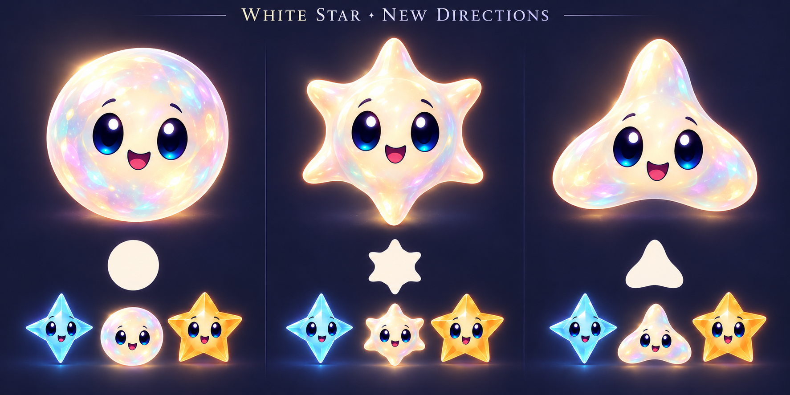

# White connector: symbol and opaline-material exploration

Status: **Opal Orb selected by the user**; body packaged with authored runtime expressions; combined gameplay acceptance pending. Radiant Pearl and Soft Tri-Star are pocketed for possible future roles, with no new mechanics or progression authorized for them. The user asked to explore a different design, research star symbols and consider a round, opaline body. This supersedes the initial seven-point Lumi silhouette as the assumed direction. White/storm implementation remains authorized. The user chose the round opal silhouette and subtle rainbow/omni reading; the personal name and detailed production finish remain open.

Built-in image generation, using the approved Sunny/Spark sheets only as finish/face references. [Exact prompt](prompt.md). The image was inspected: three forms, white/ivory opalescent material, no chain badges, silhouettes and cast-context studies. The requested individual column titles were omitted; left is **Opal Orb**, center **Radiant Pearl**, right **Soft Tri-Star**. Center rays read as solid rounded lobes rather than delicate optical spikes. Small context images have approximate scales and generated cast variations; they are not measured24/36/44pt tests or screenshots. All need transparent normalized bodies, restrained glow/material work and authored runtime expressions before use.

## Research and what it suggests

- [NASA: stars](https://science.nasa.gov/universe/stars/) describes stars as balls of hot gas. [NASA: diffraction spikes](https://science.nasa.gov/asset/webb/webbs-diffraction-spikes/) explains how mirror shape and telescope supports create the spikes in images. A round star character is compatible with an astronomical reading; points are a visual convention, not an obligatory body shape. The orb recommendation is a design judgment, not a scientific requirement.
- [Unicode miscellaneous symbols](https://www.unicode.org/charts/PDF/U2600.pdf) distinguishes star, Sun and conjunction symbols; [Dingbats](https://www.unicode.org/charts/PDF/U2700.pdf) includes pointed stars and rounded/balloon-spoked asterisks. This gives a useful shape vocabulary. These glyph names do not establish that a shape means “wildcard” or “connector”. No cultural/sacred meaning is being assigned to the new design.
- [IAU constellation reference](https://www.iau.org/IAU/Astronomy-FAQs/Constellations.aspx) distinguishes bounded constellation areas from recognizable star-pattern asterisms. Lines and groupings can suggest relationships; the Soft Tri-Star is an original three-lobed form, not a claimed historical constellation glyph.
- [GIA: opal](https://www.gia.edu/opal) and [opal description](https://www.gia.edu/opal-description) explain play-of-color from ordered microscopic silica spheres, with precious/common opal distinguished by whether this effect is present. Milky body plus subtle shifting family-colored light is a useful material metaphor for a connector. It is not literal evidence that a player understands the rule. Keep the body predominantly white; color changes must not imply permanent family conversion.

## Recommendation and next production check

Produce the selected **Opal Orb**: smooth circular silhouette and pearly depth contrast with all six faceted cast bodies, while the warm face keeps the shared world. Remove the literal chain tattoo from the assumed design. Retain the rounded radiant and triangular forms as alternatives until review, rather than spending effort on another full expression sheet prematurely.

Test the selected form against empty cells, ready-group circles, Dusk, grown stars and pale Spark at actual gameplay sizes. Check that it remains a substantial one-star body, not a bubble, currency orb, pearl pickup or two linked pieces. Tune restrained iridescence/outline and expression, then verify native motion and non-color/spoken connector meaning. The original concept batch changed no gameplay, save, build setting or geometry. The later material batch packages the selected orb through the shared renderer; fresh integration-branch skies now select the combined generation, with broader acceptance and remote integration still open.

Production source: [faceless Opal Orb](../../../../Artwork/StarCast/opal-body-v1.png), generated using the built-in image tool with the [saved prompt](../../../../Artwork/StarCast/opal-body-prompt-v1.txt). It is now packaged by the shared tool and rendered with authored faces. Native material sheets and the hosted arrival/restore regression have been inspected; combined environment/interaction and actual VoiceOver acceptance remain pending.
