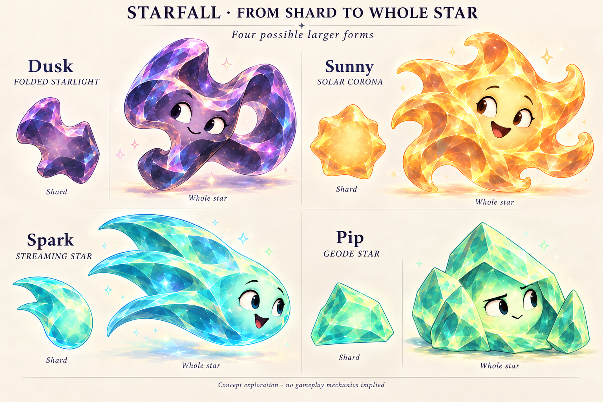

# From shard to whole star

**Status: Rejected as the cast direction, October 20, 2026.** The user does not like these larger interpretations and instead selects [traditional characters paired with varied faceless pieces](../characters-and-shards-2026-10-20/README.md), coordinated by color. Preserve this folder as historical exploration; its review below records what was tested, not the current recommendation.

The original exercise treated Dusk, Sunny, Spark and Pip pieces as fragments that could suggest larger stars. The user continues to like the varied playable shapes, particularly Dusk's contour.

**Generated concept — not gameplay.** Small samples are faceless; larger characters remain intact. This is a proposed visual relationship, not a fracture animation, upgrade path or selected cast replacement.

This is a useful visual relationship to explore before choosing whether the board pieces and named cast are separate. A fragment can carry a memorable contour or facet from a larger being. The larger being then has more room for anatomy, acting and silhouette than a compact board token.

## The design test

| Character | Proposed whole form | What the fragment should reveal |
| --- | --- | --- |
| Dusk | One broad ribbon of crystal light folded through an asymmetric loop | The opposing notches and thick turn belong to its crossover. The opening and folds can support playful peeking. |
| Sunny | A generous solar body with an uneven, sculptural corona | The golden piece echoes a cupped section of the broad solar folds. Its open mass supports welcoming gestures. |
| Spark | A leading luminous body with a sweeping fan of connected light streams | The aqua piece echoes the curved shoulder and hooked taper of a stream. The whole silhouette directs attention forward. |
| Pip | A slanted crystalline shell sheltering a luminous inner body | The mint piece echoes a substantial shell plate. Its deliberate planes support close inspection and careful tilts. |

Judge whether the pairs connect through contour and structure, rather than color alone. Each whole form must be appealing on its own and explain more than a larger version of the same tile. Do not force every completion into a radial five-point star.

The small samples are faceless in this study; faces belong to the whole characters. This is one way to examine separated objects and cast, not a decision to remove faces from the current game.

## What the first image establishes

**Dusk is the most useful result.** Its admired notches and curved front section visibly belong to a larger folded body. The offset opening gives that anatomy a possible performance vocabulary: peeking, curling and unfolding. This is a stronger explanation for the unusual piece than evaluating it only as a self-contained miniature star.

Sunny's broad curled corona produces a warm, generous whole form, but its small solar sample is related mainly through color, material and curved planes; an exact local fragment relationship needs a more deliberate drawing. Spark's streaming shape is appealing and directional, but the result is closer to an amplified comet with additional fins than a distinct parent inferred from a sliver. Pip's wedge relates clearly to the surrounding crystal structure, although the whole still risks reading as a mineral cluster with a face. Its sheltered inner body and purposeful movement need further development.

The shared facet density is higher than the brief requested. These are candidates for character construction, not finished model sheets or geometric cutting patterns. No literal part-to-whole fit has been measured, and no motion is demonstrated.

## Story and gameplay remain separate decisions

The visual relationship can support literal fragments, naturally shed material, or crystallized light associated with each character. No origin is settled here. The sheet shows intact characters alongside design samples, without a breaking, reassembly or upgrade sequence.

Selectable characters, unlocks and special mechanics remain optional ideas from the user, not implemented or required by this exercise. The current app, rules, saves, cast resources and Murk design are unchanged.

## Sources

The [varied silhouette board](../directions-2026-10-20/celestial-silhouettes-v2.png) supplies the fragment shapes and expressive crystal treatment. The approved [Murk sheet](../../world-01/murk-v1.png) supplies the standard for integrated anatomy and acting, without copying his moon/crescent construction. The built-in OpenAI image tool generated one 1536×1024 study. Its [exact prompt](whole-stars-prompt.txt) and [provenance](provenance.json) are retained; the selected PNG is copied byte-for-byte from its generated original.

Source: `d0dfcc1` with the preceding October 20 character artwork and documentation staged. This batch adds only this unbundled design folder and updates documentation indexes/current design decisions. No build-affecting source, app resource or configuration changed. The full image and all four relationships were visually inspected. Repository hygiene, whitespace, local links and file hashes are checked; native build, interaction, animation, VoiceOver and device validation are not applicable to this art-only study.
