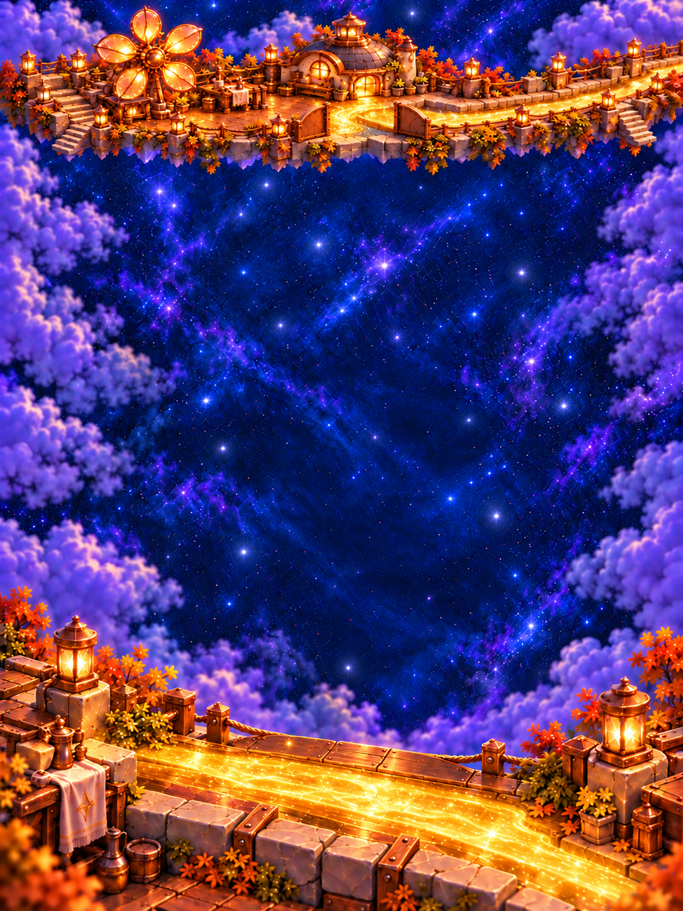

# Sunwheel Mill

**Status:** Adopted for development; publication and installation pending · **Updated:** October 20, 2026 · **Owner:** Current implementer

Restore a community workshop that sends useful light onward. A broad copper flower-wheel rises above a low slate-and-timber mill; connected working terraces, bearing access, channels and a footbridge explain how this place is used. At completion, its closed outlet opens and a golden ribbon reaches the onward route toward Bell Choir.

Fifteen distinct paintings are packaged and source-accepted: five cumulative states for each of three bespoke compositions: iPhone, iPad portrait and iPad landscape. Start with the [art brief](BRIEF.md), [production acceptance](PRODUCTION_PLAN.md) or [board reviewer](board.html). The reviewer uses the packaged faceless piece shells, with ordinary and representative grown sizes, over one continuous painting. It omits native `LivingLight` interior fill/shader, aura and deformation. It is a composition study, not native gameplay evidence.

The [atlas](../WORLD_ATLAS.md#07--sunwheel-mill--useful-work-starts-again) owns the approved identity and story. The [level-design kit](../level-design-kit/README.md) owns camera, layout, bleed and scale. The [current piece contract](../star-cast/README.md#motion-material-and-growth) distinguishes faceless gameplay pieces from the expressive story cast. No walking residents are painted into the board.

| Painting | Visible restoration |
| --- | --- |
| 0% | Copper flower-wheel, quiet mill and connected terraces remain recognizable. Bearing, glass vane inserts and channels are dormant; outlet is physically closed. |
| 25% | Center bearing, one rounded vane insert and its nearby housing awaken. |
| 50% | Three vane inserts glow; the mill and nearby workshop lights awaken while the first response persists. |
| 75% | All five wheel inserts and ordinary workshop lamps are restored. The outlet remains an unmistakably closed copper gate and the onward channel is dark. |
| 100% | The outlet's copper leaves separate around a visible opening; contained golden light follows the onward channel. All earlier recovery persists. |

The existing 18-light challenge selects paintings at scores 0/5/9/14/18. The shared registration makes a committed Frostfruit Orchard repair the prerequisite for this seventh location through the existing world journey. Five later locations remain unavailable. Existing light transfer, whole-image transitions, native actions, saves and local repair records remain the implementation boundary; slow wheel rotation, sound and story clips in the atlas remain future art direction.

The [selected asset manifest](production-assets.json) records all fifteen App paths, original attempts, exact dimensions, byte sizes and SHA-256 hashes. Independent source review verified fifteen distinct hashes and byte equality with every selected original output. [Prompt provenance](art-prompts.json) retains the attempts and corrections. The final landscape 75% removes the extra gate leaf; portrait 100% was regenerated from its selected closed 75% to preserve the outlet's position. Source review finds a coherent closed/open reward in all three families.

| iPhone | iPad portrait | iPad landscape |
| --- | --- | --- |
|  |  |  |

**Selected packaged source paintings — not native captures.** All fifteen were visually inspected for cumulative vane/lamplight, fixed scenery and the closed-to-open outlet. This does not establish native UI contrast, input or transitions.

[Original board verification](../../evidence/sunwheel-mill-2026-10-20/README.md) passes at `d057696` / `dev.a15832d0fd`, with the current living-light pieces and first-pair Story rules integrated. Source-bound Core, hosted, phone/tablet/compact and routing checks pass with zero skips; Sunwheel native stills and sampled normal completion are inspected. [Three retained native captures](../../evidence/sunwheel-mill-2026-10-20/captures.json) show the closed 75% outlet, dense landscape board and open-outlet portrait result. Publication and canonical installation remain pending. Physical play, measured contrast, continuous-playback performance, actual VoiceOver and full RC retain separate acceptance.

[Latest map-integration verification](../../evidence/sunwheel-mill-2026-10-20/MAP_INTEGRATION.md) passes at `49d54fc` / `dev.6fa54c5e65`, adding the [two transparent map sprites](map-island/README.md) through the existing modular renderer. The fifteen board paintings are unchanged. The newer report records affected UI/routing checks separately from the original full board/state and sampled-motion evidence. Publication and canonical installation remain pending.

The [production plan](PRODUCTION_PLAN.md) retains the incomplete pre-derivation sparse/dense review gate and the limited historical master probe. Later final-state checks establish their own coverage; they do not rewrite that sequence.
