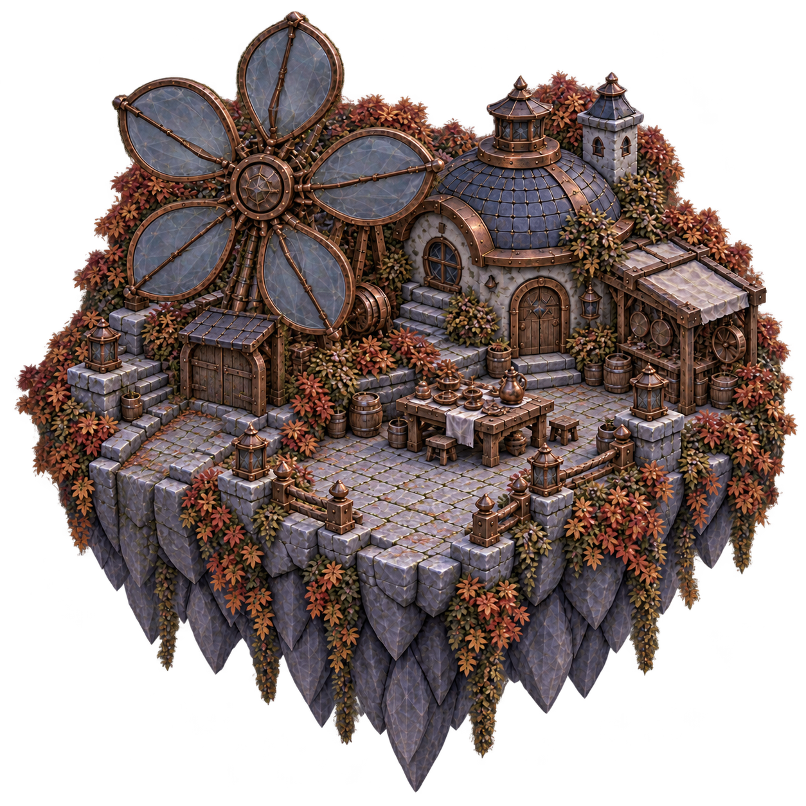
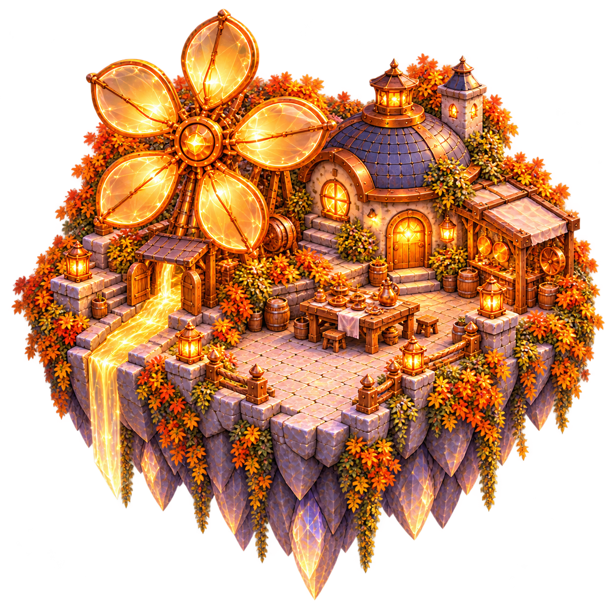

# Sunwheel Mill map island

**Status:** Adopted for development; publication and installation pending · **Updated:** October 20, 2026

Two transparent map sprites extend the [modular world map](../../world-01/production/layered-2026-10-20/README.md) with Sunwheel as its seventh ready island. They are separate from the [fifteen gameplay paintings](../production-assets.json): the map represents committed repair as damaged/restored, while the playable board presents five restoration milestones.

Main `f4144ec` introduced the six-island renderer while Sunwheel was being verified. Merely registering the seventh challenge would leave it selectable only through Places. This pair supplies the missing painted island and native marker through the existing `WorldMapContent`, scene and selection owners. Frostfruit → Sunwheel uses the shared connection mapping. No new progression or renderer is introduced.

| Damaged | Restored |
| --- | --- |
|  |  |

**Source sprites, not native screenshots.** The complete five-vane wheel, workshop, workbench, front path and rocky underside remain registered. Windows and lamps are dark and the outlet is closed in the damaged image; the restored image opens the outlet and illuminates the golden channel. Neither contains actors, text, names, UI or outgoing bridge fragments.

Both original built-in image-generation exports are **1254×1254 RGBA**, copied into the normal asset catalogue without pixel changes, resampling or recompression. [Generation provenance](generation.json) retains both full prompts, reference roles, original paths, hashes and measurements. The alpha≥128 union is `(23,18)`–`(1241,1233)`. The native pin anchors to the front stone path at `(0.50,0.65)`; four route ports use shared terrain. All attachment samples have alpha≥251 in both states. The restored export has two isolated alpha1 corner samples, consistent with the existing family; actual zero-alpha exterior pixels and native matte inspection remain separate checks.

The existing renderer adds 8% logical clearance and keeps native minimum island/label sizes. Seven islands need four rows in two-column portrait and three rows in three-column landscape; scrolling preserves the whole island and full-size controls. Each is still one native button. Repair alone selects the sprite; access, selection, press and focus remain independent native states.

The pair adds **12,580,128 bytes** of RGBA8 source pixels (12.00 MiB); PNG files total **5,015,643 bytes**. This is source-image accounting, not measured resident memory or frame-time evidence. The existing renderer selects one state per island, with no new custom cache. Physical memory/performance remains a separate profiling gate before substantial catalogue expansion.

The existing map components already passed their six-island native slice before this addition. [Latest map-integration verification](../../../evidence/sunwheel-mill-2026-10-20/MAP_INTEGRATION.md) at `49d54fc` / `dev.6fa54c5e65` records real selection/Entry/Back, Frostfruit's earned unlock, mixed repairs, compact/largest text and both tablet orientations. Its ten selected native tests and 53 inspected stills retain their exact scope; [original board evidence](../../../evidence/sunwheel-mill-2026-10-20/README.md) remains separate at `d057696`. Publication and canonical installation remain pending. Physical play, actual VoiceOver, measured contrast and performance remain separate acceptance.
