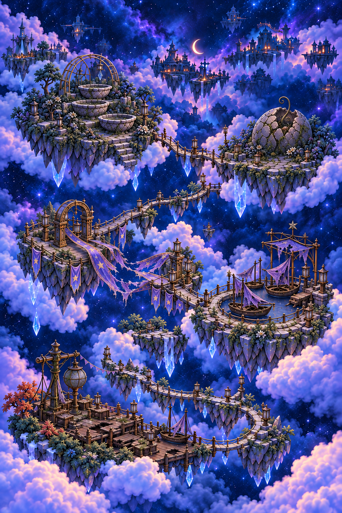

# World-map production sources

**Current work:** The [modular map](layered-2026-10-20/README.md) is adopted for development with [source-bound checks](../../../evidence/ui-adversarial-2026-10-20/IMPLEMENTATION.md). The approved concept guides materials and landmark identity. The [UI production workflow](../../UI_PRODUCTION.md) requires a native slice with independent states and responsive composition before expanding the family.

The replacement separates sky/clouds, seven independently placed islands and their repair states, connectors and native markers/card. `WorldMapArtwork` owns the content/registration catalogue; `WorldMapPainting` composes a read-only app snapshot. Existing Core/store owners retain access, completed repairs and persistence. All twelve identities remain in Places; five have no playable content.

[Ribbon’s travel-identity revision](cohesion-2026-10-23/README.md) aligns its damaged bridge with Entry and gameplay. The original modular exports retain their historical provenance.

## Rejected whole-map prototype

The user rejected the [October 20 full-page pair](interactive-2026-10-20/README.md) as the production implementation. The plates and [generation record](interactive-2026-10-20/generation.json) remain historical provenance; the rejected whole-map runtime assets are removed.

*Historical prototype source paintings, not current renderer evidence. The broad composition was aligned by an image edit; exact pixel registration was not established.*

## Historical twelve-landmark plates

`world-damaged-v1.png`, `world-restored-v1.png` and their [original generation record](generation.json) are retained unchanged as the October 19 production source. They contain the earlier poster layout and baked title. The [original integration contract](../../../OFFICIAL_LOCATIONS_AND_TUTORIAL_PLAN.md) and [development evidence](../../../evidence/official-world-2026-10-19/README.md) preserve that implementation's source-bound results.
