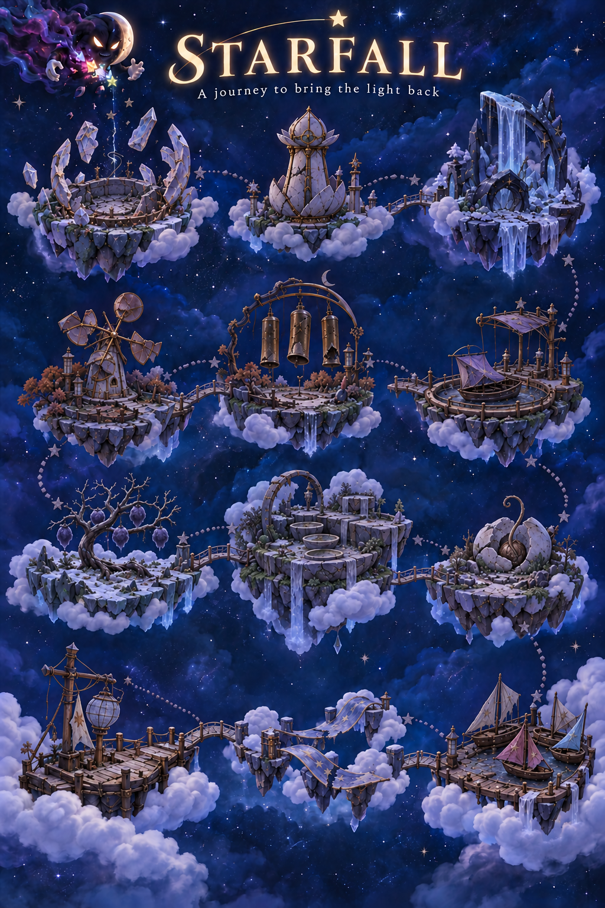
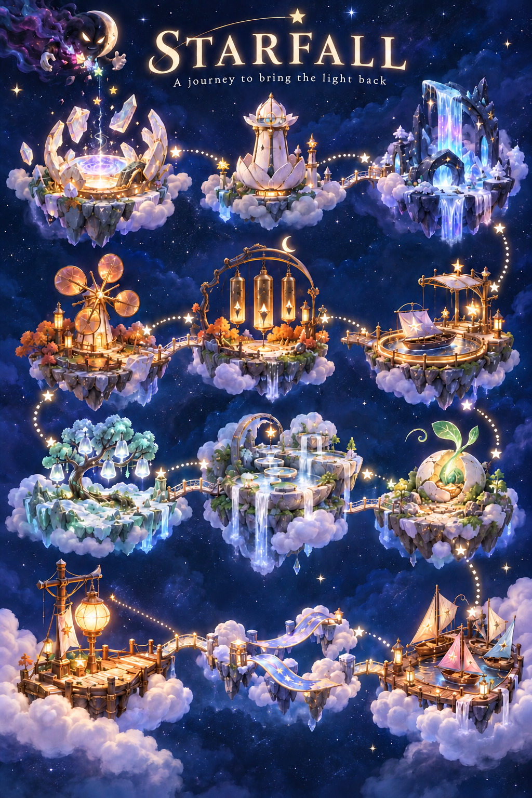

# Painted world-map states

Two 1024 × 1536 registered paintings supply the normal app's overworld. The damaged plate is the baseline; saved completions reveal corresponding regions and outgoing roads from the repaired plate. Native veils conceal unreached details. There are no numbered badges or unfamiliar helper creatures. Runtime controls, names and status belong to `WorldMapView`; the art does not decide access.

These are source paintings, not native captures. The [integration contract](../../../OFFICIAL_LOCATIONS_AND_TUTORIAL_PLAN.md) and [development evidence](../../../evidence/official-world-2026-10-19/README.md) own behavior and acceptance.

Generated with the built-in image tool from the approved map after removing the alien helpers. The [generation record](generation.json) retains exact edit prompts, paths and SHA-256 hashes. Packaged copies are in `WorldMapDamaged.imageset` and `WorldMapRestored.imageset`. `WorldMapLayout` owns normalized landmark/road registration; future edits must keep both plates aligned and recheck the native completion masks on phone/tablet.
