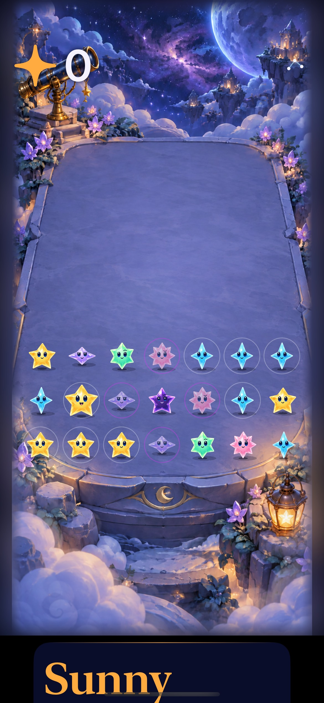
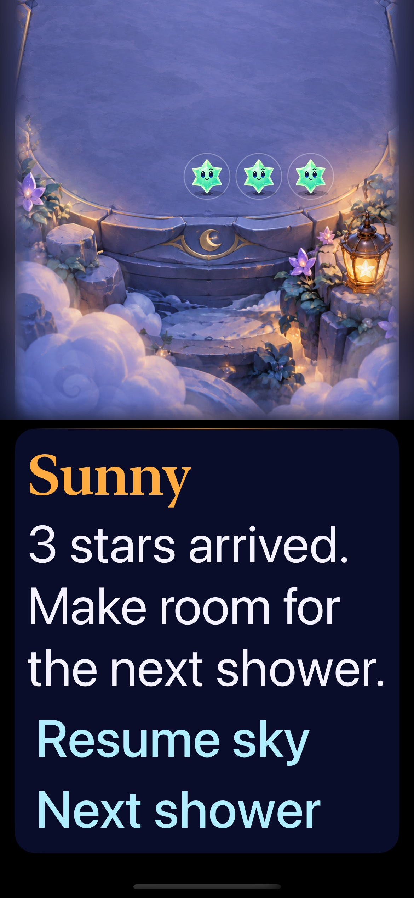
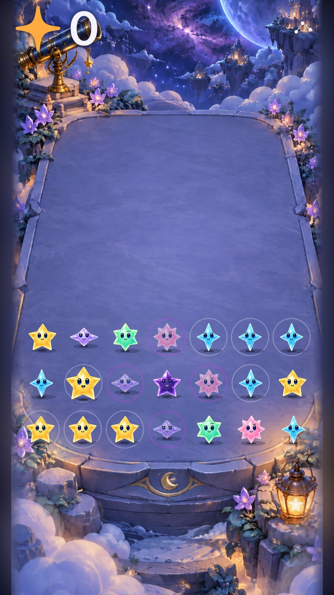

# Accessible terrace and guide layout

**Result: Partially verified · Owner: current implementer · Date: 2026-10-17.** Adopt the layout correction: at accessibility text sizes the terrace keeps a viewport-sized canvas and the full guide flows below it in the same native scroll view. The shared projection is unchanged. Ordinary-size layout retains its existing overlay. This removes the demonstrated text/board overlap on iPhone 17e and SE3; it does not establish complete VoiceOver or device acceptance.

## Acceptance recorded before implementation

- At accessibility text sizes, board and guide occupy separate layout regions. Keep full text and native scrolling; no font shrinking or hidden guidance.
- Rendering, prop registration and native hit cells keep the existing shared mapping. Real front/edge taps clear the expected group at ordinary and maximum text sizes on iPhone 17e and SE3.
- Telescope, lantern, manual shower, menu/settings dismissal and restart remain usable; outcome messages and committed state survive interruption. No rule, clock, RNG, save or normal-size layout changes.
- Reproduce the original maximum-text edge-clear failure, add a focused regression for board/guide separation, then inspect native captures. Run core, relevant native tests, simulator builds and hygiene. Separate actual VoiceOver and animation evidence from layout assertions.

Decision point: adopt the bounded layout correction only after native taps and captures support it; preserve full VoiceOver/human/game-rule gates separately.

## Result against the criteria

| Criterion | Observed result |
| --- | --- |
| Board/guide separation | Pass on both phones. A new native frame assertion fails on baseline: guide text starts at y=580 while front-cell bottom is y=701.31. It passes with the guide as a separate layout sibling. |
| Projected real taps | Pass: maximum-text initial front-left clear on both phones; ordinary sparse/dense corner taps on SE3. Six hosted geometry/renderer checks also pass. |
| Props, manual input and menu | Pass in maximum-text native flows: telescope/lantern respond, next shower advances exactly once, menu opens and Done dismisses. Largest-text settings feedback/dismissal passes on 17e. |
| Outcomes, restart, interruptions | Ordinary-size SE3 First Light completion/restore/replay/survival and paused growth/dark/menu/background/restore checks pass. Maximum-text terminal restart was not separately run. |
| Rules and saves | Unchanged Core/store/scene, RNG, schema, clocks and resources. Existing guide extracted once and reused by both layouts; no new state owner or pilot flag. |
| Motion, VoiceOver, device | Not newly verified. Still captures and native taps prove layout, not falling motion, whole-round actual VoiceOver or physical-device feel. |

The original unmodified maximum-text test passed on SE3 before the new assertion; the historical edge-clear failure is not universal. The direct overlap regression establishes the current demonstrated failure without claiming to explain every earlier tap failure. We did not remove assertions or add retries to obtain green results.

## Native appearance

| 17e board | 17e guide after scrolling | SE3 board |
| --- | --- | --- |
|  |  |  |

Inspected native iOS 27.0 captures from the candidate identified below. Text wraps at full size. Scrolling trades simultaneous board/control visibility for readable copy and unobstructed cells. The very large score shares scenery with the telescope, whose native activation passed; header art overlap is not a new visual polish claim. Markdown rendering was not separately reviewed.

## Source and verification

**Source:** `5bbf809`, with only `App/FallingSkyView.swift`, `App/StarfallTheme.swift` and `UITests/ObservatoryInteractionTests.swift` changed. Candidate export `starfall-production-guide-xayqxbsy` and baseline `starfall-accessible-baseline-pilo8jqt` are captured in [source.json](source.json). Candidate App/Core/UI test hashes were checked against the working tree. Baseline restores committed view/theme while retaining the new test assertion. The only runtime differences are the view layout/extraction and removal of the obsolete fixed canvas token.

Both exports use isolated bundle `com.starfall.validation.guide`. They exclude concurrent dirty project/signing settings, generated workspace and untracked branding. Normal app saves were not reset. No app file/target/resource membership changed.

**Environment:** Xcode 27.1, arm64, Debug native/hosted tests and Release simulator build; iOS 27.0. iPhone 17e MechanicsLab `A84C81F5-AE41-496A-97AE-E17C63E18D29` and iPhone SE3 Small Phone QA `E90550D2-AE94-4695-8E6F-707BD527C12F`. XcodeBuildMCP used `CODE_SIGNING_ALLOWED=NO ARCHS=arm64 ONLY_ACTIVE_ARCH=YES -parallel-testing-enabled NO`, shared scheme Starfall, DerivedData `/tmp/starfall-accessible-layout`.

| Check | Result | Raw artifact |
| --- | --- | --- |
| Original SE3 maximum-text test | 1 pass before regression added | `test_sim_2026-10-17T17-32-07-562Z_pid40582_c3c89390.xcresult` |
| Baseline 17e separation regression | 1 failure, expected overlap | `test_sim_2026-10-17T17-33-30-866Z_pid40582_0308782a.xcresult` |
| Candidate 17e maximum-text board/props + settings | 2 passed | `test_sim_2026-10-17T18-32-24-314Z_pid85535_ec03e93a.xcresult` |
| Candidate SE3 maximum-text + ordinary corners + outcome/restore + First Light replay | 4 passed | `test_sim_2026-10-17T18-33-36-479Z_pid85535_60fcf5dd.xcresult` |
| All ObservatoryGeometryTests | 6 passed | `test_sim_2026-10-17T18-36-15-375Z_pid85535_fc4161e4.xcresult` |
| `swift test` | 61 passed | `/tmp/starfall-accessible-core.log` |
| Release simulator build | Passed, no reported warnings | `build_sim_2026-10-17T18-36-39-521Z_pid85535_5dfb4a71.log` |
| Hygiene | Passed | `python3 scripts/ci-hygiene.py`; `git diff --check` |

Raw xcresults/logs remain under `~/Library/Developer/XcodeBuildMCP/workspaces/Starfall-27844ad883f3/{result-bundles,logs}/`; exported attachments are in `/tmp/starfall-accessible-layout-{17,se}-captures`.

To reproduce after this commit, use the [guide validation exporter](../paused-guide-adoption-2026-10-17/export-validation.py) from a clean checkout (theme now comes from HEAD). Build/test its emitted project with the flags above and `-destination 'platform=iOS Simulator,id=LOCAL_SIMULATOR_ID'`. Select `StarfallUITests/ObservatoryInteractionTests/testLargestTextKeepsPropsAndPausedControlsReachable` and `StarfallUITests/FallingSkyInteractionTests/testLargestTextSettingsFeedbackAndDismissal` for the 17e run. On SE3 select the same Observatory largest-text method plus `ObservatoryInteractionTests/testActualCastSparseDenseAndProjectedCornerTaps`, `FallingSkyInteractionTests/testPausedGuideReportsGrowthDarkOutcomesAndRestore` and `FallingSkyInteractionTests/testFirstLightGoalCompletionRestoreReplayAndSurvival`, each under StarfallUITests. Hosted selection is `StarfallAppTests/ObservatoryGeometryTests`; Release uses `-configuration Release build` without test selections. No blanket retries or motion suppression were added.

## Responsible boundary and remaining work

The old ZStack placed an unbounded Dynamic Type guide over a fixed 1,000-point canvas. More canvas height could not reserve space for copy growth. The correction belongs in layout ownership: the board owns its canvas and the guide owns separate flow space. Rendering, registered props and accessibility cells still consume the same local geometry. The normal-size guide, terminal guide and paused guide retain one implementation. Both board and sibling guide hide from accessibility while settings are shown.

The inspected sibling paths are paused/terminal guide composition, active guide absence, settings hiding, shared cell/renderer mapping, prop targets, ordinary clears and restore. This verifies the demonstrated overlap on two portrait simulator sizes; it does not eliminate every possible projection or focus bug. Tablet/landscape/minimum OS and maximum-text terminal replay remain unverified.

**Decision:** adopt the bounded layout correction. **Next action:** investigate the known actual VoiceOver terrace-first focus behavior with a real screen-reader flow, then return to the natural/Surge comprehension comparison. Candidate phase rules remain isolated. Historical evidence stays source-bound; the old failed captures are not rewritten.

## Combined-main publication verification

Verified source `2659949` in a clean feature worktree incorporating GitHub main through PR #25. During checks only the experiment-register documentation was edited to remove a duplicate adoption row; app, tests, resources and build configuration stayed identical to that source. Personal signing/project state from the primary checkout was excluded.

Xcode 27.1, iOS 27.0, arm64 iPhone 17e “Starfall Crystal Glow QA” (`D65C5E40-734F-42BF-8F91-97E980ED19C2`): Debug native run passed all 10 selected tests with no failures or skips—six ObservatoryGeometryTests plus largest-text board/props/separation, largest-text settings dismissal, First Light completion/restore/replay and system Reduce Motion. `swift test` passed all 61 core tests; Release simulator build, hygiene and diff checks passed. Native screenshots above were inspected again before publication. The SE3 checks and baseline reproduction retain their original source receipts above.

Reproduce using `xcodebuild -project Starfall.xcodeproj -scheme Starfall -configuration Debug -destination 'platform=iOS Simulator,arch=arm64,id=LOCAL_SIMULATOR_ID' -derivedDataPath /tmp/starfall-accessible-final ARCHS=arm64 ONLY_ACTIVE_ARCH=YES CODE_SIGN_IDENTITY=- CODE_SIGNING_ALLOWED=YES DEVELOPMENT_TEAM= CODE_SIGN_STYLE=Manual -parallel-testing-enabled NO` followed by `test` and selections `StarfallAppTests/ObservatoryGeometryTests`, `StarfallUITests/ObservatoryInteractionTests/testLargestTextKeepsPropsAndPausedControlsReachable`, and the three FallingSkyInteractionTests methods `testLargestTextSettingsFeedbackAndDismissal`, `testFirstLightGoalCompletionRestoreReplayAndSurvival`, `testSystemReduceMotionKeepsManualPlayWorking`. Release uses generic iOS Simulator destination, `-configuration Release CODE_SIGNING_ALLOWED=NO build`.

Raw artifacts: `/tmp/starfall-accessible-final.xcresult`, `/tmp/starfall-accessible-final.log`, `/tmp/starfall-accessible-final-core.log`, `/tmp/starfall-accessible-final-release.log`. Full VoiceOver play, maximum-text terminal replay, physical devices, tablets and minimum-OS coverage remain unverified by this publication run.
