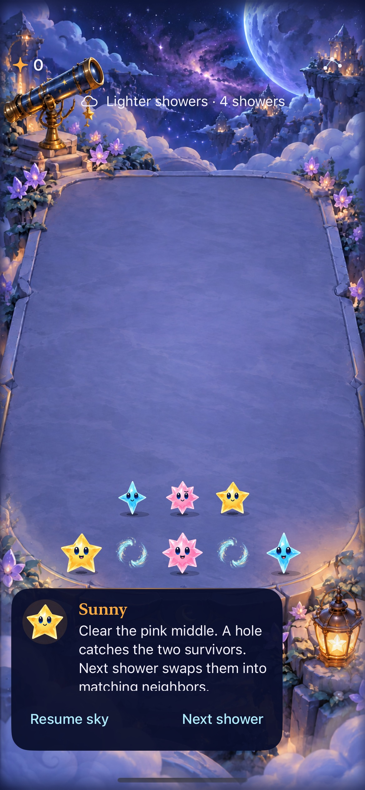
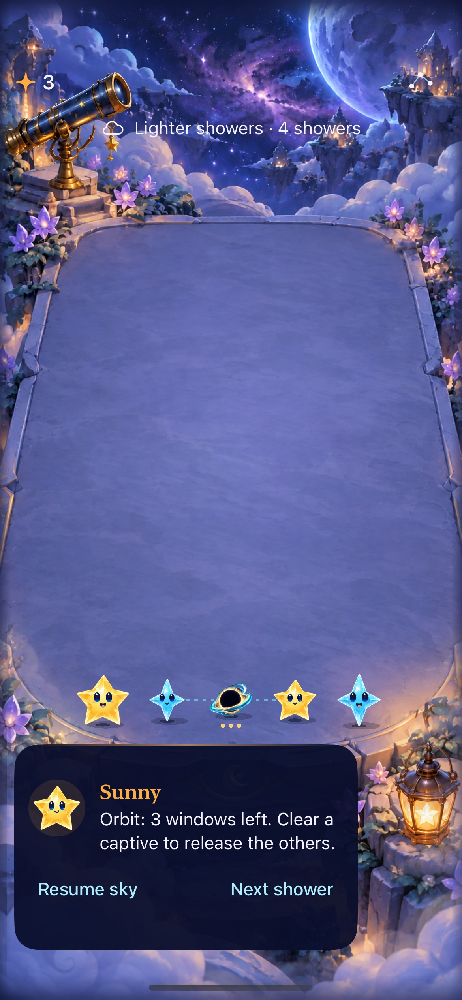
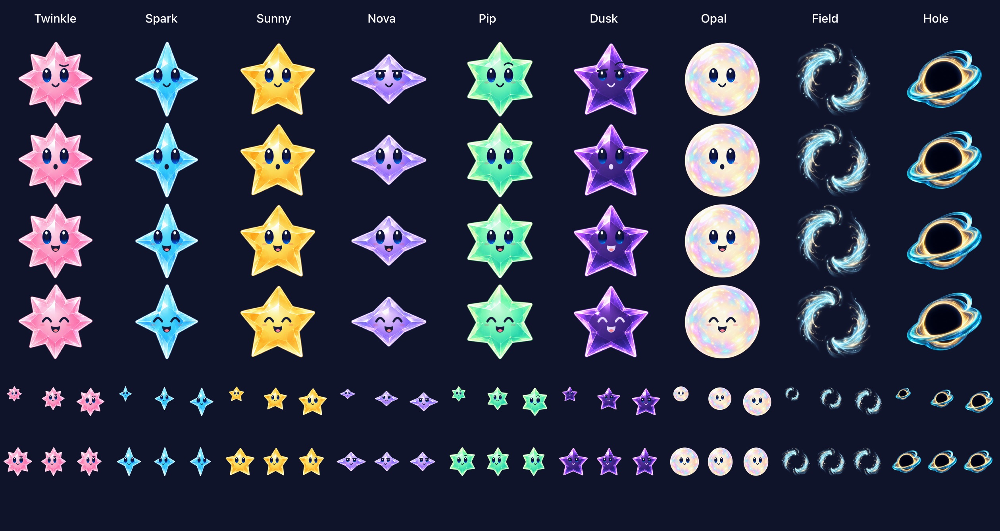

# Attraction reads as a field

**Result:** Verified development checks · **Owner:** current implementer · **Date:** 2026-10-17

The former magnetic crystal is now an open blue-gold aura with wisps and light motes, a transparent center, no face or star points, and no ground shadow or physical landing response. Player-facing labels say “Attraction field.” The same material serves board, forecast and flight. This visual correction preserves the existing occupied-cell, collision, clearing, RNG and save rules; attraction on ordinary grown stars remains a separate mechanics decision.

**Next action:** current implementer to integrate this bounded visual revision; inspect player recognition during the next human/device session. The existing [fast-shower input-window problem](../native-input-windows-2026-10-17/README.md) remains open: this change preserves collision/orbit phase timing and sequencing.

## Appearance and acceptance

**Native runtime:** normal text, paused floor fixture, iPhone 17e / iOS 27.0 Simulator, source below. The field has no contact shadow; ordinary stars retain theirs. These inspected attachments were converted to JPEG quality 75 without cropping or scaling. The native test clears the middle, rotates captives, releases them and restores the resulting round. Maximum Dynamic Type was also inspected from the native attachment; board and settings remain usable.

**Native material export:** actual shared factory at 24, 36 and 44 points, JPEG quality 80. Original generated source and exact prompt are in [Artwork/StarCast](../../../Artwork/StarCast/README.md); production normalization uses the existing offline packaging script. Motes are part of the bounded raster, not an unbounded particle emitter. The hole artwork is unchanged.

| Acceptance | Observed result |
| --- | --- |
| Distinct field silhouette and resource | Transparent center, padded alpha, shared material, no old crystal catalog resource; focused hosted assertions pass. Small-size sheet and native floor captures inspected. |
| No physical field response | Shared shadow offset is zero; scene omits field shadows and physical receiver/contact responses; field landing uses a finite fade instead of squash/bounce. Hosted scene checks pass. |
| Existing outcomes and interruption parity | Core and full hosted suite pass; native collision, rotation, captive clearing, trace selection, background expiry, restore and settings dismissal pass. |
| Motion and accessibility | Unsuppressed normal-motion convergence and orbit sampled from recording; actual system Reduce Motion and maximum text native checks pass. Full actual VoiceOver remains an RC check. |

## Verification context

**Tested source:** local commit `7f42f58034b8e3aea57dbbb1e650acb91a63b6eb`, tree `cd183d335f8494aada1da0b8bbef24597b65e1bc`, based on main `5865a04199646c5535c5574c120af1084bf648b6`. The tests/builds ran on exactly these source/resource inputs before commit; subsequent changes are this evidence folder/index only. No Core, Xcode membership or phase timing changes. [Provenance and asset hashes](source.json).

**Environment:** Xcode 27.1 / Swift 6.4, Debug and Release; dedicated Starfall Gravity Orbit QA, iPhone 17e / iOS 27.0, simulator `A83E40E8-E0BE-49C4-A48E-5938E3DA09E2`.

| Check | Result / raw output |
| --- | --- |
| Core | `swift test`: 109 pass; `/tmp/starfall-attraction-field-core.log`. |
| Hosted | All 158 pass; `/tmp/starfall-attraction-field-hosted.xcresult`. Includes material contracts, rule/save parity, cancellation, restart, rapid-input and native timing measurements. Timing checks do not assert a comfortable input window. |
| Native | Six gravity/trace checks pass; `/tmp/starfall-attraction-field-native.xcresult`. Floor collision/rotate/clear/restore, selected captive trace, background/three-window expiry, largest text, actual system Reduce Motion, take-now and settings dismissal. |
| Debug / Release | Both simulator builds pass; `/tmp/starfall-attraction-field-build.log` and `-release.log`. Initial hosted test compilation timed out on a complex pixel-index expression; simplifying the typed index fixed compilation before the successful runs. |
| Motion | Ignored `artifacts/attraction-field-2026-10-17/native-motion.mp4`, 131.957 seconds. Exact-time frames inspected at 41.62–42.22 seconds (field convergence/formation) and 45.35–46.31 (captive orbit). Normal cases use full animations. This sampled review does not establish device frame rate or human enjoyment. |
| Hygiene | `python3 scripts/ci-hygiene.py` and `git diff --check`: pass. |
| Explicit gaps | No physical-device, performance profiling or actual VoiceOver session. No new native terminal scenario: First Light cannot spawn fields. No human comprehension/balance acceptance. Markdown source/links reviewed; rendered Markdown not inspected. |

All xcodebuild commands use `-project Starfall.xcodeproj -scheme Starfall ARCHS=arm64 ONLY_ACTIVE_ARCH=YES CODE_SIGNING_ALLOWED=NO`. Debug uses `-configuration Debug -destination 'platform=iOS Simulator,id=A83E40E8-E0BE-49C4-A48E-5938E3DA09E2' -derivedDataPath /tmp/starfall-attraction-field-build build-for-testing`; hosted/native runs use `test-without-building`, selecting `StarfallAppTests` or `StarfallUITests/GravityUITests` and `StarfallUITests/GravityTraceUITests`. Release uses `-configuration Release -destination 'generic/platform=iOS Simulator' -derivedDataPath /tmp/starfall-attraction-field-release build`.

The shared cache remains at 86 materials and nine body rasters. The new formation fade is finite and owned by the existing scene lifecycle. No new clocks, particles, dependency, per-frame asset decoding or persistence schema were introduced.
