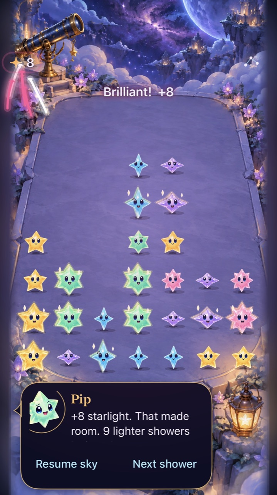
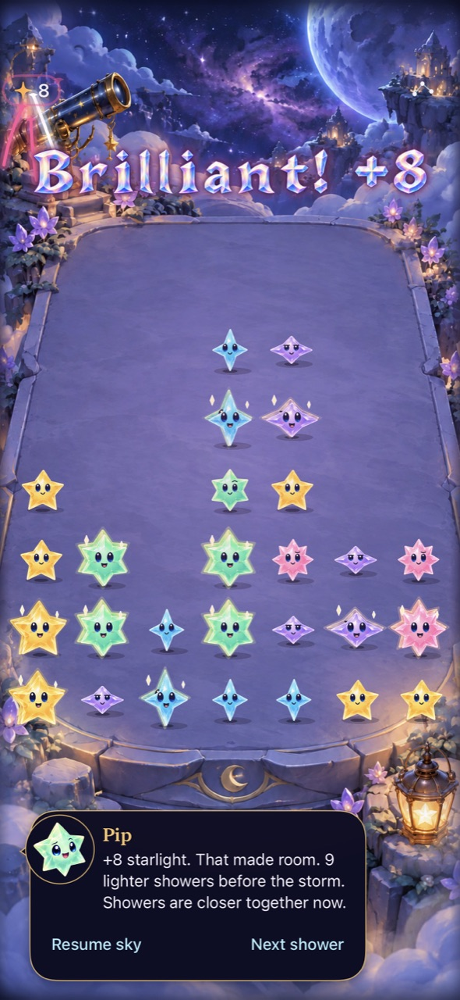
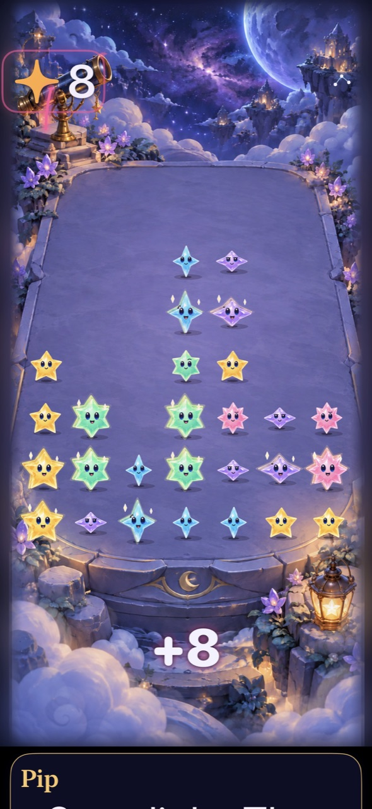

# Celebration lettering leaves the next move visible

**Result:** Partially verified · **Owner:** current implementer · **Date:** 2026-10-18

All award categories now share a protected region above the playable rows. Maximum-text awards remain below the board. The complete lettering animation, including its glow, is bounded inside that region. Compact canvases use native title/value text when crystal glyphs would become too small; taller layouts retain the animated crystal alphabet.

The original obstruction is reproduced and corrected. Physical recognition during repeated fast play remains unmeasured. This is the first delivery in the [gameplay quality plan](../../GAMEPLAY_QUALITY.md).

**Delivered:** [PR #142](https://github.com/lbeezr/starfall/pull/142), main `c985a97f023489d6d26ec24b6287cbba0525eae0`; canonical updater verified the original phone app as `dev.d7e15ddf2a`. [Sanitized delivery receipt](delivery.json) records the installation and pending cloud CI at install. No player data was reset.

**Next action:** Proceed to consequence feedback; incorporate physical readability feedback when available.

## Inspected native appearance

| Compact canvas | Tall canvas | Maximum text |
| --- | --- | --- |
|  |  |  |

*Native UIKit/SwiftUI hosts on iPhone 16 Pro Max / iOS 27.0 Simulator, normal SpriteKit motion, seed 28 after twelve showers, 33 occupied stars before an exact +8. Source `362586f` plus snapshot `b67ce0a9a362`, runtime `dev.d7e15ddf2a`; hashes in [source.json](source.json). Retained images are JPEG exports reduced to 1280 pixels high. These are sampled runtime frames, not physical-phone or animation-smoothness evidence.*

Inspected the compact default entry and middle frames, compact maximum-text middle frame, and tall default/maximum-text frames. Survivors are identifiable during collection trails; the award no longer covers their faces or silhouettes. The first candidate made compact decorative type too small, so it was revised to native text before acceptance.

## Outcomes and verification

| Check | Result | Scope |
| --- | --- | --- |
| Original reproduction | Failed as expected | Central lettering crossed the first playable row on compact, tall and tablet geometry; retained under `artifacts/gameplay-board-clarity/reproduction.xcresult`. |
| Protected region regression | Passed | All 49 cells, four canvas sizes, default/accessibility placement and offset coordinate origins. The whole animated label is clipped to the region. |
| Core | 169 passed | `swift test --disable-sandbox`, explicit temporary module cache; deterministic rules, saves and replay. |
| Hosted app tests | 287 passed, none skipped | Debug, `StarfallAppTests`, normal system motion. Includes ordinary/recipe/trace/relay pixel visibility, crowded four-variant captures, receipt replacement, independent input, cancellation and quiet behavior. |
| Native interaction | 6 passed, none skipped | Rapid input, native matching/recipes, settings/background, Reduce Motion and both endings/replay. |
| Simulator build | Debug tests and Release build passed | No resource/target membership changed. |
| Hygiene / diff | Passed | `python3 scripts/ci-hygiene.py`; `git diff --check`. |
| Actual VoiceOver | Not run | Routine iteration; full session remains an RC gate. |
| Physical phone | Installation verified | Canonical current-main archive, core tests and signed installation identity passed. Player comfort remains unmeasured. |

## Responsible boundary and remaining risk

The overlay previously selected the center of the canvas for every named award and allowed entrance scaling, recoil and exit motion beyond that location. It had no protected playfield boundary. Ordinary awards also had an origin-local fallback. Both routes now use the same projected row/header geometry; no node positions, occupied-cell guesses or animation callbacks decide layout or game state. Examined all award levels and both native/artwork fallbacks. Core, Store, clock, gesture admission, hit geometry, saves and sound/haptics are untouched.

Collection trails and small clear particles remain animated and bounded as before. This correction removes lettering occlusion; it does not prove that all effects are comfortable during prolonged play. Follow up at the next physical review or any new distraction report, with repeated dense clears and actual device frame-pacing observation. Compact physical hardware, iOS 17 runtime and actual VoiceOver remain unverified in this batch.

## Reproduction and artifacts

Use scheme `Starfall`, Debug, iPhone 16 Pro Max QA simulator / iOS 27.0 (24A434), Xcode 27.1 (27A9275), Swift 6.4. The tested app inputs are the four files hashed in `source.json`; documentation edits do not affect the runtime fingerprint.

Native command family: `test_sim` with `-sdk iphonesimulator CODE_SIGNING_ALLOWED=NO ARCHS=arm64 ONLY_ACTIVE_ARCH=YES -parallel-testing-enabled NO`, scoped by `-only-testing`. [Machine-readable verification](verification.json) records exact result bundles and the six native cases. Raw XCTest results, full-size PNGs, build logs and the core log are disposable under ignored `artifacts/gameplay-board-clarity/`; this folder retains the concise outcome and selected captures.
