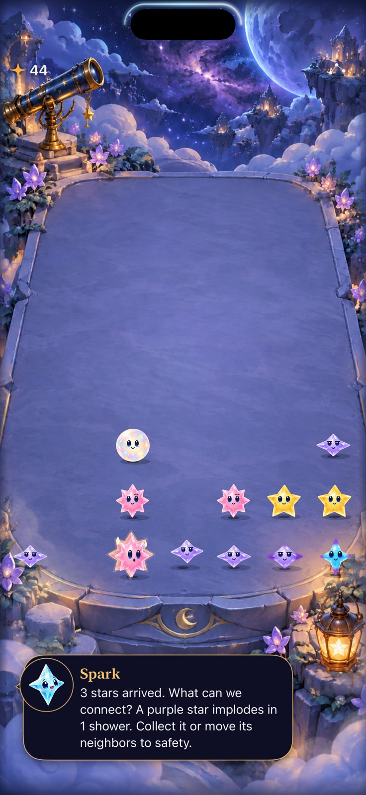

# Repeated automatic clears point back to contact timing

**Result:** Partially verified · **Owner:** current implementer · **Date:** October 18, 2026

Keep the current rules and awards. A 90-second visible-only native sample reaches 31 showers and 44 starlight. Eleven of fourteen attempted taps score; three do not, with later “Stars settling…” feedback and an intervening shower in each later snapshot. The first miss precedes every award. Celebrations therefore cannot explain all three misses. Exact native contact-time admission remains unknown; this is not a measured human miss rate or a product fix.

**Next action:** instrument the actual native contact/admission timeline on a bounded local reproduction before changing input or pacing. Retain the ordinary full animations. The refreshed [participant protocol](../../PLAYTEST-FALLING-SKY.md) now names current aging rules and the longer fresh cadence; it previously directed players to V2/Dusk.

## What the automatic sample establishes

| Check | Observed result / limit |
| --- | --- |
| Repeated normal automatic play | Fresh seed 28; visible AX values only, no forecast/Core oracle, no pause for selection. 90-second selection loop, 99.669-second test. Fourteen attempts, eleven score changes totaling 44, sixteen stale selections skipped, no terminal outcome. Driver scans and XCTest contact latency are included. |
| Award placement | Eleven successful ordinary clears award 3–6. Extracted frames show sampled glyphs above the occupied rows. No Brilliant, recipe or relay occurs in this automatic sample; the [paused crowded +8 review](AWARDS.md) remains separate. No inference that all repeated awards are comfortable. |
| Miss context | Query-time showers 1/8/19 become 2/9/20 in the later failure snapshots. All three snapshots show disabled targets and settling feedback. These observations are consistent with the known query-to-contact deadline boundary, but do not establish its exact native ordering or exclude another contact problem. |
| Current-rule boundary reproduction | New seed-28 first/second-shower hosted check passes both orders: admitted pre-deadline contact holds the clock; post-deadline stale clear cannot commit or queue; a new settled contact scores three. Existing retained-Dusk boundary and other input/lifecycle siblings pass in the 14-test suite. This is deterministic Store evidence, not instrumentation of the three OS contacts. |
| Compatibility/build | Core 162, hosted 14, native one pass; Debug compilation and build/run pass. No production source, rules, saves, routing or resources changed. Actual VoiceOver and physical play are not run. Release not repeated for test/documentation-only changes. |

**Runtime evidence:** end attachment, Debug iPhone 16 Pro Max / iOS 27.0 Simulator, default text, normal effects with Calm explicitly off and system Reduce Motion off. It shows the sampled end state, not a large award or proof of fluid motion. The changing Core board and camera/arrival positions need not match the stable paused review.

## Evidence and limits

Base main `3fd0a8e2f0f04e269c4f5593fcd146846fe149d0`; local merge `571b9c3b9efd33e46c04e27d99a105a7e1079d15` has the identical tree. During the native sample only `UITests/FreshSkyPlaytests.swift` differs in build inputs (SHA-256 `7d050902416f9fabdfb3f0e5209461fc85d862884bc10232ae1ca767e11f6cc3`). The later hosted check additionally changes `AppTests/ResponsiveInputTests.swift`; production bytes remain equal throughout. [Source hashes, complete attempt log and capture/video provenance](automatic-source.json).

Xcode 27.1 / Swift 6.4, Debug arm64, owned simulator `5107CBBF-108B-4B94-9125-A873F948A38C`, iOS 27.0 (24A434). Native command uses the [crowded review's project, destination, signing and timeout flags](AWARDS.md#reproduction-and-source), selecting `StarfallUITests/FreshSkyPlaytests/testRepeatedAutomaticVisibleMatchesSeed28` and result `artifacts/calibration-native/repeated-automatic-awards.xcresult`. Hosted command selects `StarfallAppTests/ResponsiveInputTests`, result `repeated-fresh-contact.xcresult`. `swift test` passes 162; hygiene and diff checks pass. No retries or weakened assertions.

Ignored raw attachments/logs use the corresponding result prefixes. Raw video `artifacts/calibration-native/repeated-automatic-awards.mp4` is 124.46 seconds, including launch/termination padding. All nine contact sheets were inspected: 105 requested one-second samples over seconds 10–114, with returned timestamps slightly offset or duplicated. This is sampled chronological appearance evidence; continuous animation smoothness, exact tap instants and frame pacing are unverified. The recorded first capture is historically named `first-clear` by the existing driver but is its **first attempt**, which did not score here; do not present it as a successful clear.

No new buffering or deadline grace is justified by these captures. The responsible paths inspected are native `beginContact`, `beginBoardContact`, Store `beginConstellationHold`, `canContact`/`clearAvailability` and clear admission. Native touch-down goes through the hold gate before gesture recognition; an admitted hold freezes the clock. Readiness queried earlier cannot reserve a future contact. The remaining question is what each actual OS contact encountered, especially when its origin is stable but its complete tap group spans moving columns.
