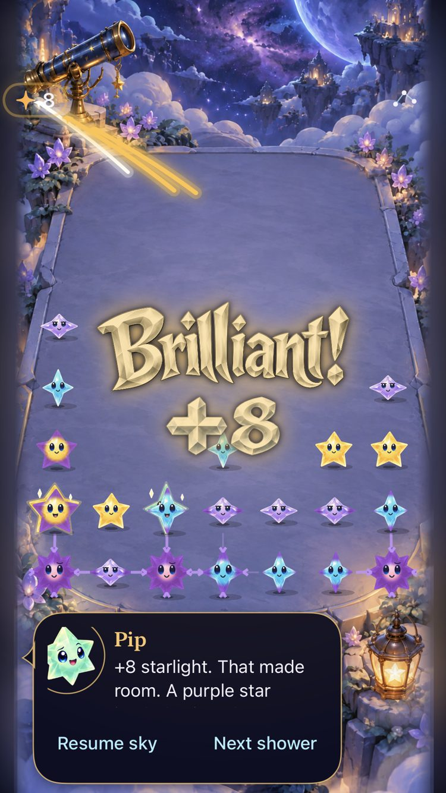
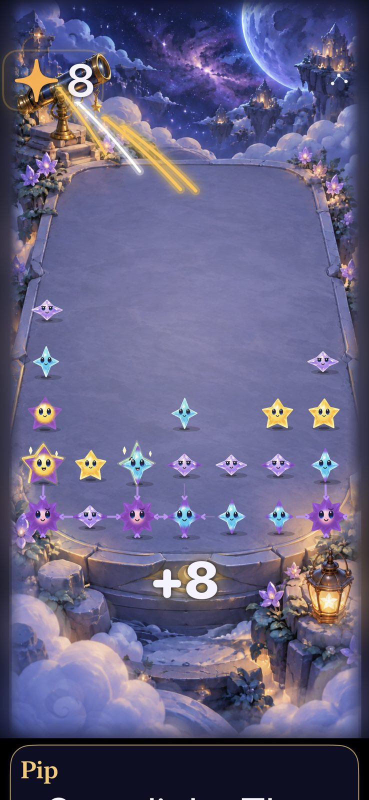

# A crowded current sky retains a visible next match during its award

**Result:** Partially verified · **Owner:** current implementer · **Date:** October 18, 2026

Keep the current celebration presentation. A reproducible critical-mass history with 26 occupied cells produces a Brilliant +8 while an independent lower match remains visible and available to the Store. The central glyph overlaps one aqua survivor for part of the 1.4-second celebration. This is a sampled tradeoff, not proof that repeated celebrations are comfortable. Maximum text uses the native +8 beneath the board.

**Next action:** compare repeated ordinary/large/recipe/relay clears during automatic showers and physical play; tune only against observed recognition or contact problems. No product rules, timing, saves, art or layout changed in this batch.

## Captured result

| Compact host, default text | Large host, maximum text |
| --- | --- |
|  |  |

**Runtime evidence:** real `FallingSkyView`, Store and SpriteKit scene in native UIKit hosts sized 375×667 and 430×932 points, on iPhone 16 Pro Max / iOS 27.0 Simulator. Normal effects, system Reduce Motion off; large/default and accessibility5 text. These are host layout comparisons, not separate compact/large hardware tests. Captures sample approximately 0.65 seconds after the commit. The accessible page intentionally scrolls to its dialogue; scrolling that dialogue was not checked here. Still captures do not establish continuous animation quality or human comprehension.

## Outcomes against acceptance

| Criterion set before the check | Result and limit |
| --- | --- |
| Reproducible crowded current-rule history | Fresh-survival seed 28, 29 committed showers, 26 occupied cells, exact eight-light clear. Uses current fresh factory and validated local archive; no alternate generation or new fixture route. |
| Inspect actual award during full presentation | Four layout/text variants capture before, approximately 0.18/0.65/1.1 seconds, and after. Initial discovery frames were inspected as a complete contact sheet; final selected frames were inspected individually. Other final frames remain raw attachments. SpriteKit reduced motion is asserted false. No video or smoothness measurement. |
| Next choice and expiry remain independent | Independent-column legal group is checked before clear; Store still admits a legal clear immediately after the award starts; all three capture thresholds are reached and the award expires within two seconds. This is Store admission, not a native contact on this exact crowded history. |
| Representative native input | Direct recipe/relay and ordinary 16-point drift at normal/largest text pass on the same source. These existing fixtures are separate from the crowded sample. |
| Rule/save/interruption compatibility | All 162 Core tests and all 14 celebration hosted tests pass, including concurrent awards/save independence and reset/settings/background cancellation. No save/rule change. Actual VoiceOver, physical feel, repeated automatic crowded play and hardware-specific layout remain unverified. |

## Reproduction and source

Runtime equals main `b8cf29f`; local merge `564e3ed972dc4b9587d4a12809cad38edf582cd3`, clean before this batch. Only `AppTests/StarlightCelebrationTests.swift` differs in tested build inputs, SHA-256 `f0cf38536c47f078d1fc5805a394ea3f60d4c391a941014da31c219910064308`. [Source and capture hashes](awards-source.json). Isolated defaults and a manual shower clock hold the restored paused board steady; scene and reward animations run normally. No automatic-storm comfort claim follows from that control.

Xcode 27.1 (27A9275), Swift 6.4, Debug/arm64, simulator `5107CBBF-108B-4B94-9125-A873F948A38C` / iOS 27.0 (24A434). `swift test` passes 162 tests. The Debug native batch passes 14 hosted plus two UI tests, zero failures/skips. Test-only change uses existing target membership; no Release build rerun because runtime, resources and routing are unchanged. Hygiene and `git diff --check` pass.

```sh
xcodebuild -project Starfall.xcodeproj -scheme Starfall -configuration Debug \
  -destination 'platform=iOS Simulator,id=5107CBBF-108B-4B94-9125-A873F948A38C' \
  -derivedDataPath /tmp/starfall-calibration-derived -parallel-testing-enabled NO \
  -collect-test-diagnostics never -test-timeouts-enabled YES \
  -default-test-execution-time-allowance 180 -maximum-test-execution-time-allowance 240 \
  -resultBundlePath artifacts/calibration-native/crowded-awards-final.xcresult \
  -only-testing:StarfallAppTests/StarlightCelebrationTests \
  -only-testing:StarfallUITests/SkyTechniqueInteractionTests/testTapRecipesRelayWithoutAnyModeOrMenuToggle \
  -only-testing:StarfallUITests/ResponsiveInputUITests/testSixteenPointOrdinaryDriftClearsOnceAtNormalAndLargestText \
  ARCHS=arm64 ONLY_ACTIVE_ARCH=YES CODE_SIGN_IDENTITY=- CODE_SIGNING_ALLOWED=YES \
  DEVELOPMENT_TEAM= CODE_SIGN_STYLE=Manual test
```

Raw logs and attachments: ignored `artifacts/calibration-native/crowded-awards-final*`; Core log `artifacts/calibration-current/crowded-core.log`. The preceding one-test discovery run also passes; its search across seeds was replaced with the exact discovered history for a stable regression sample. No failing test was weakened or retried.
