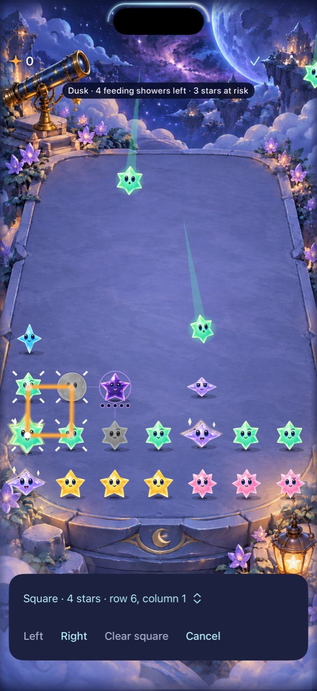

# Keep an unchanged recipe usable through automatic rain

**Result:** Verified for the sampled setup and focused boundaries; overall calibration continues · **Owner:** current implementer · **Date:** October 18, 2026

Automatic play exposed two input problems: every shower discarded a valid selected recipe, and recipe/move controls advertised general readiness while execution required their particular columns to be free. The normal app now renews an unchanged recipe against the committed board after a shower and uses the same per-action admission for controls and execution. Rules, cadence, RNG and saves remain unchanged.

**Next action:** Compare fresh setup-first play and recognition against clear-first play. This prepared, known solution establishes execution, not discovery, human preference or physical feel. Keep timing and exchange rules unchanged.

## Outcomes against acceptance

| Criterion | Result | Evidence / limit |
| --- | --- | --- |
| Useful setup in the ordinary current-generation game while rain runs | Pass | Seed 0, six manual showers while paused, then resume; hold the move from core cell (4,0) to (4,1) for six seconds. Select the resulting square at (1,0), cross another automatic shower, clear for exactly 4 starlight and observe a further shower. Native run: 46.683 seconds including preparation/queries. |
| Surviving recipe remains actionable; stale committed state and cancelled choices rejected | Pass | Renew only an explicit recipe whose cells, IDs and full gem values still match. Update snapshot/generation while retaining the same unchanged choice token; cancellation and changed choices retire callbacks. Repeated reconciliation of the same event is idempotent. |
| Settling columns match native action availability | Pass | Shared store preview/admission drives both controls and execution. Hosted case verifies unavailable during the seed-0 shower, available after landing, then score 4. Controls check readiness first and consume selection only after store acceptance; rejected commits retain it. No queued action. |
| Changed ingredients, bare anchors and live swaps cancel | Pass | Focused intent checks. Unsupported/empty skies and ordinary lifecycle invalidation retain their previous cancellation contract. |
| Settings/background and largest text | Pass | Two sibling native cases pass. Inspected largest-text selected-control capture: actions reflow vertically and remain reachable after scrolling. |
| Button move, direct swipe and empty relay siblings | Pass | Two additional native cases pass on the same source: `testNudgeWithButtonsAndSwipePreservesFourStarRecipe` and `testExactSquareThenGravityCreatesDeliberateRelay`, in `automatic-setup-button-siblings.xcresult`. Six distinct native cases total. |
| Normal motion / visual | Partial | Calm effects requested off; native gestures run with ordinary presentations. Inspected selected-square and resumed-rain stills. No retained current-run video or smoothness/performance acceptance. |
| Reduce Motion, actual VoiceOver and device feel | Not rerun | No geometry or animation changes. Actual VoiceOver remains an RC gate. No physical install/play claim. |

**Inspected native capture:** Debug, iPhone 16 Pro Max / iOS 27.0 Simulator, default text, normal effects requested. The dimmed action corresponds to reserved columns; the test then waits for admission and clears the square. Source: `a90f33f` plus [hashed inputs](recipe-source.json), runtime fingerprint `dev.1c5aa1fc07`; the binary displays `dev.local`, version 0.1.0 (1). JPEG reduced from the original XCTest PNG. A still cannot establish motion quality.

## Cause and correction

The view treated every input-generation/game change as unconditional selection cancellation. This correctly rejected stale committed actions but also removed an unchanged recipe after unrelated rain. Separately, `SkyTechniqueControls` used general input readiness; `performTechnique` computed the actual turn and rejected occupied columns. An enabled action could therefore consume its selection without committing a clear.

The store now grants recipe revalidation only for a committed, nonterminal shower. Intent revalidation checks the current recipe and unchanged ingredients, renews its snapshot/generation, and preserves the choice token only while that exact choice remains valid. Changed/cancelled choices still invalidate callbacks. All other invalidations cancel. The same reconciliation handles both observed generation and game changes. Traces and swaps still cancel, and no animation callback decides legality. Intent commits now consume their selection only after store acceptance, preserving a choice rejected at the snapshot/generation boundary while leaving cancelled-choice callbacks unable to execute. A small shared store boundary previews and checks the action for both controls and execution; controls receive that capability rather than an unrelated game/global readiness pair.

Examined related paths: recipe and directional move controls, direct swap/trace cancellation, current-generation snapshot checks, shower presentation, settings/background lifecycle, empty/unsupported Arrange exit and old callback consumption. This does not establish that every possible touch race is eliminated.

## Verification context and unsuccessful iterations

Fetched main before analysis and again before integration: `7ddc83734e4729e0b7923eb7e68a8370442766d5`. Local base `a90f33f35e7f367e8f32112799ade11dc410e73a` has the same tree. The [source record](recipe-source.json) identifies the four modified app files and two test files at verification. No project/resource membership changes. Xcode 27.1 (27A9275), macOS 27.0.1; QA simulator `5107CBBF-108B-4B94-9125-A873F948A38C`.

- Initial source: square formed and selected, then its action vanished on rain; native case failed. The existing authored technique fixtures disable rain and could not establish this behavior.
- Revalidation-only prototype: 25 hosted checks and the interruption sibling passed; slow control polling ran through the recipe's lifetime. Seeded replay retains it through shower 10; Dusk changes it at 11. The later native failure hierarchy reached 14 showers. Revalidation must not preserve that changed recipe.
- Prompt-contact prototype: selection crossed rain, but pressing a globally enabled action did not score. The per-action admission discrepancy was confirmed in source and covered by the final hosted landing test. The native outcome alone does not timestamp the exact rejection mechanism.
- Shared-admission source passed 26 hosted and 3 native checks. A follow-up accepted-commit variant retained selection on rejection but missed a native clear again. Source review identified an additional race: renewing the unchanged choice token unnecessarily retired a button callback. The actual failed admission was not instrumented; this is a source-based mechanism, not a timestamped diagnosis of that tap. The final design keeps that explicit choice identity and renews only its committed snapshot/generation; tests still reject cancelled-choice callbacks and old committed store snapshots.
- Final stable-choice source: 27 hosted and 4 native checks pass, including the prompt 0.2-second hold (39.979 seconds including preparation/queries) and six-second hold. Both commit observations record score 4 at shower 8, followed by further rain. Release simulator build passes. No blanket retries, assertion weakening or suppressed motion. A bounded condition waits for a real shower and actual action readiness.

Raw output remains under ignored `artifacts/`: `calibration-native/automatic-setup*.log/.xcresult` and attachment folders; `calibration-current/automatic-setup-core.log`, `recipe-stable-choice-release.log`, and `recipe-stable-choice-smoke/`.

| Check | Procedure | Result |
| --- | --- | --- |
| Core | `swift test` | 149 pass; Core unchanged throughout this batch |
| Hosted/native + Debug build | `xcodebuild test`, shared Starfall scheme, Debug/arm64, QA destination above, parallel testing off. Only `StarfallAppTests/SkyTechniqueStoreTests`, `StarfallAppTests/TraceInputPolishTests` and four `StarfallUITests/SkyTechniqueInteractionTests` methods: `testDeliberateSquareSetupWhileAutomaticRainRuns`, `testPromptSquareSetupWhileAutomaticRainRuns`, `testSettingsAndBackgroundCancelSelection`, `testLargestTextRecipeActionsRemainReachable` | 27 hosted + 4 native pass; `automatic-setup-stable-choice.xcresult` |
| Release build | `xcodebuild -project Starfall.xcodeproj -scheme Starfall -configuration Release -sdk iphonesimulator -destination 'generic/platform=iOS Simulator' -derivedDataPath /tmp/starfall-calibration-release ARCHS=arm64 ONLY_ACTIVE_ARCH=YES CODE_SIGNING_ALLOWED=NO build` | Pass |
| Model integration | `python3 tools/mechanics/compare-pacing.py --seeds 2 --seed-start 64 --seconds 30 --baseline-cadence announcedCycleV1 --candidate-cadence announcedCycleV2 --include-setups --output artifacts/calibration-current/recipe-stable-choice-smoke` | 32 runs / 760 independently replayed commits. Runs and summaries identical before/after the shared control-admission extraction. Baseline already included recipe revalidation; this is a smoke check, not a new balance comparison or model of recipe-menu use. |
| Hygiene | `python3 scripts/ci-hygiene.py`; `git diff --check` | Pass |

The native helper deliberately avoids redundant existence polling on already-present live controls; it still requires a selected recipe to cross a real shower and waits for enabled/hittable admission. XCTest timing is not human reaction time. No cadence or new exchange cost is justified by these failures.

Documentation verification: Markdown source and relative links checked; rendered document not inspected.
