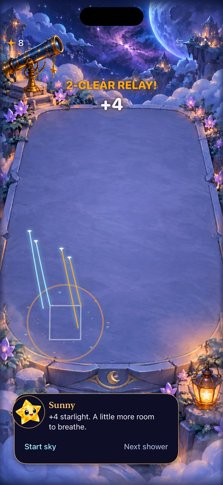

# Current-source play works; retain rules while investigating missed attempts

**Result:** Verified bounded development checks; calibration remains in progress · **Owner:** current implementer · **Date:** October 18, 2026

Keep the mechanics steady. On freshly merged main `5bec506`, two automatic native samples and an exact-recipe/relay pass; all seven receipt checks pass. Captured frame sequences show falling stars, Dusk collapse, visible awards and collection trails. The timing runner now uses current logical sessions, per-action admission and independent presentation completions. Its earlier whole-board wait overstated the deliberate setup policy's failure rate.

**Next action:** Investigate native attempts that produced no score before choosing numeric tuning. Observe admission feedback at the actual contact boundary, then compare deliberate setups under automatic rain. These short automated samples and frame sequences do not establish human recognition, enjoyment, smoothness or physical feel.

**Follow-up:** The [contact-readiness diagnostic](CONTACT_READINESS.md) explains the examined non-scoring attempts and verifies the driver’s late checks. The original observations below retain their source; the next play question is deliberate setup execution under automatic rain.

## Subsequent main integration

Before integration, fetched and merged main **`90ef9ed`**, interruption teardown. On clean local merge `73760a4`, **149 Core and both fresh native samples pass**, plus the **32-run model smoke**. Every smoke event and metric matches `5bec506` exactly. Only interruption code changed; View, Scene, celebration/anchor rendering, Core and the fresh driver are unchanged. The table, footage and 1,024-run study below retain their tested `5bec506` source. [Integration hashes](fresh-source.json) keep the later runtime fingerprint separate. No old measurement is relabeled as a main86 run.

Main then merged **`46642c3`**, trace speech/haptic ownership. It is reconciled before publication: Debug simulator build-for-testing and 32 model runs pass, with exact main86 event/metric equality. The diff routes trace cues through the store and leaves admission, clear/reward/timing and drawing/anchor logic unchanged. Native fresh evidence remains main86; no new physical speech/haptic acceptance is inferred. The recorded footage retains its main85 source.

## Current native observations

| Sample | Attempts | Final score / showers | Scope |
| --- | --- | --- | --- |
| Seed 5 | 15 | 40 / 22 | Automatic rain; largest exposed reward; no setup/forecast search |
| Seed 180 | 14 | 33 / 24 | Same policy; six matching groups at the endpoint |
| Authored relay | Two activations | 8 / rain disabled | Exact square, gravity-created square, causal relay, empty-board controls |

Fresh samples start a selection cycle while elapsed time is below 45 seconds; a native scan/gesture already in flight may finish later (the last seed-180 attempt starts at 47.14 seconds). The driver queries the 49 stable native cell identifiers afresh, retains a value snapshot, then taps the chosen identifier. It never pauses the clock or reads hidden incoming state. Native query/gesture overhead is part of these observations, not a reaction-time measurement. No sample reaches a terminal state.

**Open observation:** attempts are not accepted clears. Seed 180's score stays at 30 across several attempts while automatic showers and visible matches continue. Seed 5 also has non-scoring attempts. Moving-column reservations, changed groups and scan-to-contact delay can intervene; the current trace does not identify each rejection reason. Do not label those attempts a proven game bug, successful input, or a human difficulty result.

### Award visibility now has runtime evidence

**Runtime capture:** `014d9b8`, equivalent to main `5bec506` for app inputs; runtime fingerprint `dev.3ff8f71dce`. iPhone 16 Pro Max / iOS 27.0 Simulator; default text; Calm and system Reduce Motion off. JPEG extracted from the actual relay recording at **72.595 s**, scaled proportionally to 1,280 pixels high. The reset-only authored board disables rain/saving. This is an observed frame, not concept artwork.

The inspected sequence shows `SQUARE! +4`, total four, the surviving Aqua stars settling, then `2-CLEAR RELAY! +4`, total eight, upward collection trails and returned ordinary controls. Awards/trails disappear in later frames. This confirms the sampled recipe/relay effect is visible after the nested-anchor fix. It does not cover ordinary clears, constellations, dense/danger layouts, large text effects, audio/haptics or actual VoiceOver.

The automatic recording contains 35.945 seconds, including failed-driver diagnostics and the next launch. All 71 requested half-second samples were inspected. The relay recording contains 112.918 seconds including idle/home time; 52 quarter-second samples from 64–77 seconds were inspected, retaining actual frame timestamps. There are repeated timestamps and variable capture intervals. These sequences show animation states and ordering; they do not measure frame pacing or prove smoothness. Raw MP4s and extraction code remain under ignored artifacts/temporary storage.

## Correct the timing model before changing the game

The previous model used the store's global `canClear` flag and one presenter callback. That flag means the whole board is settled; the app can admit independent-column actions sooner. A single callback would also lose overlapping completions. The runner now filters each tap/trace/exchange through the real store, retains every modeled completion and uses `SkyInteractionSession` with native commit-before-release ordering. Exact receipt values and feedback contracts are extracted from production declarations; no duplicate reward algorithm is introduced.

The default is `--input-model columns`. `--input-model settled` retains the conservative whole-board-wait comparison, using current session ordering. This is an offline comparison switch, not an app pilot. Reaction/search time and swap contact remain assumptions. The added `--seed-start` supports confirmation cohorts. [Current source, commands and groups](column-study.json) describe **1,024 runs / 124,831 replayed commits**, seeds 64–79, 180-second horizons, four policies, two cadence IDs, full/quiet duration models and two timing assumptions.

Current `announcedCycleV2`, full-motion model; each row has 16 samples:

| Decision / contact | Admission | Clear-first ended / median score | Setup-first ended / median score |
| --- | --- | --- | --- |
| 0.45 s / 0.5 s | Settled | 8 / 221.5 | 0 / 190.5 |
| 0.45 s / 0.5 s | Columns | 8 / 221 | 0 / 229.5 |
| 1 s / 1 s | Settled | 7 / 177 | 13 / 60.5 |
| 1 s / 1 s | Columns | 8 / 231.5 | 1 / 193.5 |

The deliberate setup policy's ending count changes from **13/16 to 1/16**. Thus the earlier severe setup-failure result is not robust to the app's actual admission windows. Clear-first does not improve on every measure; these are different visited states and censored trajectories, not a causal estimate of player enjoyment or a universal setup advantage. Quiet results and all policy/cadence groups are retained in the JSON.

Policies still use taps/full-component walks and at most one improving exchange per shower. They do not enumerate optimal subsets or exact-recipe trimming, model visual perception of moving stars, or measure search skill. Blocked-opportunity time describes the modeled clear choices, excluding setup opportunities. No-opportunity time is conditioned on the selected admission model. Do not compare those fractions as identical denominators.

## Verification and provenance

[Current/historical source hashes](fresh-source.json) separate attempted drivers from the successful source. Tested local merge **`014d9b8479d5bdd8ed31a0a1180267c89108696c`**, fetched main **`5bec506ab2899ff69538fcfd233338ba8a516bb1`**. App, Core, Config and project inputs match main; only the fresh UI driver differs in the native build. Simulator binaries display `dev.local`; source fingerprints do not claim a stamped phone installation. No app rule, save, RNG, cadence, resource, target membership or production UI changes are included in this batch.

| Check | Result / boundary |
| --- | --- |
| Core | 149 pass on current source; `swift test`, `main85-core.log`. |
| Native | Two fresh automatic samples pass; exact recipe/relay passes separately with recording. |
| Hosted | Seven `StarlightCelebrationTests` pass, including nested score/header anchors, zero-reward Dusk, Opal, causal receipt categories and interruption/expiry. |
| Builds | Debug simulator tests/build and generic simulator build-for-testing pass. Release not repeated: this batch changes only offline tooling and UI tests, with no app/config/resource change. |
| Tool regressions | Two independent clears overlap in full and quiet models; same-column input remains blocked; each callback releases its own columns; every commit matches independent replay and valid-save checks. Default/non-setup CLI and bounds checks pass. |
| Historical compatibility | Before current-session ordering, settled mode reproduced all 512 prior fast/deliberate events and metrics after removing added fields. Repeated 32-run column samples matched byte-for-byte. These are historical regression checks, not current native acceptance. Current main smoke passes 32 runs; PR85's shared policy preserves those model events exactly. |
| Accessibility / interruption | System Reduce Motion read as off; no new layout or interruption behavior. Earlier current-main source-bound checks remain separate. Full actual VoiceOver is deferred to RC. |
| Hygiene | `python3 scripts/ci-hygiene.py` and `git diff --check` pass. |

Environment: Xcode 27.1 (27A9275), Swift 6.4, arm64, Debug; QA simulator `5107CBBF-108B-4B94-9125-A873F948A38C`, iPhone 16 Pro Max, iOS 27.0 (24A434). Native commands use scheme Starfall, no parallel testing, 180-second method allowances, bounded 240-second maxima and ad-hoc simulator signing. No physical device operation or installer bypass.

### Retained failures and recovery limits

The first driver expected Begin in the reset-only route; it failed before gameplay, then the redundant case was interrupted. The corrected start helper passed two exploratory pre-celebration samples. Current-source attempts then reproduced filtered-query index invalidation and later AX-identity replacement during showers. Querying stable cell identifiers at each read/tap fixes those driver mechanisms; both original seeds now pass. Assertions and normal effects were retained. This does not establish that every possible harness race or dropped player contact is eliminated.

The prior hosted launch failed when QA entered Shutting Down; device boot/create and inventory also stalled. Scoped recovery did not resolve it. A TERM request to the global service overlapped another task's new test job, and did not complete the restart; its effect on that job is unknown. No further global recovery or simulator erase was performed. This batch rechecked the service, found QA fully shut down, then used the normal build/run path to boot it successfully. The old-source launch was stopped before current-source tests. No passing result is substituted for the retained failed attempts.

Raw output: `artifacts/calibration-native/main85-{fresh,stable-cells,relay-motion}.{log,xcresult}`, corresponding attachments/MP4s and frame sheets; `artifacts/calibration-current/main85-{columns,settled}-{fast,deliberate}/`, `main85-smoke/`, and `main85-core.log`. Older `fresh-visible*` and `fresh-celebrations*` files retain their earlier sources. Earlier runs that missed subsequently merged main changes are not relabeled as current.
