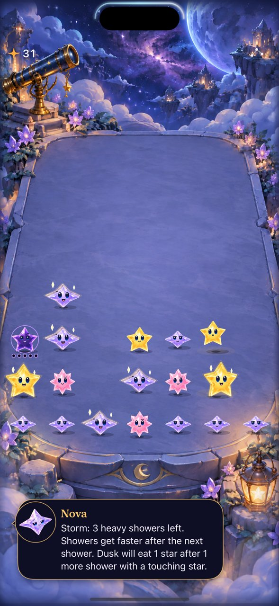

# Current-rule calibration includes empty-space trace links

**Result:** Partially verified calibration; offline enumeration corrected · **Owner:** current implementer · **Date:** October 18, 2026

Keep the current rules and cadence. The calibration tools now follow Core's one-empty-space constellation links and validate that a policy walk covers its entire selected set. The previous timing runner reproducibly stopped at a trace-validity assertion on current source. Related Opal-study traversal and five-cell enumeration had the same obsolete adjacency assumption and could omit gap opportunities.

The corrected runner completes 256 modeled rounds across seeds 0–7 and 64–71, replay-checking 22,811 commits. A repeated 32-run sample has identical complete run objects, including events. Bounded fixture checks cover a single gap, diagonal and Opal components, four occupied-midpoint variants, exact selected sets and clear rewards. This repairs the measurement boundary; no app rule, save, gesture or timing value changes.

**Next action:** Use current-source native rounds to assess recognition and execution, then select a demonstrated friction for one bounded refinement. These explicit timing policies do not establish player preference or phone gesture comfort.

## What the corrected sample says

Each cohort runs eight seeds for at most 120 active seconds, two cadence lookups, four policies and full/quiet presentation models: 128 runs per cohort. The table shows only the app's current `announcedCycleV2` under the full-motion model. Most rounds reach the horizon; scores are observed values, not completed-round score distributions.

| Cohort / policy | Ended / 8 | Median observed score | Median no-clear-opportunity time | Longest early gap in cohort |
| --- | --- | --- | --- | --- |
| 0–7 / largest clear | 0 | 168 | 40.7% | 3.65 s |
| 0–7 / height safety | 0 | 168.5 | 43.2% | 3.65 s |
| 0–7 / trace oriented | 1 | 161.5 | 41.5% | 3.65 s |
| 0–7 / setup first | 0 | 149 | 28.1% | 2.65 s |
| 64–71 / largest clear | 1 | 163 | 44.7% | 3.65 s |
| 64–71 / height safety | 0 | 161 | 43.5% | 4.55 s |
| 64–71 / trace oriented | 0 | 159.5 | 43.4% | 3.65 s |
| 64–71 / setup first | 0 | 153.5 | 30.6% | 2.85 s |

Setup first makes at most one immediate-reward-improving exchange per shower. It executes 168 and 169 exchanges across the respective current-cadence full-motion cohorts. Fewer no-clear-opportunity intervals coexist with lower median scores and fewer delivered showers: exchanges also hold the existing shower clock. This does not isolate human planning benefit, prove an optimal strategy, or justify speeding up rain. The earlier three-move plan remains outside this one-step policy.

No-clear-opportunity time is conditioned on available input and the modeled tap/full-component clear choices; it excludes setup opportunities. Read it alongside blocked-opportunity time and input admission. Models use 0.45 s reaction, 0.12 s per trace step and 0.5 s exchange contact; these are assumptions, not measured player timings. Retracing a canonical full component may cost more contact time than an efficient human trace. Exact recipe subsets are not enumerated by the timing policy. Complete group distributions, source hashes, commands and event-file digests are in [gap-link-summary.json](gap-link-summary.json); historical distributions retain their earlier rules.

## Root cause and correction

`constellationGroup(at:)` changed in PR #95 to include stars linked across an empty midpoint. The timing runner still built its depth-first walk with literal one-cell row/column bounds. It could return a truncated path and either fail the minimum-size assertion or silently ignore part of the selected component. Opal analysis independently used the same old geometry for walks and connected fives.

`tools/mechanics/CalibrationTrace.swift` now owns the shared bounded offline walk. It asks production `canLinkConstellation` for edges, chooses a colored anchor, and rejects a walk unless every requested cell is reached and Core accepts the anchored prefix. The timing caller additionally requires exact equality between Core's committed constellation cells and the component. Opal five-cell expansion also asks Core for edges. Both wrappers hash and compile the helper; the gravity-study wrapper, which appends the Opal enumerator, does the same.

Acceptance before adopting the correction: reproduce the original failure; cover the entire single-gap set and clear reward; reject occupied midpoint variants; preserve diagonal/Opal legality, bounds, source immutability and replay; compile every current consumer; and reproduce complete event records. Existing historical lab exporters/intents were inspected as search results but were not migrated or used as current calibration. No claim is made that every archived tool now models current rules.

A sibling smoke run also exposed `KeyError: 'example'` in the gravity report formatter for a short run with no encounter. `GravitySupplySummary.example` is optional and Swift omits it when nil; the formatter now removes it optionally while still requiring rounds. The same one-seed/six-shower no-example case completes after correction. This is output handling, with no generator or measurement selection change.

## Verification context

Source: local merge `519f6f8767ad8ad83c0ca059b2e2407f73c8e820`, incorporating main `9b0f9d3` (PR #97); production app/Core inputs still match PR #95 `1ed6290`. Only the seven recorded mechanics-tool files differ for these measurements. Documentation added afterward is outside compilation. The source manifest records exact hashes, including the shared helper. Xcode 27.1 / Swift driver 1.168.6, macOS 27.0.1 arm64.

| Check | Result / evidence |
| --- | --- |
| Original reproduction | `compare-pacing.py --seeds 2 --seconds 20 --include-setups --candidate-cadence announcedCycleV2`: pre-change `PacingMeasure.swift:32` precondition failure. Original log retained under ignored artifacts. |
| Shared regression / model | Corrected same command passes; both 128-run cohorts pass. Every accepted modeled commit replays, totaling 22,811. Repeated 32-run result objects compare exactly. |
| Settled comparison | The same two-seed/20-second command with `--input-model settled` passes shared legality and replay checks. No pre-change equality claim across different rules. |
| Opal sibling | `study-opal-choices.py --calibration --seeds 2 --showers 12`: passes shared trace checks, bounded-five/cap checks and sampled source/save validation. |
| Gravity consumer | `study-gravity-opportunities.py --seed-start 256 --seeds 1 --showers 6`: shared checks and no-example output complete. Initial formatter failure retained. |
| Core / hygiene | `swift test`: 152 tests, zero failures; `python3 scripts/ci-hygiene.py` and `git diff --check` pass. |
| Native build / interaction | Debug `xcodebuild test`, same dedicated simulator as the help report: gap repeated attempt 11.223 s; seed-180 fresh 52.099 s; seed-5 fresh 51.940 s, all pass. No Release rerun for offline-tool-only edits. |
| Rule/save change | None. Core is compiled unchanged; no normal app saves are read or written by the models. |
| Actual VoiceOver / device / motion quality | Not established by model runs. [Largest-text help and System Reduce Motion](HELP_ACCESSIBILITY.md) have separate bounded native evidence. Actual VoiceOver and physical-device acceptance remain RC work. |

Raw logs and runs are under ignored `artifacts/calibration-gap-links/` and `artifacts/calibration-current/gap-links-*.log`. An initial helper compilation failed because a geometry-only check tried to call Core's internal board initializer from the separate pacing module; the check now decodes a local fixture variant through Codable, without widening production APIs. The blocked variants are topology probes and are never admitted as valid app saves. The first Opal sample predates this test-harness adjustment; the final Opal run includes it.

## Fresh native rounds on the current rules

**Inspected runtime capture:** app inputs match `1ed6290`, Debug iPhone 16 Pro Max / iOS 27.0 Simulator, default text, Calm Effects off and system Reduce Motion off. Native test source matches the recorded HEAD; dirty mechanics tools do not enter the app target. This selected end-of-sample image displays the complete storm/Dusk warning at default text. It does not establish animation smoothness, dense/largest-text active-play fit or human recognition. Capture hash and original attachment are in the summary record.

Both ordinary automatic samples reach 22 showers without ending. Seed 180: nine attempts, one non-scoring attempt, eight stale selections skipped, final score 31. Seed 5: eight scoring attempts, nine stale selections skipped, final score 38. The sampled non-scoring attempt had queried readiness true and a six-starlight reward; its subsequent native hierarchy disables the target and says “Spark. Stars settling…”. This reproduces the previously documented query-to-contact settling boundary, without proving the exact touch-down timing or a new product defect. Do not count skipped stale targets as attempted taps or claim every contact succeeded. All four diagnostic images (gap clear, both end samples and miss) were inspected.

Native reproduction uses `xcodebuild test` with the help report's project/scheme/Debug destination/DerivedData/signing flags, result path `artifacts/calibration-native/gap-links-fresh.xcresult`, and `-only-testing:StarfallUITests/FreshSkyPlaytests -only-testing:StarfallUITests/ConstellationTraceNativeTests/testNativeGapSwipeAndRepeatedAttempt`. No source, test assertions or motion settings were changed to obtain these passes. No video was recorded for this batch.
