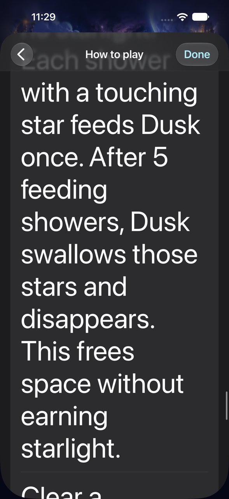
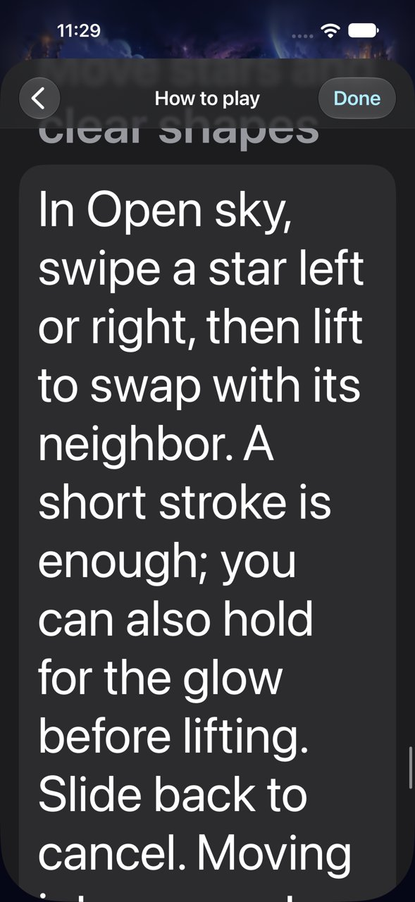
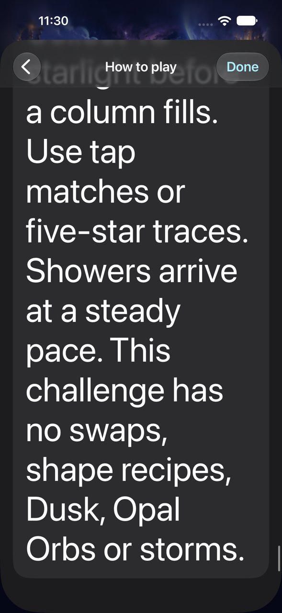

# Largest-text help remains readable through dismissal

**Result:** Verified for the sampled development checks · **Owner:** current implementer · **Date:** October 18, 2026

All 44 overlapping native captures were inspected from the first matching instruction through the final First Light paragraph at Accessibility XXXL. Text reflows within the help list, including the new gap-link and short-swipe instructions and the complete five-feed Dusk explanation. Done stays reachable. Dismissing help preserves the round; the next manual shower still works. No product correction was needed.

The separate System Reduce Motion check passes with app Calm Effects explicitly off: enable the actual system switch, deliver the seed-5 shower, clear three stars for three starlight, and restore the original system switch to off. This establishes a small usable native interaction, not full motion, gesture comfort or enjoyment acceptance.

**Next action:** Repair and verify current-rule calibration trace enumeration before reusing balance distributions; then observe fresh automatic-round recognition and gesture execution. Full actual VoiceOver and physical-device acceptance remain RC work.

## What was inspected





**Native runtime evidence:** Debug app inputs match `1ed6290` (PR #95). iPhone 16 Pro Max Simulator / iOS 27.0 (24A434), largest text, Calm Effects off, system Reduce Motion restored to off before this help run. The two UI-test files differ from main; exact hashes and original attachment mapping are in [the source record](help-accessibility-source.json). Images are selected from the 44 inspected captures and reduced to 1,280 pixels high. Local app displays `dev.local`, version 0.1.0 (1); these are development captures, not a stamped release or device acceptance.

The bounded native test checks the expected foreground app/help navigation and reachable Done on every scroll, captures overlapping reading positions, reaches the final line, dismisses, compares the original board value and score, and delivers one shower. All nine sections and eighteen paragraphs are readable across the captured sequence. The translucent pinned navigation obscures scrolling text temporarily; the overlap exposes those lines at another position. No permanently clipped paragraph or inaccessible dismissal was observed.

## Verification context

Tested checkout: `18e2e2ddf966469abe3553568ba6dab4c77f249c`, incorporating origin/main `1ed62906973ba93a8e03c41251a9b139c1c10b0b`; only the two recorded UI-test files dirty. Xcode 27.1 (27A9275), macOS 27.0.1 arm64. Simulator UDID `5107CBBF-108B-4B94-9125-A873F948A38C`; dedicated DerivedData `/tmp/starfall-calibration-derived`.

| Check | Result and scope |
| --- | --- |
| Core | `swift test`: 152 tests, zero failures on current main rules. |
| Native build/interaction | Debug simulator `xcodebuild test`: both selected methods pass; System Reduce Motion 31.175 s, largest-text help 110.948 s. |
| Help visual | All steps 00–43 inspected across eleven contact sheets. Gap links, swaps, Dusk and final paragraph included; default-text help has earlier source-bound evidence. |
| Reduced-motion sequence | 112.348 s recording; inspected the first 48 s overview plus 40 requested 0.1 s samples from 25–29 s covering arrival and clear. Three stars become visible, clear, score becomes 3 and Pip displays +3 feedback. Actual frame timestamps vary and duplicate; sampled stills do not prove smoothness or every animation's suppression. Native Settings captures and assertions show off → on → off. |
| Interruption/state | Help remains foreground through bounded scrolling, dismissal preserves the initial round, and subsequent input works. No new restart/background/save-schema coverage claimed. |
| Hygiene | `python3 scripts/ci-hygiene.py` and `git diff --check` pass. |
| Release / hosted | Not rerun for these UI-test-only edits; no app source, target membership, resources or routing change. |
| Actual VoiceOver / physical device | Not run in this development batch; required at RC. |

Reproduction command (normal motion preferences are not forced globally):

```sh
xcodebuild -project Starfall.xcodeproj -scheme Starfall -configuration Debug \
  -destination 'platform=iOS Simulator,id=5107CBBF-108B-4B94-9125-A873F948A38C' \
  -derivedDataPath /tmp/starfall-calibration-derived -parallel-testing-enabled NO \
  -collect-test-diagnostics never -test-timeouts-enabled YES \
  -default-test-execution-time-allowance 180 -maximum-test-execution-time-allowance 240 \
  -resultBundlePath artifacts/calibration-native/current-largest-help-and-motion.xcresult \
  -only-testing:StarfallUITests/ObservatoryInteractionTests/testLargestTextHelpReadsThroughAndReturnsToUnchangedRound \
  -only-testing:StarfallUITests/FallingSkyInteractionTests/testSystemReduceMotionKeepsManualPlayWorking \
  ARCHS=arm64 ONLY_ACTIVE_ARCH=YES CODE_SIGN_IDENTITY=- CODE_SIGNING_ALLOWED=YES \
  DEVELOPMENT_TEAM= CODE_SIGN_STYLE=Manual test
```

Raw logs, video, attachment export and contact sheets remain under ignored `artifacts/calibration-native/`; Core output is `artifacts/calibration-current/current-largest-help-core.log`. The earlier pre-PR-95 run also passed but does not verify the revised wording.

## Limits and the next calibration boundary

The initial tool-driven help attempt lost the app process and then used an expired UI snapshot. No new Starfall crash report was found; cause is unclassified. Home-screen captures from that attempt were excluded. The bounded native run checks its expected screen after every scroll and completes on current source, without claiming to diagnose that tool/process failure.

PR #95 changed selected constellation connectivity. Inspection found the pacing runner still walks only immediately adjacent component cells, even though Core components can now cross one empty space. Its full-component assertion may fail or a walk may omit newly connected cells. Do not reuse pre-change distributions as current calibration until the walker follows Core's authoritative link rule and full-component/boundary checks pass. No cadence or reward tuning is justified by this accessibility batch.
