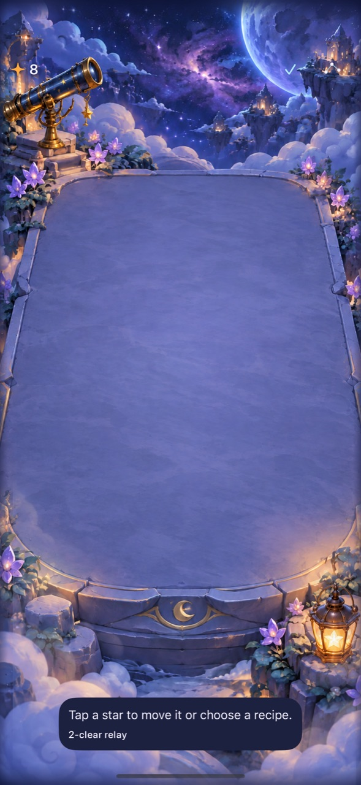
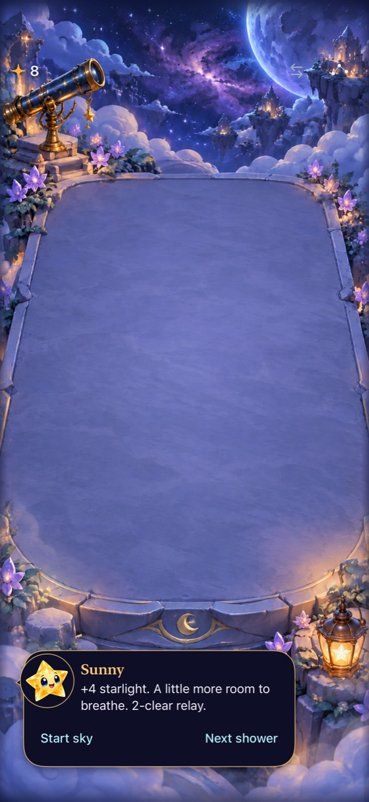

# Keep setup moves; remove the empty-board Arrange detour

**Result:** Partially verified · **Owner:** current implementer · **Date:** October 18, 2026

**Help/accessibility update:** [Complete largest-text read-through and System Reduce Motion](HELP_ACCESSIBILITY.md) pass on PR #95 source. Balance enumeration still needs gap-link verification before current-rule measurements.

**Current gesture/copy update:** [Visible planning and latest-source verification](VISIBLE_PLANNING.md) records a useful three-exchange plan, current native fresh/outcome checks, unchanged model smoke results and repairs to stale calibration dependencies/wording. Earlier Arrange evidence is historical.

**Automatic-setup update:** [Native rain and recipe admission](AUTOMATIC_SETUPS.md) verifies an ordinary seed-0 setup and fixes unchanged selections disappearing on rain plus misleading per-action readiness. Broader calibration remains open.

**Contact-readiness update:** [Native diagnostic](CONTACT_READINESS.md) explains the sampled non-scoring attempts and verifies late readiness checks. Game rules remain unchanged; deliberate automatic setups are next.

**Fresh-play update:** [Current-main automatic play and input-window correction](FRESH_ROUNDS.md) records two fresh native passes, recipe/relay footage, seven receipt checks and 1,024 current-source model runs. Retain the rules; distinguish missed native attempts before tuning.

**Combined-source update:** [Integration with main’s faster input/five-feed Dusk](INTEGRATION.md) now passes the affected development checks. The earlier three-feed measurements and captures below retain their original source.

Native play exposed a small, repeatable friction: after clearing the last recipe, Arrange stayed open with “Tap a star…” on an empty board and hid the shower controls. The correction closes Arrange when the committed sky becomes empty, restores paused-play controls and disables Arrange until a star arrives. A populated sky retains Arrange. Rules, score, RNG, saves and cadence are unchanged.

The timed study also changes the [untimed baseline’s](../calibration-baseline-2026-10-18/README.md) interpretation. Setup success depends strongly on decision delay and presentation assumptions. **Retain the existing exchange rules; no new cost, limit or mechanic is justified by these measurements.**

**Next action:** Compare fresh native clear-first/setup-first play on the combined source. Observe recognition and execution in automatic showers, then choose one bounded tuning change. Overall calibration remains in progress. Video capture failed; physical feel, human preference and full observed motion remain open.

## The observed problem and correction

**Inspected native captures:** iPhone 16 Pro Max / iOS 27.0 Simulator, default text, authored reset-only relay board. Before runtime: `11a16fc`; after runtime fingerprint: `dev.55d90a174c`, [source hashes](source.json). Local binaries display `dev.local`; the fingerprint identifies source bytes, not a stamped/installed phone build. Images are scaled to 1,280 pixels high and encoded as JPEG from original XCTest attachments retained under ignored artifacts. The fixture deliberately disables rain/saving; ordinary empty-opening advance is verified separately below. These stills do not establish animation quality.

**Root cause:** `SkyTechniqueIntent.cancel()` intentionally discarded transient selection while preserving Arrange mode. The view used that cancellation for every committed game change. Thus an empty board had no valid selection but retained the mode that replaces the ordinary footer. Arrange could also be entered on an initially empty sky.

**Responsible boundary:** the app-local intent now owns `canArrange(in:)` and committed-state reconciliation. The view uses the same eligibility for its toolbar and closes the mode when the sky becomes empty or unsupported. Selection tickets still invalidate on game changes. The core’s action legality and store’s presentation/clock ownership are untouched.

**Acceptance defined before the correction:** exit after the last clear, restore paused controls, disable entry while empty, and retain useful arrangement on populated boards. The examined sibling paths include initial empty play, selection cancellation, First Light eligibility, settings/background cancellation and largest-text recipe controls. This does not claim every gesture interleaving is covered.

## What timing changes in the balance conclusion

The runner compiles the unchanged real Debug Store, trace intent, save boundary, dialogue and technique types on macOS. A virtual clock and modeled presenter execute scheduling and accepted actions. It now compiles against current dependencies, extracts complete value declarations without depending on neighboring UI names, and reads presentation durations from their production source. The sibling largest-clear policy now uses collectible `reward(of:)`, preserving feeding Dusk’s zero-reward distinction.

Setup-first may make at most one exchange per shower and only for a strictly better visible immediate reward. It then follows the normal largest-clear policy. No forecast selection, exact-recipe trimming or optimal subset planning is modeled. The explicit action budget is a diagnostic, not an app rule.

Four scenarios cover seeds 0–15 for up to 180 active seconds, two cadence lookups, four policies and full/quiet presentation models: **1,024 modeled runs**. The table shows only current `announcedCycleV2` with the normal-motion model; complete current-cadence aggregates and source/commands are in [timed-study.json](timed-study.json). Raw events and historical-cadence comparison remain under ignored `artifacts/calibration-current/`.

| Decision delay / swap contact | Clear-first: ended / median observed score | Setup-first: ended / median observed score | Setup median showers / held-time fraction |
| --- | --- | --- | --- |
| 0.45 s / 0.5 s | 6/16 · 220.5 | 0/16 · 201.5 | 71 · 12.1% |
| 0.45 s / 1.0 s | 6/16 · 220.5 | 0/16 · 187.5 | 65 · 18.8% |
| 1.0 s / 0.5 s | 10/16 · 145.5 | 12/16 · 100 | 60 · 13.7% |
| 1.0 s / 1.0 s | 10/16 · 145.5 | 11/16 · 100 | 60 · 17.5% |

The fast clear-first policy receives a median 77 showers. Longer swap contact holds the existing clock longer, reducing delivered showers and score within the observation horizon. A longer decision delay changes setup success sharply in the normal-motion model; the quiet model keeps its own different results, with no setup overflows in these samples. No-overflow rows remain censored at 180 seconds.

**Limits that affect interpretation:** these are assumed timings, not measured human timing. The sequential model waits for all presentation to finish before choosing another action; the actual app permits actions in independent columns during other animations. No-opportunity time means no ordinary tap/full-component trace while free to decide; it excludes active holds and does not count potential exchanges as clears. Changed decisions can change relief and later arrivals despite equal seeds. Do not infer a universal difficulty defect, motion-mode parity, enjoyment, or a need to restrict free exchanges.

## Checks and source boundaries

**Runtime baseline:** `11a16fc`; parent calibration commit `ba11925`. Before the UI correction only the three pacing tools differed. After it, runtime changes are exactly `App/FallingSkyView.swift` and `App/SkyTechniqueIntent.swift`; affected hosted/UI test changes are recorded in [source.json](source.json). No files/target membership, resources, Core rules, persistence schema, dependencies or phone installation changed.

**Toolchain:** Xcode 27.1 (27A9275), Apple Swift 6.4, arm64 macOS 27.0.1. Native destination: `5107CBBF-108B-4B94-9125-A873F948A38C`, named Starfall Main 16 Pro Max QA, iPhone 16 Pro Max / iOS 27.0 (24A434). Technique checks explicitly launched with Calm effects off; system Reduce Motion was observed off. The baseline automatic test later enables Calm; its earlier saved preference is not assumed. Accessibility XXXL is an explicit separate UI launch argument.

| Area | Executed result |
| --- | --- |
| Core | `swift test`: **147 passed**, zero failures, after the UI correction. Core bytes unchanged. |
| Hosted regression | `StarfallAppTests/SkyTechniqueStoreTests`: **10 passed**, zero failures/skips. Covers empty/populated/First Light intent reconciliation and stale selections, current-save nudge, column ownership, Dusk reward columns and normal/quiet exchange outcomes. |
| Corrected native UI | **4 passed**, zero failures/skips: empty opening → real shower → Arrange enables; two-clear relay → empty board → feedback/controls restored; settings/background cancellation; largest-text recipe actions and occupied-star scrolling. The largest-text capture was inspected: its guide is below the canvas and the view is scrolled; this is not a simultaneous whole-board/header acceptance. |
| Baseline native play | **4 passed** before the correction: direct swipe/hold, quick cancellation and empty-destination fall; automatic rain/paused rapid clear/settings; background/relaunch/automatic full-sky/new sky; exact square → deliberate relay. These observations remain source-bound. |
| Builds | Debug simulator build/test and Release generic iOS Simulator build succeed. Existing source/test files retain target membership. |
| Timed tool | All four 16-seed scenarios pass store/core replay parity. Two independent 2-seed/30-second runs produce identical event and summary bytes. A rerun after the UI-only correction reproduces the same event bytes. Default CLI without setup policy also passes a 2-seed/10-second smoke check. |
| Motion | Hosted full-motion exchange positions/timing pass; no animation code changed. Native video reported started but stopped with a missing-output-file error. Browser H.264/MJPEG produced no frames. **No inspected motion clip or physical feel acceptance.** |
| Accessibility | Native button semantics, disabled empty-board Arrange and largest-text controls checked. Actual VoiceOver: deferred to RC; not run on this development build. System Reduce Motion native play was not rerun in this batch; hosted quiet outcome coverage is distinct. |
| Hygiene | `python3 scripts/ci-hygiene.py` and `git diff --check` pass. |

Native commands use `xcodebuild -project Starfall.xcodeproj -scheme Starfall -configuration Debug -destination 'platform=iOS Simulator,id=5107CBBF-108B-4B94-9125-A873F948A38C' -derivedDataPath /tmp/starfall-calibration-derived -parallel-testing-enabled NO -collect-test-diagnostics never -test-timeouts-enabled YES ARCHS=arm64 ONLY_ACTIVE_ARCH=YES CODE_SIGNING_ALLOWED=NO test`, selecting the named methods/suite above. Raw logs/result bundles: `artifacts/calibration-native/{technique-smoke,relay-automatic,empty-arrange}.{log,xcresult}`. Release uses `-configuration Release -destination 'generic/platform=iOS Simulator' -derivedDataPath /tmp/starfall-calibration-release ... build`.

The original stuck QA simulator remains an infrastructure issue; scoped recovery did not restore its shutdown state. It was not erased, and other tasks’ simulator services were not reset. XCTest on the alternate simulator enabled the successful interaction/capture checks; external AX taps and streaming remain unreliable. No universal input-system fix is claimed.
