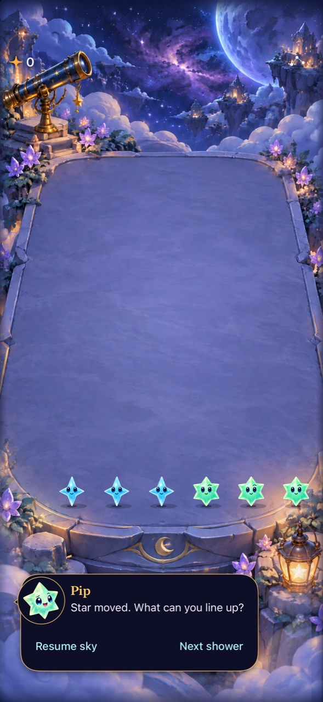

# Keep the rules; preserve visible planning evidence

**Result:** Partially verified; calibration continues · **Owner:** current implementer · **Date:** October 18, 2026

Retain the current cadence and free horizontal exchanges. A fresh seed-64 board supports a useful three-move plan that temporarily breaks a ready match, then leaves two matches. It works through the current gesture-only interface and latest character copy. The one-step improving policy cannot represent that plan; its measured survival is not a bound on human strategy or enjoyment.

This batch changes calibration infrastructure, not gameplay: compile the production Dusk/copy dependencies in the timing runner, and repair/extract the native driver after accessibility wording changed. **Next action:** Inspect complete largest-text help and Reduce Motion on the latest copy, then observe recognition and gesture comfort. No new mechanic or balance parameter is justified by these samples.

## The visible plan

Start an ordinary seed-64 sky, pause and deliver two showers. No fixture, private board state, future shower search or recipe picker is used. The bottom row is shown left to right; A is Aqua, M is Mint, and · is empty.

| State | Bottom row | Largest ready tap weight |
| --- | --- | --- |
| Two showers, no clears | · A A M M M A | 3 |
| Move the rightmost Aqua left once | · A A M M A M | 2 |
| Move that Aqua left again | · A A M A M M | 2 |
| Move it left a third time | · A A A M M M | 3; two separate groups |

On current main `33ae6fb`, three direct neighbor drags (0.8 seconds each, native element references) followed by two 0.1-second physical taps collect 3 + 3 starlight and empty the terrace. The board has not advanced during this paused example. The native strategy was first identified by reading the fresh board, then repeated after each material main update. It is now a known solution, not an uncoached-human result. Its extra action/time cost under automatic rain remains unmeasured.

**Inspected native capture:** clean runtime inputs from `33ae6fb`, Debug, iPhone 16 Pro Max / iOS 27.0 Simulator, default text, Calm effects off. Version 0.1.0 (1), displayed build `dev.local`. Only the offline runner was dirty at capture; it is not an app input. JPEG reduced from a native Simulator PNG. The 26.828-second recording was inspected as 53 half-second samples: neighbor previews, horizontal movement, two visible +3 awards, score 0 → 3 → 6 and restored ordinary controls. This is sequence evidence, not smoothness, audio/haptics or performance acceptance.

## Source-bound play and verification

Main advanced twice during the work. Earlier runs were retained at their actual sources; affected checks use the integrated source. No rules, saves, RNG, artwork or app Swift files are changed by this batch. [Input hashes and source boundaries](planning-source.json) distinguish capture, model and native-test inputs.

| Source | Observation | Limit |
| --- | --- | --- |
| `1ab1765` | Original manual Arrange-button plan collected 6, followed by four scoring automatic taps. Final saved state validates in current Core: seed 64, 20 starlight, 30 showers, standardSky, lost in column 7. 41.305-second recording inspected in 82 samples. | Historical interface; not current gesture/copy acceptance. Survival duration includes tool latency and an unattended tail after recording. |
| `d2ce8ff` | Three neighbor gestures constructed both triplets. An overlong first tool drag crossed six columns and was correctly canceled. The current-distance gestures succeeded. Fresh seed-5/180 cases and First Light win/replay/full-sky/restore/new-sky flow passed. Outcome case: 149.717 seconds. 40.483-second interactive recording inspected in 80 samples. | One paused press and one later automatic tap did not score. The former action record omitted a coordinate event; the latter was not instrumented at actual admission. Neither is evidence for changing cadence or adding buffering. |
| `33ae6fb` | Gesture plan + physical taps collect exactly 6; brief Pip reactions and ordinary controls remain readable. Two repaired fresh automatic cases pass on latest copy (54.188 and 52.258 seconds including launch/query overhead). | This establishes sampled interaction and visible strategy, not human learning or preference. Largest-text help, actual VoiceOver and physical feel remain separate. |

The pre-copy full-sky test passes on this QA simulator without a product fix, retry or timeout increase. That does not identify the cause of the earlier host's timeout or eliminate intermittent lifecycle failures. The unchanged outcome case also passes on latest-copy source in 159.484 seconds; both source-bound results retain their original environments.

### Repair the measuring tools, preserve their limits

The timing runner initially failed to compile when the store began using `DuskWarning` directly. The latest copy also depends on `SkyCopy`. Both are now compiled from their production files and included in before/after source hashes. No substitute warning/copy implementation is added. The current-source smoke has 32 runs and 760 independently replayed commits; all run events/metrics match the earlier 32-run integration baseline. This is a dependency/admission check, not a new distribution study.

The native fresh driver still recognized the old `starlight connected` / `toward a match, ...` wording, while the app exposes `toward a tap match` with an optional separate reward. Updated one shared pattern for both selection and waiting, preserving zero-reward legal matches and the last readiness check. The two scenarios now live in `FreshSkyPlaytests.swift`, explicitly in the UI-test target. The general file drops from 1,150 to 1,069 lines; the focused class is 90 lines. Reset-only startup directly uses the paused board's existing Start sky button. Assertions, the 45-second selection budget, normal effects and bounded diagnostic captures are retained. Query latency changed, so native totals are not before/after balance measurements.

The model still permits only one immediately improving exchange per shower and uses canonical full-component traces. The paused plan intentionally waits through the second shower and spends three exchanges before clearing. It demonstrates a strategy outside those bounds. No optimal-play, net-survival-benefit or human-recognition claim follows.

## Checks and remaining work

Environment: Xcode 27.1 (27A9275), macOS 27.0.1, arm64, QA simulator `5107CBBF-108B-4B94-9125-A873F948A38C`. Working differences at the final native run are test extraction/project membership and offline tooling only; app/Core inputs equal `33ae6fb`.

| Check | Result / evidence |
| --- | --- |
| Core | `swift test`: 149 pass; `artifacts/calibration-current/main93-core.log` |
| Debug build + latest native | Two `StarfallUITests/FreshSkyPlaytests` methods pass. `SkyFlowInteractionTests/testFirstLightWinReplayAndFullSky` also passes (159.484 seconds); three native cases total. Bundle `artifacts/calibration-native/main93-fresh-and-outcome.xcresult`; exact command in source record. |
| Release build | Generic iOS Simulator / arm64 build passes; `artifacts/calibration-current/main93-release.log`. New test file's target membership is also proven by native discovery/execution. |
| Fresh observations | Seed 180: 11 attempts, 1 non-scoring, 6 stale selections skipped, 39 starlight / 22 showers. Seed 5: 8 attempts, all scoring, 7 skipped, 38 starlight / 22 showers. Both samples are censored. The seed-180 non-scoring press had queried readiness true, but the captured native hierarchy reports `Spark. Stars settling…`; it is a later readiness boundary, not unexplained lost input. |
| Current model | `python3 tools/mechanics/compare-pacing.py --seeds 2 --seed-start 64 --seconds 30 --baseline-cadence announcedCycleV1 --candidate-cadence announcedCycleV2 --include-setups --output artifacts/calibration-current/main93-copy-smoke` passes; 32 runs / 760 replayed commits |
| Visual/animation | The latest three-move PNG and all 53 sampled sequence frames inspected. Earlier-source 82/80 samples are historical. No continuous-video smoothness, actual VoiceOver, audio/haptic or phone acceptance claimed. |
| Hygiene | `python3 scripts/ci-hygiene.py`; `git diff --check` pass. Markdown source/link checks only; rendered document not inspected. |

Raw captures, videos, native result bundles, tool failure logs, semantic snapshots and terminal archive remain under ignored `artifacts/calibration-native/main{91,92,93}-*` / `artifacts/calibration-current/main{91,93}-*`. Native control operations take several seconds; an operation returning success is not itself proof of a committed game action. Scores/board observations and Core validation are reported separately. The samples do not settle the unclassified presses or support a claim that every lost-touch mechanism is eliminated.
