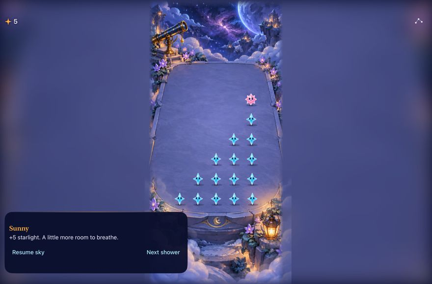

# Camera layout follows the full local canvas

**Result:** Verified for development; physical/RC acceptance open · **Owner:** current implementer · **Date:** October 17, 2026

The camera contour now uses the dimensions of its consuming playfield rather than an ancestor's safe-area-reduced size. Checked iPhone 17 and 16 Pro Max profiles require width, height and top inset; unknown, resized, rotated and accessible layouts retain the complete header forecast. This is layout approval, not generic hardware capability detection. No new camera profiles, rule/save changes, pacing adjustment or extra app.

**Next action:** Merge this final reliability batch. The reloaded updater will install normal Starfall when the configured phone reconnects; physical cutout/expanded activities, curved/second-finger interruption feel, haptic recognition and actual VoiceOver remain next-device/RC checks. The [accepted design](../../design/RELIABILITY_POLISH.md) and PRs #46/#48 own touch tickets and update identity.

**Runtime evidence:** iPad mini (A17 Pro), iOS 27.0 Simulator, main `0cd430e` plus this PR, local `dev.local` Debug product. Full-screen native capture after two-finger admission, short-trace cancellation, background/resume, rotation, a successful trace and menu restore. Resized JPEG; original PNG and AX frames remain in ignored artifacts. This frame verifies containment, not animation quality or physical feel. The earlier app-window screenshot was cropped/rotated and was not accepted as visual evidence; the final test uses `XCUIScreen.main.screenshot()` and asserts native control containment/hittability.

## Outcomes against acceptance

| Case | Observed result |
| --- | --- |
| Checked Island route | Native forecast assertion requires 148×50 and placement above the score on 16 Pro Max; menu/background and maximum-text header fallback pass. Hosted checks reject changed width/height/inset/orientation/accessibility for both profiles. |
| Touch / window boundaries | Native pinch, short trace, background/restore, successful five-from-six, and menu restore pass on phone and iPad. iPad rotates before the successful drag; edge cells, menu and guide actions remain within the window and hittable. Store/surface hosted tests retain active-session size/generation cancellation. This is not a native second finger injected during an existing held touch. |
| Small phone | SE3 forecast/menu/background/maximum-text fallback and bounded long guidance checks pass on the final source. |
| Outcomes / motion | Six selected phone flows on the pre-gravity integration source passed, including largest-text drawing, win/full/replay/restore, result actions and system Reduce Motion. The final combined source additionally passes all hosted tests, phone/forecast/rotation checks and the native captive trace. Current gravity motion acceptance remains source-bound to its own integration evidence. |
| Persistence / performance | No rule, RNG, cadence or save change in this batch. Existing regression suites pass. No performance framework, new hint system or claim of improved human enjoyment. |

## Verification context

Native runtime source: main `0cd430effa85d02165351c67bedf197c9c168428` plus this PR's explicit App/HUD/theme, geometry/native tests, pacing-consumer compatibility and documentation edits. Concurrent gravity and automatic-storm work was preserved, including both appended native test extensions. No target/resource membership changes in this PR. Later reconciliation with main `9fc0c57` changes only tooling/docs; its concurrent pacing PR #50 supplies the same canonical-fixture correction and adds current-cadence sensitivity options. Keep that implementation as the sole owner. Native runtime inputs are unchanged by this reconciliation. Xcode 27.1 (27A9275), arm64, iOS 27.0 Simulator, Debug `dev.local` and Release compilation.

Raw logs under ignored `artifacts/reliability/`:

- `layout-integrated-core.log`: `swift test`, 109 passed.
- `layout-integrated-phone.log`: all 154 hosted tests plus the two selected phone flows passed; the requested `GravityIntegrationUITests` selector names no suite, so it supplies no gravity evidence. `gravity-trace-integrated.log` separately runs the correct `GravityTraceUITests/testNativeTraceSpendsFiveCaptivesAndPreservesSixth` and passes.
- `ipad-screen-capture.log`: profile hosted tests and native iPad resize/interruption flow passed. Device `5E147A6C-3180-4583-87F8-F91372552816`; inspected full-screen attachment and AX frames under `ipad-screen-attachments/`.
- `small-fallback-native.log`: final SE3 forecast/fallback and guide checks passed. Device `E90550D2-AE94-4695-8E6F-707BD527C12F`.
- `layout-main-native.log`: earlier main `9cb8fcc` plus this batch, 144 hosted / six selected native cases passed, including the full win/loss/replay and Reduce Motion checks; these are not falsely attributed to later gravity source.
- `layout-integrated-release.log`: Release generic simulator build passed. Debug native products compiled through the tests. Builds use Starfall project/scheme, `ARCHS=arm64 ONLY_ACTIVE_ARCH=YES CODE_SIGNING_ALLOWED=NO`; native runs disable parallel testing and use bounded 120/200-second allowances (the existing two-round flow has its own 240-second budget).
- `native-plan.log`, `updater-final.log`: 3 test-matrix checks and 13 updater checks passed. Hygiene and diff checks passed.
- `current-pacing-consumer.log`: bounded one-seed/ten-second consumer smoke passed after compiling Core's canonical Debug fixtures, replacing the historical copied fixture. The subsequent merged-current runner also passes a two-seed/60-second V1/V2 smoke with 0.75-second modeled reaction (`final-current-cadence.log`). These are presentation models, not measured current gravity animation, device cadence or human preference.

Initial stronger forecast test queried the score as a Button instead of StaticText; the corrected lookup preserves the actual-route assertions. An initial attempt used a nonexistent device screenshot API; compilation was corrected to XCUIScreen. Those failed logs and the rejected app-window capture are retained. Full actual VoiceOver was not run during routine development.
