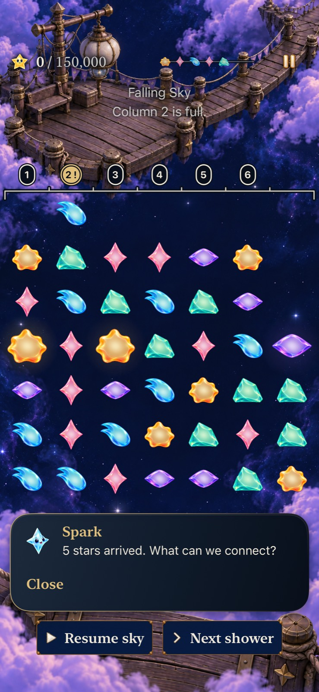
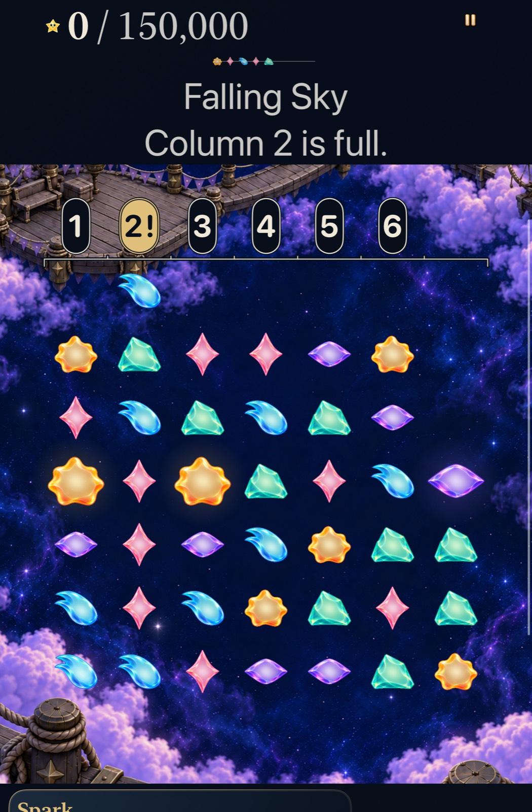
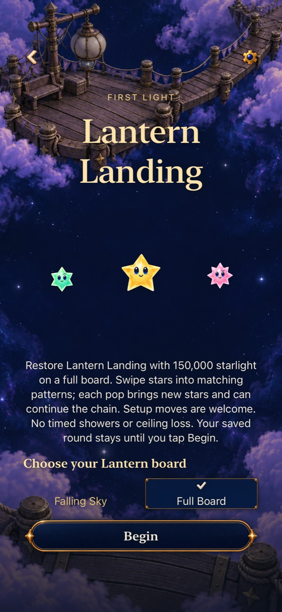

# See the ceiling and compare full-board Lantern

**Result:** Development verified; player comparison remains open · **Owner:** Current coordinator · **Date:** October 23, 2026

The user requests a visible ceiling and a playable full-board Lantern comparison while retaining the accumulating sky. [Ceiling #298](https://github.com/lbeezr/starfall/issues/298) and [Lantern #299](https://github.com/lbeezr/starfall/issues/299) own this bounded batch. Starting source: `612a369b23b58b55007da4ff02abeaaf6ca82bb9`, clean.

**Player promise:** Understand where danger begins; make a Lantern match and immediately receive another arrangement to consider. Full-board play is an explicit comparison, with human preference undecided.

**Try it:** Story Mode → Lantern Landing → choose **Falling Sky** or **Full Board** → Begin. The choice remains available on a new visit; Continue and same-round Replay keep the selected version. Both real Lantern wins can earn its existing repair.

## Contract and observable acceptance

| Slice | Acceptance |
| --- | --- |
| Ceiling | The exact arena top stays visible across paintings. Numbered markers identify columns with one or zero spaces remaining, and visibly withdraw after recovery. A full column signals risk because a matching top star can still grow. Preserve cell/hit geometry. |
| Lantern choice | Normal Lantern Entry offers Falling Sky and Full Board. Browsing/cancel preserves the retained round; Begin commits the choice. Continue and Replay retain it. |
| Full-board rules | Explicit firstLight revision 5, five colors, current four-star lines/squares/crosses and 150,000 target. Start and finish actions with 49 stars; clear, settle, refill and resolve causal matches deterministically. Setup exchanges remain available. Untimed, without showers, overflow or a move budget. |
| Persistence | Versioned supply/RNG/identity accounting, validated saves and exact replay. Old challenges/archives retain their definitions. Existing real repair progression remains; practice stays disposable. |
| Native proof | Real initial swap/clear/refill, complete round, Entry cancellation, restore/replay and settings/background; current sky recovery/overflow. Inspect phone/tablet, default/largest text and normal/quiet presentation. |

Core owns committed outcomes; Store owns save/clock/input; Scene presents each clear/settle/refill. The new ceiling uses existing `LandingGeometry` and theme-native shapes with a dark under-stroke, pearl boundary, geometric numbered risk markers and no new raster resources. Its overlay intercepts no input. Full-board play exposes a board edge without overflow markers.

The existing [pressure screenshot](../game-goal-05-pressure-recovery-2026-10-22/dev-64151f9500__pressure__iphone-17e__full.jpg) was inspected: text names column 2 while the active board has no geometric ceiling or column mapping. This is the baseline gap, not evidence of the new appearance.

## Ownership and comparison decision

Core worker owns Core rules/tests; App worker owns Store, Scene, flow, archive, catalogue and hosted tests; ceiling worker owns the new overlay/snapshot tests. Coordinator owns `FallingSkyView`, target membership, native tests, shared docs and Git. Native resources are serialized by the coordinator.

The comparison asks whether immediate refill creates useful choices and readable cascades with less unwanted waiting. The next side-by-side player session decides retain, revise or remove the Full Board option. Fixed seeds, automated completions and stills do not establish enjoyment. Ceiling clarity is independently adopted after native verification.

## Observed outcomes

The ordinary opening exchange `(8,9)` earns **66,000** through three causal phases and supplies eighteen replacement stars. The fixed ten-exchange witness reaches exactly **150,000**, with 49 occupied cells after every committed action. A setup exchange earns zero points and still remains a valid move. Every witness save round-trips and replay reproduces the same identities, supply and awards.

From current Falling Sky after four showers, column 2 is full and columns 1/3/4/5/6 have one space. The visible numbered markers map those exact columns. The real bottom-row exchange at indices `1→2` earns 5,000 and restores four spaces in column 2; the same next shower then fits. Leaving the position unchanged produces the actual blocked-arrival ending. Full Board has a quiet top edge and no overflow marker or shower control.

| Inspected normal phone | Inspected AX3XL tablet |
| --- | --- |
|  |  |

These are inspected Simulator stills from `1f3f742` plus the two recorded native-test capture refinements, snapshot `4e846183e8e8`, runtime fingerprint **`dev.17fb71332a`** (Simulator label `dev.local`). [Capture hashes and exact sources](captures.json) include Full Board phone and tablet landscape samples. The initial AX3XL pressure attachment was scrolled below the ceiling; the refined test physically reveals and asserts the complete ceiling/top-row viewport before capturing. This changes capture setup, not the geometry or rule.

## Verification and source integration

Starting source `612a369` was clean. Integrated the accepted HUD change `81826248` as `1f3f742`, then the accepted Kite encounter `b41a623c` as **`89ad295`**. The final integration retains Kite revision 4/17,000 alongside Lantern revision 5 and the v14 archive. Final runtime fingerprint **`dev.4ce4ff3aca`**; [verification.json](verification.json) records changed-source hashes, counts, selectors and commands. Relevant ceiling, Entry, HUD, Store and Scene owners are unchanged by the Kite merge; source-bound stills retain their original names and provenance.

Environment: Xcode **27.1 (`27A9275`)**, Swift **6.4**, macOS **27.0.1** arm64. iOS **27.0 (`24A434`)** Simulators: iPhone 17e (`Starfall Mechanics Lab`), iPad mini (A17 Pro), iPhone SE (3rd generation) (`Starfall Parity Compact 01a1563a`).

| Evidence | Result |
| --- | --- |
| Core | **260 passed, 0 failures/skips**, including all eleven Full Board cases and seven Kite cases after integration. |
| Hosted | **455 passed, 0 failures/skips** before Kite integration; **123 affected cases passed, 0 failures/skips** on final integration, including Full Board, ceiling, strict catalogue, Entry, archive and world/repair paths. |
| Native | **Eight selected journeys pass, 0 failures/skips:** five phone (all three Full Board journeys, ceiling recovery, real overflow), two tablet (largest-text rotation/restore and ceiling recovery), one compact-phone largest-text journey. Final combined source also passes two integration journeys: compact-phone mode-switch/cancel and current Kite choices/win/restore/replay/overflow. |
| Builds / membership | Debug build-for-testing and Release pass after both integrations. New App/AppTests/UITests files are explicitly registered; Core is discovered through the local package and compiled into the normal target. |
| Normal motion | Real native full round and hosted Scene flights pass. Quarter-second samples show swap, three pop/fall/refill phases and stable 49 stars by 51.25s of the first recording. Sampled order is established; continuous smoothness and physical listening/comfort are unmeasured. |
| Hygiene | `python3 scripts/ci-hygiene.py`, `git diff --check` and changed-document local links pass; repeated after staging. |

Core command: `env CLANG_MODULE_CACHE_PATH=/private/tmp/starfall-lantern-refill-clang SWIFTPM_MODULECACHE_OVERRIDE=/private/tmp/starfall-lantern-refill-module swift test --disable-sandbox --scratch-path /private/tmp/starfall-lantern-refill-core-20261023`.

Native/build commands use `xcodebuild -project Starfall.xcodeproj -scheme Starfall -configuration Debug`, `CODE_SIGNING_ALLOWED=NO`, `ONLY_ACTIVE_ARCH=YES` for build-for-testing, the named Simulator destinations and `/private/tmp/starfall-ceiling-refill-20261023/DerivedData`. Tests use `test-without-building -parallel-testing-enabled NO -collect-test-diagnostics never`, unique result bundles, exact selectors in the JSON, and bounded `scripts/simulator-command.py` receipts. Release uses `-configuration Release -destination 'generic/platform=iOS Simulator'` and separate `ReleaseData`. Raw logs/results/video remain disposable under `/private/tmp/starfall-ceiling-refill-20261023/`.

Earlier iterations exposed an ambiguous generic SwiftUI expression and a test's ambiguous floating-point constant; both were corrected before native acceptance. An existing unknown-revision assertion was advanced from 5 to `maximumSupportedRevision + 1`, retaining strict unknown rejection. No gameplay expectation, timing assertion or skip gate was weakened. The initial full Core attempt's one outdated assertion is retained in the verification summary.

## Decision and remaining limits

Adopt the ceiling presentation for development. Retain Full Board as the explicitly requested player comparison until the next side-by-side session decides retain/revise/remove. Assess the strong opening award, useful alternatives, unlimited setup and waiting; automated wins do not establish enjoyment. [ENGINEERING](../../ENGINEERING.md) records the concrete follow-up and bounded stabilization contract.

Actual VoiceOver, minimum-iOS-17 runtime, physical-device performance, installation and human preference are **not run** in this batch. No new asset family, special piece, move cap or later-location refill mode is added.
