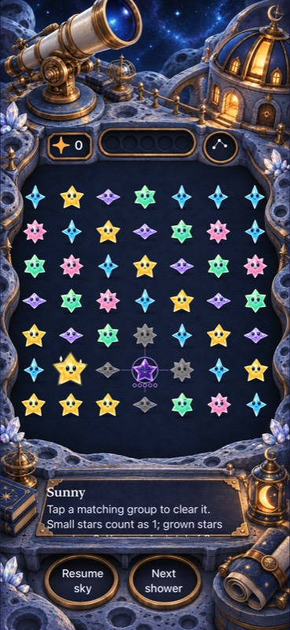
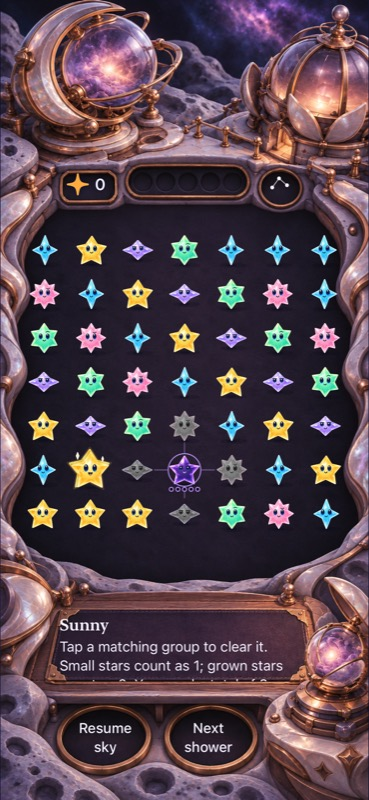
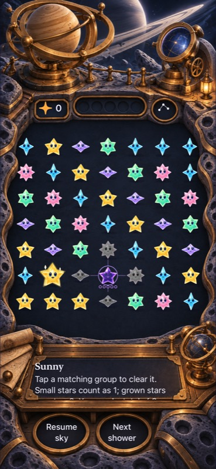
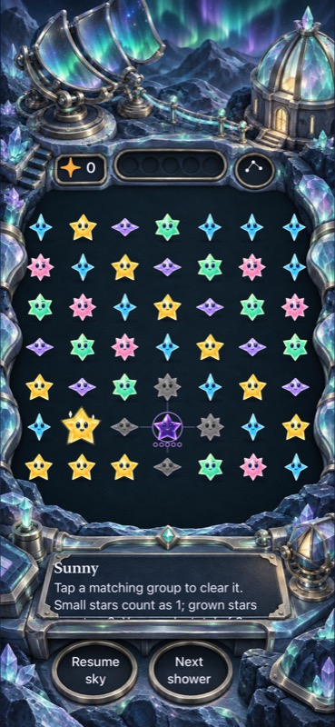
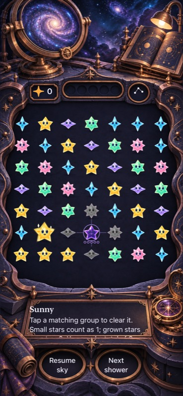
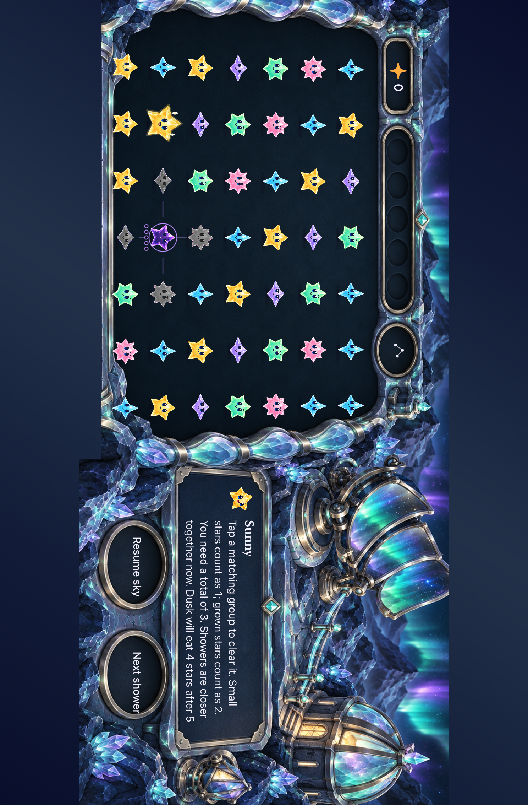
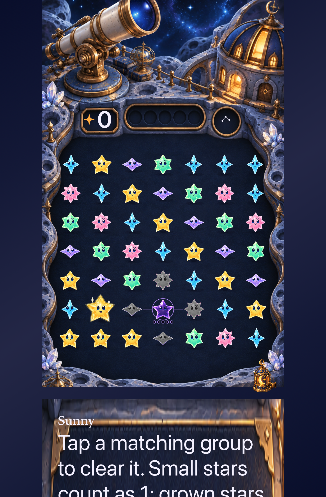

# Five celestial boards in native play

**Result:** Verified for the sampled development matrix; RC acceptance remains open · **Owner:** current implementer · **Date:** October 18, 2026

Crescent Observatory, Nebula Nursery, Orbital Orrery, Aurora Spire and Spiral Archive replace the previous roster in regular Debug/Release play. Menu → Location selects and remembers each setting without changing the round. Fifteen bundled images provide portrait, authored landscape and large-text foreground art; native text and controls occupy the painted fittings. Ten instruments have bounded, cancellable optical responses.

**Next action:** Hold publication after the user reopened the art direction. Review [centered open-sky concepts](../../design/environments/open-skies-05/README.md) before deciding the next native proof. Physical play/performance, small-phone native sampling and actual VoiceOver remain unverified on this source; actual VoiceOver belongs to RC under the development cadence.

## Native appearance

| Crescent Observatory | Nebula Nursery | Orbital Orrery | Aurora Spire | Spiral Archive |
| --- | --- | --- | --- | --- |
|  |  |  |  |  |

**Runtime evidence:** clean `e71716e`, iPhone 17e / iOS 27.0 Simulator, default text, normal motion, Calm effects off, isolated dense fixture. All five inspected. These are native captures, separate from the [generated concepts and asset provenance](../../design/environments/celestial-worlds-04/README.md). [Source hashes, capture hashes and parity](source.json) identify what the later merges changed.

**Runtime evidence:** clean `e71716e`, iPad mini / iOS 27.0 Simulator. Aurora's deeper painted crown has its own registered native score/forecast/menu centers. The authored wide stage is centered vertically, leaving broad dark margins on this tablet aspect ratio. The reading panel scrolls long dialogue; the clipped final line is not a lost message. Native tests reach the menu, both actions, instruments and edge cells in both landscape directions.

**Runtime evidence:** clean `30b09d8`, iPad mini / iOS 27.0 Simulator, largest Dynamic Type. Inspected crown and reading layout; later per-place landscape registrations do not affect this portrait sample. This does not prove physical comfort or screen-reader navigation.

## Acceptance and verification

The [implementation contract](../../design/environments/celestial-worlds-04/IMPLEMENTATION.md) owns scope. The environment adds no Core rules, RNG, save schema, account, network, SDK or progression behavior relative to integrated main. Main's newer terminal-save recovery and ceremony clearance fixes are preserved.

**Final combined runtime:** `b5a7a02a7c7434ac9e9d3975ef69d7f7281e12ab`, build `dev.4de18c939b`, with no dirty runtime inputs. A test-only lantern speech expectation was aligned with its native label after the earlier runs; that actual VoiceOver test was not run. Xcode 27.1 (27A9275), arm64; all native runs used iOS 27.0 Simulator. Raw results remain in temporary storage; the source and commands below are the durable summary.

| Criterion / check | Observed result and source |
| --- | --- |
| Rule/save invariants | 165 core tests passed at `b5a7a02` using `swift test --scratch-path /tmp/starfall-celestial-core`; `/tmp/starfall-celestial-core-publish.log`. Historical terminal-retirement coverage comes from integrated main. |
| Hosted boundaries and assets | 271 hosted tests passed, zero failed/skipped, at `6fd8b94`; `/tmp/celestial-shipping-hosted.xcresult`. Covers geometry, target containment, materials, clock/feedback/save boundaries and asset membership. Earlier combined `3c964d0` run passed 265. |
| Five locations, taps and interruption | Six passing methods in `/tmp/celestial-ui-places.xcresult` cover every location, repeated props, native edge clears, preservation through menu/background, restart, quiet effects and largest text. One element-query failure was corrected and rerun below. |
| Phone landscape and large text | Four methods passed, zero skipped, at `30b09d8`; `/tmp/celestial-phone-final1.xcresult`. All five wide layouts in both directions, large score/menu, repeated prop/background/restart cancellation, sparse/dense cast and corner taps. |
| Final per-place registration | 13 tests passed, zero skipped, at `e71716e`; `/tmp/celestial-final-registration.xcresult`: geometry suite plus all five iPad landscape locations, native clears and controls. Earlier tablet run passed 261 hosted/UI tests including largest text; `/tmp/celestial-ipad-final.xcresult`. Small-phone geometry profiles are tested mathematically; a small-phone native session was not run. |
| Normal play, recipes and reduced motion | Nine UI methods passed, zero skipped, at `3c964d0`; `/tmp/celestial-main-play.xcresult`: automatic rain, pause/clear/replay/settings, actual system Reduce Motion and seven technique flows (tap, trace, exchange, dark rescue, interruption). These were not blanket animation-suppressed tests. |
| Win, overflow and restore | Three methods passed, zero skipped, at `e71716e`; `/tmp/celestial-final-outcomes.xcresult`: First Light completion/restore/replay/survival, First Light overflow and sparse/dense native corner clears. |
| New save notices | Three UI methods passed, zero skipped, at `6fd8b94`; `/tmp/celestial-shipping-ui.xcresult`: rejected save/background/replace/restore, failed write/acknowledgement/handoff and Archive orientation play. Scenery stops while a notice owns the modal surface. |
| Latest main reconciliation | 15 tests passed, zero failed/skipped, at `b5a7a02`; `/tmp/celestial-publish-integration.xcresult`: `SkySaveArchiveTests` and the tablet `SkyFlowInteractionTests/testLandscapeWelcomeEntryAndPreferences` matrix. |
| Debug / Release | Debug compiled with the native runs. Release passed at final `b5a7a02` (5.6 seconds), log `build_sim_2026-10-18T23-04-31-051Z_pid56979_8973eeef.log` in the local XcodeBuildMCP workspace. All builds use scheme Starfall, arm64, `CODE_SIGNING_ALLOWED=NO`. |
| Visual / animation | All five phone portraits, all five wide layouts and largest-text samples inspected. A native 68.6-second, 30 fps normal-motion recording at `e71716e` shows an instrument tap, five-starlight clear, survivor fall and a manual shower. Exact 42.50/42.80-second samples were inspected for clear/descend continuity. Frame inspection and functional outcomes do not certify real-time smoothness or physical performance. Raw recording stays at `/tmp/celestial-normal-motion.mp4`. |
| Accessibility | Stable native semantics, shape cues, shared cell mapping, 44-point target containment, actual native activation, large Dynamic Type and Reduce Motion sampled. Full actual VoiceOver deliberately deferred to RC; no physical-device acceptance claimed. |
| Hygiene | `python3 scripts/ci-hygiene.py` and `git diff --check` passed after the final evidence edits. Changed-document relative links and image targets resolve; rendered Markdown was not inspected. |

Reproduce native runs with `xcodebuild -project Starfall.xcodeproj -scheme Starfall -destination 'platform=iOS Simulator,id=<device>' -derivedDataPath <temporary-path> ARCHS=arm64 ONLY_ACTIVE_ARCH=YES CODE_SIGNING_ALLOWED=NO -parallel-testing-enabled NO -only-testing:<selection> test`. Phone: `21025903-D90D-4E30-BA74-45D3EFB2F5E4`; tablet: `5E147A6C-3180-4583-87F8-F91372552816`. Final selections are `StarfallAppTests`, the named `SkyFlowInteractionTests` notice methods, and `LandingPlaceInteractionTests/testArchivePhysicalRecessAcrossOrientations`. Prior matrices use the named `LandingPlaceInteractionTests`, `LandingHeaderInteractionTests`, `ObservatoryInteractionTests`, `FallingSkyInteractionTests` and `SkyTechniqueInteractionTests` methods described above. These are focused development checks, not a complete RC matrix.

## Corrected findings

- A short-landscape court extended its bottom row beyond the viewport. Crown placement now reserves the seven full native rows; projection round trips, containment and minimum target checks cover the original size and phone/tablet siblings.
- Screenshot review found stars sized only by court width could crowd wide rows. `LandingGeometry.starStep` bounds bodies, shadows and award effects by both cell axes; the scene and celebration share that owner.
- The largest-text header initially stretched its painted wells and left native controls outside them. An 80-point minimum crown and shared registrations keep the score/menu in their wells. Long dialogue scrolls inside a clipped reading surface; accessibility sizes reflow below the board.
- Landscape Aurora has a deeper crown in its authored painting. Its source split and native control centers are registered separately; other place-specific centers are measured from their art.
- The first landscape UI attempt queried the reading surface as `Other`; SwiftUI exposes the scrolling form as a scroll view. The corrected query uses the stable identifier across element types and retains visibility, cell separation, target size and hit assertions.

These are presentation corrections. Raw test bundles and logs stay in temporary storage; selected native captures and source metadata below are the durable record. The initial multi-method UI tool call exceeded its 300-second response timeout; xcodebuild continued and produced a complete bundle with six passing methods and the element-type failure above. It is not reported as a clean pass.

## Delivery

**Not published or installed.** The attempted branch push failed because local Git/gh had no authenticated GitHub session. Before publication was recovered, the user requested a design rethink around centered iPad gameplay and aerial/open-space settings. Work stopped at local commit `add1492`; no PR or celestial phone installation occurred. The existing canonical updater continues to serve GitHub main independently. The tested platform-based implementation and evidence remain available for comparison.
