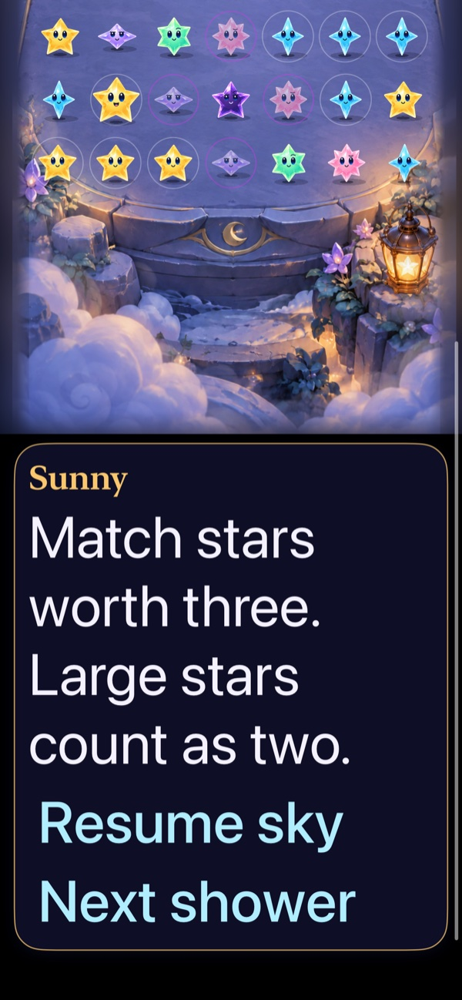
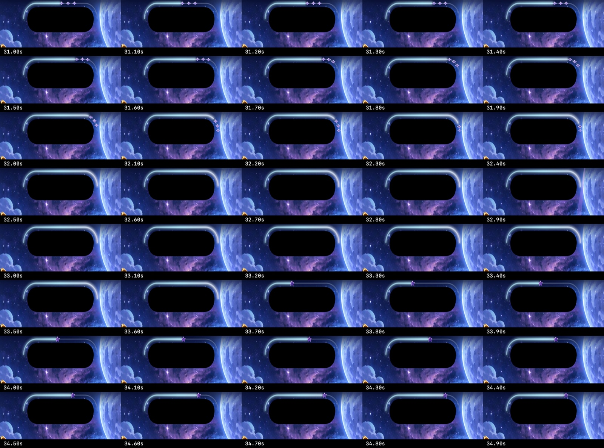
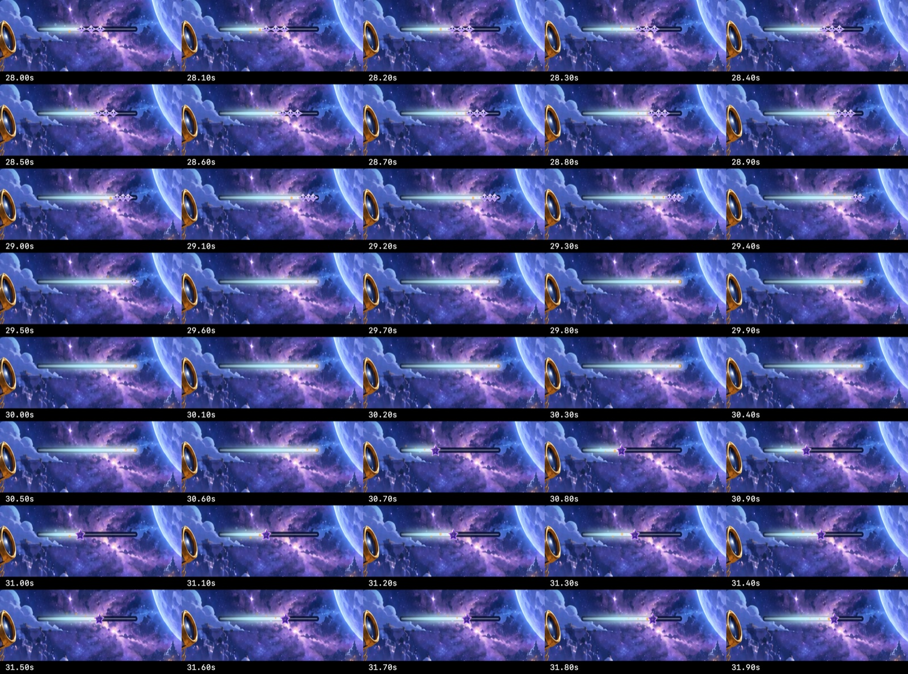

# Character chat, reusable scripts and a complete shower trail

**Result:** Verified for the scoped development checks; device/RC acceptance remains separate · **Owner:** Current implementer · **Date:** October 17, 2026

The selected midnight/brass bubble now carries gameplay guidance and ceremony explanations at the bottom. Six separate expressive portraits and a local JSON catalog support different speakers without another UI implementation. The Debug Dialogue studio previews real scripts, editable values and all portraits. [Authoring instructions](../../../App/DialogueScripts/README.md) are the front door for future scripts/scenarios/maps; this change adds no maps, progression or rule engine.

The shared straight/island forecast renderer now moves each star to the endpoint before fading. Rules, RNG and core saves are unchanged. Exact photographed app identity and physical-phone acceptance are not established by this checkout's simulator checks.

**Next action:** Use the authoring guide/Debug studio for new scripts. Integrate into the newer storm/cadence phone branch with its own rule/save regressions before a physical update; reserve actual VoiceOver for RC acceptance.

## Outcomes against the design

| Criterion | Observed result | Limit |
| --- | --- | --- |
| One bottom character surface | Implemented in gameplay and welcome/entry/endings | Titles, counters and functional control labels remain; no new top announcement surface. This checkout predates the photographed storm/cadence branch. |
| Future speakers/scripts | JSON script/line IDs, speaker IDs, typed priority, optional expiry and explicit values; store hook and Debug studio | Future scenario controllers own event timing and stale async-result rejection. No maps or narrative progression are added. |
| Better avatars | Six separate 256×256 transparent runtime assets, distinct silhouettes and dedicated large faces | One authored expression per speaker; no lip sync or recorded voice. Original generation masters/prompts retained in Artwork/Dialogue. |
| Rule/save/interruption | 63 Core tests and initial focused store/session checks pass | Final-source native summary follows below; all 107 hosted tests passed again at the later source with the shared speaker-name owner. |
| Motion | Shared progress regression covers 1–5 stars, both spacings, endpoint/fade/reset and monotonicity | Two complete normal-motion cycles were inspected on both paths, with falling arrivals; quiet modes remain discrete. No frame-pacing or device-performance claim. |
| Accessibility | Largest-text gameplay and ceremony routes pass initial native checks; name is included once in the message's accessible label | Actual VoiceOver: deferred to RC; not run on this development build. Physical-device acceptance is separate. |

## Verification context

**Source:** Base `f35eba8` with working-tree changes recorded in [source.json](source.json). No changes to StarfallCore, rule generation, save schema, external services or other worktrees. New Swift files, hosted/UI tests and catalog have explicit Xcode membership; portrait sets use the existing asset catalog. These are working-tree results, not a clean published-commit claim.

**Environment:** Xcode 27.1 (27A9275); Starfall scheme; iOS 27.0 Simulator. Initial destination: Starfall Crystal Glow QA (`D65C5E40-734F-42BF-8F91-97E980ED19C2`, iPhone 17e profile). Native extras: `CODE_SIGNING_ALLOWED=NO ARCHS=arm64 ONLY_ACTIVE_ARCH=YES -parallel-testing-enabled NO`. DerivedData `/tmp/starfall-character-chat-build`.

Core: `swift test`, 63 passed, zero failures; `/tmp/starfall-character-chat-core.log`. Hygiene and whitespace checks run separately. Native logs and xcresults live under `/Users/lbeezr/Library/Developer/XcodeBuildMCP/workspaces/Starfall-ef4631013443/`.

Initial focused hosted suite: 29 passed, zero failures/skips; `test_sim_2026-10-18T00-36-27-923Z_pid39010_bf6dd55c.xcresult`. Later complete hosted suite passed 107 tests, including packaged alpha/margin checks, old saves, clock/feedback interruption, native rendering and bounded material tests; `test_sim_2026-10-18T00-43-30-827Z_pid39010_ae0d5a8b.xcresult` also contains two failed UI checks described below. Final-source results will supersede it where changed.

Initial UI run: 7 passed, 2 failed; `test_sim_2026-10-18T00-37-32-369Z_pid39010_c156ed55.xcresult`. It passed real projected front/back taps, active-message expiry/reopen while showers continue, largest text chat/preview, First Light win/replay/full-sky loss/restore, largest text welcome/entry, Reduce Motion entry/replay and actual Home/activate/navigation. The MCP call timed out at 300 seconds; xcodebuild completed normally at 324.6 seconds with the recorded 7/2 result. Do not describe the timeout as an app crash or this run as green.

## Final native checks and inspected captures

| Check | Result and source-bound output |
| --- | --- |
| Complete hosted app suite | 107 passed, zero failures/skips in `test_sim_2026-10-18T00-46-04-483Z_pid39010_4cb0fa52.xcresult`; that combined run's one UI failure exposed the modal duplication described below. Subsequent edits affect the view/accessibility representation and UI waits only; models, clock, renderer materials and hosted-test inputs are unchanged. |
| 17e modal, script, menu and automatic-clock follow-up | 5 passed, zero failures/skips; `test_sim_2026-10-18T00-48-56-320Z_pid39010_2707f33a.xcresult`. |
| Small phone (SE3 profile, E90550D2-AE94-4695-8E6F-707BD527C12F) | Final 4 passed, zero failures/skips: full cast/close/reopen/modal/retained round/Home/activate, active expiry/reopen, largest-text preview and actual prop/manual-control reachability. `test_sim_2026-10-18T00-54-20-801Z_pid39010_b4a41209.xcresult`. Original small run had 3 passes and 2 failures (decorative-name exposure and an immediate resume assertion); `test_sim_2026-10-18T00-51-25-643Z_pid39010_69e0e240.xcresult`. Real front/back corner taps passed in that original run. |
| 16 Pro Max profile (5107CBBF-108B-4B94-9125-A873F948A38C) | Final 4 passed, zero failures/skips: all three dialogue flows and actual system Reduce Motion manual play; `test_sim_2026-10-18T00-56-18-008Z_pid39010_c59f4284.xcresult`. |
| Normal-motion repeated automatic showers | Added a focused test using the real native test driver, ordinary animations and brisk three-second cadence after the opening. It waits on committed shower counts 4 and 9, then pauses via the menu. Passed on 16 Pro Max (`test_sim_2026-10-18T00-59-57-845Z_pid39010_16edfa1c.xcresult`) and 17e (`test_sim_2026-10-18T01-01-18-345Z_pid39010_acfca5fa.xcresult`). Each run restores the original Reduce Motion preference; both were verified back at 0. |
| Debug/Release build and packaging | Debug builds occurred through the native tests. Final Release simulator build passed without warnings/errors: `build_sim_2026-10-18T01-03-35-259Z_pid39010_5bfd7620.log`. Catalog and all portrait resources compile in the real app target. The authoring studio is excluded from Release by `#if DEBUG`. |
| Hygiene | `python3 scripts/ci-hygiene.py` and `git diff --check` passed. Core has no new UI imports or rule/save edits. |

Native commands use XcodeBuildMCP `test_sim` with the selected classes/methods above and the listed common extras. Build uses `build_sim`, Release, `CODE_SIGNING_ALLOWED=NO ARCHS=arm64 ONLY_ACTIVE_ARCH=YES`. Test methods are in `SkyDialogueInteractionTests`, `SkyFlowInteractionTests`, `ObservatoryInteractionTests` and `FallingSkyInteractionTests`; hosted suites include `SkyDialogueTests`, `FallingSkyStoreTests` and the unchanged material/save/feedback suites.

| Active chat | Authoring studio | Largest text |
| --- | --- | --- |
|  |  |  |

**Inspected native captures — 17e follow-up source.** Exported from `2707f33a.xcresult` above; visual layout is unchanged by the later explicit accessibility representation. The studio shows the generated portraits in the actual component, not the original concept sheet. Small/large-phone final checks separately exercise the representation and controls. These screenshots do not establish motion or human preference.

**Inspected native motion samples — 16 Pro Max, normal motion.** Cropped source frames at 0.1-second steps, 31.0–34.9 seconds, from `/tmp/starfall-dialogue-island-full-motion.mp4`; the three Nova previews travel down the right arc, converge at the endpoint and fade by 32.5 seconds. A second inspected sequence at 34.0–37.9 seconds shows Dusk arriving/fading at 35.5 seconds and the next aqua forecast. Full frames also show moving falling stars/trails. Crops are downsampled JPEG diagnostic frame extractions, not generated art or performance measurements; original movies/frame PNGs remain under `/tmp`.

**Inspected native motion samples — 17e fallback, normal motion.** Frames at 0.1-second steps, 28.0–31.9 seconds, from `/tmp/starfall-dialogue-straight-full-motion.mp4`; all three previews reach the right endpoint before disappearing around 29.6 seconds. The earlier inspected 25.0–28.9-second sequence shows the mint train finishing and the next forecast. These confirm the sampled motion, not frame pacing. An earlier manual-tool tap recording stayed paused and is excluded as motion evidence; the accepted recordings use native XCUI activation and condition-based shower waits.

## Investigated failure mechanisms

**Trail cutoff:** Inspected the photographed cue's likely renderer at local branch `codex/forecast-layout-boundaries` (`9cb8fcc`), including both straight and island paths and committed forecast selection. The old mapping fixes each follower at `lead - index * spacing`; when `lead` reaches 1, followers end at `1 - index * spacing`. A five-star train with island spacing 0.105 leaves the last star at 0.58. The new `SkyTrailMotion` gives each star its own bounded progress ending before the existing deadline, followed by a short endpoint fade. Both paths consume that mapping. No animation callback schedules or commits a shower. Automated samples verify that opacity only falls after position reaches 1. The exact installed photo build was not recovered, and this is not a physical-phone reproduction claim.

**Modal accessibility and preview checks:** The initial cast-preview check required noninteractive text to report `isHittable`; its recording shows the complete studio bubble visible. Requiring existence and the entire text frame inside the viewport then exposed the deeper issue: the paused gameplay chat remained in the native tree behind the menu, producing two `experiment.message` elements. The game view now unmounts its HUD/guide under settings at ordinary and accessibility sizes; dismissal tasks cancel with that subtree. The regression requires no underlying message and exactly one menu pause control, then exactly one studio message throughout six speaker changes. The five-test follow-up passed on 17e (`test_sim_2026-10-18T00-48-56-320Z_pid39010_2707f33a.xcresult`). No first-match workaround hides duplicates. Small-phone checking additionally exposed the decorative name as a separate native element; the entire name/message/portrait area now has one explicit text accessibility representation. Props already gate native input/accessibility on their active state; board cell leaves are conditionally removed under modals. No actual VoiceOver acceptance is inferred from these structural checks.

**Menu reachability:** Adding development tools exposed an old test's assumption that Help was already in the initial lazy menu snapshot. Development tools now follow player links; the test performs bounded native scrolling and still requires Help to be hittable and its page to open. Menu contents remain scrollable at larger sizes. A small-phone Home/activate check also needed a condition-based enabled/hittable wait for the real scene resume, replacing an immediate post-transition assertion; retained committed state is still checked.

## Remaining acceptance

Physical phone, human timing/readability preference, minimum-OS/tablet layout and actual VoiceOver remain separate acceptance. Review integration with the newer storm/cadence branch before applying this older-base build over a phone running that branch: route its existing committed phase/cadence events through `store.say`, remove its separate top labels/announcements, and retain its rule/save contracts. Do not import those mechanics merely to adopt this UI. The shared cutoff correction covers both path mappings examined; it does not claim every possible cue implementation was audited.
