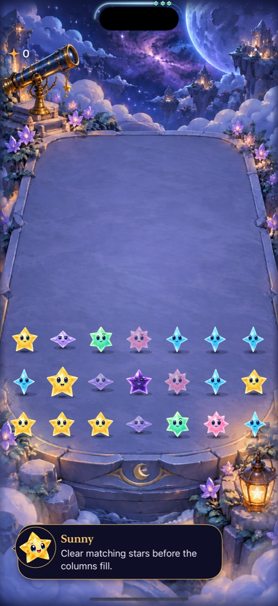
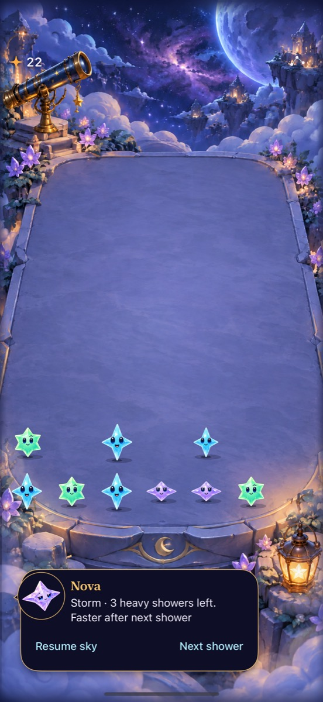
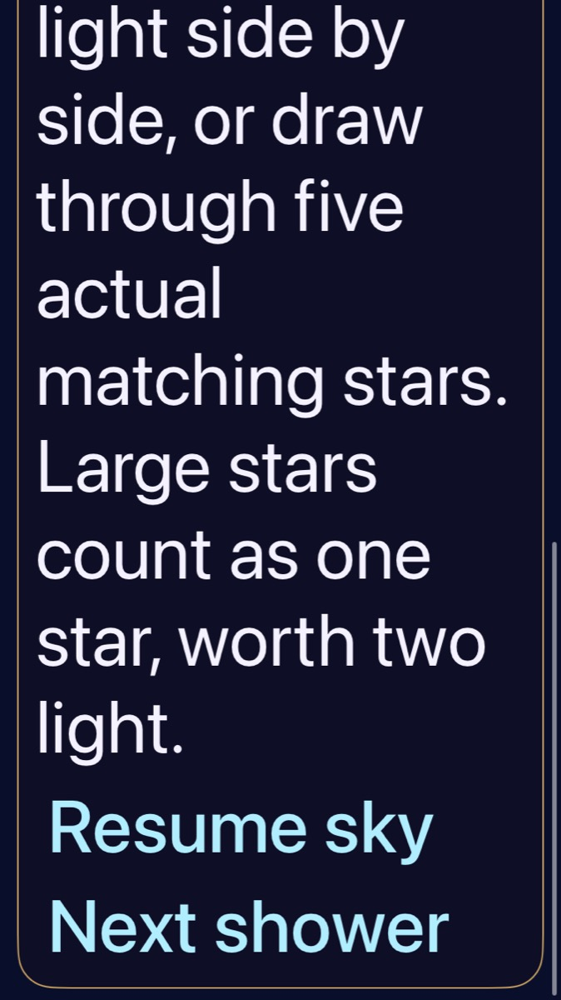
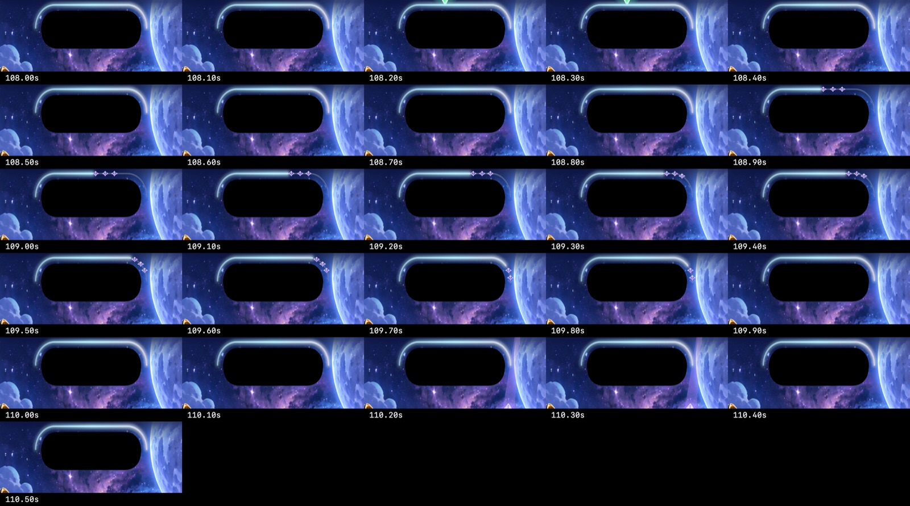
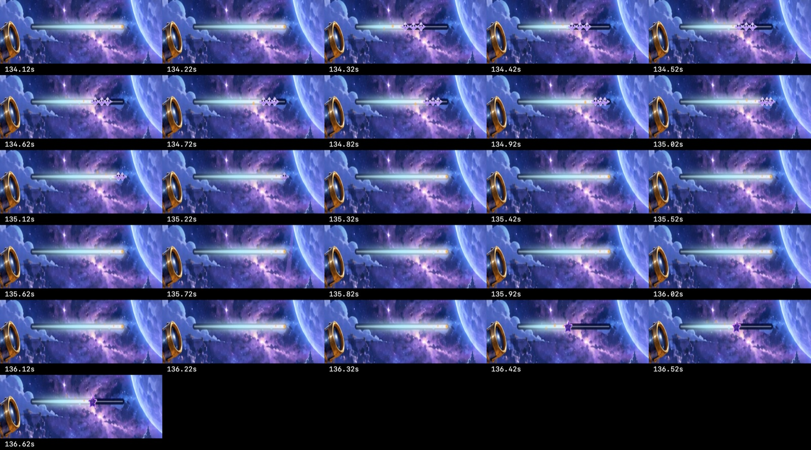

# Character chat integrated with current production play

**Result:** Verified for development integration · **Owner:** Codex · **Date:** October 17, 2026

The normal Starfall target uses a single bottom character chat for guidance, storm counts and cadence warnings. Six separate conversation portraits, bundled JSON scripts and a Debug Dialogue studio support later scripts/scenarios/maps. Every forecast miniature completes its path and fades before the committed deadline. This integration preserves current constellation controls, Opal, gravity/attraction fields, saves and cadence generations.

**Next action:** Merge the verified tree into GitHub main and inspect the existing in-place device updater. Physical-device acceptance and full actual VoiceOver remain separate RC work; App Store distribution is outside this change.

## Acceptance and boundary

- No upper gameplay-message labels or cadence banners; score/menu/forecast remain in the header.
- Visible and spoken timing information use the same committed snapshot and one character attribution. Ordinary automatic counts refresh without extra transition speech; explicit input can replace stale guidance.
- The existing generation guard rejects interrupted completion speech. Restart discards transient scripts; chat never mutates rules, deadlines or saves.
- Compact chat keeps the geometry-derived footer budget. Long introductions scroll while actions retain their targets; accessibility text follows the full terrace in a scrollable sibling.
- Current production attraction-field artwork and terminology are preserved. Older saved generation/cadence and replay behavior are unchanged.

## Verification context

Production base: `1b466c3` (PR #56), including attraction-field artwork and the gravity flight-overlap fix. Latest combined test source: `5c4d7c7`, clean before its checks; runtime identity `dev.9578a04ee5`. Earlier broad layout/flow checks and captures belong to `8032ff2` / `dev.eb2d80dad2`, based on PR #55. Later evidence-only changes do not alter either runtime fingerprint. The original implementation commit `c47bd5c` was selectively integrated onto production rather than merging its divergent historical branch.

Toolchain: Xcode 27.1 / iOS 27.0 simulator. Tests use `CODE_SIGNING_ALLOWED=NO ARCHS=arm64 ONLY_ACTIVE_ARCH=YES -parallel-testing-enabled NO`, scheme `Starfall`, DerivedData `/tmp/starfall-chat-production`.

| Check | Result / scope |
| --- | --- |
| Core | `swift test`: 109 passed. Core sources unchanged by this feature or the attraction-field merge. |
| Hosted | Latest combined source: **169 passed, zero failures/skips** on SE3. The earlier PR #55 integration passed 166 on 16 Pro Max. Includes save migration/replay, clocks/input holds, materials, catalog, priorities, explicit help/pressure ownership and stale expiry. |
| Native / motion / layout | PR #55 integration source: **10 passed, zero failures/skips** — five Max; four SE3 play/Reduce Motion/largest-text/full-motion; one SE3 First Light win/full/replay. Latest PR #56 combined source: **three passed, zero failures/skips** — normal-motion cycles, storm counts/menu/background, gravity clear/restore. Earlier 17e runs passed six speaker switches and cadence transitions. |
| Debug / Release build | Final combined source passes Debug test builds and Release simulator build; no compiler warnings. JSON and all source/test files are target members; catalog and all six portraits are exercised in hosted/native checks. |
| Hygiene | `python3 scripts/ci-hygiene.py` and `git diff --check` pass. |
| Actual VoiceOver | Deferred to RC; not run on this development build. Existing RC checks updated for the single attributed message. |
| Physical device | Not installed/visually accepted in this session; configured updater currently reports the iPhone unavailable. |

## Findings and corrections

The old fixed forecast offset left followers short of the endpoint at the deadline. One bounded `SkyTrailMotion` mapping now serves both straight and calibrated camera-contour paths, without scheduling or completion callbacks. Existing production cast identity conversion remains intact for Opal and attraction fields.

Initial integration failed compilation because historical project object identifiers collided with newer production files. New resource/source entries now use unique identifiers; the corrected Debug build passed without warnings. Initial hosted checks found outdated unattributed speech/catalog samples and a real priority issue: routine feedback from a player action could be suppressed by an earlier help message. Explicit input now interrupts stale chat; automatic notices still respect priority. A focused store regression checks that help and pressure are one visible/spoken message without mutating the sky/save.

Initial native checks passed all four dialogue tests but failed two assertions that still named the removed `sky.guide` container or required an unattributed storm label. Assertions now target `sky.dialogue` / `experiment.message` and retain the count, modal, front-row and action-target checks. Both original reproductions passed on rerun. Capture inspection also found excess empty bubble space for short copy; the height budget now belongs outside the bubble background, preserving bounded long introductions.

The earlier [old-base delivery evidence](../character-chat-2026-10-17/README.md) remains historical. It does not establish acceptance of this combined production source. Authoring starts in [App/DialogueScripts](../../../App/DialogueScripts/README.md); source portraits and prompts live in [Artwork/Dialogue](../../../Artwork/Dialogue/README.md).

## Native appearance and motion

| Compact information | Committed storm and cadence |
| --- | --- |
|  |  |

**Runtime evidence:** final combined source `8032ff2`, Debug, iPhone 16 Pro Max simulator / iOS 27.0. The short bubble fits its content; longer copy retains the footer budget. These still captures establish appearance, not motion or physical cutout clearance.

**Runtime evidence:** same source, SE3 / iOS 27.0, largest accessibility text. The native test scrolls the complete message into view before reaching the full-size actions; this selected capture shows the actions and final message lines. Portrait art is omitted at accessibility sizes.

**Diagnostic motion samples:** native recordings at 30 fps, normal system motion and Calm effects off; extracted every 0.1 seconds. The inspected contour interval is 108–110.5s and the straight interval 134.12–136.62s. Each visible follower completes the path and fades before its shower; full frames also show normal falling stars. The movies remain in `/tmp/starfall-chat-production-{island,straight}.mp4`; these compact crops are references to that inspection, not substitutes for full-animation or physical-device acceptance.

[Exact commands/context and result bundle paths](verification.json) retain the final 171-test Max run (166 hosted + five native), four native SE checks, final SE ending/replay check and Release build. The latest clean test/build source is `5c4d7c7`; subsequent working-tree differences are Markdown/evidence exports only. PR #56 landed immediately before publication, so its shared arrival refactor and gravity completion change were integrated and the full hosted suite, three affected native checks and Release build rerun (172 tests passed). The earlier geometry, script and ending checks remain source-bound above. GitHub publication must match the final local tree exactly; latest runtime identity is `dev.9578a04ee5`. Documentation rendering has not been checked in a viewer.
