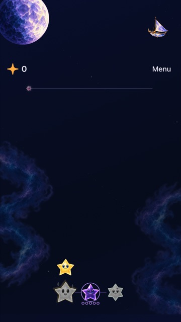
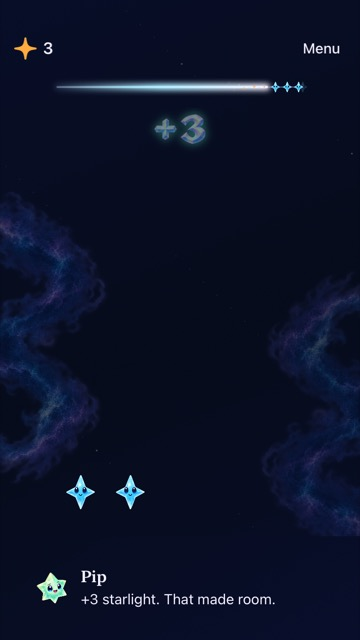

# Recover full development CI

**Result:** Partially verified · **Owner:** current implementer · **Date:** October 19, 2026

Repair simulator discovery, remaining UI regressions and the partial screenshot captures in separate verified batches. Acceptance requires a complete development run: tooling checks, core tests, Debug/Release builds, source-counted UI/hosted matrices with zero failures/skips, and valid compact evidence. Native screenshots require direct inspection; a passing assertion alone does not accept rendering. Physical delivery and full RC VoiceOver are outside this development task.

**Next action:** Complete the full development matrix on the merged fixes, inspect its exported evidence and record the passing source/run before closing remote acceptance.

## Batch 1: simulator host

[Run 39274515592](https://github.com/lbeezr/starfall/actions/runs/39274515592), attempt 1, source `73ad2beddb4c247fe9190f356c518f433731ef31`, job `118136124483`, passed all five Python suites and 177 core tests, then `simctl list devices available --json` timed out after 30.021 seconds. The runner was ARM64 macOS 15 with Xcode 26.3. No native build/test ran.

[Apple's Xcode 26.4 notes](https://developer.apple.com/documentation/xcode-release-notes/xcode-26_4-release-notes) identify a repaired `simdiskimaged` loop that could hang simulator commands (172343027), and require macOS 26.2+. [GitHub's macOS 26 image](https://github.com/actions/runner-images/blob/main/images/macos/macos-26-arm64-Readme.md) includes Xcode 26.6. Change the existing job to standard `macos-26`; retain the 30-second discovery bound, one runner, matrix, public-main triggers and cost guard. [Standard runners remain free for public repositories](https://docs.github.com/en/actions/reference/runners/github-hosted-runners#standard-github-hosted-runners-for-public-repositories).

This is an evidence-backed environment correction, not proof that Apple's reported mechanism caused this timeout: no service crash sample was captured. The remote discovery receipt and full run must verify the outcome. Local static/tooling checks cannot emulate GitHub's VM.

**Remote result:** [Run 39276071444](https://github.com/lbeezr/starfall/actions/runs/39276071444), source `451219d`, completed inventory in 7.132 seconds and boot in 4.994 seconds on macOS 26.6.2 / Xcode 26.6, then passed the Debug build. [Compact receipt](discovery.json). The next verified integration cancelled that run during Release compilation; this proves successful discovery/build on the new environment, not full CI acceptance or a universal cure for simulator service failures.

## Batch 2: room for the complete serial matrix

[Run 39201250877](https://github.com/lbeezr/starfall/actions/runs/39201250877), source `515f7f8`, job `117894490089`, reached only 35 UI cases before cancellation at 05:23 UTC. Native UI began at 04:58:38; the completed cases consumed 1,445.977 seconds. Its 29 passing cases alone consumed 1,231.546 seconds (42.47 seconds/case); six cases failed. This is observed partial-run throughput, not a successful-suite median, and does not prove which cancellation mechanism fired.

The current source-counted plan selects 120 UI and 316 hosted cases. Extrapolating only those passing UI durations gives about 85 minutes of UI work, before setup, Debug/Release builds, hosted tests and export. A 35-minute whole-job cap is incompatible with that workload. Raise the single-job bound to 150 minutes to accommodate the existing coverage and variation; keep the 90/240-second UI test bounds, hosted/operation bounds, serial execution, zero-retry policy and all count/skip gates. Revisit the estimate using the first complete passing run, not failed-test elapsed time. No new runner or parallel job is added.

Verification: all five existing Python suites pass (55 checks); the workflow parses with Ruby's YAML parser, hygiene and diff checks pass. These checks use main `451219d` plus the workflow/script README/evidence changes. No runtime input changes. Complete remote timing remains pending.

## UI and capture investigation

The compact SE simulator used by the maintenance reproduction was in landscape at the fresh launch, while earlier XCTest attachments had portrait dimensions and cropped content. The fresh simulator screenshot renders its visible landscape viewport. Investigate orientation/setup and scrolling at the native test boundary before changing game rendering. Preserve existing outcome assertions, historical Dusk fixtures, normal-motion checks and all selected tests.

## Batch 3: native input readiness and portrait captures

**Verified subset:** five UI cases pass, zero failures/skips, on Xcode 27.1 / iOS 27.0 / iPhone SE (3rd generation), Debug. Source `451219d` plus only `UITests/FallingSkyInteractionTests.swift` as a native build input; [hashes and capture provenance](readiness.json) identify that snapshot. Subsequent workflow/docs commits do not change those runtime/test inputs. `swift test` passes all 177 cases; the native test action builds the app and test targets. Hygiene/diff checks pass. Release is inapplicable to this test-only correction.

The class now explicitly starts in portrait and reuses the existing non-playing-edge scroll helper for sky controls; menu navigation shares one local helper. The Calm Effects row is reached through the existing lazy-menu helper. Compact scrolling keeps both paused actions physically reachable; the original board-size, hittability, exact score, menu suspension, forecast-label, restoration and early-cascade assertions remain. No timeout, motion, rule or save changes were made.

Exact selected methods: `testCompactHUDMenuSuspendsWithoutChangingPauseChoice`, `testCompactPlayfieldKeepsControlsVisible`, `testDarkStarInfluenceRestoreAndAdjacentClear`, `testFirstLightGoalCompletionRestoreReplayAndSurvival`, and `testOpeningCascadeAllowsNativeClearBeforeLastWave` in `FallingSkyInteractionTests`, serial, via XcodeBuildMCP `test_sim`. The initial orientation/menu-only probe passed three and exposed the remaining compact offscreen-action assumption; the final helper correction passes all five in 197.817 seconds.

| Retained Dusk before clear | Fresh cascade after early native clear |
| --- | --- |
|  |  |

**Native source `451219d` + test snapshot `38b36fae`, SE3 / iOS 27.0, default text.** These size-reduced JPEG previews preserve the original PNG hashes in the manifest. Both original attachments and the compact paused-actions capture were inspected: the prior black crop is absent, stars/score/menu render, and the scrollable controls are readable. This closes the demonstrated portrait capture failure, not all landscape or device rendering. The normal-motion cascade test clears before its fourth wave with Calm Effects and system Reduce Motion off; stills alone do not establish animation quality. First Light win/restore/replay and menu interruption pass; actual VoiceOver, physical play and full remote CI remain separate acceptance.

## Batch 4: fresh and retained balance contracts

**Verified subset:** the repaired balance case and all six `CriticalMassProductionTests` pass (7/7), then the largest-text settings/restore case passes (1/1), with zero skips. Debug / Xcode 27.1 / iPhone 17e / iOS 27.0; [source hashes, commands' result paths and case durations](balance-readiness.json) distinguish the two test snapshots. Native actions build the test targets. Core: 177 pass; hygiene/diff pass. No app/core/save/resource changes; Release is inapplicable to these test-only changes.

The balance case now explicitly verifies fresh survival has a pace control and no Dusk-frequency control, then exercises the retained `unfed` Dusk fixture in the existing isolated review defaults. It uses current pace labels, preserves an occupied cell and committed board through changes, verifies saved Gentle/Frequent settings after relaunch, resets defaults and verifies Frequent versus None at exact shower counts. Native manual showers finish the sequence because retained skies deliberately have no fresh opening cascade; automatic timing remains covered by the unchanged opening/menu/background cases. A shower committed during Begin/menu admission counts toward that exact total.

The first probe's new zero-before-pause assumption failed after a legitimate Brisk arrival; the corrected test passes in 108.578 seconds. Its explicit 180-second outer allowance contains fresh/retained setup, restore and two replays; individual 5-second waits, assertions and normal motion remain. The native invocation enables the same 90-second default/240-second maximum policy as CI. This is a measured case allowance, not a blanket retry or assertion relaxation.

The broader SE3 probe also exposed two largest-text switch callers using the board helper for lazy menu rows. Those callers now use the existing menu helper; the final native case passes in 40.454 seconds and restores feedback preferences. The balance and largest-text fixes were tested separately; this is not a full-class pass. The earlier broad probe exceeded the MCP transport's 300-second response window, continued in Xcode and was explicitly stopped before its class-wide selection could reach an RC-only VoiceOver method. Its completed failures remain recorded above. The complete local/remote development runs use the planner's existing exclusions and exact-count gates.

## Batch 5: layout-specific controls and retained guide history

The complete local development probe of `6c47961` exposed two further assumptions. `testCompactHUDMenuSuspendsWithoutChangingPauseChoice` expected a running sky's actions to disappear on every phone, although the fixed landing canvas deliberately keeps them outside the guide. It now checks the actual two layout contracts: absent during play in the scrolling guide, or visible and correctly labelled on the fixed canvas. Both branches keep the menu-freeze, automatic resume, explicit pause and hidden legacy-HUD assertions.

The compact reproduction also missed the 1.25-second approaching cue. Its failed element-predicate checks captured accessibility hierarchies, leaving a measured 3.9-second gap between reads. A direct label predicate avoids that diagnostic work during polling; the exact `Shower approaching` assertion and eight-second bound remain unchanged. The initial tall-phone check passed, the initial compact check failed at this cue, and the corrected compact check passed.

`testPausedGuideReportsGrowthDarkOutcomesAndRestore` assumed fresh survival would generate Dusk on shower six. It now retains the fresh-growth assertions and explicitly checks no Dusk arrived, then uses the existing isolated `imminent` retained fixture. A remote Violet clear must preserve Dusk, an adjacent drained Amber clear must remove it with the exact reward, and menu/background/relaunch must preserve the committed result while dropping transient dialogue. Restore keeps the same isolated defaults domain. No fixture, game rule or app source changes.

**Verified subset:** both selected cases pass on iPhone SE (3rd generation) and iPhone 17e / iOS 27.0 / Xcode 27.1, Debug: four executions, zero failures/skips. [Source-bound results](layout-and-guide.json) record the exact test snapshot, native result paths and durations. The original complete probe continues independently to expose other failures; it is not a passing acceptance run. Core inputs are unchanged (177 tests pass); native test actions build the app/test targets. Hygiene/diff checks pass. Inspected tall and compact captures render complete portrait viewports without the earlier black crop; the compact guide is below the visible board and those stills do not prove its text appearance. Full remote development acceptance remains open.

## Batch 6: remove cosmetic simulator setup from the critical path

[Run 39279682027](https://github.com/lbeezr/starfall/actions/runs/39279682027), attempt 1, source `6c47961`, job `118152932449`, passed tooling checks, 177 core tests and both Debug/Release builds. Inventory took 4.630 seconds; boot readiness completed after a long Core Location migration. The subsequent `simctl status_bar override` timed out at 63.698 seconds against its 60-second limit. Cleanup succeeded; installation, captures and native tests were not reached. [Artifact provenance and stage receipts](status-bar-timeout.json) identify iPhone Air / iOS 26.5 / Xcode 26.6. This is a distinct simulator-service stall after successful discovery, not another inventory failure.

Remove the artificial 9:41/full-battery override. Screenshot cosmetics are not an app-readiness contract and should not gate the functional matrix. Captures now retain actual simulator status values. Boot readiness, installation, live-process checks, screenshot creation, complete UI/hosted counts, zero-skip gates and bounded cleanup remain mandatory; no failure is swallowed and no timeout or retry is added. This removes the demonstrated nonessential failure point without claiming other simulator commands cannot stall.

Verification on main `1b9790e` plus this script/docs batch: all ten simulator-lifecycle checks pass, including real descendant cancellation and primary-failure preservation; shell syntax, hygiene and diff checks pass. No app/test source changes. The next full remote run must verify installation through export with this correction.

## Batch 7: native anchor pixel alignment

The complete hosted matrix on Ribbon Crossing main `c40aad5` passed 327 cases and failed the expanded-canvas anchor check. A diagnostic reproduction measured a requested 375×1200-point canvas as `(17, -145⅙, 375, 1200⅓)` on the 3× iPhone 17e. The scenery already satisfied its one-physical-pixel assertions; the wait incorrectly demanded an exactly equal canvas size. This was test geometry precision, not a misplaced restoration image.

Apply the same physical-pixel precision to canvas readiness and explicitly assert all four canvas components after registration. Preserve the three-second deadline and every scenery-coordinate assertion. No runtime layout, artwork, outcome or save changes. The nested-anchor sibling and all 17 celebration cases pass on the 17e; the focused translated-anchor case also passes on the 2× SE3. The complete hosted suite then passes **328/328, zero failures/skips**, in 116.243 seconds. Core remains 178/178; native test actions build the targets; hygiene/diff pass. Release is inapplicable to this test-only change. [Source hashes, reproduction and commands](anchor-pixel-alignment.json) distinguish the unrelated pending UI edits and the separately failing compact lesson case. Full remote acceptance remains open.

## Batch 8: current UI contracts and physical input readiness

The original complete 120-case UI probe finished with **108 passes, 12 failures, zero skips** in 4,112.444 seconds. Its prepared source predates Ribbon Crossing; it inventories failures and is not current-main acceptance. After the earlier guide/layout fixes, the remaining categories were stale forecast placement, idle cadence samples ending in legitimate overflow, large-text scrolling through the playfield, missed short forecast states and help navigation readiness.

The UI tests now use the existing non-playing-edge scroll boundary, distinguish exposed board cells from modal previews, read the flowing guide before returning to native cells, and check the forecast's actual separate header row or calibrated island placement. The 16-shower cadence sample makes real native clears for its final three arrivals, asserting each clear changes score without advancing the shower count. It retains exact phase text, geometry, interruption and final-count checks; it no longer expects an idle full column to survive forever.

Forecast observation queries the exact identifier/label every 100 milliseconds within the original timeout. The initial direct-label predicate still polled only once per second and could retry a stale accessibility element while the quiet display changed. The final query catches the cue before the unchanged-board assertion and then verifies the actual arrival. Compact running skies pause through the menu, with an explicit admission wait before input and dismissal/paused-label checks afterward. Normal animation, Calm Effects and actual system Reduce Motion remain separate cases; no retries, additional exclusions or forced quiet settings were introduced.

Help tests wait for the animated toolbar to accept input and fully reveal each button before tapping. The compact largest-text failure attachment showed the test still on “How to play”: a partly visible lazy row was reported hittable, but its tap did not open the example. The corrected native case enters the lesson, completes its exact four-starlight result, survives background/resume and dismisses to an unchanged round. The normal and system Reduce Motion methods retain every square/cross/Opal/relay outcome and retry check.

**Verified subset:** [source-bound runs](ui-readiness.json) record **17 distinct affected UI methods passing** across bounded runs, including all eight pacing cases, all four dialogue cases, all three lesson cases, compact HUD and forecast placement. The three countdown modes also pass on SE3; the final added menu-admission wait passes on 17e. The largest-text lesson passes on both phones. The intermediate failures remain in the receipt. Core is 178/178 and hosted is 328/328 separately; native targets compile, hygiene/diff pass. No app/runtime, rule, save, artwork or build-setting changes; Release is inapplicable to this test-only batch. A complete current-source local/remote UI pass is still required.

Inspected lesson, forecast and dialogue attachments render portrait content without the earlier black crop. The compact forecast capture is a scrolled page with the header above the viewport; long live dialogue scrolls rather than fitting all text at once. The Debug studio's largest-text Continue/Sunny wrapping remains a documented cosmetic follow-up in ENGINEERING. Still images do not establish animation quality, actual VoiceOver or physical-device acceptance.

## Batch 9: observe the storm before taking screenshots

[Run 39290050989](https://github.com/lbeezr/starfall/actions/runs/39290050989), source `2d94194`, passed 178 core tests, Debug/Release builds, simulator inventory/boot, installation and initial board captures. Its first UI case failed before the Kite Harbor integration cancelled the run. The automatic storm test observed three and two heavy showers, then missed the one-heavy-shower state and saw recovery instead. On Xcode 26.6 / iPhone Air / iOS 26.5, a screenshot between observations consumed 2.26 seconds while a storm count can last only 1.7 seconds; the next stale-element read also entered hierarchy retries. [Exact log interval and source receipt](storm-observation.json).

Observe all four required labels in order before capturing the recovery state. Share the existing 100-millisecond query-membership sampler with forecast checks, preserving each eight-second bound, the exact required count text, score 22 and entirely automatic showers. No manual clear/arrival, motion suppression, retry, exclusion or game-rule change is introduced. Examined the manual storm, countdown and automatic-dialogue sibling paths: their capture points occur while paused or before a persistent-state/monotonic-count check, rather than between short-lived phases. The obsolete intermediate attachments are not selected export requirements.

**Verified subset:** automatic storm, manual storm/menu/background and quiet forecast pass on 17e (3/3); automatic storm and quiet forecast pass on SE3 (2/2), zero failures/skips. The normal automatic case takes 19.819 and 20.383 seconds respectively. Recovery captures were inspected on both phones; the compact guide remains scrollable. Current Kite Harbor main also passes 178 core tests; native targets build, hygiene/diff pass. Release is inapplicable to this UI-test-only correction. The accepted feature changes expand development UI coverage from 123 to **126**; hosted remains **328**. The companion full local probe continues on its recorded pre-Kite source, while the next clean remote run must accept current main.
