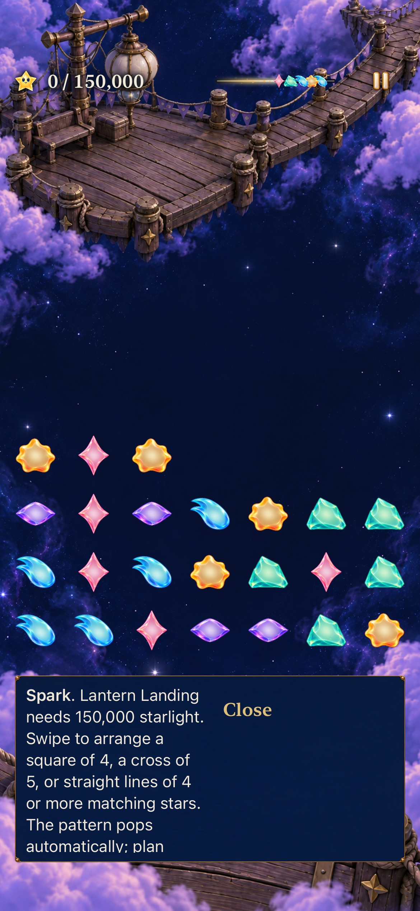
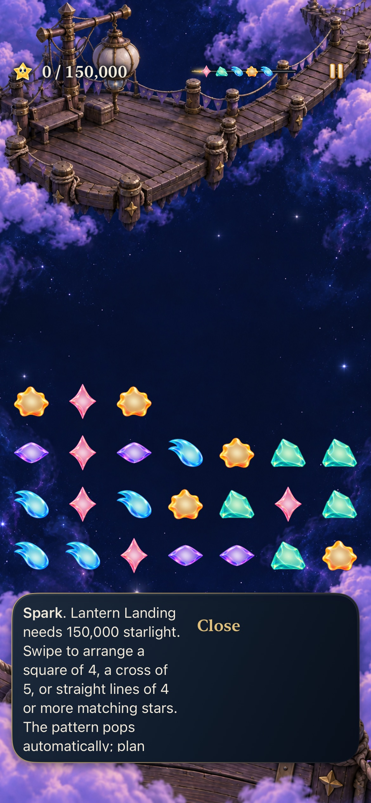
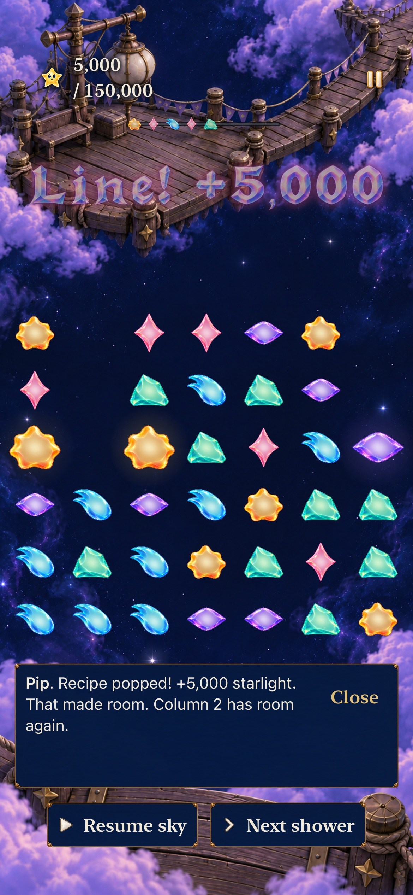
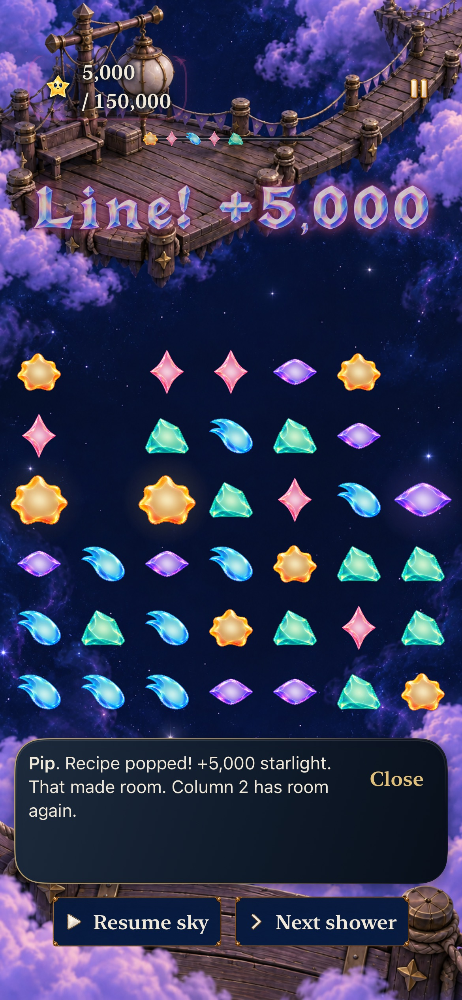
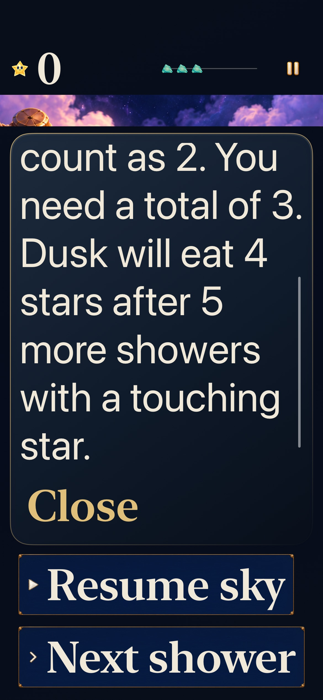
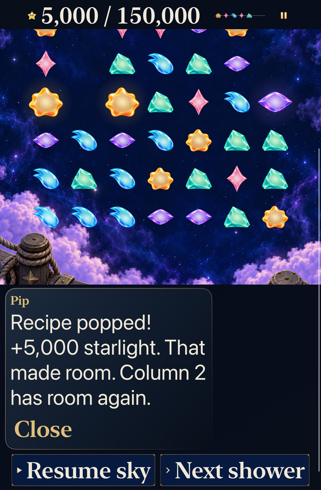

# Lantern visual benchmark

**Status:** Verified for scoped development adoption · **Owner:** Factory coordinator · **Date:** October 23, 2026

[Cohesion goal 1](https://github.com/lbeezr/starfall/issues/282) establishes the ordinary Lantern screen as a shared art-direction reference. The normal app replaces the dialogue's flat rectangular backing with shallow midnight enamel, a restrained warm upper rim, rounded corners and a small contact shadow. Native content, padding, reader, portraits, actions and timing keep their existing owners.

**Next action:** Merge this verified slice, then activate goal 2 from main and compare collection material in warm Lantern and cool Ribbon. The [ten-goal queue](https://github.com/lbeezr/starfall/issues/281) requires a separate visible refinement and verified main merge for each outcome.

## Decisions the following goals should share

| Element | Direction and boundary |
| --- | --- |
| Painted places | Retain the continuous celestial painting, readable landmark and open sky behind the stars. Do not add independent ornament merely to fill space. |
| Stars | Retain distinct family silhouettes, warm luminous cores, transparent edges and the one-body grown treatment. Forecasts and board bodies already share their material. Goal 2 examines effects in context. |
| HUD | Keep the field dominant and exact native facts at safe viewport edges. Goal 3 refines the relationship between earned score and fixed target. |
| Dialogue | Use an opaque night-blue reading field with pearl text. Warm metal catches the upper edge; depth remains shallow. The surface supplies no input or layout. |
| Controls | Preserve the existing primary-action hierarchy, actual labels, target bounds and native press/cancel behavior. Goal 4 examines the distinct compact action face. |
| Motion | Earned events may be expressive; resting decoration stays restrained. This surface adds no animation or waiting. Later goals own motion and collection emphasis. |

The player promise is one coherent place to arrange living stars and understand their consequence. The smallest situation is Home → Story → Lantern → Begin, followed by a real full-column recovery and guide reopen. The judgment is visual craftsmanship; automated checks cannot establish player preference.

## Surface contract

`SkyDialogueBubble` keeps its existing medium content inset and applies `ObservatoryDialogueSurface` only to non-embedded dialogue. The new background uses native continuous 24-point corners, the existing opaque enamel colors, a thin warm-to-dark rim and a five-point contact shadow with a three-point downward offset. Increased contrast strengthens the rim. It neither clips nor receives input or accessibility focus. No bitmap, resource, generic panel, HUD or control skin is replaced.

Reject the candidate if text/Close approaches the rounded corners, the rim competes with the stars, the field looks gray, or the shadow merges into adjacent controls. Long text must remain fully readable through the existing scroll pane, with actions fixed and immediately available. Existing rectangular compact buttons remain a known later craft seam; expanding this passive surface into them would skip their state contract.

## Verification context

Baseline: clean main `c496576bde4e89c1f20370054d3c96bfa2f90886`, runtime input fingerprint `dev.976d4838a7`. Candidate: the same commit plus the three exact hashed Swift paths in [verification.json](verification.json), fingerprint `dev.0b9dfde7bb`. Simulator products display `dev.local`; that label is not used as a source identity.

Toolchain: Xcode 27.1 (27A9275), Swift 6.4, macOS 27.0.1 arm64. Debug iOS 27.0 (24A434) Simulator: dedicated iPhone 17e `DB9604E1-D7A8-4C75-BA25-E29243AEC02D` and iPad mini (A17 Pro) `E9575758-60A8-45C0-B2AB-91B73C8A8FDC`. Largest text is AX3XL. Normal and Calm effects are recorded per selected case.

| Check | Result / scope |
| --- | --- |
| Baseline startup and full-column recovery | Passed 2/2, zero failures/skips, using unchanged prepared products on the dedicated phone. |
| Candidate Debug build for testing | Passed; only the three recorded Swift production inputs differed from main. |
| Core | Passed 242/242, zero failures/skips; no rule/save/RNG inputs changed. |
| Candidate hosted and phone native checks | Passed 28 hosted and three UI cases; separate AX3XL phone reader passed 1/1. All zero failures/skips. |
| Tablet AX3XL | Both Story startup and quiet pressure/recovery cases passed. An extra phone-reader stress case failed identically on clean baseline because its paragraph fits without the assumed scroll pane. The aggregate remains 2 passed / 1 failed, not a full passing matrix. No assertion changed. |
| Inspected before/after appearance | Startup, recovery, paused reopen and maximum-text reading inspected. Text stays clear and the rim subordinate; content/action positions are preserved. |
| Motion | No new animation; interaction checks alone do not certify continuous smoothness. |
| Actual VoiceOver, physical device, human preference | Not performed; no new delivery or RC acceptance claimed. |

The initial baseline attempt on a borrowed phone was killed when another job used that simulator. The isolated baseline passed. An initial candidate MCP request timed out after 300 seconds; its Xcode process later stopped during an intentional session interruption, before a complete result bundle existed. Its one reported case and subsequent recovery assertions are incomplete evidence, not a passing batch. A concurrent tablet boot reported the Mac's process-resource limit. After the session restart, inventory showed no booted simulators and 839 processes; the unchanged candidate was rerun through the repository's bounded process owner. Raw logs/results remain under temporary storage.

## Adoption decision

**Retain** this surface and the strongest existing scenery, star and primary-action language. The native comparison removes the flat slab without adding a texture family or layout dependency. **Revise later** compact text-action craftsmanship through goal 4’s real state contract. No comparison route, asset family or new saved state remains. Human reading comfort and aesthetic preference remain questions for the next ordinary player session; they are separate from software and inspected-appearance evidence.

## Inspected native comparison

| Before | Adopted surface |
| --- | --- |
|  |  |
|  |  |

Debug iPhone 17e / iOS 27.0, default text, normal motion. Both sides show the same committed stars, score and text; forecast/award age differs slightly. Baseline is clean `c496576b`; candidate is that source plus snapshot `c0cb3a85494d`. The warm upper rim follows the pearl/brass text hierarchy, and the dark lower edge stays quiet against bright lower clouds. These are appearance comparisons, not recordings or comprehension evidence.

| Largest-text phone reader | Largest-text tablet recovery |
| --- | --- |
|  |  |

Candidate snapshot `c0cb3a85494d` / `dev.0b9dfde7bb`, AX3XL, Debug iOS 27.0 Simulator. The phone uses normal motion in the retained historical regression fixture; tablet recovery uses Calm effects. These test reading/control boundaries, not current Lantern mechanics by implication. Exports retain native pixels, JPEG quality 80, without crop/resize; hashes are in the verification record.

Reproduction: XcodeBuildMCP `build_sim(buildForTesting: true)`, then `python3 scripts/simulator-command.py --receipt <temp>/stages.jsonl <stage> 600 xcodebuild -testProductsPath <products> -destination 'platform=iOS Simulator,id=<dedicated simulator>' -collect-test-diagnostics never -parallel-testing-enabled NO -only-testing:<each selector in verification.json> -resultBundlePath <unique result> test-without-building`. Core used `swift test --scratch-path /private/tmp/starfall-factory-gameplay-20261022/CoreBuild --jobs 2`. Hygiene/diff and local-document links are checked on explicit staged paths. No routing, configuration, resources, fixtures or target membership changed; Release/resource membership checks are inapplicable to this passive Swift-only slice.
