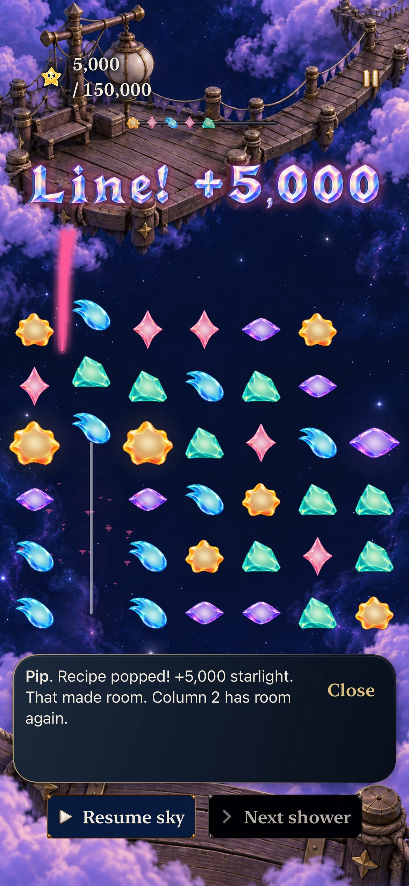
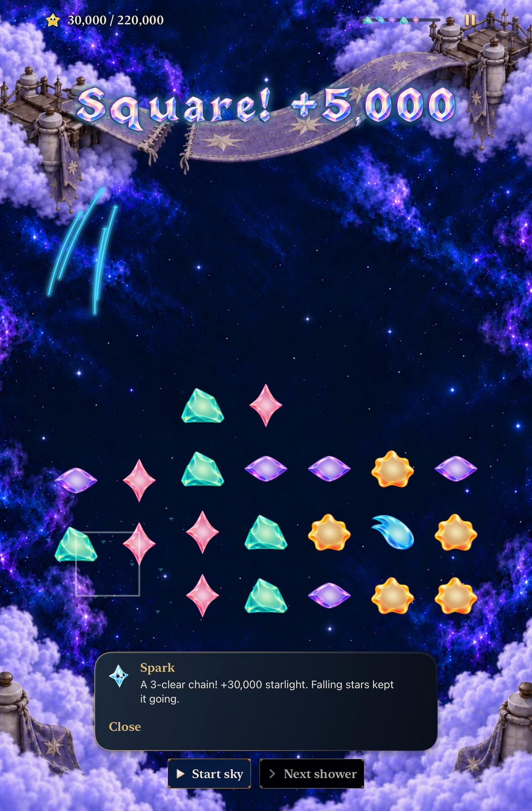
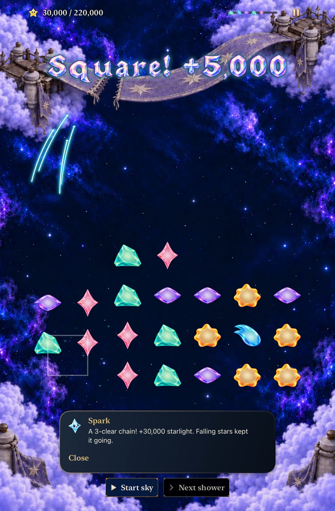
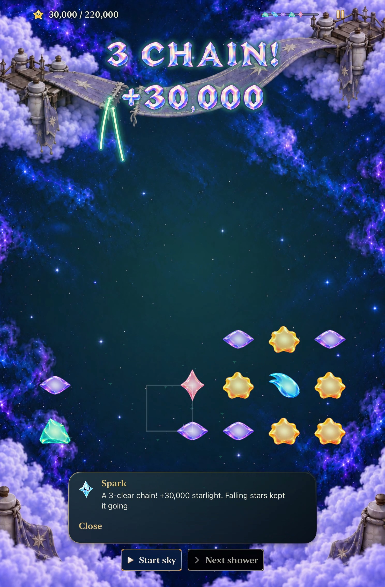
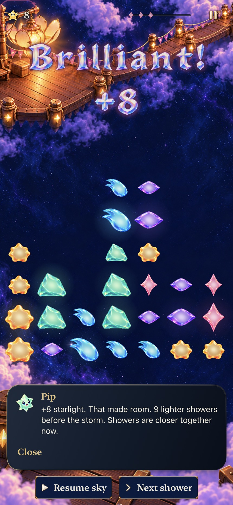

# Collection light belongs to its stars

**Status:** Verified for scoped development adoption · **Owner:** Factory coordinator · **Date:** October 23, 2026

[Cohesion goal 2](https://github.com/lbeezr/starfall/issues/283) refines the finite light collected from rewarding stars. Ordinary and grown pieces already have pale centers with colored shells; their cached forecasts agree. Existing collection streaks instead have solid colored cores. The normal app carries the existing living-light material's pale center and family-colored emission into those streaks.

**Next action:** Merge this bounded refinement, then activate goal 3 from main. Palette consolidation alone would not satisfy this goal; the retained native comparisons show the actual material change.

## Contract and disconfirming evidence

`LivingLight` owns the emission pair alongside its existing material profile. Ordinary families, Dusk and Opal use that profile; historical magnet/hole effects explicitly retain their existing single-color emission. `StarlightCelebrationOverlay` uses family color for the existing wide surround/shadow and pale center for the existing narrow stroke/head. It adds no drawing pass, asset, packet, animation or state owner.

Preserve the exact rewarding pre-clear identity and grown weight, six-packet cap, paths, timing, stagger, opacity, source/destination, quiet/cancellation, arrival cue, lettering and score bloom. Keep board/forecast materials, story-cast colors, committed score, input and saves unchanged. The tested player situation is a real earned clear against warm Lantern and cool Ribbon, including the four-shower crowded/grown Lantern state.

Reject white-laser appearance, lost family identity, disappearance against bright wood/clouds, or an effect that overpowers remaining stars. The colored surround must remain apparent. This pass does not resolve the separately queued score-overlap emphasis seam in goal 9.

## Source and verification

Activation main is `678f7c7c0b49fcfef5cf66d88ef8767d132fcbb6` after goal 1's separate [PR #292](https://github.com/lbeezr/starfall/pull/292). Baseline runtime fingerprint is `dev.0b9dfde7bb`; the unchanged prepared products match main's runtime inputs. Candidate fingerprint is `dev.d33057befd`, with only the two hashed production files in [verification.json](verification.json) differing at compilation. Simulator products display `dev.local`. Before publication, main advanced to `a11ec8680c1e3cf869e4612544ed6298737e8c33` through documentation/Project-recovery merges #294/#295. Rebase preserves those changes; runtime input fingerprint remains `dev.d33057befd`, so the compiled acceptance still applies.

Xcode 27.1 (27A9275), Swift 6.4, macOS 27.0.1 arm64; Debug iOS 27.0 (24A434). Native Lantern comparisons use the dedicated iPhone 17e; Ribbon uses the dedicated iPad mini, with a matched viewport before/after in each world. Hosted window renders use explicit 375×667 and 430×932 viewports on the dedicated iPad mini, default/maximum text, with normal SpriteKit motion asserted.

| Check | Result / boundary |
| --- | --- |
| Core | Passed 242/242, zero failures/skips. No rule, RNG or save change. |
| Debug build for testing | Passed. |
| Hosted material/collection | Passed 29/29, zero failures/skips: `SkyPieceTests` and `StarlightCelebrationTests`. Covers forecast/rest parity, family silhouettes, grown weights, packet timing/budgets, dense native rendering, Opal, quiet and cancellation. |
| Matched real Lantern/Ribbon before/after | Four accepted recording runs pass with zero skips: the same two native cases before/after. Lantern retains its 5,000-point recovery and next shower; Ribbon retains reversible alternatives, the 30,000-point three-clear chain and exact return. |
| Human, physical device, actual VoiceOver | Not performed. No phone installation or RC acceptance implied. |

Core command: `swift test --scratch-path /private/tmp/starfall-factory-gameplay-20261022/CoreBuild --jobs 2`. Hosted/native commands use prepared `.xctestproducts` with `xcodebuild ... test-without-building`, exact selected cases, `-collect-test-diagnostics never`, serial testing and unique temporary result paths through `scripts/simulator-command.py`. The temporary capture helper starts a ten-second H.264 recording before the real exchange, requires recorder startup/success, bounds the complete witness and holds a per-simulator lock. It does not alter the app or input.

Two initial baseline attempts overlapped because the coordinator started Ribbon before Lantern's process completed. Both failed and are excluded from acceptance. The corrected capture scheduling checks terminal handles before starting the next case and adds a nonblocking per-simulator lock. No assertions, motion settings or production behavior were changed to obtain a passing comparison. Raw logs, result bundles and movies stay in temporary storage; the durable record retains selected inspected frames, hashes and compact results.

## Adoption

**Retain** the pale center with its visible family surround. Warm Lantern Rose and cool Ribbon Aqua/Rose/Mint remain distinguishable and resemble the pieces’ inner light. The narrow flight stays expressive without erasing neighboring stars or dialogue. **Keep** existing widths, phases and all other effects; **defer** the separate score-overlap correction to goal 9. No alternate runtime route remains. Human recognition and repeat comfort remain questions for an ordinary player session, separate from inspected material coherence.

## Inspected flight comparisons

| Warm Lantern before | Warm Lantern after |
| --- | --- |
|  |  |

[Before motion](dev-c496576b-wip-c0cb3a85494d__lantern-collection__iphone-17e__before.mp4) · [After motion](dev-678f7c7c-wip-787039fc3544__lantern-collection__iphone-17e__after.mp4). Both are 1.55-second normal-speed excerpts of the same real 5,000-point clear. Different recorder start offsets are aligned around the exchange/flight, not claimed as identical presentation ages.

| Cool Ribbon before | Cool Ribbon after |
| --- | --- |
|  |  |

[Before three-clear motion](dev-c496576b-wip-c0cb3a85494d__ribbon-chain__ipad-mini-a17-pro__before.mp4) · [After three-clear motion](dev-678f7c7c-wip-787039fc3544__ribbon-chain__ipad-mini-a17-pro__after.mp4). These 2.75-second normal-speed excerpts preserve the first, second and third earned phases. Exact source/movie hashes and actual sampled times are in the verification record. The baseline movies use the goal-1 compiled snapshot `c496576b` + `c0cb3a85494d`, whose runtime inputs equal activation main `678f7c7c`. Candidate movies use main plus snapshot `787039fc3544`. Both are Debug, default text, normal motion, iOS 27.0 Simulator. Stills retain native pixels; clips are smaller previews exported with `AVAssetExportPreset960x540`, without interpolation or speed changes.

| Family identity | Dense grown context |
| --- | --- |
|  |  |

The dense frame is an explicitly sized native hosted window, not a physical phone. Its test asserts current-rule history, 33 initial stars, the exact +8 award, three sampled phases and an independent next match. Native/forecast equality and ordinary/grown silhouettes remain unchanged. Review of timestamped frame sequences supports this scoped material decision; it does not establish continuous smoothness, physical display comfort or human recognition.

An earlier passing Ribbon phone movie covered the reversible setup rather than the scoring move, so the matched flight comparison uses the correctly triggered tablet pair. The first passing candidate Lantern movie had sparse samples across the short packet interval; the recorder-warmed replacement supplies the retained flight. Neither insufficient movie is promoted as material proof. Source input hashes and test assertions remained unchanged throughout; all accepted comparisons use normal motion. No routing, fixture, resource or membership changed, so Release/resource-membership checks are inapplicable to this Swift-only slice.
