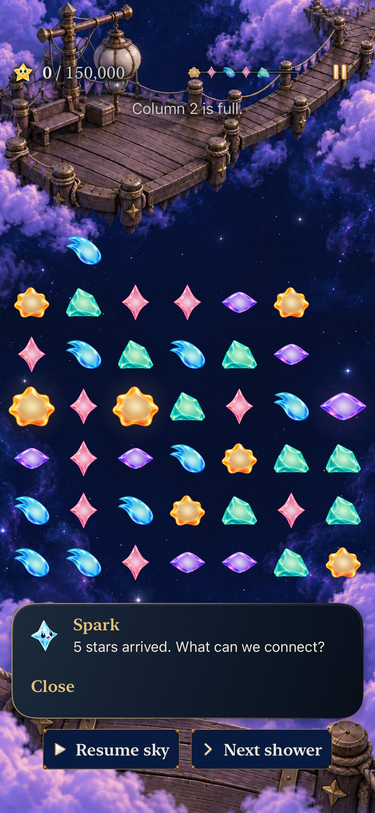
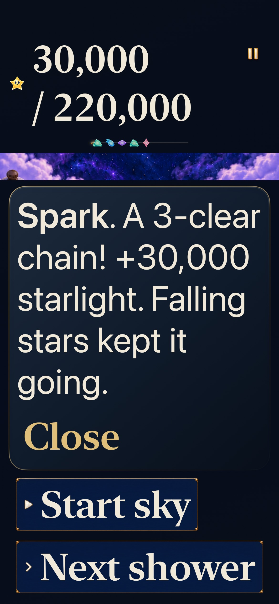
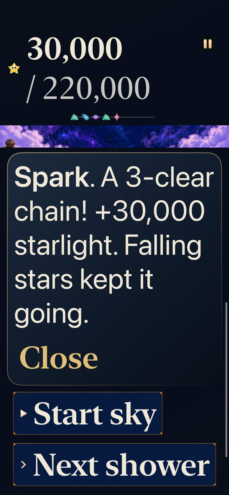
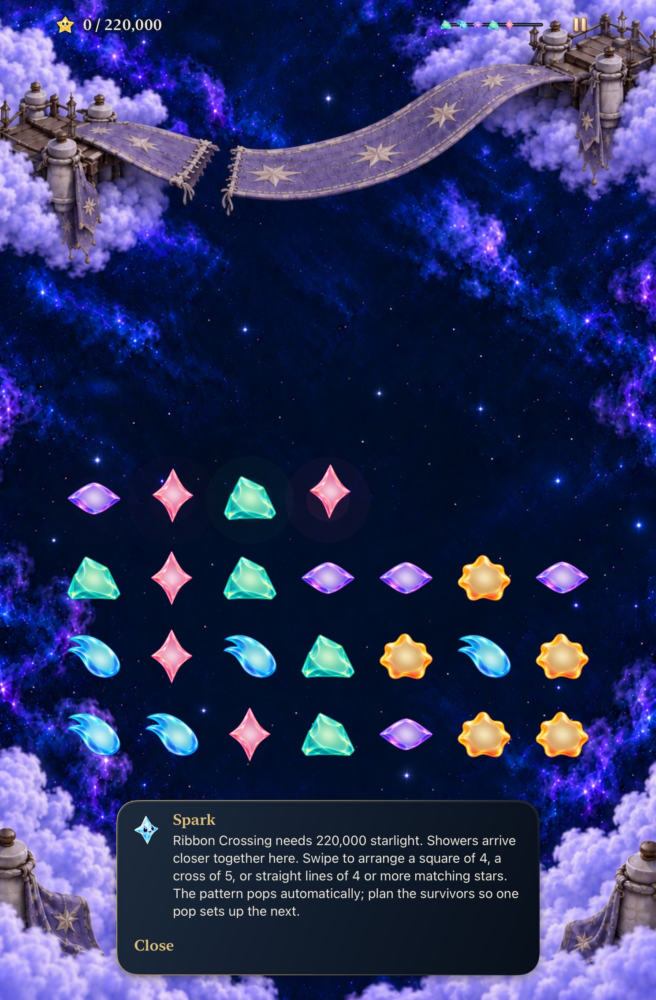
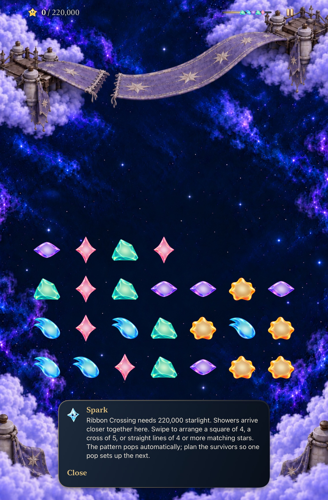
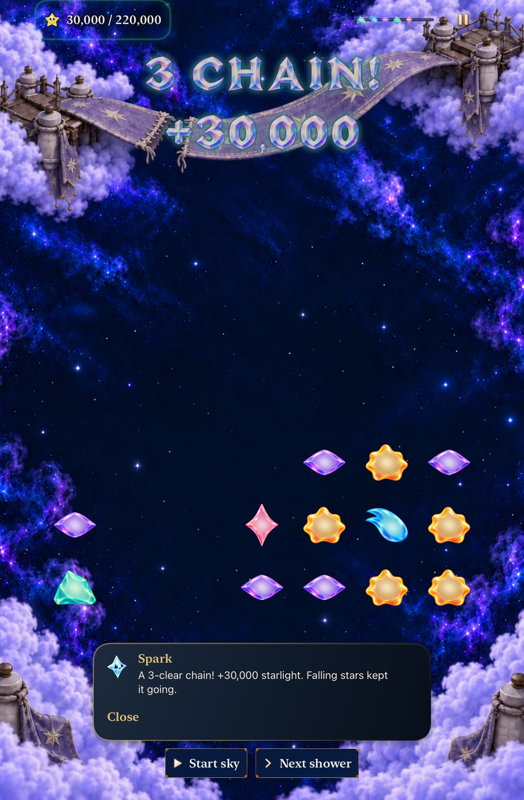
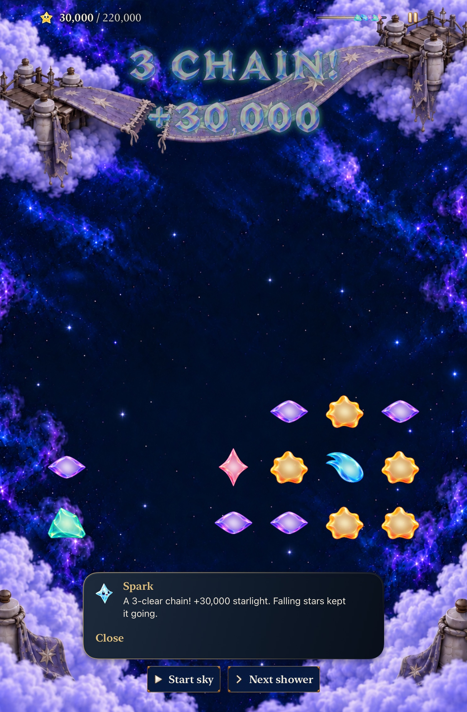
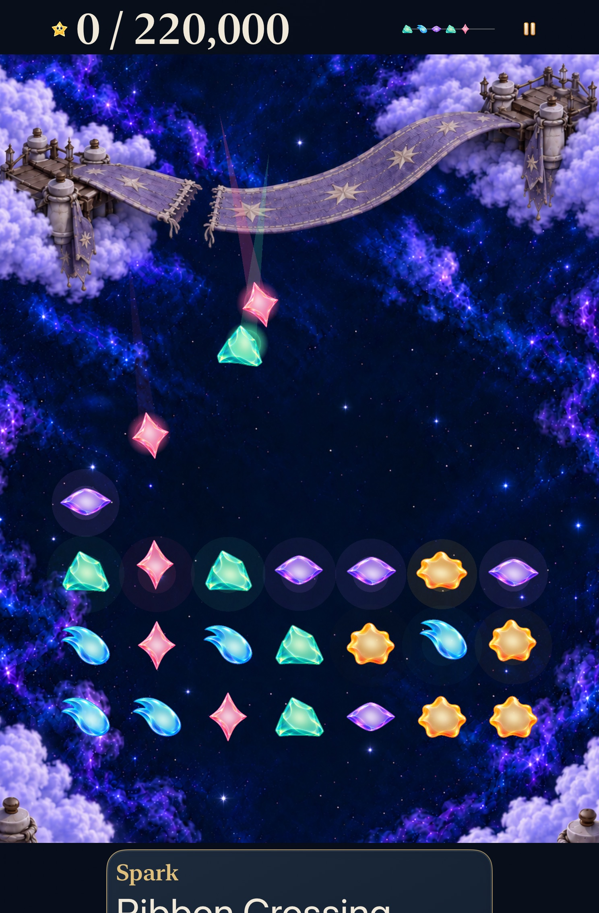
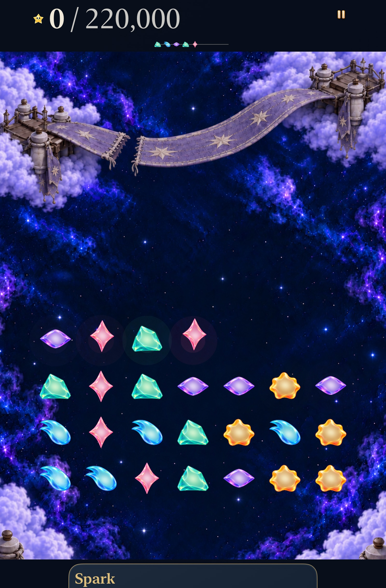

# Earned score leads the instrument

**Result:** Verified for scoped development adoption · **Owner:** Factory coordinator · **Date:** October 23, 2026

[Cohesion goal 3](https://github.com/lbeezr/starfall/issues/284) keeps earned score bright and semibold while the fixed target uses regular weight and supporting ink at the same Dynamic Type size. The native comparison also exposed an existing largest-text forecast mismatch: a short score let the forecast stay beside the menu. Accessibility sizes now select the existing stacked header explicitly.

**Next action:** Merge this verified goal separately, then activate interface-craft goal 4 from main. Human reading preference and physical display comfort remain unmeasured.

## Contract and decision

`SkyScoreInstrument` owns both horizontal and stacked score/objective expressions. Exact grouped values, native size, symbol, spacing, score anchor, minimum target and complete single `experiment.score` accessibility representation remain intact. `FallingSkyView` owns header reflow: accessibility sizes use the existing 160-point forecast below the score/menu row; default text keeps width-based fitting and calibrated island routing. The taller accessible header reduces the scroll viewport; board projection, cell sizes and coordinate mapping stay unchanged.

**Retain** this hierarchy. Earned `30,000` reads ahead of `/ 220,000`, including at AX3XL. Targets remain legible over warm Lantern and cool Ribbon; default play keeps its compact single row, and largest text gives forecast its own clear line. Keep all other materials and motion, with no alternate runtime route. The separate packet/score-overlap correction remains goal 9.

## Verification

Activation main is `612a369b23b58b55007da4ff02abeaaf6ca82bb9`, after goal 2’s [PR #296](https://github.com/lbeezr/starfall/pull/296). Baseline prepared runtime inputs `dev.d33057befd` equal that main, compiled from `678f7c7c` plus goal-2 snapshot `787039fc3544`. Final candidate is `dev.21d62cc22f`, main plus the two production-file hashes in [verification.json](verification.json), snapshot `19529984a3d0`. Products display `dev.local`.

Debug, Xcode 27.1 (27A9275), Swift 6.4, macOS 27.0.1 arm64; iOS 27.0 (24A434), dedicated iPhone 17e and iPad mini A17 Pro. Largest text is AX3XL. The reflow/placement hosted checks additionally exercise exact six-digit totals, narrow widths and calibration boundaries.

| Check | Result and scope |
| --- | --- |
| Core | 242/242, zero failures/skips; Core inputs unchanged throughout this UI-only batch. |
| Final Debug build for testing | Passed, 5.3s. |
| Final hosted | 4/4, zero failures/skips: six-digit score reflow, award clearance and both `SkyShowerPlacementTests`. |
| Final native phone | 4/4, zero failures/skips: forecast/menu/background, real crowded recovery, AX3XL quiet reading, AX3XL normal-motion Ribbon chain and exact return. |
| Final native tablet | 3/3, zero failures/skips: forecast/menu/background, default/AX3XL normal-motion Ribbon choice, chain and return. |
| Baseline matched largest text | Phone 2/2 and tablet 1/1 pass. Default before captures reuse goal 2’s passed same-build native journeys. |
| Physical, human, actual VoiceOver | Not performed. No minimum-OS, RC or phone-delivery acceptance implied. |

Commands and bounded stage receipts are in the verification record. Core uses `swift test --scratch-path /private/tmp/starfall-factory-gameplay-20261022/CoreBuild --jobs 2`. Hosted/native runs use exact selected cases with prepared `.xctestproducts`, serial testing, unique result bundles, `-collect-test-diagnostics never`, and `scripts/simulator-command.py` process ownership/timeouts. Hygiene/diff and local documentation-link checks accompany publication. This subset does not claim the full source-counted native inventory passed. No routing, fixture, resource or membership changed, so Release/resource-membership checks are inapplicable.

## Original failures remain evidence

The target-only candidate (`dev.1315cb2ee3`) passed three phone journeys and one default tablet journey, but failed the Open Sky AX3XL own-row assertion. Unchanged phone main failed identically: forecast minY 68.67 was above menu maxY 106.67; unchanged tablet failed at 22 versus 60. Width-only `ViewThatFits` selection was the violated presentation boundary. Explicit accessibility reflow corrects it; the same test passes on both devices without assertion or fixture edits.

The first candidate tablet AX3XL Ribbon case failed before Starfall launched: after the Accessibility tap, Settings still showed General and lacked Motion. Its next default-text case navigated correctly and passed. The final same AX3XL case passes. The original setup failure remains separate from product acceptance; [ENGINEERING](../../ENGINEERING.md) records the unisolated cause, recurrence trigger and bounded follow-up. No helper retry policy is added.

XCTest’s automatic baseline movie could not be decoded by AVFoundation and supplies no visual/motion proof. The supplementary zero-score header pair below comes from actual baseline/final prepared-product installs and identical reset-only launches on the dedicated simulator, using native-resolution `simctl` screenshots after MCP inspection. The candidate is restored afterward. Stills establish composition, not continuous smoothness or equal animation age. Motion timing and rules are unchanged.

## Inspected native comparisons

All twelve retained stills were inspected; [capture provenance and hashes](captures.json) distinguish source, device, text and phase. PNG-to-JPEG export preserves pixel dimensions. Arrival poses, forecast travel and receipt fades may differ between samples; compare stable type roles and committed facts.

**Crowded Lantern, phone default:** target emphasis falls behind earned progress while pressure, forecast, menu, board and fixed controls retain their roles.

| Before | After |
| --- | --- |
|  |  |

**Ribbon chain, phone AX3XL:** exact 30,000/220,000 values reflow without shrinking; the full receipt and controls remain reachable.

| Before | After |
| --- | --- |
|  |  |

**Ordinary Ribbon, tablet default:** compact instruments stay at the edge and the playfield dominates.

| Before | After |
| --- | --- |
|  |  |

**Ribbon cascade, tablet default:** the earned total stays primary beside the finite celebration. Different fade ages do not establish timing changes.

| Before | After |
| --- | --- |
|  |  |

**Ribbon opening, tablet AX3XL:** the forecast moves below the score/menu row even when the large zero-score expression fits horizontally. Opening arrival ages differ.

| Before | After |
| --- | --- |
|  |  |

**Zero-score Open Sky, phone AX3XL:** the independent short-score case demonstrates the repaired row contract. These are paused reset-only review states through the production header.

| Before | After |
| --- | --- |
|  |  |

## Project reconciliation

After goal 2 merged, canonical iPhone/iPad Project View 1 visibly placed #282/item 280950224 with merged #292 and #283/item 280950271 with merged #296 in Done, both closed completed. The temporary “cohesion” filter was discarded; no status, membership or workflow edits. The parent’s [observation](https://github.com/lbeezr/starfall/issues/281#issuecomment-6366315267) keeps this specific check separate from #220’s earlier recovery.
