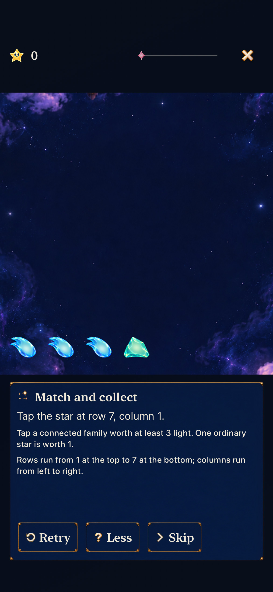
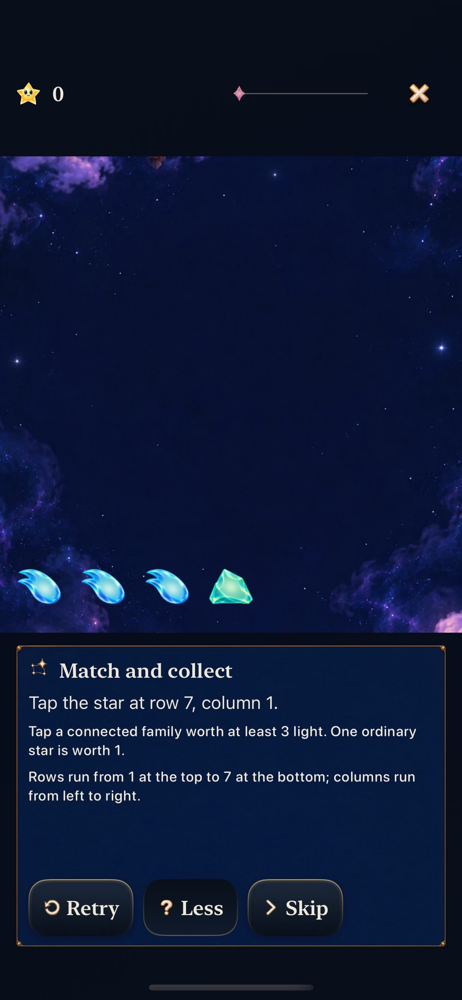
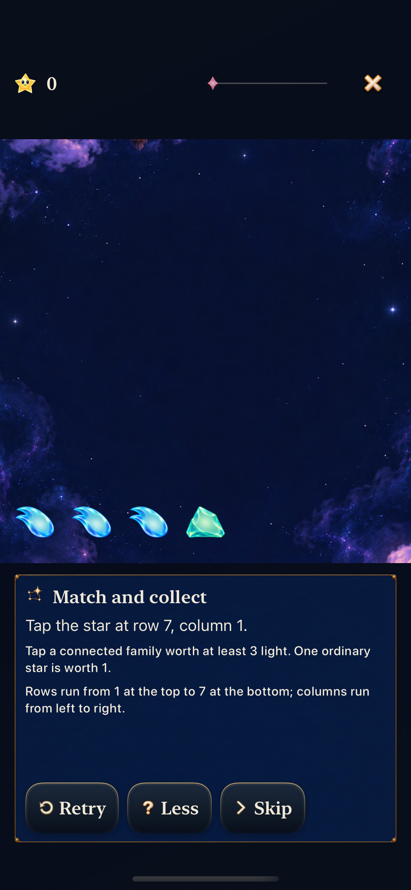
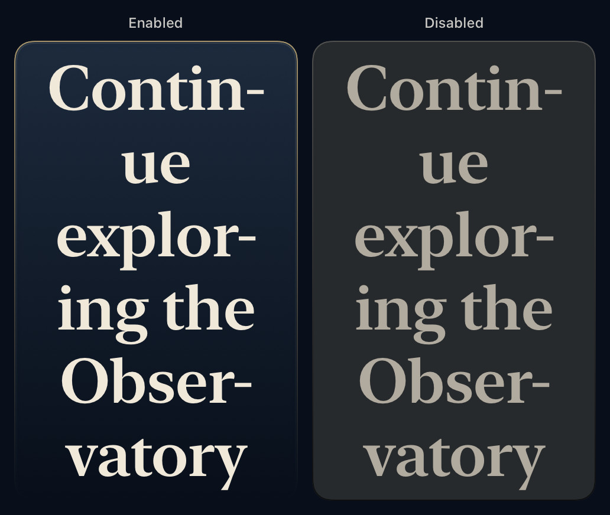
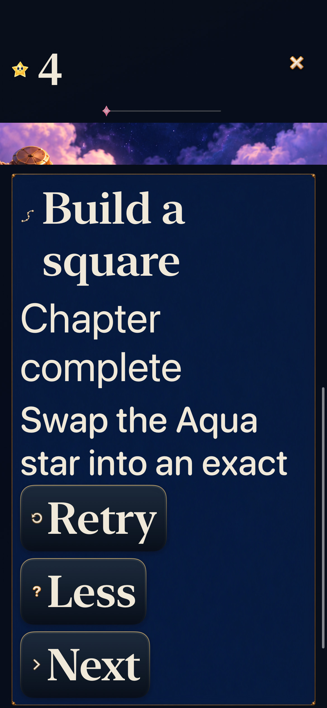
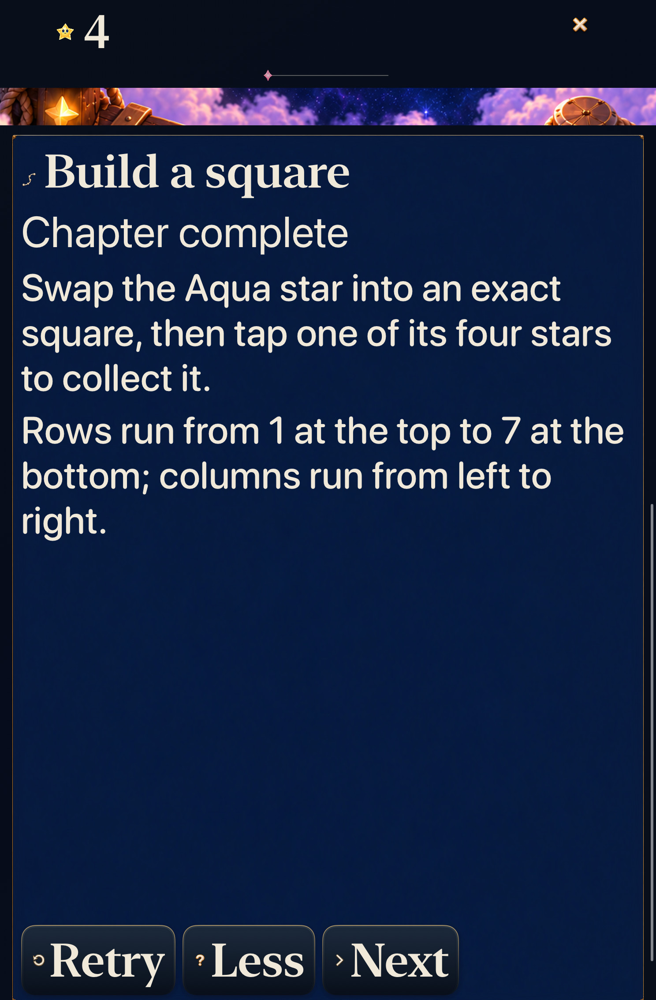

# Compact actions share enamel depth

**Result:** Verified for scoped development adoption · **Date:** October 23, 2026

[Cohesion goal 4](https://github.com/lbeezr/starfall/issues/285) gives compact and secondary actions a rounded midnight-enamel face, fine brass upper rim and shallow contact shadow. A held action depresses its lighting immediately; disabled actions keep the same geometry with a quiet flat finish. Labels, native interaction and focus retain their existing owners.

**Decision:** Retain this shared surface. The native Match comparison makes actions distinct from the passive reading frame while preserving the illustrated glyphs and pearl lettering. Next, merge this goal individually and activate the Seed Moon environment slice. Human preference, physical reading and actual VoiceOver remain unmeasured.

## Inspect the change

Both captures use the actual normal-app Match practice route, reset seed 64, default text and Calm off. The board, copy, control labels, padding and target sizes are unchanged. The baseline is the prepared `dev.21d62cc22f` build equivalent to activation main `81826248`; the final is clean source `8c52334e` / `dev.8895bb79c7`.

| Before | After |
| --- | --- |
|  |  |

The held Hint action reverses the edge lighting and loses its raised contact shadow. Releasing 160 points above the button cancels it: the label remains Less and the detail stays open. Subsequent ordinary taps still toggle the disclosure, complete Match and advance to Grown stars.

| Held | Released outside |
| --- | --- |
|  |  |

[Native press/cancel recording](dev-81826248-wip-5be0538bb9c6__tutorial-actions__iphone-17e__press-cancel.mp4), 9.392 seconds at normal speed, includes the held state, drag off, disclosure taps and the following chapter. Inspected frames establish state chronology and material appearance; no continuous-smoothness claim. The recording precedes the unrelated Kite merge, with identical two production-file hashes. Final integrated tests repeat the same press/cancel behavior. The long baseline manual recording is temporary reference only: its short drag activated Hint and does not establish cancellation or matched gesture timing.

## Size and disabled states

These are native `ImageRenderer` captures of production `Button`/`StarfallButtonStyle`, 240-point buttons at 2×, not full-app interaction evidence. All six compact/secondary default/AX5 short/long pairs were inspected. The two roles render the same face. Long words use native hyphenation; all text remains present and disabled geometry equals enabled geometry. This extreme string is a component stress case, not a new shipped label.

| Phone AX3XL | Tablet AX3XL |
| --- | --- |
|  |  |

Actual practice completes the square, backgrounds/resumes and returns to the unchanged retained round. Captures show the existing scroll position revealing controls; they do not imply all lesson text and the board fit simultaneously. Tall primary Home/Begin actions retain their previous reading-panel fallback and passed navigation/return checks.

## Ownership and verification

`ObservatoryCompactActionSurface` presents only passive decoration. `StarfallButtonStyle` supplies its existing native pressed/enabled state. Minimum 48-point compact targets, full rectangular hit shape, focus ring, wrapping label, selection-only surface policy and animation-free transaction stay unchanged. No new assets, skins, preferences or alternate route. Passive reading surfaces, primary/ceremony/utility/game controls, rules, saves and board geometry are unchanged by this goal.

Activation main `81826248` advanced independently through Kite PR #293 to `b41a623c633d22dc9248e4fcdfc5bb505be1452f`. Goal 4 was rebased before final acceptance. Final build and all selected tests use clean local commit `8c52334e843f108e6d39e49424cfe60d5c5e601f`, runtime `dev.8895bb79c7`. The published commit may differ in documentation only; [verification.json](verification.json) records exact build inputs and earlier snapshot `5be0538bb9c6`. [captures.json](captures.json) binds selected bytes to their source and evidence type.

| Check | Result |
| --- | --- |
| Integrated Core | 249/249, zero failures/skips; includes the newly merged Kite coverage. |
| Final Debug build for testing |Passed, 21.7s. |
| Final hosted |3/3, zero failures/skips: catalog registration, density and extended action sizing/disabled-state renders. |
| Final native phone |2/2, zero failures/skips: normal held press/cancellation/disclosure/progression and largest-text quiet square/background/exact return. |
| Final native tablet |2/2, zero failures/skips: largest-text practice/background/return and Home/Entry/Back reachability. |
| Earlier production slice | 242 Core, 3 hosted and 3 native checks passed before Kite integration; not substituted for final source checks. |
| Hygiene/diff/local links |Passed at publication. |
| Release/membership |Inapplicable to this goal: no routing, resources, fixtures, membership or build settings changed. |
| Actual VoiceOver, physical device, human preference, minimum-OS/RC |Not performed. No installation requested. |

Debug Xcode 27.1(27A9275), Swift 6.4, macOS 27.0.1 arm64; iOS 27.0(24A434) on dedicated iPhone 17e and iPad mini A17 Pro simulators. Exact selected cases, prepared products, bounded commands and stage receipts are in verification.json. Source-counted inventory 203 UI/446 hosted is not a full-suite pass.

Manual setup limitations remain separate: MCP taps reported success without changing the visible app, so native XCTest owns interaction acceptance. Device Hub semantic clicks reached the baseline route; one later window-availability failure ended manual gesture work. No product assertion was weakened and no blanket retry added.

Canonical Project View 1 was inspected after Goal 3 merge: #284/item280950300 appeared in Done, closed completed with merged PR #297, alongside Goals 1–2. The temporary filter was discarded without status/membership/workflow edits.
