# Seed Moon becomes a connected tending place

**Result:** Verified for scoped development adoption · **Owner:** Cohesion factory coordinator · **Date:** October 23, 2026

[Cohesion goal 5](https://github.com/lbeezr/starfall/issues/286) brings the isolated Seed Moon shell closer to the connected architectural standard of Lantern and Silver Pools. Fifteen replacement paintings join its mineral shell to a supported approach and a continuous foreground crescent. The pearl, scoop, mint roots and closed-bud→open-shelter story remain recognizable.

**Decision:** Retain this environment refinement, merge it individually, then activate goal 6. Human aesthetic preference, physical reading and actual VoiceOver remain unmeasured. Bright stonework reduces contrast behind forecast/pause; the glyphs remain identifiable in inspected views. Goal10 will review that shared HUD/backdrop boundary.

## Matched native slice

These actual phone captures use the same baseline code, paused 49-star fixture, score 14/18, default text and normal effects. The right capture changes only the75%/100% paintings. The complete family was expanded after this slice and tablet-route correction.

| Before: isolated shell | After: connected approach and close crescent |
| --- | --- |
| 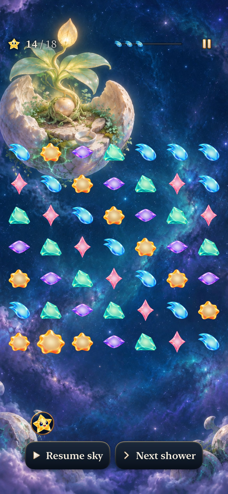 | 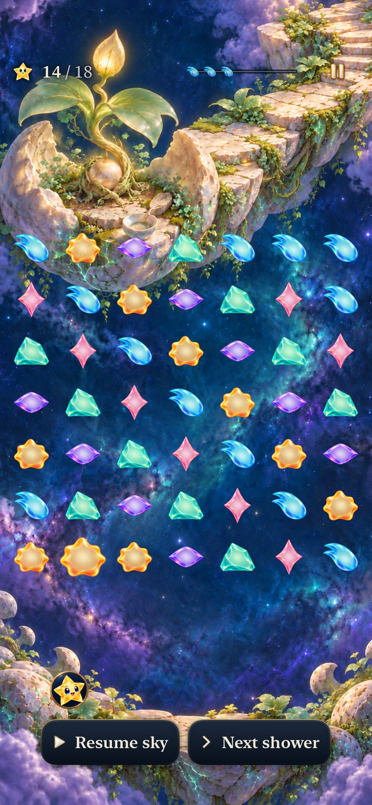 |

Baseline is main-equivalent `5b3efc62` / `dev.8895bb79c7`; paired candidate is that base plus snapshot `17b99a521911` / `dev.b705fa64cd`. Exact dirty hashes are in the [prompt/native decision record](../../design/seed-moon-04/cohesion-2026-10-23/art-prompts.json). This is composition evidence, not motion or preference evidence.

## Artwork-family checkpoint

The family checkpoint checks use clean local source `f7487ebdad8292f833c6361f76c2d048c44eb674`, rebased onto main `6f8fc7a`. Its build plist reports the generic `dev.local`; the exact source and immutable prepared products identify it. Subsequent changes are documentation only. This integration preserves PR301's new ceiling rail and crowded-column markers, absent from the earlier baseline; those are independent of the painting refinement.

| Dormant0% | First root25% | Shoot50% |
| --- | --- | --- |
| 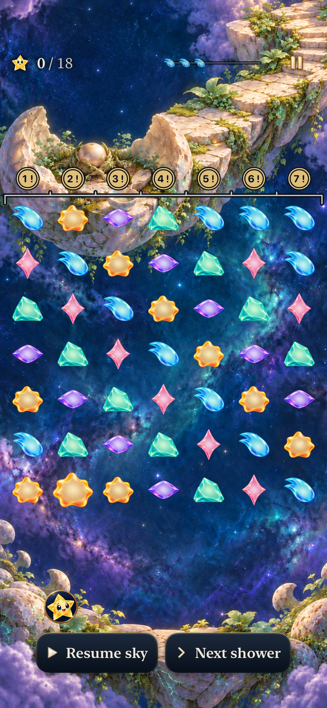 | 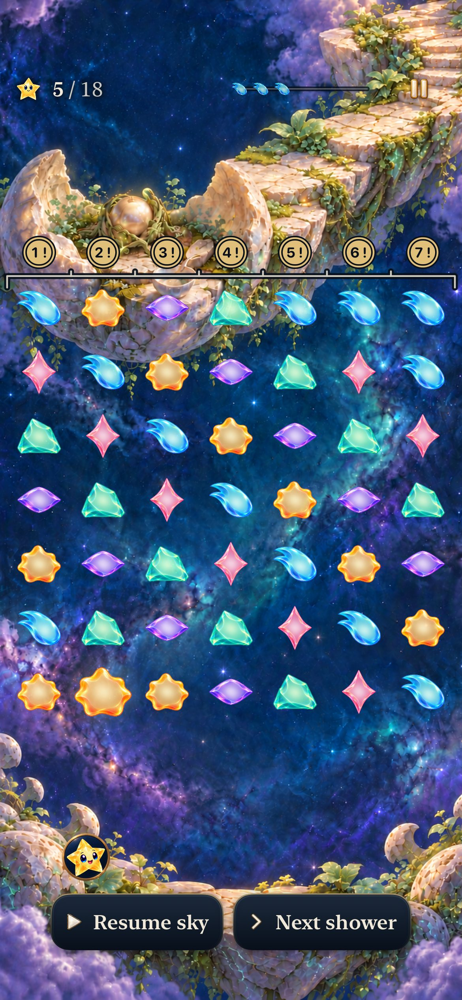 | 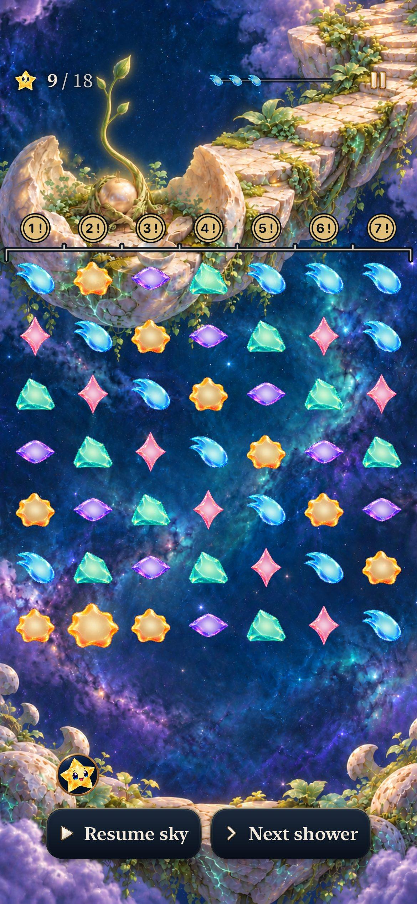 |

The shoot approaches the default score area but does not cover its lettering in the inspected phone capture. Native source art and all five phone states were inspected; no exact original shoot-height claim. At 75%, the bud remains closed. At 100%, the open canopy remains visible above the normal result. The100% fixture withdraws/dims the stars and is **not active dense-board evidence**.

| Tablet portrait,75%, actual49 | Tablet landscape,75%, actual49 |
| --- | --- |
| 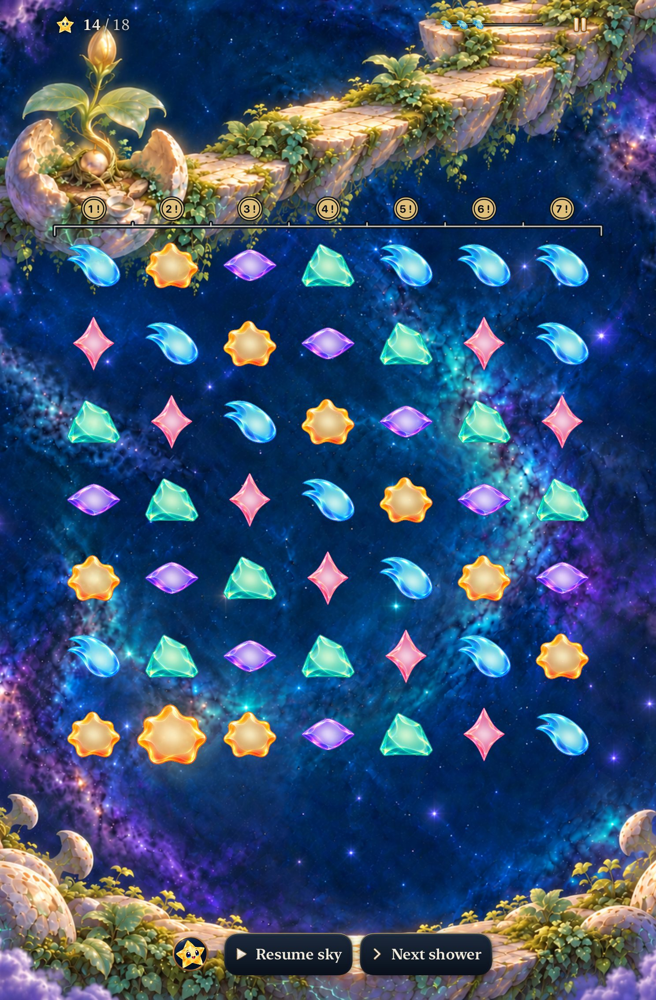 | 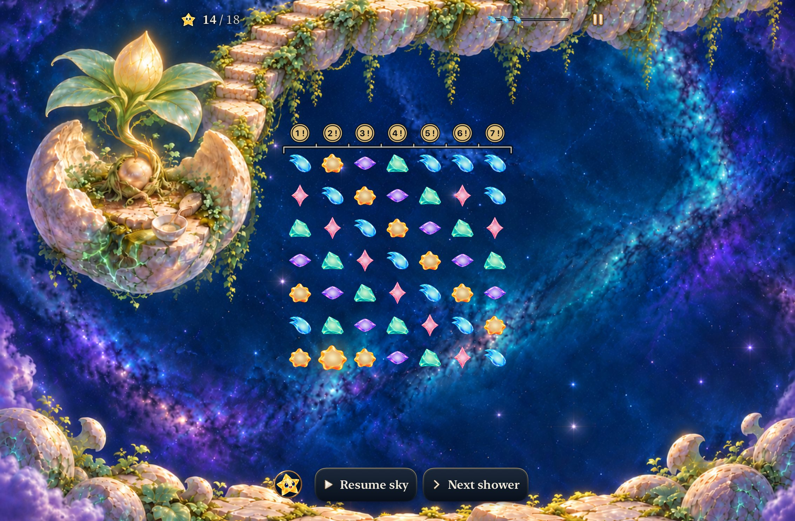 |

All ten tablet milestone views and two real-clear states were inspected against matching baseline captures. The sparse fixtures contain 21 actual stars, not49; each has 49 native cell targets. Those states keep a stable shell, route, foreground and five cumulative plant beats. Landscape000/025 show no exposed border from their slightly different generated dimensions. The full75% views above separately establish the sampled49-star appearance, including grown amber. Root reviewed the full boards and selected sparse states; the environment worker inspected every tablet state.

The first landscape master was rejected after its diagonal approach crossed the upper rows. The selected high route stays above the board. Initial25% variants were also rejected for prematurely lighting the completed root network. All attempts remain in the three [cohesion prompt records](../../design/seed-moon-04/cohesion-2026-10-23/README.md), with exact prompts, reference roles, hashes and decisions. Selected PNGs are byte-identical generated outputs; no script resampling/cropping. [Production manifest](../../design/seed-moon-04/production-assets.json) preserves all fifteen superseded selections, including the earlier phone050 correction.

## Transition and interruption

The [before](dev-5b3efc62__seed-finale__iphone-17e__before.mp4) and [integrated after](dev-f7487ebd__seed-finale__iphone-17e__after.mp4) clips show a real14→18 clear, light transfer, closed-bud→open-canopy crossfade and named result. Each is a four-second normal-speed AVFoundation export from a native recording. Recording starts are log-triggered and differ; elapsed positions are not matched phase ages. Inspected original frames cover0.1–2s in the final recording and0.3/1/2s in the baseline. This establishes chronology and painting continuity; it does not establish continuous smoothness or human satisfaction.

The actual win persists across background/relaunch; same-round Replay returns to0%. Separate native cases verify overflow/replay, system Reduce Motion with AX3XL, and cancellation over retained Lantern/Ribbon/Kite boards with replacement only at Begin. Tablet rotation preserves star identities/frames, and two native clears advance5→9→13. No rule, save, input, light-destination or board-geometry change belongs to this goal.

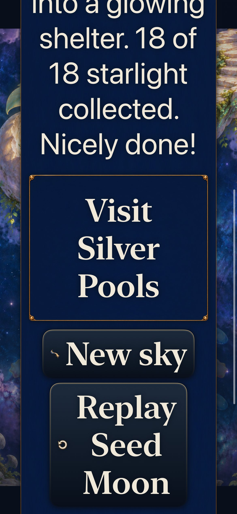

This viewport proves the existing scrolled result action is visible; it does not imply all result text fits simultaneously. The preceding largest-text play capture was inspected separately and keeps the canopy visible below the reflowed header.

## Verification and limits

[verification.json](verification.json) records exact inputs, selected results, devices and commands. [captures.json](captures.json) binds retained native-pixel JPEG exports to their original screenshots. Raw logs/xcresults remain disposable under `/private/tmp/starfall-cohesion-20261023`.

| Check | Result |
| --- | --- |
| Core on integrated source |260/260, zero failures/skips |
| Debug build for testing / Release build |Pass,28.8s /45.6s |
| Hosted restoration suite |12/12, zero failures/skips; all 105 registered rasters and exact per-state aspect/fill |
| Native phone |4/4 total, zero failures/skips: recorded win/restore/replay plus overflow, largest text/Reduce Motion and retained-location cancellation |
| Native tablet |1/1, zero failures/skips: rotation, real clears and all ten scene views |
| Release membership |15 Seed Moon renditions, exact source dimensions; compiled catalog290,200,456bytes |
| Provenance |15/15 selected source byte matches;20 cohesion attempts preserved; no alternate runtime route |
| Hygiene / links / whitespace |Hygiene and whitespace pass after explicit staging; local links checked again after documentation commit |

Only `RestorationArtwork.sourceSize(for:)` changes Swift behavior: it registers landscape 0% as 1445×1088,25%/75%/100% as 1447×1087 and 50% as 1446×1087. Existing whole-image fitting owns presentation. The geometry guides were regenerated from compiled latest-main Core and current registration; they do not measure SwiftUI coverage.

No physical-device installation/play, actual VoiceOver, minimum-iOS17 run, full RC matrix, compact phone-landscape native rerun or human preference measurement. Hosted fill checks include844×393. The four-second exports and retained stills are review evidence, not performance profiles. Forecast/pause contrast is the bounded remaining visual follow-up for goal 10; no blanket readability claim is made for uninspected backgrounds or devices.

## Later main integration: current Seed ingredient encounter

PR302 merged while the scenery slice was in validation. Clean combined source`cf4f4007108c40bc41bb33b17f77d6331820af86` starts from main`dd69da9e68b7469a7c1270ed289de7e78684437b` and preserves its new Seed4/11,000-point encounter. The15 paintings, exact sourceSize mapping and shared renderer match the checkpoint above; the earlier18-light scenes are historical-rule fixtures. Neither rules nor saves are modified by this scenery goal.

Integrated Core passes268/268. Debug/Release pass25.6s/37.9s. The12 hosted restoration checks repeat successfully, and current-Seed largest-text quiet tablet Help, preserve-route completion and onward navigation pass. Native tablet orientation was landscape1133×744, retained from the explicit dense-board review; its large-text play/result canvas scrolls. The opening capture shows only the visible board portion, and its grown ingredient is not established by that single image. Exact input/score assertions and later actions retain their own coverage. Final phone source/result counts and selected current-rule captures are recorded in verification.json.

The final phone cases pass2/2 (current spend/preserve→save/restore→Replay→overflow, plus historical18-light win/restore/Replay), zero failures/skips; tablet passes13/13 including12 hosted and1 native. Current phone captures retain the grown opening and real6,000/8,000 clears. The shoot’s upper stem lies behind part of the wider point-score header; native lettering remains readable in the inspected frames. That shared scenic/HUD boundary joins the goal10 contrast review. Celebration receipts temporarily overlap the plant during the actual clear; these captures are not settled50% stills.

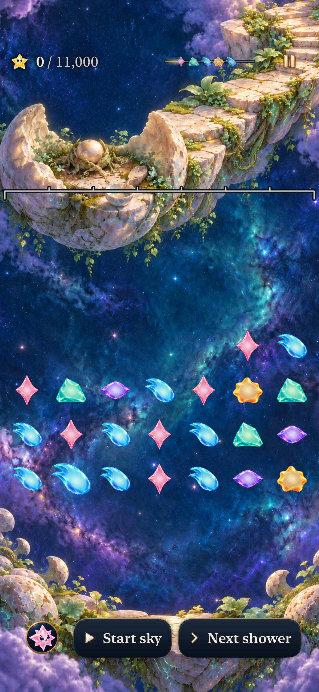

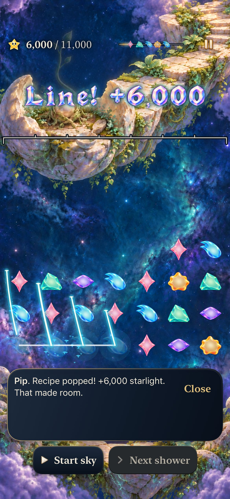

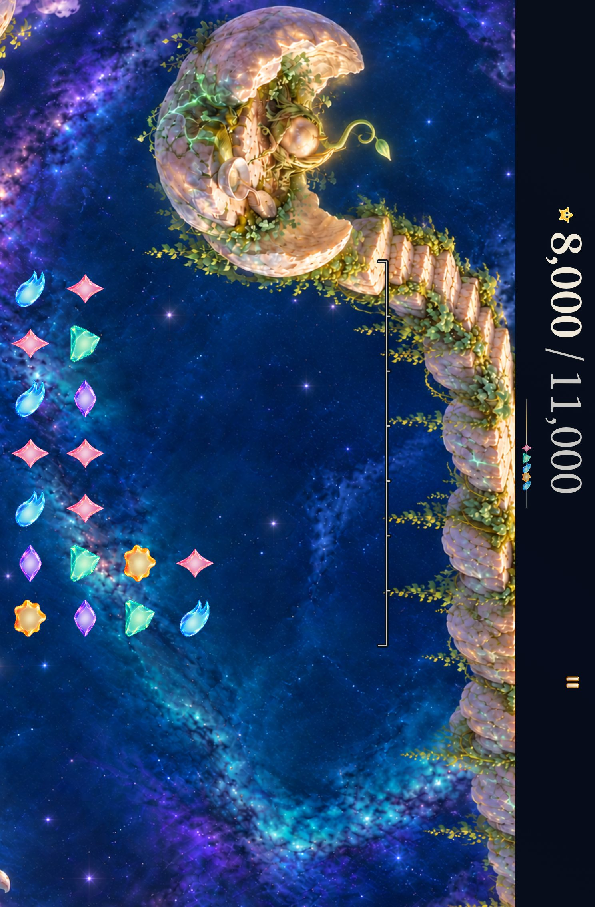
