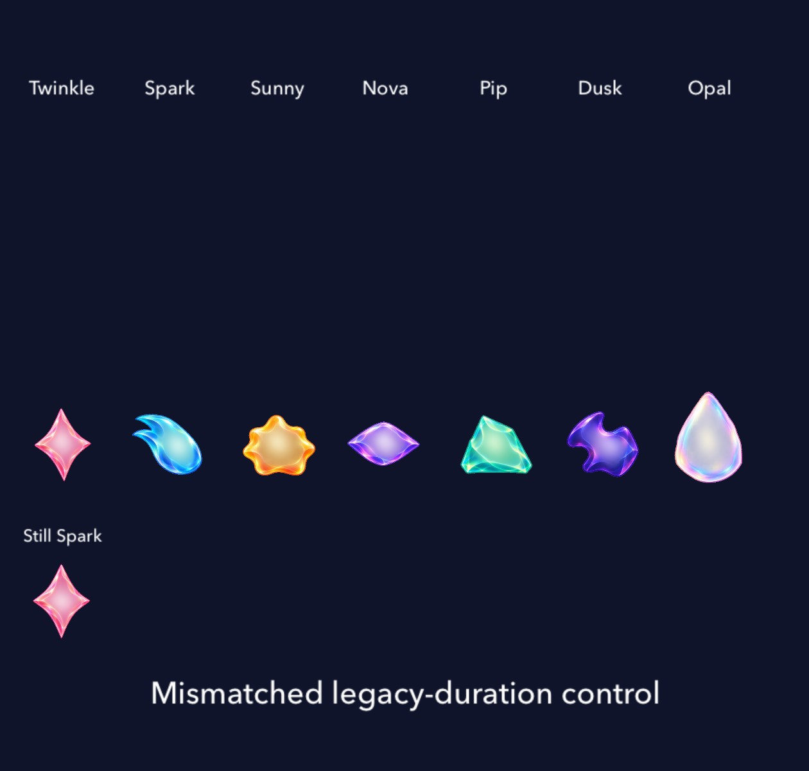
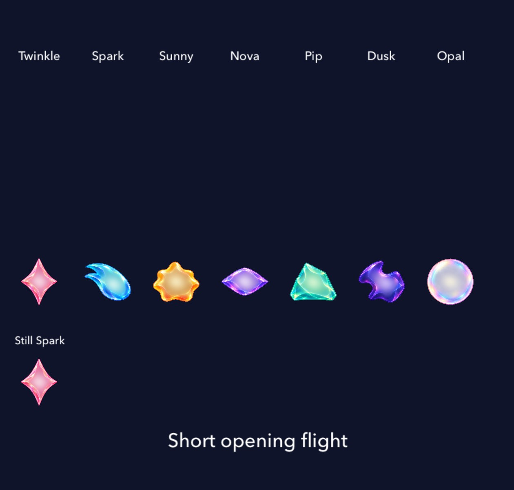

# Flight responses finish at the landing

**Result:** Verified for scoped development adoption · **Owner:** Cohesion factory coordinator · **Date:** October 23, 2026

[Cohesion goal 6](https://github.com/lbeezr/starfall/issues/287) corrects a duration mismatch in rapid opening rain. Its approach lasts 0.34 seconds, while body banking and internal light previously ran for 0.48 seconds and were discarded at the landing. The scene now passes its actual approach duration through the existing body/light owners. Their original normalized response finishes into that landing; ordinary 0.48-second flights keep their timing.

**Decision:** Retain this bounded motion correction and merge individually. Travel paths, opening duration/stagger, contact/landing responses, committed outcomes, clock and next-input timing are unchanged. Human feel and continuous smoothness remain unmeasured.

## Inspect the handoff

| Old-duration control at short arrival | Corrected short flight settled |
| --- | --- |
|  |  |

These are actual SpriteKit component renders at the same destination, from clean `8e10ce7a`,420×400-point SKView on iPhone17e Simulator. The left deliberately pairs the unchanged default 0.48-second response with0.34-second parent travel, reproducing the former production mismatch through the existing API. It is a controlled native specimen, **not a screenshot of an earlier full game**. At actual arrival plus 50ms in SpriteKit time, every family retains measured internal-light displacement and an unfinished body pose. The corrected short and ordinary flights each reach full body/light rest at their own arrival boundary. All seven still exhibit sampled flight motion; a resting neighbor stays still.

The [before normal-app recording](dev-cf4f4007__ribbon-opening__iphone-17e__before.mp4) and [after recording](dev-882ac0d0__ribbon-opening__iphone-17e__after.mp4) show current Ribbon Begin and progressive rain-in through the settled opening. Three-second AVFoundation exports preserve normal speed. Original frames inspected at 0.5/0.8/1.2/1.5 seconds before and 0.35/0.6/0.8/1/1.5 seconds after retain their actual encoder ages. Starts differ and some frames duplicate/gap; equal video timestamps are not equal flight ages. The component control isolates the endpoint correction; these game clips establish that the normal opening still presents progressively. No continuous-smoothness, frame-rate or perceived-latency claim.

The complete native Ribbon case also performs a reversible zero-score exchange, a real three-clear chain to 30,000, waits for next-input readiness, cancels Replay and restores the exact board. Its before and after assertions pass. The short retained recordings cover rain-in, not that later exchange sequence. An optional late observer attached after its gesture marker had already passed and recorded SpringBoard; that supplemental capture is rejected and remains temporary.

## Ownership and verification

`FallingSkyScene.sendStar` forwards the duration it already uses for movement/contact/tail lifetime. `SkyPieceMotion.prepareFlight` scales its existing warp/roll phase lengths, including Opal’s finite wait; `LivingLight.prepareFlight` uses the same duration for its existing normalized response. Defaults remain0.48 seconds. No new state, resource, action queue, preference or route. Fields/holes retain their existing guards. Quiet modes and stale-completion cancellation keep their existing owners.

Activation main was `495d4062`. The recorded candidate is clean `882ac0d0`; a test-only endpoint capture adds `8e10ce7a`. Main then independently merged the optional mode-practice route to `0d77ee41`; final clean combined source is`365ca5e58917ec23db07081c064bced1e39b4f8f`. The three production motion files and extended hosted test match `8e10ce7a` exactly. Their SHA256s and exact results appear in [verification.json](verification.json); retained media hashes appear in [captures.json](captures.json). Local bundles report `dev.local`; immutable prepared products and source identify them. Subsequent changes are documentation only.

| Check | Result and scope |
| --- | --- |
| Core |268/268 at activation;272/272 after independent practice integration, zero failures/skips |
| Debug build for testing |Pass at initial 5.7s, endpoint-capture 3.0s, integrated 18.8s |
| Affected hosted |7/7 on initial and integrated source, zero failures/skips: actual arrival poses, material refresh, Lantern/Ribbon opening, replacement/quiet cancellation, ordinary survival storm input windows and recipe pop→fall→pop/cancellation |
| Final component capture |1/1 on `8e10ce7a`, zero failures/skips; explicit matched arrival captures |
| Native phone |Before/after Ribbon cases1/1 each; integrated repeat1/1, zero failures/skips |
| Native tablet AX3XL |1/1 on `8e10ce7a`, normal motion, zero failures/skips: Entry, opening, reversible exchange, chain, Replay cancellation/retained return |
| Hygiene, links and whitespace |Run after explicit staging/final documentation commit |

Xcode27.1(27A9275), Swift6.4, macOS27.0.1; Debug arm64, iPhone17e and iPadmini A17Pro/iOS27.0(24A434) Simulator. The compile-derived level-guide ownership hashes were refreshed; the geometry and guide pixels do not change.

No physical-device installation/play, actual VoiceOver, minimum-iOS17 run or full RC matrix. Release/resource-membership checks are inapplicable to this existing-source timing-only slice; no routing, fixture, resource or build-setting changes belong to it. Default body-flight coverage does not claim a new Full Board gameplay acceptance. Native input tests establish preserved committed order/readiness, not enjoyment.
