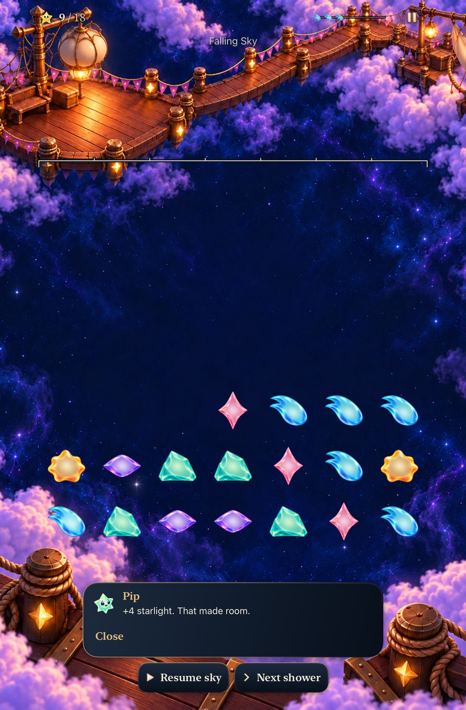
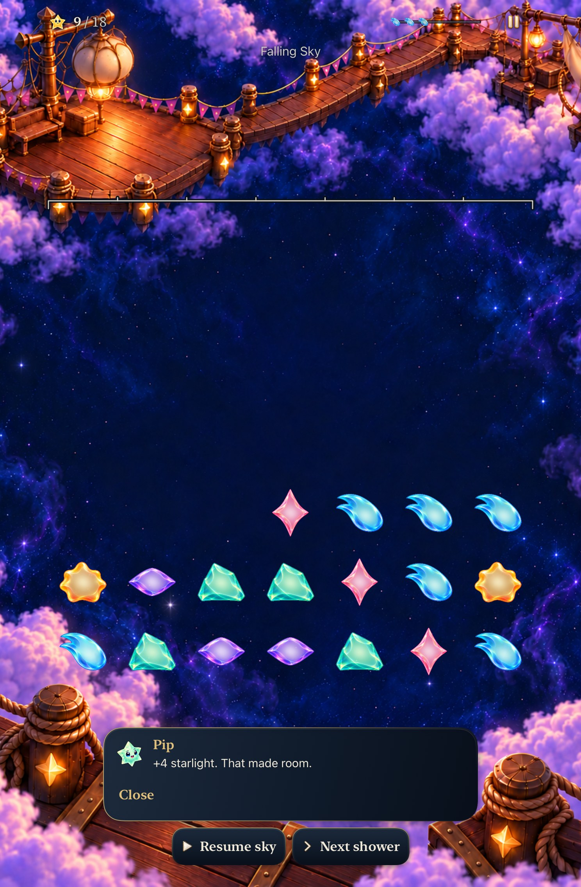

# Earned dock lights stay lit

**Result:** Verified for scoped development adoption · **Owner:** Cohesion factory coordinator · **Date:** October 23, 2026

[Cohesion goal 7](https://github.com/lbeezr/starfall/issues/288) corrects two tablet 50% paintings: an upper main-dock fitting in portrait and the post immediately right of the main lantern in landscape were already lit at 25%, went dark at 50%, then lit again at 75%. Their existing amber emission now persists through the earned midpoint. Camera, supports, main-lantern stages and quiet sky remain qualitatively registered. No Swift, rules, saves, geometry, input or route changes.

**Decision:** Retain both corrected paintings. The portrait native full-board slice was proved before producing the landscape sibling. Exact generated pixels, references and prompts are recorded in the [art provenance](../../design/lantern-landing-01/cohesion-2026-10-23/art-prompts.json); [verification.json](verification.json) binds acceptance to source and [captures.json](captures.json) binds the selected media to raw exports.

## Compare the earned midpoint

| Portrait before | Portrait after |
| --- | --- |
|  |  |

These native iPad mini A17Pro/iOS27.0 captures follow the same historical 5→9 clear, leaving 17 stars. Clean baseline `365ca5e5` has the same app/Core/project/test build inputs as activation main `7e712f31`; only App/README differs under those directories. Clean candidate `76b52f23` includes independent main `ffdf28ee` Full Board advice, absent from the baseline. That optional menu does not appear in these historical Falling Sky scenes. Both local bundles report `dev.local`; the source and immutable prepared products identify them.

The [landscape before](dev-365ca5e5__lantern-50__ipad-mini-a17pro__landscape-before.jpg) and [after](dev-76b52f23__lantern-50__ipad-mini-a17pro__landscape-after.jpg) show the other fitting. The [portrait](dev-76b52f23__lantern-50__ipad-mini-a17pro__portrait-active49.jpg) and [landscape full boards](dev-76b52f23__lantern-50__ipad-mini-a17pro__landscape-active49.jpg) each contain 49 actual stars, independently asserted from 49 cell targets. Ordinary/grown silhouettes, score, forecast and actions remain readable in these samples.

All 20 native milestone stills were inspected: five states × sparse/full × two orientations. No new crop seam, displaced support or unintended sibling-light change was found. At 75% the bright upper chamber stays closed; at 100% it opens distinctly above the [portrait result](dev-76b52f23__lantern-100__ipad-mini-a17pro__portrait-result.jpg) and beside the [landscape result](dev-76b52f23__lantern-100__ipad-mini-a17pro__landscape-result.jpg). Terminal gameplay is dimmed and withdrawn, so those result views are not active-density evidence.

## Observe collection and restoration

Normal-speed five-second clips retain the actual5→9 clear: [landscape before](dev-365ca5e5__lantern-25-to-50__ipad-mini-a17pro__landscape-before.mp4), [landscape after](dev-76b52f23__lantern-25-to-50__ipad-mini-a17pro__landscape-after.mp4), and [corrected portrait](dev-76b52f23__lantern-25-to-50__ipad-mini-a17pro__portrait-after.mp4). Native frames requested at 0.3, 2.5 and 3.5 seconds show the starting 25% painting, earned packets and the brighter 50% scene. The old landscape fitting loses its light; the corrected one keeps it. Portrait retains its existing fitting through the same causal sequence. The scene remains a whole-image crossfade; no articulated lantern rig is introduced.

The clock is deliberately paused, with normal effects and system motion enabled. Real controls commit progress. Encoder ages differ and one requested 3-second frame repeats an earlier frame; these samples establish observed sequence and endpoints, not continuous smoothness, frame rate or perceived timing. The first baseline recording began too late to show the crossfade and is excluded as transition proof. Re-recording with lead-in supplied the evidence above. JPEG exports apply native screenshot orientation metadata without resizing or cropping; an initially sideways export was corrected before adoption.

## Verification and remaining limits

At clean `76b52f23`: 280 Core tests ; 12 hosted restoration tests; one 20-state tablet audit; one real tablet rotation/clear case; one portrait clear/settings/background/relaunch/Entry-cancellation case; and one phone AX3XL/system-Reduce-Motion win/Replay case pass with zero failures/skips. Matched baseline rotation/clear cases also pass. Debug build-for-testing passes in 28.7s; Release in 101.6s. The Release catalogue contains 105 restoration rasters, including both opaque corrected paintings at their original 1086×1448 / 1448×1086 sizes. Existing hosted checks inspect packaged aspect ratios and shared layout/committed-state boundaries. No new resource member is needed.

Hygiene, links, whitespace and final-source integration are recorded before publication. Historical 18-light fixtures sample the shared renderer; they do not establish current 150,000-point reachability. Largest-text phone acceptance covers scrolled result/replay controls, not simultaneous visibility of the entire scene. No physical installation/play, minimum-iOS17 run, actual VoiceOver, full RC, measured contrast or human recognition/comfort evidence is claimed.

**Historical preview correction:** The October22 published JPEG named `portrait-dense49-50` in the [earlier payoff report](../game-goal-06-lantern-payoff-2026-10-22/README.md) shows 21 stars despite its filename. It supports painting/fitting inspection, not full-board readability. The original 49-star attachment remains separately recorded in that report’s `milestone-audit.json`, SHA256 `2eeb16cae56764143d7186c71b573427cc8046ceb9605193af68bd942ab07075`, and visibly contains 49 stars. Historical bytes/manifests are preserved; this publication-label error does not invalidate the raw dense audit.

**Final integration:** Clean `3b6838c1dfcc873c0e9c06d19aaf5488aad736b6` preserves newer main `379f8410`, including Silver’s independent encounter and paired practice. Both paintings, environment/geometry/theme/celebration owners and the Lantern native test match recorded `76b52f23` exactly. Final 295 Core, 12 hosted restoration and one tablet rotation/real-clear case pass with zero failures/skips; Debug 25.5s and Release 34.9s pass, with all 105 restoration rasters present. Only documentation follows this clean checkpoint. The recordings keep their original sources; final integration does not relabel them.
