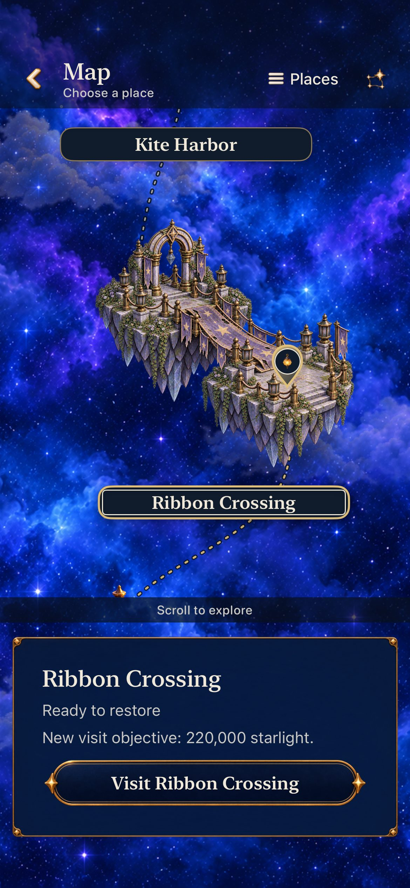
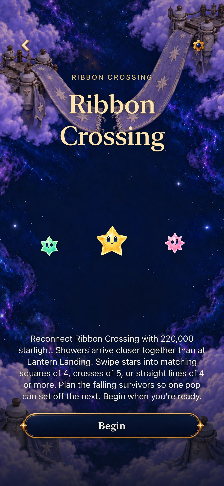
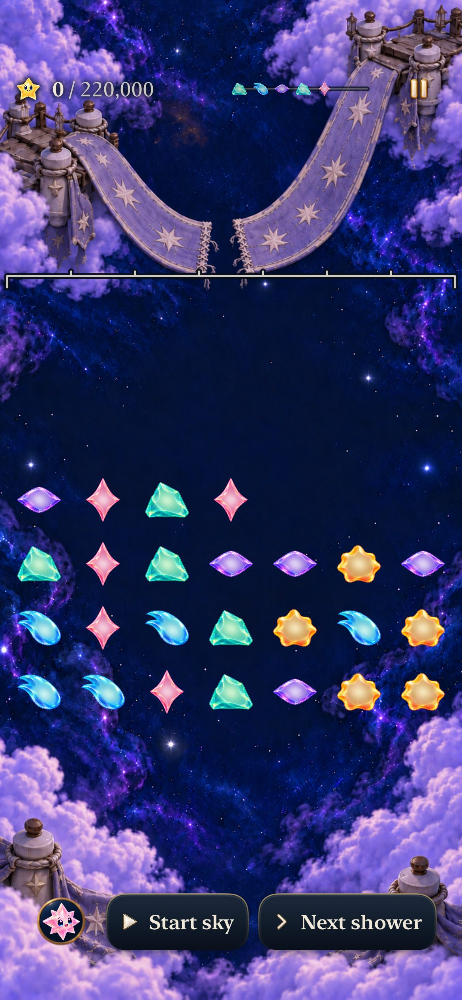
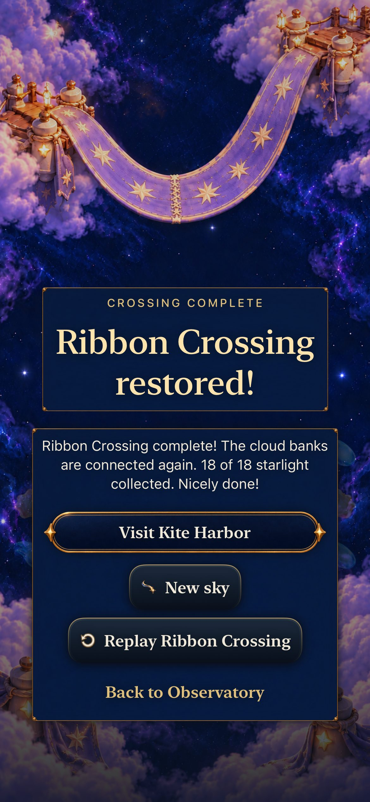

# Ribbon’s repair state survives the journey

**Result:** Verified for scoped development adoption · **Owner:** Cohesion factory coordinator · **Date:** October 23, 2026

[Goal 8](https://github.com/lbeezr/starfall/issues/289) replaces Ribbon Crossing’s almost intact damaged map bridge with two separated frayed ends. The same violet cloth, star motifs, brass fittings and pearl arch now communicate the missing crossing already shown by Entry and gameplay. The restored map and result still show the repaired span. One existing PNG and its measured alpha-body metadata change; navigation, render/input geometry, rules and saves retain their existing owners.

**Decision:** Retain the revised asset. The native phone slice proves the gap remains visible at actual map scale. [Exact generation provenance](../../design/world-01/production/cohesion-2026-10-23/art-prompts.json), [source-bound checks](verification.json) and [capture hashes](captures.json) preserve the original source and distinguish the candidate from later integration.

## Compare the same arrival

| Before | After |
| --- | --- |
|  |  |

Both default-text iPhone 17e/iOS 27.0 Simulator captures follow the same earned Lantern repair and named onward action. Baseline compiled `3b6838c1` has identical App/Core/project/test/Config inputs to activation main `68374968`. Candidate `c69f47ab` changes only this PNG and the measured pair union among build inputs. The existing marker, ports and canvas clearance retain their positions. The alpha≥128 union moves from `(14,33)`–`(1245,1211)` to `(14,31)`–`(1250,1211)`; this accounting metadata does not drive renderer geometry. The generated exterior is qualitatively preserved, not pixel-identical.

The revised PNG is copied byte-for-byte from built-in ImageGen. Original canvases, prompt and generation entry remain historical; the maintained manifest records the current override. All five attachment points remain supported at alpha 253, corners are transparent, and the cleft exposes the native sky without a matte. Pixel count and runtime texture count do not grow.

## Follow Entry, play and return

Entry and current paused play keep the same frayed violet bridge. The actual Continue tap after the integrated largest-text journey restores the current zero of 220,000 opening with 25 stars. The result comes from a separate historical 14→18 native clear, followed by background/relaunch and same-round Replay; it samples the shared repaired painting, not current 220,000-point reachability.

The complete Lantern→Ribbon native journey earns a historical Lantern repair, selects Ribbon’s current goal card, cancels Entry, returns to the exact saved Lantern result, relaunches, and enters Ribbon again. Begin alone replaces that round with the current automatic-pattern opening. The [canceled-return capture](dev-c69f47ab__lantern-return__iphone-17e__cancel-retains-result.jpg) retains the named result. The AX3XL sibling passes the same path; its [Entry reading-end capture](dev-fb76f713__ribbon-entry__iphone-17e__ax3xl-reading-end.jpg) shows reachable Begin after scrolling, not the entire page simultaneously.

The [tablet recovered journey](dev-fb76f713__map-recovery__ipad-mini-a17pro__portrait.jpg) contrasts damaged Ribbon with restored Lantern. The [landscape two-repair state](dev-fb76f713__map-two-repairs__ipad-mini-a17pro__landscape.jpg) keeps Ribbon intact/restored beside ready Kite. All nine tablet captures were independently inspected. The all-ready landscape frame does not include Ribbon; its portrait frame shows the intact lit bridge with the lower island/name outside the viewport. Two-repair portrait/landscape provide the complete repaired Ribbon comparison. Seven fixture states and both applicable tablet orientations retain independent access, completion and selection, native labels/actions, Entry cancellation and saved-round presence. Completed-world restored art followed by an explicit new damaged Revisit is intentional and preserved.

## Verification and limits

First slice `c69f47ab`: 295 Core tests, 19 hosted map/registration/save tests and the default phone journey pass. Integrated clean `fb76f713` preserves independent main `5838139d` FullBoard revision 6/archive v15; 305 Core, 19 affected hosted tests, the two phone cases and seven-state tablet case pass. All selected native checks have zero failures/skips. Debug builds pass in 31.7s/18.1s and integrated Release in 43.6s. Release includes 14 transparent island rasters; both Ribbon states remain 1254×1254. No new target member or alternate route is introduced. Documentation follows the clean compiled checkpoint without changing build inputs.

The map change is static. Tests enable normal effects; normal journey/result cases explicitly disable system Reduce Motion. No new animation or sensory timing claim is made from these stills. The tablet review is a bounded fixture audit, not human place-recognition evidence. No physical installation/play, actual VoiceOver, minimum-iOS17, full RC, measured contrast or enjoyment acceptance is claimed. Revisit physical gap readability and place recognition during ordinary play.
