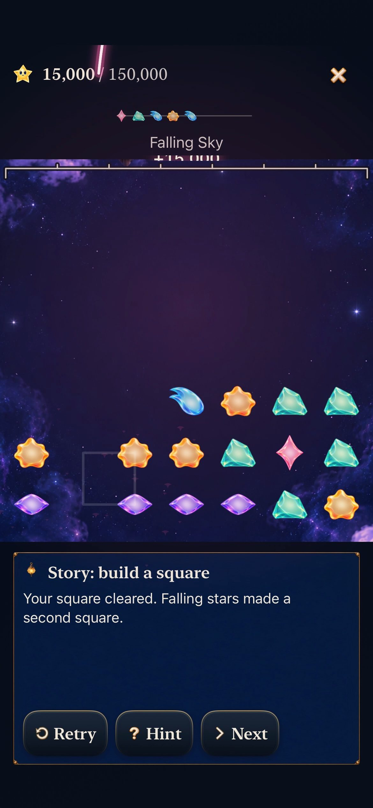
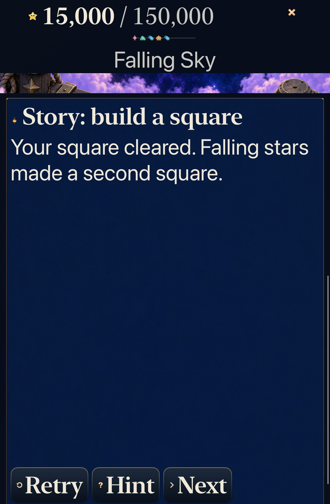
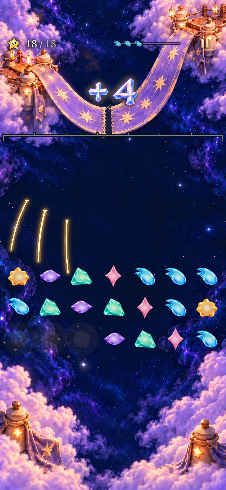

# Collection light leaves the score readable

**Result:** Verified for scoped development adoption · **Owner:** Cohesion factory coordinator · **Date:** October 23, 2026

[Goal 9](https://github.com/lbeezr/starfall/issues/290) corrects a current native conflict: Rose packet light crosses `15,000 / 150,000` during the second Story-square clear. The shared packet pass now composites its heads, tails and shadows outside the measured score rectangle with four points of clearance. Its existing paths, timing, six-packet budget and separate arrival bloom remain unchanged. Quiet presentation retains exact awards without this Canvas; audio/haptic, rules, saves, layout and artwork owners are unchanged.

**Decision:** Retain the correction. A failing rendered regression becomes green without weakening its assertions, and the same actual swipe preserves the score while collection continues. [Verification](verification.json) identifies clean sources; [captures](captures.json) bind selected exports and recordings to raw inputs/readiness.

## Compare the same second clear

| Before | After |
| --- | --- |
|  |  |

These are native iPhone 17e/iOS 27.0 Simulator frames from the same optional current Story-square lesson: Core `(1,2)→(1,1)` clears Aqua, then falling survivors form Rose, leaving sixteen stars and exactly 15,000 points. The overlay remains passive; the native case returns to the exact saved live round and world state. Sampled Rose-arrival ages differ slightly, so this is a scenario comparison, not a pixel-identical timing comparison.

Normal-speed [before](dev-fb76f713__square-chain__iphone-17e__before.mp4) and [after](dev-a72d541__square-chain__iphone-17e__after.mp4) clips retain 4.2 seconds of the actual gesture and both clears. Packet light remains visible below and above the score exclusion; its [arrival bloom](dev-a72d541__score-bloom__iphone-17e__after.jpg) remains around the score. Five frames from each exact retained clip were inspected for starting state, clear flight, Rose arrival, bloom and settled survivors. Original full-resolution recording frames additionally expose the score conflict. Export preserves normal playback speed and aspect; finite sampling does not establish continuous smoothness, frame rate or human timing preference.

## Contrast quiet and restoration

The AX3XL Calm tablet case preserves the optional hint, exact 15,000 result, sixteen survivors and prior live round. Its screenshot is a scrolled completion viewport. The [normal Ribbon repair clip](dev-a72d541__ribbon-repair__iphone-17e__normal.mp4) shows the contrasting restoration-directed packet pass and named result. Its historical 14→18 clear, background/relaunch and same-round Replay all pass; it does not prove current 220,000-point reachability. The [named result](dev-a72d541__ribbon-result__iphone-17e__historical-18.jpg) retains its onward action.

## Verification and remaining finding

Baseline immutable products were compiled at clean `fb76f713`, with identical build inputs to activation main `47e633e3`; only App/README differs under App/Core/project/tests/Config. Clean red checkpoint `e4c65f3` extracts the existing packet pass and adds one fixed-age raster test. Five of six samples paint 2,255–15,761 bright/shadow pixels into the protected score. The same test passes after clean candidate `a72d541`, with zero score pixels and visible packet ink elsewhere for both destination kinds. This isolates the actual shared drawing pass; it is separate from native scene evidence.

Candidate acceptance: 305 Core tests; 36 hosted celebration/audio tests; normal phone Story-square, normal phone Ribbon win/relaunch/Replay, and AX3XL Calm tablet practice all pass with zero failures/skips. The hosted suite retains anchors, default/maximum-text rendered awards, crowded skies, exact phase awards, budgets, cancellation/expiry, single voice, interruption and mute checks. Debug candidate build-for-testing passes in 3.2s and Release in 19.3s. No resource or target member is added. Hygiene, whitespace, selected export hashes and documentation links are checked before publication. Only documentation/evidence follows the clean compiled checkpoint.

**Carry into Goal 10:** Compact normal practice wraps the forecast beneath the growing score; its separate mode caption leaves the award lettering clipped above the ceiling. Both comparison recordings show this existing layout problem. It is not fixed or hidden by packet protection. The final integrated review owns a stable measured receipt row while preserving board mapping and readable practice controls; [ENGINEERING](../../ENGINEERING.md) records the trigger. Quiet/maximum-text behavior and ordinary-game award regions need contrasting checks. Earlier synthetic crown geometry did not establish this real wrapped-header case.

No new physical installation/play, actual listening/haptic-comfort, actual VoiceOver, minimum-iOS17, full RC or measured performance claim. The extra composite layer is bounded to one per active receipt; physical GPU cost remains within the existing device-performance follow-up.
