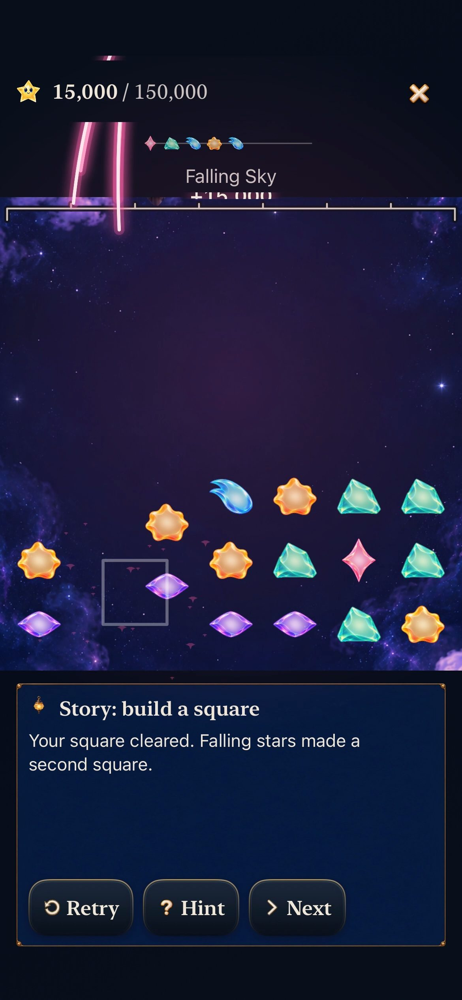
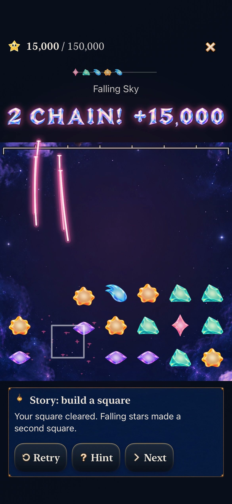

# Practice rewards have room to read

**Result:** Verified for scoped development adoption · **Owner:** Cohesion factory coordinator · **Date:** October 23, 2026

[Goal 10](https://github.com/lbeezr/starfall/issues/291) corrects the strongest remaining visible mismatch found during the integrated review: compact practice clipped the crystalline award beneath its wrapped forecast and mode caption. The existing celebration overlay now uses a measured 64-point practice row. The forecast starts on its own stable row, so the committed 0→15,000 score cannot reflow the header and move the stars. The reading shelf pays for this space; the full native canvas, star scale, hit mapping and scroll remain authoritative.

The correction reuses `StarlightAnchors`, the live overlay and the theme's existing type/spacing tokens. Ordinary gameplay and accessible/landscape practice retain their existing measured fallback. There is no alternate presentation route, rule, save or audio/haptic change. Goal 9's score exclusion and separate arrival bloom remain intact.

## Compare the actual lesson

| Before | After |
| --- | --- |
|  |  |

Both native iPhone 17e recordings follow the same current-rule optional Story-square lesson. Core `(1,2)→(1,1)` clears Aqua, then falling survivors form Rose: 15,000 points and sixteen survivors. The [before clip](../cohesion-goal-09-score-focus-2026-10-23/dev-a72d541__square-chain__iphone-17e__after.mp4) and [after clip](dev-0c65bc22__square-chain__iphone-17e__normal.mp4) retain the actual gesture at normal playback speed. Their animation ages differ slightly. Six frames from the exact after clip show the opening, committed outcome, full [Square! +5,000](dev-0c65bc22__square-award__iphone-17e__normal.jpg), full chain award, separate [score bloom](dev-0c65bc22__chain-bloom__iphone-17e__normal.jpg), then settled survivors. Existing Aqua packet light briefly crosses part of “Square!”; it stays outside the protected score. Finite samples do not establish continuous smoothness or human timing preference.

The [375×667 hosted window](dev-3410e14__chain-award__375x667-window__hosted-normal.jpg) scrolls the unchanged full canvas while retaining the complete award and guide actions. The [768×1024 hosted window](dev-3410e14__chain-award__768x1024-window__hosted-normal.jpg) provides a larger contrast. These are real hosted windows on the owned tablet simulator, not additional devices or minimum-iOS evidence. [Captures and hashes](captures.json) identify every selected source and export.

Separate main [PR #326](https://github.com/lbeezr/starfall/pull/326) subsequently added destination columns to the forecast. Clean integration `f2ed225c` preserves that row. Its [normal-speed recording](dev-f2ed225c__square-chain__iphone-17e__normal.mp4), [complete chain award](dev-f2ed225c__chain-award__iphone-17e__normal.jpg) and [small hosted window](dev-f2ed225c__chain-award__375x667-window__hosted-normal.jpg) confirm the receipt still fits. The native case also reveals the [complete top-row target](dev-f2ed225c__practice-top-row__iphone-17e__normal.jpg) before the decisive lower swipe, then returns to the exact saved round. Earlier comparison media keeps its original source and isolates the first correction before that independent forecast addition.

## Carry the preceding coils forward

Each goal has its own main merge and source-bound evidence. This review retains their production owners rather than adding another theme, animation engine or artwork route.

| Goal / separate merge | Integrated decision |
| --- | --- |
| [1 · #292](https://github.com/lbeezr/starfall/pull/292) · [Lantern benchmark](../cohesion-goal-01-benchmark-2026-10-23/README.md) | Retain the painted celestial place, living-light focus and restrained warm fittings. |
| [2 · #296](https://github.com/lbeezr/starfall/pull/296) · [Collection material](../cohesion-goal-02-living-collection-2026-10-23/README.md) | Retain distinct silhouettes, pale inner light and family-colored emission through board, forecast and flight. |
| [3 · #297](https://github.com/lbeezr/starfall/pull/297) · [HUD hierarchy](../cohesion-goal-03-hud-hierarchy-2026-10-23/README.md) | Retain earned score ahead of target; keep forecast, pressure and dialogue in their own roles. |
| [4 · #300](https://github.com/lbeezr/starfall/pull/300) · [Compact craftsmanship](../cohesion-goal-04-compact-actions-2026-10-23/README.md) | Retain shallow midnight enamel, pearl labels and restrained brass rims. |
| [5 · #314](https://github.com/lbeezr/starfall/pull/314) · [Seed Moon place](../cohesion-goal-05-seed-place-2026-10-23/README.md) | Retain supported, connected terrain across its fifteen paintings; physical contrast remains an observation question. |
| [6 · #317](https://github.com/lbeezr/starfall/pull/317) · [Flight handoff](../cohesion-goal-06-flight-handoff-2026-10-23/README.md) | Retain finite body/light responses that finish at the actual landing. |
| [7 · #321](https://github.com/lbeezr/starfall/pull/321) · [Cumulative restoration](../cohesion-goal-07-cumulative-light-2026-10-23/README.md) | Retain earned tablet fittings through the midpoint and the distinct completed lantern. |
| [8 · #324](https://github.com/lbeezr/starfall/pull/324) · [Travel identity](../cohesion-goal-08-travel-identity-2026-10-23/README.md) | Retain the torn damaged map crossing and matching Entry/play identity. Completed world → fresh damaged Revisit is intentional. |
| [9 · #325](https://github.com/lbeezr/starfall/pull/325) · [Score focus](../cohesion-goal-09-score-focus-2026-10-23/README.md) | Retain packet light outside the measured score while keeping the arrival bloom and exact sensory outcomes. |
| 10 · [#291](https://github.com/lbeezr/starfall/issues/291) · this correction | Revise compact practice to reserve actual reward space and keep its header stable. |

Representative [Home](dev-3410e14__home__iphone-17e__normal.jpg), [current Lantern line](dev-3410e14__lantern-line__iphone-17e__normal.jpg) and [current Ribbon chain](dev-3410e14__ribbon-chain__iphone-17e__normal.jpg) retain that direction. The [largest-text Calm completion](dev-3410e14__practice-complete__ipad-mini-a17pro__ax3xl-calm.jpg) shows a scrolled reading viewport, not simultaneous board and guide. Fresh [Seed Moon at 8,000](dev-86a1348__seed-active-clear__ipad-mini-a17pro__normal.jpg) is an active clear with the earned shoot and collection light. Its supporting stone/foliage and utility controls remain identifiable in this tablet portrait sample; it predates PR #326 and does not certify that later forecast row. Goal 5 retains its original landscape and closed-bud evidence.

Remove the superseded clipped placement from the current visual selection. Earlier flat compact faces, solid packet cores, contradictory midpoint lights and nearly intact damaged bridge remain historical provenance, with their original evidence intact. No continuing runtime comparison or temporary route is needed. Existing separate gameplay-depth work, including revision-6 Full Board and retained revision-5 practice/history, remains preserved.

## Verification boundaries

[Verification](verification.json) records clean compiled checkpoints, exact selected tests, failed setup assumptions and integration. The native review includes Home/Entry/Open Sky, current Lantern's real line and restore, current Ribbon's three-phase chain/Replay, practice and long instructions, map return and retained historical play. Earlier nine-goal visual/motion evidence keeps its own original source; reading those reports is not a fresh full-matrix run.

Acceptance: 305 Core tests, 37 initially affected hosted tests, then 43 integrated celebration/audio/forecast tests pass. Nine unique existing native cases pass across eleven executions, including the first slice and affected integration repeats. Every accepted selection has zero failures and skips. Final Debug build-for-testing takes 19.2s; Release takes 16.1s. No new source or asset member is added. The matrix inventory is 219 UI / 513 hosted, not a full-matrix pass. Subsequent changes are documentation/evidence only; hashes bind the five changed Swift/test inputs to clean `f2ed225c`.

The new hosted regression renders actual SpriteKit phase callbacks at three window sizes. It checks the measured award/header, the real clipped scroll viewport, all 49 visible-cell intersections, stable board/header geometry and visible ink for both exact awards. The first attempt incorrectly treated clipped offscreen rows as visible and stopped at the initial nil receipt before phase callbacks. The corrected test follows the actual viewport and presentation lifetime; the assertions still require both visible awards. The attempted write to the read-only Reduce Motion environment key was removed after a compiler diagnostic; normal system motion remains an assertion, not a forced quiet workaround.

One native batch accidentally selected the 98-exchange current Ribbon full-round witness in place of a retained-history boundary. It was explicitly cancelled after 362.65s, exit 75, and supplies no acceptance. The intended historical Ribbon 14→18 win, relaunch and same-round Replay subsequently pass on final integration. That historical check does not establish current 220,000-point reachability. Mode hint stills show partial inner-scroll detail and do not prove complete worked-text reading or the intermediate Next shower state; the separate Storm case checks its complete long detail and actual shower control. Quiet and scrolled reading capture limits remain explicit.

## Questions for hands-on play

Do full-width crystalline rewards feel earned or too emphatic over repeated chains? Can players notice the next meaningful arrangement while collection light finishes? Does bright Seed Moon stone and foliage stay comfortable behind the native instruments on a physical display? Are earned lights and damaged/repaired travel states recognized promptly? Do sound and haptics reinforce that priority at comfortable levels?

These remain with the existing player-observation, visual-accessibility and device-performance work (#206/#209/#210/#207). No physical installation/play, listening/haptic comfort, actual VoiceOver, minimum-iOS17, measured contrast, full RC or enjoyment claim is made. The next spiral should use those observations or another reproduced seam to choose its next bounded goal.
