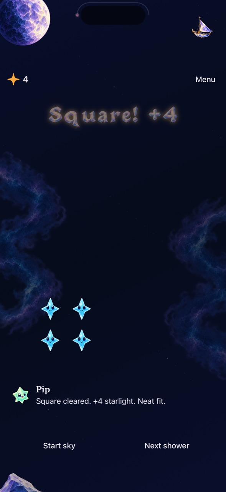

# Player-action feedback follows the commit

**Result:** Partially verified · **Owner:** current implementer · **Date:** 2026-10-18

Player clears and swaps now publish their result immediately after saving the committed state. Their animation completions cannot repeat that result or replace newer help. Manual and automatic shower completions also respect feedback that appeared after their presentation began.

An exact square or cross receives the same celebration category through tap, held trace or explicit activation. Broader groups stay broader clears. An automatically removed neighboring Dusk is not a recipe ingredient; its more consequential removal explanation remains visible. Real traced paths remain intact in the celebration.

**Next action:** Merge and verify canonical phone delivery, then finish the outward-swipe feedback correction before shower-pacing work. The prior [board-clarity batch is delivered](../board-clarity-2026-10-18/README.md).

## Inspected native result

*Native iPhone 16 Pro Max / iOS 27.0 Simulator, normal motion, integrated source `0842a61`, runtime `dev.bf4ade9d68`. The fading Square +4 award stays in the protected sky region, the guide names the result, and the next square remains visible. JPEG export reduced to 1280 pixels high. This frame shows appearance; commit-time assertions establish prompt delivery, not the screenshot alone.*

## What was reproduced and corrected

The previous guide could keep explaining an invalid tap after the next valid clear had already changed the score. The original hosted regression failed before implementation: the Dusk-help line remained visible at commit, then the animation completion changed dialogue revision. The new boundary publishes the committed result synchronously and owns later delivery by both presentation ticket and dialogue revision.

Recipe classification previously depended on which input method called the Store. A separate reproduction confirmed a tap square beside Dusk received an ordinary celebration while the identical held selection received Square. The Store now asks Core for the exact selected recipe once, excluding automatic Dusk consequences; scoring and legal selection are unchanged.

The first test draft mistakenly treated the authored fork's nine-star tap group as an exact five-star cross, and attempted to save a deliberately non-saving authored fixture. Those assumptions were corrected with a separate broader-group regression and the existing save-valid Observatory fixture. Production rules/save validation were not relaxed.

## Original acceptance and evidence

| Check | Result / limit |
| --- | --- |
| Reproductions | Old delayed-copy and tap/Dusk classification tests failed as expected. |
| Immediate feedback / ownership | Focused clear, swap, manual-shower and automatic-shower cases verify newer invalid-tap help survives duplicate completions. |
| Exact outcomes | Tap/held/explicit square, held/explicit cross, broader nine-star group, adjacent Dusk and preserved trace path checks. |
| Core | 169 tests passed; Core is unchanged. |
| Hosted | Original source: all 291 passed, none skipped. Includes current save/replay, interruption, receipt and presentation coverage. |
| Native interaction / visuals | Six native tests passed, none skipped: recipes/relay, rapid same-color swap and held trace, settings/background, incomplete trace and next tap, system Reduce Motion, First Light win/full-sky/replay. |
| Build / hygiene | Debug test build and Release simulator build passed. Hygiene and diff checks passed. |
| Actual VoiceOver / physical feel | Not run; routine development, with actual VoiceOver reserved for RC. Installation is recorded separately. |

## Nightscape integration

Main advanced to `496ba70` during publication. The feedback changes were merged with its accepted five-nightscape layout at clean source `0842a61956943d102bc034a179373a160c6e75fe`. Only two documentation conflicts required resolution; both workstreams remain intact. [integration-source.json](integration-source.json) records the clean runtime inputs. The inspected capture above refreshes the former Observatory layout; the earlier `dev-c985a97-wip-fe665b7ffd66` JPEG remains historical, source-bound evidence.

Integrated checks passed: **169 Core, 297 hosted, seven native UI checks, and Release simulator build**. Six native cases cover recipes/relay, rapid swap/trace, interruption recovery, incomplete-trace recovery, system Reduce Motion and all five nightscapes with native corner taps; a separate First Light win/full-sky/replay check also passed. No failures or skipped checks. The same iPhone 16 Pro Max / iOS 27.0 environment and commands above were used, with `STARFALL_BUILD_ID=dev.bf4ade9d68` for native/Release. Hosted tests used the default `dev.local` bundle label on the same runtime source. [integration-verification.json](integration-verification.json) records results and raw-bundle paths. Only documentation/capture files changed after testing.

## Original source and verification context

Base `c985a97f023489d6d26ec24b6287cbba0525eae0` plus snapshot `fe665b7ffd66`; runtime `dev.f441a271c0`. [source.json](source.json) hashes the five app/test inputs. Xcode 27.1 (27A9275), Swift 6.4, Debug, iPhone 16 Pro Max QA / iOS 27.0 (24A434) Simulator.

Commands use `swift test --disable-sandbox` with the temporary module cache and XcodeBuildMCP `test_sim` with `-sdk iphonesimulator CODE_SIGNING_ALLOWED=NO ARCHS=arm64 ONLY_ACTIVE_ARCH=YES -parallel-testing-enabled NO` and scoped test identifiers. [verification.json](verification.json) records the final native cases and build result. Disposable logs and XCTest bundles are under `artifacts/consequence-feedback/`; the first delayed-copy reproduction is `artifacts/consequence-feedback-reproduction.xcresult`.

No rule, RNG, save schema, shower schedule, hit geometry, target membership, resource, sound or haptic change. First Light remains outside recipe classification. Final outcomes retain ceremony speech ownership. Interruptions still cancel receipts and presentation tickets; restore retains committed game state and discards transient copy. Human comprehension and actual VoiceOver timing remain separate observations, not claims made by the test suite.

A separate input-adapter audit found that outward swipes at the board edge receive the generic “To tap, lift on the star you touched” message. Address that gesture-intent explanation in the next small priority-2 batch after this independently verified delivery; do not change gesture thresholds or add a new move rule.
