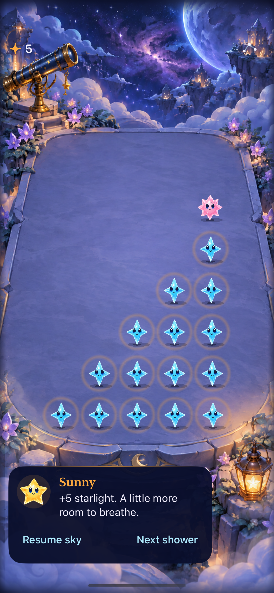
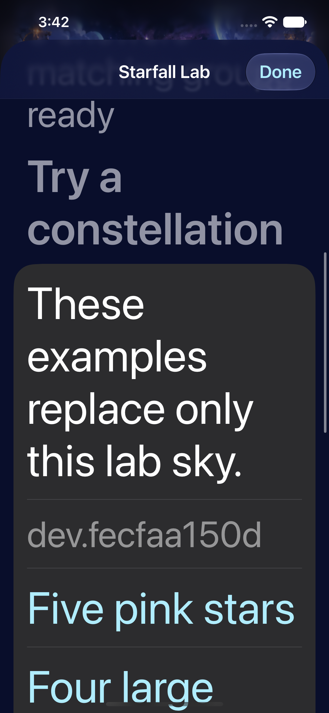
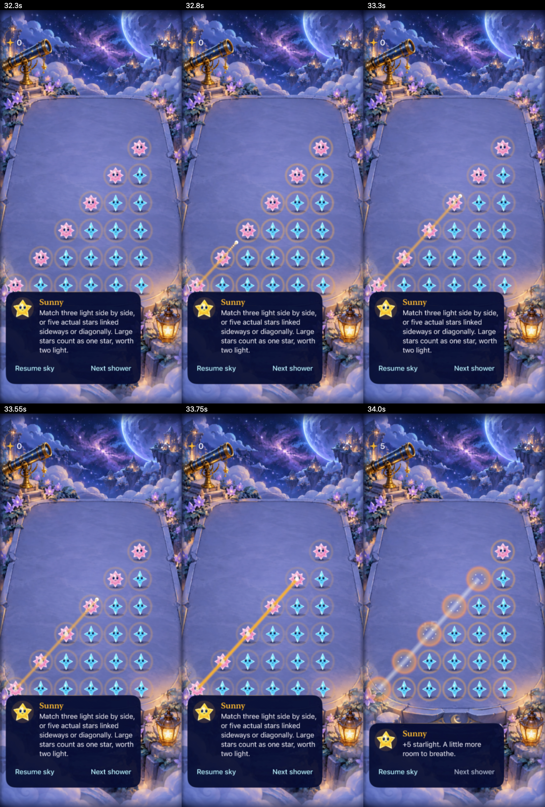

# The drawing build clears only the stars you trace

**Result:** Partially verified · **Owner:** current implementer · **Date:** 2026-10-17

**Starfall Lab · `dev.fecfaa150d` is installed and launched on the connected iPhone.** Swipe through five or more distinct matching stars, then lift: only those stars clear. Resting groups glow without solution lines; a sparkling fingertip/trail charges toward a shape pulse and finite burst. Ordinary orthogonal matches retain taps. The user accepts the mechanic direction and chose selected-star clearing for strategy; gesture feel and complete accessibility acceptance remain open.

**Next action:** try drawing in the existing lab, then complete the native accessibility/physical-play gates and integrate into the original Starfall identity with its round preserved. The agreed destination is one app; the temporary lab is the only extra phone install now. No production pilot flag.

## What changed from the tap trial

The [earlier tap-only pair](../constellations-native-2026-10-17/README.md) cleared a whole connected component. The user explicitly superseded that rule: omitted stars are the player's choice and remain on the board. The [new design and acceptance criteria](../../design/CONSTELLATION_TRACE.md) were written before implementing the gesture.

Core validates a bounded ordered walk, same family, neighboring diagonal/orthogonal steps and five distinct stars. Revisiting a selected star permits branching but never adds score twice. Growth keeps its existing value; four grown diagonal stars still fail. Only orthogonal darkness dissolves; settling occurs once. Preview/RNG and untraced identities are preserved. The ordinary generator relief predicate remains unchanged.

The input owns only a transient source snapshot, generation and walk. UIKit touch release/cancel/multitouch handling is local to the board surface; native SwiftUI buttons remain the accessible cells. Effects never choose a cleared set or advance the game. Lifecycle generations invalidate a trace on shower, restart, fixture replacement, pause/settings/background, motion change and layout replacement. A partial lift or leaving the board cancels without mutation. The active trail is bounded to 196 walk entries, at most 49 distinct sparks and 24 fading fingertip motes; release effects are finite and render/restart removes them. No texture generation, background worker, pooling or per-frame SwiftUI state publication was introduced.

Haptics increase only as new stars join the walk, with a distinct five-star readiness impact. They respect the haptic preference and quiet/accessibility modes. There is no idle vibration. Simulator success does not establish physical haptic quality.

## Native states and motion




**Latest runtime evidence:** `dev.fecfaa150d`, iPhone 17e / iOS 27.0 Simulator. Native input clears five and leaves the sixth; the maximum-text menu displays the actual built Info.plist ID and dismisses successfully. These inspected captures do not establish broad largest-text or VoiceOver play.



**Motion sample — preceding `dev.b2ca7e4407`:** frames at 32.3–34.0 seconds of a normal-motion native recording. The scene/effect source bytes are identical to the current build; the later correction changes touch/scroll arbitration and the build ID. Inspected frames show the trail growing only under input and the local release pulse/removal. The raw recording is under ignored artifacts. This is one automated straight-path motion sample, not a physical iPhone feel/performance acceptance or an animation-suppressed test.

## Verification results and limits

| Area | Result |
| --- | --- |
| Core | All 61 package tests pass on the exported trace core; its core bytes are unchanged in the final labelled build |
| Hosted store/rule/intent/scene | **23 methods pass** on the final runtime: chosen subset, invalid count/family/jumps/bounds, repeats, untraced identity, darkness, preview/RNG/restore, stale tickets and lifecycle interruptions; inherited ordinary clock/save/challenge checks retained |
| Native input and build label | **Three UI methods pass** on the final runtime: five-from-six swipe and restore; short/outside cancellation plus ordinary taps; maximum-text swipe, actual menu ID and dismissal |
| Build | Final Debug simulator, Release simulator and development-signed iPhone builds pass. Fixture core source and app/test fragments compile in the exported targets |
| Phone | Same lab bundle updated in place without reset arguments, renamed Starfall Lab, then launched successfully. The regular Starfall install's identity/version/path remain identical to pre-install metadata; its save contents were not read |
| Full motion | One normal-motion sequence inspected as above; current scene source is identical. Repeated rounds, frame pacing and physical haptic feel remain unverified |
| Accessibility | Native buttons plus add/release/cancel constellation actions are implemented; selected-walk activation and announcements have **not been verified with actual VoiceOver**. The older tap-only count/value speech failure remains source-bound to its own evidence. System Reduce Motion passed in that older interaction, not this new swipe: current native quiet-mode drawing and full VoiceOver play remain open |
| Cancellation scope | Store/intent cancellation and native short/outside drags pass. Native interrupted drags and physical multitouch still need representative manual checks; do not infer them solely from the intent tests |
| Balance / enjoyment | Not established. Earlier whole-component bot survival counts must not be attributed to this selected-walk interaction |

### Failed checks led to bounded corrections

The first new UI test referenced a core type unavailable in the UI-test target; coordinate tuples removed that test-only dependency. An inherited dark-star fixture finder chose a trace-only group then attempted an ordinary tap. In the exported inherited regressions it now searches ordinary groups, retaining all score/dark/save assertions; explicit trace regressions cover the new action separately. All 23 hosted methods then passed.

The first maximum-text swipe **failed**: the enclosing scroll view could take over a drag. The correction is at the input boundary: a local recognizer opts in only when a touch starts on an eligible star, and that scroll pan waits for the trace recognizer to fail. Empty/other starts fail immediately so ordinary scrolling remains available. The same native drag passed after correction, along with ordinary taps, partial/outside cancellation and menu dismissal. This verifies the examined scroll conflict; physical multi-finger and every interruption path are not claimed eliminated.

The first build-ID stamp was missing from the generated Info.plist. A minimal lab-only input plist supplies the custom key through a build setting. The built simulator and signed device plist both contain `dev.fecfaa150d`; the native menu assertion and inspected screenshot verify its displayed value. Source-only labels are not accepted as installation evidence.

## Install hygiene and build identity

[Build conventions](../../DEVELOPMENT_BUILDS.md) define `dev.<ID>` now and `rc.1.<ID>`, `rc.2.<ID>` for future selected release candidates. The current product version is `0.1.0`, numeric lab build `2`; the content fingerprint distinguishes runtime revisions. `lab_build.py` is the sole lab stamp owner. Test/prose changes do not change the runtime ID.

The phone now contains **regular Starfall + one Starfall Lab**, matching the agreed transitional arrangement. Starfall Control was uninstalled. Ten obsolete comparison apps were removed from the active mechanics simulator: baseline, paired shower, supernova, surge, guide review, compact surge, natural/Surge Observatory, pressure and phase labs. The original production app and the stable latest lab bundle were preserved. Other named QA simulators, unrelated apps, historical source exports and evidence were left intact; cleanup does not mean their historical experiments were adopted or rejected.

The lab keeps bundle `com.starfall.constellations.candidate` and defaults suite `starfall.constellations.candidate`; normal Starfall remains `com.starfall.prototype`. The signed app has no shared app-group or Game Center entitlement. No original app launch/reset/uninstall, save-container read or save transfer occurred. No phone screenshot was captured. Removing the temporary lab later must follow verified integration into the original app and preservation of its round.

## Reproduce this source

Base is `b0de3ff`, with the tracked runtime snapshot captured before concurrent ranking work began. This snapshot contains the same production app/core base as `1583e76`; this work adds isolated rule/input/effect/build fragments. Concurrent root `App`, `Config`, project and ranking edits were **excluded** from the tested and installed export. They were not reset, staged or integrated as part of this work.

Current local project: `artifacts/constellations/development-scroll-fixed/candidate/Starfall.xcodeproj`. Its `CONSTELLATION-LAB.json` records the base, dirty status, tools and exported runtime/config/test hashes. [Durable source manifest](source.json) retains the relevant hashes and raw-log names. This is snapshot/working-tree evidence, not acceptance of a clean published production commit.

```sh
python3 tools/mechanics/prepare-constellation-labs.py --source <captured-snapshot> --output <new-export-directory>
swift test
xcodebuild -project Starfall.xcodeproj -scheme Starfall -configuration Debug -destination 'platform=iOS Simulator,id=A84C81F5-AE41-496A-97AE-E17C63E18D29' -derivedDataPath <separate-path> ARCHS=arm64 ONLY_ACTIVE_ARCH=YES CODE_SIGNING_ALLOWED=NO -parallel-testing-enabled NO -only-testing:StarfallAppTests/FallingSkyStoreTests -only-testing:StarfallUITests/ConstellationTraceNativeTests test
```

Run package/build commands inside the export. Release uses `-configuration Release -destination 'generic/platform=iOS Simulator'`. Device builds use the connected iPhone destination and a local development team; only the verified lab bundle is installed with `devicectl`, then launched without fixture/reset arguments. Reusing a snapshot validates every recorded byte before derivation, avoiding half-written source from another workstream. Export destinations must be new.

Environment: Xcode 27.1 (27A9275), Apple Swift 6.4, arm64; candidate Simulator is iPhone 17e / iOS 27.0, `A84C81F5-AE41-496A-97AE-E17C63E18D29`. Phone is iPhone 16 Pro Max / iOS 26.6.2 (23G90). Logs/result bundles/video and installation inventory remain under ignored `artifacts/constellations`. Repository hygiene and diff checks pass; local links and captures inspected, Markdown rendering not checked. See the [engineering register](../../ENGINEERING.md) for adoption triggers.
