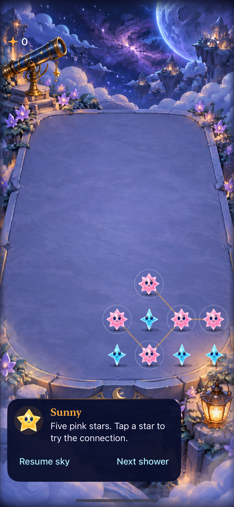
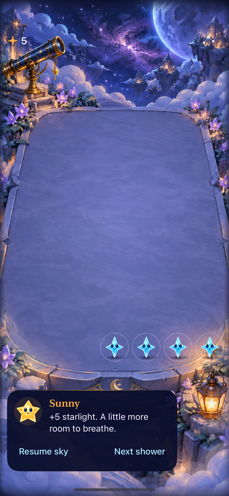

# Separate constellation apps are installed for iPhone comparison

**Result:** Partially verified · **Owner:** current implementer · **Date:** 2026-10-17

**Constellation Lab** and **Starfall Control** are installed on the connected iPhone 16 Pro Max; Constellation Lab launched successfully. Five actual same-family stars qualify through diagonal or orthogonal links, and tapping any member clears the whole constellation. The user confirmed both decisions for this trial. Production Starfall remains unchanged. Installation and deterministic checks do not establish human preference or complete accessibility acceptance.

**Next action:** try the same examples in each app, then ordinary play. After observed prediction and clear/wait choices, adopt/remove or name one bounded remaining question. No permanent production pilot flag.

**Later decision:** The user selected swiping and clearing only traced stars. [The current drawing build](../constellation-trace-2026-10-17/README.md) supersedes this source-bound tap-only pair; Control has been uninstalled.

## Try the comparison

| App | Rules | Identity and saved state |
| --- | --- | --- |
| Starfall Control | Today's orthogonal groups worth at least three starlight | `com.starfall.constellations.baseline`; defaults suite `starfall.constellations.baseline` |
| Constellation Lab | Ordinary clears plus whole same-family eight-neighbor components of five actual stars | `com.starfall.constellations.candidate`; defaults suite `starfall.constellations.candidate` |
| Starfall | Existing production game and current phone round | `com.starfall.prototype`; untouched |

Open **Sky menu → Five pink stars** in either comparison app to load the reported relationship. Tap the pink star in front-based cell `(1,3)`: Control rejects the clear, while the candidate collects five light. The fixture adds contrasting support under elevated stars; it is not a reconstruction of the full phone board. No phone screenshot was retained.

The same menu also offers **Four large diagonal stars** (ineligible despite eight light), **Connected seven-star group** (whole-component precedence), and **Five stars beside darkness** (only orthogonally adjacent darkness dissolves). Selecting an example replaces only that app's lab round. **Replay this sky** returns to the fresh seed-5 opening after any example, so both apps can reproduce the same opening. **New sky** chooses a random seed independently. First Light remains available with its fixed eighteen-light objective.

The five pink stars can be cleared with an ordinary tap; no trace, hold or special power. Grown stars count as one actual star and score two light. Existing orthogonal darkness, column settling, committed saves and clock cancellation remain authoritative. Connections recompute after settlement; no automatic cascade. The candidate retains the ordinary generator relief predicate, as in the [offline comparison](../constellations-2026-10-17/README.md).

## Native appearance




**Runtime captures:** final native candidate runtime, iPhone 17e / iOS 27.0 Simulator, normal text. Thin spanning-tree links sit behind eligible stars and use `ObservatoryGeometry`, also used by hit cells. Existing halos and spoken star count/value provide cues beyond family color. Links are removed during presentation and rebuilt on settlement. These inspected stills establish the pictured states and link placement, not motion quality. The source-bound largest-text capture was also inspected: the guide moves below the playfield and the tested cell remains usable; this is not complete largest-text play acceptance.

## Outcomes against acceptance

The [trial design](../../design/CONSTELLATION_TRIAL.md) defines the rules and adoption gates.

| Check | Result and boundary |
| --- | --- |
| Five-star fixture, every tap origin, grown count/score, overlap, darkness and bounds | Offline fixture checks pass; hosted/native checks exercise the exported rule |
| Matched offline comparison after sharing the rule owner | All original aggregate and matched-board results unchanged |
| Core package | 61 tests pass in each export; production suite also passed in the preceding offline batch |
| Store and interruption | All 21 hosted store methods pass in each app, including committed-clear restore, rapid repeated input, background/pause/motion/restart/fixture replacement, stale callbacks, challenge completion/overflow, clock and settings contracts |
| Native input and persistence | Four focused UI methods pass in each app: five-star tap/restore, dark/overlap/four-grown cases, ordinary opening and menu example selection/background, largest-text fixture input |
| Build and source/resource membership | Debug simulator, Release simulator and development-signed iPhone builds pass for both apps. Fixture source is compiled by the exported local Swift package; store/scene/menu/tests are appended only to existing target-member files |
| Actual VoiceOver and system Reduce Motion | Control focused speech/activation and system Reduce Motion pass. Candidate system Reduce Motion passes; candidate focus speaks the five-star count, but the value phrase is absent from captured speech, so its combined speech/activation check fails. Full VoiceOver play remains open |
| Physical device | Separate app installation and candidate process launch pass; physical tapping, subjective feel and learner comprehension are not observed |
| Full-motion review | Ordinary motion remains enabled in the primary native run; still captures and assertions do not prove animation quality. Repeated full-motion review remains open |

### Initial failures remain visible

The first candidate build used a SwiftUI color directly as a UIKit color; explicit conversion fixed the isolated scene fragment. An initial hosted check incorrectly expected a motion-setting change to invalidate a live rain deadline, although that boundary intentionally preserves timing. The corrected check still verifies stale presentation rejection and preserved deadline. Another check incorrectly expected zero links on the four-pink-star fixture, overlooking its eligible aqua support component. It now checks the exact eligible-component link bound and an empty board. Final hosted reruns pass; no gameplay assertion or production code was weakened.

The first VoiceOver probe obtained the spoken star count before the value phrase and failed its same-snapshot assertion. A bounded follow-up collects actual speech utterances until both count and value are observed, and still requires native activation to collect five. The bounded follow-up still captures only the count, so candidate count-plus-value speech is a failed check, not a pass. The next interaction refinement must make the complete count/value phrase readable and repeat focused activation. The Control speech/activation check passes. Two initial native First Light checks failed because the extra lab section moved the challenge below the menu viewport; the lab test helper now scrolls to the existing action, preserving its assertions. Hosted challenge completion/overflow remain green; final native follow-up remains source-bound in raw logs.

## Save and phone isolation

Only the two distinct lab bundles were installed. Before installation, both signed bundle identifiers and application identifiers were verified; neither app has a shared app-group entitlement. Store defaults use separate named suites; the remaining local preferences are inside each separate app sandbox. The original phone app's identity, version and installation URL match the pre-install metadata exactly. No original app launch/reset/uninstall, app-container read, save copy or write was performed. This proves the installation boundary examined; the original save contents were deliberately not inspected.

The candidate was launched without fixture/reset arguments and starts paused. The phone is iPhone 16 Pro Max / iOS 26.6.2 (23G90). This record contains no phone screenshot or unrelated installed-app inventory.

## Reproduce and inspect the source

From the repository:

```sh
python3 tools/mechanics/prepare-constellation-labs.py --output artifacts/constellations/native-review
python3 tools/mechanics/compare-constellations.py
```

The output directory must be new. It contains separate Xcode projects for `baseline` and `candidate`; open either `Starfall.xcodeproj`, select the shared Starfall scheme and its intended phone. Use local development signing for each distinct bundle. The installed pair's durable local projects are under ignored `artifacts/constellations/native/{baseline,candidate}`. No source, resource, scheme or rule change is made to the production target.

`constellation_candidate.py` owns the rule transformation for both offline and native uses; the native build omits the offline ordinary-clear diagnostic copy. `ConstellationFixture.swift` owns the four shared, validated lab fixtures. Store and UI fragments test the exported app, while `ConstellationLinks.swift` uses the existing scene projection and material tokens. The exporter snapshots tracked source bytes, records dirty paths, and includes hashes for untracked trial fragments it injects. `CONSTELLATION-LAB.json` hashes every exported app/core/config/project/test input. Runtime bytes remained identical when the focused test instrumentation was extended.

**Source:** production base `1583e7601ba3e6f1d5ac5d9659310ab6a826d77c`, initially clean; this work adds only offline/export tooling and documentation. [Source manifest](source.json) retains exact runtime/config/test/tool hashes; raw source snapshots, full manifests, logs, result bundles and phone-install metadata remain under ignored artifacts or temporary storage. This is working-tree evidence, not clean published-commit acceptance. Assets are unchanged from the source commit.

**Environment:** Xcode 27.1 (27A9275), Apple Swift 6.4; arm64 Simulator / iOS 27.0. Candidate uses `A84C81F5-AE41-496A-97AE-E17C63E18D29` (Starfall Mechanics Lab, iPhone 17e); Control uses `6E9BC34B-C5C6-48ED-9593-D16AC994BCC8` (Starfall Compact HUD QA, iPhone 17e).

Core command: `swift test` in each export. Native command: `xcodebuild -project Starfall.xcodeproj -scheme Starfall -configuration Debug -destination 'platform=iOS Simulator,id=<simulator>' -derivedDataPath <separate-path> ARCHS=arm64 ONLY_ACTIVE_ARCH=YES CODE_SIGNING_ALLOWED=NO -parallel-testing-enabled NO -only-testing:StarfallAppTests/FallingSkyStoreTests -only-testing:StarfallUITests/ConstellationNativeTests test`. Release uses `-configuration Release -destination 'generic/platform=iOS Simulator'` and the same arm64 settings. Signed device builds use a local development team and the connected phone destination; `devicectl device install app` installs only the verified lab bundles. No signing credentials or personal profile are committed.

Repository hygiene and `git diff --check` pass. Local document links checked; Markdown rendering not checked. The remaining adoption trigger is observed iPhone comprehension/play, full-motion review, representative accessibility play and explicit adopt/remove decision; see [engineering follow-up](../../ENGINEERING.md).
